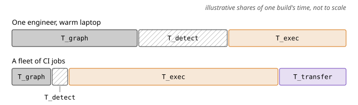

# 1. What a build system decides

The go command and Bazel both turn Go source into binaries, but they make different choices at
six points. This chapter names those six decisions and gives a model of where build time goes.

## A build is a function


A build turns sources into outputs. Ideally it is a function: the same sources, tools and flags
always give the same outputs. Rerunning all of it after every edit is too slow, so a build system
splits it into steps and skips each step whose result it already has.

- An **action** is one step: one run of one tool, such as compiling a package, with known
  inputs and outputs.[^bazel-actions]
- Its **key** is a hash of everything that can change its output: the input files, the outputs
  of earlier actions, the tool and its flags.
- A **cache hit** means an output is already stored under that key, so the action is
  skipped.[^bazel-actions]
- A build is **hermetic** when the same inputs always give the same output, whatever else is on
  the machine.[^bazel-hermetic] Only then can a stored output stand in for running the
  action.[^bazel-remote-caching]

## Cutoff and the critical path



When a source changes, the action that reads it reruns, and its new output changes the keys of
the actions that use it. The change spreads along the graph until **early cutoff** stops it: when
an action reruns but its output is identical to last time, the actions after it need not
run.[^alacarte-cutoff] In Figure 1.2, an edit reruns `a` and `d`. The output of `d` is unchanged,
so nothing after `d` runs.

The **critical path** is the longest chain of actions in which each needs the output of the one
before. No number of cores or machines finishes a full build faster than this chain.

## Six decisions


We describe a build system by its answers to six questions (Figure 1.3). Chapter 8 places the
go command's answers beside Bazel's.

### 1. Unit

How much does one action do? A large unit, such as a module, reruns more than an edit needs. A
small unit, such as a file, reruns little but multiplies the fixed cost of starting each action.
For Go, the compiler compiles one package per run,[^go-compile] and both the go command and
rules_go (Bazel's Go support) make one compile action per
package.[^go-compileaction][^rules-go-library]

### 2. Graph

The graph can be derived from the sources, as the go command does from import
statements,[^go-command] or declared in build files, as Bazel requires.[^bazel-build-files] A
derived graph needs no upkeep, but it is derived again each time it is needed and describes only
what the language can. A declared graph can describe anything, such as a code generator or a C
library, and a long-lived process can keep it in memory.[^bazel-server] In exchange, someone must
keep it in step with the code.

### 3. Change

To find what changed since the last build, a system can hash every input again, compare saved
file sizes and modification times, or be told by the operating system. Rehashing reads every
byte. Comparing metadata visits every file but reads none. Notifications cost in proportion to
the change. The last two need state kept between builds.

### 4. Key

A key that leaves out an input lets a stale output through. A key that includes something that
does not affect the output, such as an environment variable that differs between machines,
causes misses and stops machines sharing results.[^bazel-cache-issues] A subtler choice is how a
dependency enters its users' keys. By its sources alone, the build cannot cut off
early.[^alacarte-traces] By its whole output, any change to that output reruns every user. By
only the part its users read, a change that leaves that part alone reruns none of them.

### 5. Sharing

A cache can belong to one process, one machine, or a whole team and its continuous integration
(CI) jobs. The wider it is shared, the more often a result computed once is reused, but only if
builds are hermetic and keys match across machines.[^bazel-remote-caching]

### 6. Execution

Actions can run on the machine that started the build or on a pool of remote machines. Remote
execution raises the limit on parallelism from one machine's cores to the size of the
pool,[^bazel-rbe] and adds time to move inputs and outputs over the network. Each action must
then declare every input, because the remote machine has nothing else.[^bazel-remote-execution]

## A cost model



We split the time of one build into four terms:

```text
T = T_graph + T_detect + T_exec + T_transfer
```

- **T_graph**: obtaining the graph; on every run if it is derived, after each restart if a
  long-lived process keeps it.
- **T_detect**: finding what changed.
- **T_exec**: running the actions that missed the cache. It is at least their critical path, and
  at least their total work divided by the cores or machines available.
- **T_transfer**: moving bytes to and from a shared cache or remote machines.

Each kind of scale drives different terms:

| Scale | Drives | What helps |
|---|---|---|
| Packages and files in the repository | T_graph, T_detect | A graph kept in memory; detection in proportion to the change |
| Edits × actions that depend on what changed | T_exec | A precise key, so that cutoff comes early |
| Engineers × machines × CI jobs | T_exec, summed over machines | A cache shared across machines |
| Size of the largest build | T_exec | Remote execution; a shorter critical path |
| Languages and generated code | Uncached work outside the graph | A graph that can declare any action |

Figure 1.4 sketches what we expect. When one engineer edits one package on a laptop with warm
caches, only a few actions rerun, so T_graph and T_detect take a large share of the wait. A CI
fleet runs the same actions on many machines, so T_exec dominates, and sharing results is what
reduces it.[^bazel-remote-caching] In our view, the go command is designed for the first case
and Bazel for the second; Chapters 4 to 8 show why.

## What this means at scale

- Compare build systems by their six decisions, not by feature lists.
- A build that is slow on a laptop and a build that is expensive across a fleet are different
  problems, dominated by different terms.
- A shared cache pays off only if keys are complete and match across machines. Check what enters
  the key before paying for cache capacity.
- The critical path is a floor that more cores and machines cannot lower. Shorten the chain
  instead.

## References

[^bazel-actions]: Bazel, "Remote Caching", section "Overview".
    <https://bazel.build/remote/caching#overview>
[^bazel-hermetic]: Bazel, "Hermeticity", section "Overview".
    <https://bazel.build/basics/hermeticity#overview>
[^bazel-remote-caching]: Bazel, "Distributed Builds", section "Remote caching".
    <https://bazel.build/basics/distributed-builds#remote-caching>
[^alacarte-cutoff]: Mokhov, Mitchell and Peyton Jones, "Build Systems à la Carte", ICFP 2018,
    section 2.3 and Fig. 3. <https://doi.org/10.1145/3236774> (authors' copy:
    <https://github.com/snowleopard/build/releases/download/icfp-final/build-systems.pdf>)
[^go-compile]: Go, `cmd/compile/doc.go`, package documentation.
    <https://github.com/golang/go/blob/go1.27.3/src/cmd/compile/doc.go#L6>
[^go-compileaction]: Go, `cmd/go/internal/work/action.go`, `CompileAction`.
    <https://github.com/golang/go/blob/go1.27.3/src/cmd/go/internal/work/action.go#L628>
[^rules-go-library]: rules_go, `docs/go/core/rules.md`, `go_library`.
    <https://github.com/bazel-contrib/rules_go/blob/v0.65.0/docs/go/core/rules.md?plain=1#L89>
[^go-command]: Go, "About the go command", sections "Motivation" and "Go's conventions".
    <https://go.dev/doc/articles/go_command>
[^bazel-build-files]: Bazel, "Artifact-Based Build Systems", introduction and sections
    "Understanding artifact-based build systems" and "Extending the build system".
    <https://bazel.build/basics/artifact-based-builds#understanding-artifact-based-build-systems>
[^bazel-server]: Bazel, "Client/server implementation".
    <https://bazel.build/run/client-server>
[^bazel-cache-issues]: Bazel, "Remote Caching", section "Known issues": environment variables
    leaking into an action, and tools outside the workspace.
    <https://bazel.build/remote/caching#known-issues>
[^alacarte-traces]: Mokhov, Mitchell and Peyton Jones, "Build Systems à la Carte", section 4.2.4,
    deep constructive traces. <https://doi.org/10.1145/3236774> (authors' copy:
    <https://github.com/snowleopard/build/releases/download/icfp-final/build-systems.pdf>)
[^bazel-rbe]: Bazel, "Remote Execution Overview".
    <https://bazel.build/remote/rbe>
[^bazel-remote-execution]: Bazel, "Distributed Builds", section "Remote execution".
    <https://bazel.build/basics/distributed-builds#remote-execution>
