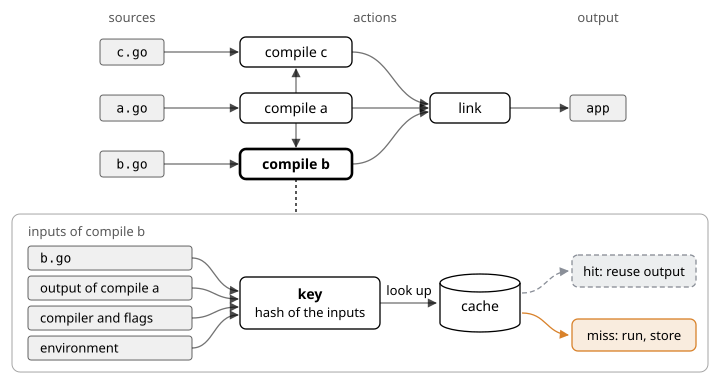

# 1. What a build system decides

The go command and Bazel both turn Go source into binaries, but they make different choices at
six points.

## Actions and keys



A build turns sources into outputs. Rerunning all of it after every edit is too slow, so a build
system splits it into steps and skips each step whose result it already has.

- An **action** is one step: one run of one tool, such as compiling a package, with known
  inputs and outputs.[^bazel-actions] Actions form a **graph** (Figure 1.1): an edge runs from
  each action to those that read its output.
- Its **key** is a hash of everything that can change its output: its input files, what it reads
  from earlier actions, the tool, the flags and the environment.
- A **cache hit** means an output is already stored under that key, so the action is
  skipped.[^bazel-actions]
- A build is **hermetic** when the same inputs always give the same output, whatever else is on
  the machine.[^bazel-hermetic] Only then can a stored output stand in for running the
  action.[^bazel-remote-caching]

## Cutoff and the critical path


When a source changes, the action that reads it reruns, and its new output changes the keys of
the actions that use it. The change spreads along the graph until **early cutoff** stops it: when
an action reruns but its output is identical to last time, the actions after it need not run
(Figure 1.2).[^alacarte-cutoff]

The **critical path** is the chain of actions, each needing the output of the one before, that
takes longest to run. No number of cores or machines finishes a build sooner than its critical
path.

## Six decisions


We describe a build system by its answers to six questions (Figure 1.3). Chapter 8 places the
go command's answers beside Bazel's.

### 1. Unit

How much does one action do? A large unit, such as a module, reruns more than an edit needs. A
small unit, such as a file, reruns little but multiplies the fixed cost of starting each action.
For Go, the compiler compiles one package per run,[^go-compile] and both the go command and
rules_go (Bazel's Go support) make one compile action per
package.[^go-compileaction][^rules-go-compile]

### 2. Graph

The graph can be derived from the sources, as the go command does from import
statements,[^go-command] or declared in build files, as Bazel requires.[^bazel-build-files] A
derived graph needs no upkeep but describes only what the language can;[^go-command] the go
command derives it again on every run (Chapter 4). A declared graph can describe anything, such
as a code generator or a C library, and a long-lived process can keep it in memory.[^bazel-server]
In exchange, someone must keep it in step with the code.

### 3. Change

To find what changed since the last build, a system can hash every input again,[^go-filehash]
compare each file's saved metadata, such as its modification time,[^bazel-filestate] or be told
by the operating system.[^bazel-watchfs] Rehashing reads every byte. Comparing metadata visits
every file but reads none. Notifications cost in proportion to the change. The last two need
state kept between builds.

### 4. Key

A key that leaves out an input lets a stale output through: a wrong hit.[^bazel-cache-issues] A
key that includes something that does not affect the output, such as an environment variable
that differs between machines, causes misses.[^bazel-cache-issues] A subtler choice is which
part of a dependency enters its dependents' keys. With its sources, there is no early
cutoff.[^alacarte-traces] With its whole output, any change to that output reruns every
dependent. With only the part dependents read, a change elsewhere reruns none of them (Chapter 7).

### 5. Sharing

A cache can belong to one process, one machine, or a whole team and its continuous integration
(CI) jobs. The wider it is shared, the more often a result computed once is reused, but only if
builds are hermetic and keys match across machines.[^bazel-remote-caching]

### 6. Execution

Actions can run on the machine that started the build or on a pool of remote machines. Remote
execution raises the limit on parallelism from one machine's cores to the size of the
pool,[^bazel-rbe] and adds time to move inputs and outputs over the network. Each action must
then declare every input, because the remote machine has nothing else.[^bazel-remote-execution]

## A cost model


We model the time of one build with four terms:

```text
T ≤ T_graph + T_detect + T_exec + T_transfer
```

- **T_graph**: obtaining the graph; on every run for a tool that exits after each build, after
  each restart for a long-lived process that keeps it.
- **T_detect**: finding what changed.
- **T_exec**: running the actions that missed the cache. It is at least their critical path, and
  at least their total work divided by the cores or machines available.
- **T_transfer**: moving bytes to and from a shared cache or remote machines.

The terms can overlap (Chapter 6), so the wait T can be shorter than their sum. A fleet's cost
is T summed over its builds. Each kind of scale drives different terms:

| Scale | Drives | What helps |
|---|---|---|
| Packages and files in the repository | T_graph, T_detect | A graph kept in memory; detection in proportion to the change |
| Edits × actions that depend on what changed | T_exec | A precise key, so that cutoff comes early |
| Engineers × machines × CI jobs | T_exec and T_transfer, summed over builds | A cache shared across machines |
| Size of the largest build | T_exec | Remote execution; a shorter critical path |
| Languages and generated code | Uncached steps outside the graph, not in T | A graph that can declare any action |

Figure 1.4 sketches what we expect. On a laptop whose caches hold the last build, one edit
reruns few actions, so finding the change takes a large share, and finding the graph too if no
long-lived process keeps it. A fresh CI runner without a shared cache obtains the graph from
scratch[^bazel-cache-issues] and runs every action, so T_exec dominates; across a fleet,
sharing results reduces it.[^bazel-remote-caching] In our view, the go command is designed for
one engineer on one machine with a repository small enough to rescan on every run, and Bazel
for a large repository built on many machines; Chapters 4 to 8 show why.

## What this means at scale

- We recommend comparing build systems by their six decisions, not by feature lists.
- Find which term dominates before optimizing: per build on a laptop, summed over builds across
  a fleet (Chapter 9).
- Before paying for a shared cache, check what enters the key: a missing input gives wrong hits,
  and a value that differs between machines gives misses.
- Once the critical path bounds a build, we recommend shortening it over adding cores or machines.

## References

[^bazel-actions]: Bazel, "Remote Caching", sections "Overview" and "How a build uses remote
    caching". <https://bazel.build/remote/caching#overview>
[^bazel-hermetic]: Bazel, "Hermeticity", section "Overview".
    <https://bazel.build/basics/hermeticity#overview>
[^bazel-remote-caching]: Bazel, "Distributed Builds", section "Remote caching".
    <https://bazel.build/basics/distributed-builds#remote-caching>
[^alacarte-cutoff]: Mokhov, Mitchell and Peyton Jones, "Build Systems à la Carte", ICFP 2018,
    section 2.3 and Fig. 3. <https://doi.org/10.1145/3236774> (authors' copy:
    <https://github.com/snowleopard/build/releases/download/icfp-final/build-systems.pdf>)
[^go-compile]: Go, `cmd/compile/doc.go`, package documentation.
    <https://github.com/golang/go/blob/go1.27.3/src/cmd/compile/doc.go#L6>
[^go-compileaction]: Go, `cmd/go/internal/work/action.go`, `CompileAction`.
    <https://github.com/golang/go/blob/go1.27.3/src/cmd/go/internal/work/action.go#L628>
[^rules-go-compile]: rules_go, `go/private/actions/compilepkg.bzl`, `emit_compilepkg`: one
    `GoCompilePkg` action per package.
    <https://github.com/bazel-contrib/rules_go/blob/v0.65.0/go/private/actions/compilepkg.bzl#L201-L210>
[^go-command]: Go, "About the go command", sections "Motivation" and "Configuration versus
    convention". <https://go.dev/doc/articles/go_command>
[^bazel-build-files]: Bazel, "Artifact-Based Build Systems", introduction and sections
    "Understanding artifact-based build systems" and "Extending the build system".
    <https://bazel.build/basics/artifact-based-builds#understanding-artifact-based-build-systems>
[^bazel-server]: Bazel, "Client/server implementation".
    <https://bazel.build/run/client-server>
[^go-filehash]: Go, `cmd/go/internal/cache/hash.go`, `FileHash`: hashes the whole file and
    remembers the result only as long as the process lives.
    <https://github.com/golang/go/blob/go1.27.3/src/cmd/go/internal/cache/hash.go#L140-L183>
[^bazel-filestate]: Bazel, `lib/actions/FileStateValue.java`,
    `createRegularFileStateValueFromPath`, and `lib/actions/FileContentsProxy.java`: file times
    and inode number stand in for contents unless the file system offers a fast digest.
    <https://github.com/bazelbuild/bazel/blob/9.3.2/src/main/java/com/google/devtools/build/lib/actions/FileStateValue.java#L137-L147>
    <https://github.com/bazelbuild/bazel/blob/9.3.2/src/main/java/com/google/devtools/build/lib/actions/FileContentsProxy.java#L21-L38>
[^bazel-watchfs]: Bazel, `lib/skyframe/LocalDiffAwareness.java`, the `--watchfs` option, default
    `false`: use the operating system's file watch service "instead of scanning every file for a
    change".
    <https://github.com/bazelbuild/bazel/blob/9.3.2/src/main/java/com/google/devtools/build/lib/skyframe/LocalDiffAwareness.java#L51-L63>
[^bazel-cache-issues]: Bazel, "Remote Caching", section "Known issues": environment variables
    leaking into an action, tools outside the workspace, and in-memory state lost in CI
    containers. <https://bazel.build/remote/caching#known-issues>
[^alacarte-traces]: Mokhov, Mitchell and Peyton Jones, "Build Systems à la Carte", section 4.2.4,
    deep constructive traces. <https://doi.org/10.1145/3236774> (authors' copy:
    <https://github.com/snowleopard/build/releases/download/icfp-final/build-systems.pdf>)
[^bazel-rbe]: Bazel, "Remote Execution Overview".
    <https://bazel.build/remote/rbe>
[^bazel-remote-execution]: Bazel, "Distributed Builds", section "Remote execution".
    <https://bazel.build/basics/distributed-builds#remote-execution>
