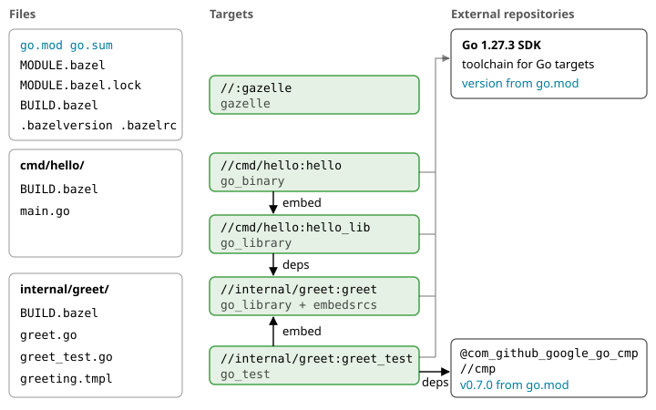

# 2. A minimal Bazel Go repository

This chapter walks through `examples/minimal`: one Go module with a command, a library and a
test, built with Bazel 9.3.2, rules_go 0.65.0 (Bazel's rules for Go) and Gazelle 0.54.0 (a tool
that writes Bazel's build files from Go source). Every listing is the file as it is in the
repository, and every command was run on macOS/arm64.

## The files



`MODULE.bazel` declares the repository's external dependencies. A `BUILD.bazel` file makes its
directory a *package* and declares *targets*, the named things Bazel builds. A *label* names a
target: `//cmd/hello:hello` is target `hello` in package `cmd/hello`, and `//cmd/hello` is
short for it.[^bazel-glossary] Figure 2.1 places each file beside the targets it defines.

### `.bazelversion`

```text
9.3.2
```

Bazelisk, a launcher installed as `bazel`, reads this file and downloads that release.[^bazelisk]

### `MODULE.bazel`

```starlark
module(name = "minimal")

bazel_dep(name = "rules_go", version = "0.65.0")
bazel_dep(name = "gazelle", version = "0.54.0")

# The Go SDK version comes from go.mod, so `go` and Bazel compile with the same toolchain.
go_sdk = use_extension("@rules_go//go:extensions.bzl", "go_sdk")
go_sdk.from_file(go_mod = "//:go.mod")

# Third-party modules come from go.mod and go.sum; Bazel never resolves versions itself.
go_deps = use_extension("@gazelle//:extensions.bzl", "go_deps")
go_deps.from_file(go_mod = "//:go.mod")
use_repo(go_deps, "com_github_google_go_cmp")
```

`bazel_dep` adds rules_go and Gazelle. `use_extension` loads a *module extension*, code that
creates external repositories (fetched directories, named `@name`) from tags such as
`from_file`.[^bazel-extension] `go_sdk.from_file` takes the Go version from the `toolchain` line
of `go.mod`, or from the `go` line if there is none,[^rg-from-file] and registers that SDK as
the *toolchain*: the compiler, linker and standard library every Go target uses.
`go_deps.from_file` turns each module in `go.mod` into a repository, fetched at that version and
verified against `go.sum`.[^gz-go-deps] The name reverses the domain:
`github.com/google/go-cmp` becomes `com_github_google_go_cmp`.[^gz-repo-name] `use_repo` lists
the direct dependencies, and `bazel mod tidy` keeps that list current.[^rg-bzlmod-use-repo]
Bazel records the results in `MODULE.bazel.lock`, which belongs in version control.[^bazel-lockfile]

### `go.mod`

```text
module example.com/minimal

go 1.27.3

require github.com/google/go-cmp v0.7.0
```

This is the only list of versions. The go command and Bazel read the same file, so
dependencies change with the usual `go get`, and no second list exists.[^rg-bzlmod-go-mod]

### The root `BUILD.bazel`

```starlark
load("@gazelle//:def.bzl", "gazelle")

# gazelle:prefix example.com/minimal
gazelle(name = "gazelle")
```

`//:gazelle` runs Gazelle over the repository. `# gazelle:prefix` is a *directive*, a comment
Gazelle reads as configuration; it sets the import path of the root. Gazelle would read the same
value from `go.mod`.[^rg-bzlmod-prefix]

### The generated BUILD files

```starlark
load("@rules_go//go:def.bzl", "go_library", "go_test")

go_library(
    name = "greet",
    srcs = ["greet.go"],
    embedsrcs = ["greeting.tmpl"],
    importpath = "example.com/minimal/internal/greet",
    visibility = ["//:__subpackages__"],
)

go_test(
    name = "greet_test",
    srcs = ["greet_test.go"],
    embed = [":greet"],
    deps = ["@com_github_google_go_cmp//cmp"],
)
```

Gazelle wrote `internal/greet/BUILD.bazel` from the Go files. Each import became a `deps` label,
and `//go:embed greeting.tmpl` became `embedsrcs`.[^gz-embed] The compile sees only listed
files, so without that line it fails with `could not embed greeting.tmpl: no matching files
found`.[^rg-embedcfg] The test `embed`s the library, so both compile as one package, as
`go test` compiles a test file in the package it tests; in `cmd/hello`, `go_binary` embeds
`hello_lib` the same way.[^rg-embed]

### `.bazelrc`

```text
# Keep the action environment fixed so that cache keys do not depend on the caller's shell.
common --incompatible_strict_action_env
# Show test output only for failures.
test --test_output=errors
```

`common` lines apply to every command, `test` lines to `bazel test`. The first flag gives
actions a fixed `PATH` instead of the caller's, so cache keys do not depend on a developer's
shell; Bazel 9.3.2 already defaults to it, and the line keeps the choice
visible.[^bazel-strict-env] The second prints a failing test's log, where the default prints
only a summary.[^bazel-test-output]

## Building, testing and running


The `bazel` command is a client. It hands each command to a long-lived server, starting one if
none is running, and the server keeps the loaded packages and the dependency graph in memory
between commands.[^bazel-client-server] The server works in three phases: *loading* reads BUILD
files, *analysis* turns targets into *actions* (single tool runs, such as one compile), and
*execution* runs the actions whose results are not cached.[^bazel-phases] On macOS each action's
process runs in a sandbox, a working directory that holds only its declared
inputs.[^bazel-sandbox] Chapter 6 explains the machinery; here is how it looks from the terminal.

Gazelle changes nothing when the BUILD files are current:

```console
$ bazel run //:gazelle
INFO: Analyzed target //:gazelle (52 packages loaded, 257 targets configured).
INFO: Running command line: bazel-bin/gazelle
```

A clean build of the command runs the five processes of Figure 2.2:

```console
$ bazel clean
$ bazel build //cmd/hello --execution_log_json_file=/tmp/exec.json
INFO: Analyzed target //cmd/hello:hello (105 packages loaded, 8446 targets configured).
INFO: Elapsed time: 55.112s, Critical Path: 52.52s
INFO: 13 processes: 8 internal, 5 darwin-sandbox.
$ jq -r '[.mnemonic, .targetLabel, .metrics.totalTime] | @tsv' /tmp/exec.json
GoStdlib                @@rules_go+//:stdlib                                         36.688s
GoCompilePkg            //internal/greet:greet                                        0.113s
GoCompilePkg            //cmd/hello:hello                                             0.033s
GoLink                  //cmd/hello:hello                                             0.304s
GoToolchainBinaryBuild  @@rules_go++go_sdk+main___download_0_darwin_arm64//:builder  14.213s
```

Compiling and linking the example's code took under half a second. The other 51 seconds compiled
the standard library and rules_go's builder, a program that wraps the Go tools; Chapter 7
explains both. `hello_lib` was not compiled separately, because the binary compiles the sources
it embeds.

The server is what makes the next command fast. A new server loads and analyzes again even when
every action is cached; a running one does neither:

```console
$ bazel shutdown && bazel build //cmd/hello
Starting local Bazel server (9.3.2) and connecting to it...
INFO: Analyzed target //cmd/hello:hello (105 packages loaded, 8446 targets configured).
INFO: Elapsed time: 9.320s, Critical Path: 0.07s
INFO: 1 process: 12 action cache hit, 1 internal.
$ bazel build //cmd/hello
INFO: Analyzed target //cmd/hello:hello (0 packages loaded, 0 targets configured).
INFO: Elapsed time: 0.170s, Critical Path: 0.00s
```

`//...` means every target. It includes the runner behind `//:gazelle`, so the first full build
also compiles Gazelle.[^gz-macro] Bazel reruns a test only when the test or its dependencies
change (or it last failed).[^bazel-cache-tests] On this Mac, the first run of a freshly linked
test binary took 8.4 s and a forced rerun 0.1 s; Chapter 5 measures that first-launch cost.
`bazel run` builds a target and runs it, passing the arguments after `--`.

```console
$ bazel build //...
INFO: Analyzed 5 targets (64 packages loaded, 311 targets configured).
INFO: Elapsed time: 47.101s, Critical Path: 46.63s
INFO: 109 processes: 6 action cache hit, 32 internal, 77 darwin-sandbox.
$ bazel test //...
//internal/greet:greet_test                                              PASSED in 8.4s
$ bazel test //...
//internal/greet:greet_test                                     (cached) PASSED in 8.4s
Executed 0 out of 1 test: 1 test passes.
$ bazel test //... --nocache_test_results
//internal/greet:greet_test                                              PASSED in 0.1s
$ bazel run //cmd/hello -- Ada
INFO: Running command line: bazel-bin/cmd/hello/hello_/hello <args omitted>
Hello, Ada!
```

### gopls

gopls, Go's language server (the process behind an editor's completion and diagnostics), learns
about packages by running `go list`. If `GOPACKAGESDRIVER` names a program, gopls asks that
program instead.[^xtools-driver][^rg-editors] The example's launcher is the one rules_go's editor
guide gives:

```bash
#!/usr/bin/env bash
# gopls asks this script for package data instead of running "go list".
exec bazel run -- @rules_go//go/tools/gopackagesdriver "${@}"
```

The driver queries Bazel for the targets that contain a file, then builds them with an *aspect*
(extra actions attached to existing targets) that writes each package's files and imports as
JSON.[^rg-driver] Calling it directly, as the guide suggests for debugging, shows both
steps:[^rg-editors-debug]

```console
$ echo {} | ./tools/gopackagesdriver.sh file=internal/greet/greet.go
Running: [bazel query ... same_pkg_direct_rdeps("internal/greet/greet.go"))]
Running: [bazel build ... --aspects=@@rules_go+//go/tools/gopackagesdriver:aspect.bzl%go_pkg_info_aspect ... @@//internal/greet:greet]
{"NotHandled":false,"Compiler":"","Arch":"","Roots":["@@//internal/greet:greet"],"Packages":[...]}
```

With `b.String()` changed to `b.Len()` in `greet.go` (and restored afterwards), gopls reported
the type error through the driver:

```console
$ GOPACKAGESDRIVER=$PWD/tools/gopackagesdriver.sh gopls check internal/greet/greet.go
.../internal/greet/greet.go:21:9-16: cannot use b.Len() (value of type int) as string value in return statement
```

Editors set the same variable; the guide gives settings for VS Code, Neovim, Vim, Sublime Text,
Helix and Zed, and warns that the first load takes time.[^rg-editors-setup]

## What this means at scale

- `go.mod` remains the one list of versions, for the Go SDK and for every module. With
  `.bazelversion` and a checked-in `MODULE.bazel.lock`, every machine resolves the same build.
- A clean build here spent 51 of 55 seconds on the toolchain, not the code. Every fresh machine
  pays that again unless a shared cache serves it, so we recommend one from the start (Chapter 9).
- A server restart repeats loading and analysis even when every action is cached. We recommend
  keeping servers warm on CI runners as well as laptops.
- BUILD files are generated. Run `bazel run //:gazelle` with every change that adds a package or
  an import; Chapter 3 adds a check for continuous integration (CI).
- gopls keeps working, but through `bazel build`, so editor latency now follows Bazel's.

## References

[^bazel-glossary]: Bazel, "Glossary": *package*, *target*, *label*, *toolchain*.
    <https://bazel.build/reference/glossary>
[^bazelisk]: Bazel, "Installing Bazel using Bazelisk".
    <https://bazel.build/install/bazelisk>
[^bazel-extension]: Bazel, "Module extensions".
    <https://bazel.build/external/extension>
[^rg-from-file]: rules_go, `go/private/go_mod.bzl`, `_version_from_go_file`, which
    `version_from_go_mod` calls.
    <https://github.com/bazel-contrib/rules_go/blob/v0.65.0/go/private/go_mod.bzl#L76-L79>
[^gz-go-deps]: Gazelle, `internal/bzlmod/go_deps.bzl`, `go_deps_impl`, which declares one
    `go_repository` per module with its version and sum; `cmd/fetch_repo/module.go`,
    `fetchModule`, which has `go mod download` verify the sum.
    <https://github.com/bazel-contrib/bazel-gazelle/blob/v0.54.0/internal/bzlmod/go_deps.bzl#L802-L814>,
    <https://github.com/bazel-contrib/bazel-gazelle/blob/v0.54.0/cmd/fetch_repo/module.go#L47-L48>
[^gz-repo-name]: Gazelle, `internal/bzlmod/go_deps.bzl`, `_repo_name`.
    <https://github.com/bazel-contrib/bazel-gazelle/blob/v0.54.0/internal/bzlmod/go_deps.bzl#L190-L194>
[^rg-bzlmod-use-repo]: rules_go, `docs/go/core/bzlmod.md`, "Specifying external dependencies".
    <https://github.com/bazel-contrib/rules_go/blob/v0.65.0/docs/go/core/bzlmod.md#L155-L166>
[^bazel-lockfile]: Bazel, "Bazel Lockfile".
    <https://bazel.build/external/lockfile>
[^rg-bzlmod-go-mod]: rules_go, `docs/go/core/bzlmod.md`, "Specifying external dependencies".
    <https://github.com/bazel-contrib/rules_go/blob/v0.65.0/docs/go/core/bzlmod.md#L146-L147>
[^rg-bzlmod-prefix]: rules_go, `docs/go/core/bzlmod.md`, "Generating BUILD files".
    <https://github.com/bazel-contrib/rules_go/blob/v0.65.0/docs/go/core/bzlmod.md#L130-L136>
[^gz-embed]: Gazelle, `language/go/fileinfo.go`, `goFileInfo`, which reads `//go:embed`
    patterns; `language/go/generate.go`, `setCommonAttrs`, which writes `embedsrcs`.
    <https://github.com/bazel-contrib/bazel-gazelle/blob/v0.54.0/language/go/fileinfo.go#L312-L328>,
    <https://github.com/bazel-contrib/bazel-gazelle/blob/v0.54.0/language/go/generate.go#L827-L828>
[^rg-embedcfg]: rules_go, `go/tools/builders/embedcfg.go`, `resolveEmbed`.
    <https://github.com/bazel-contrib/rules_go/blob/v0.65.0/go/tools/builders/embedcfg.go#L279-L282>
[^rg-embed]: rules_go, `docs/go/core/rules.md`, the `embed` attributes of `go_binary` and
    `go_test`.
    <https://github.com/bazel-contrib/rules_go/blob/v0.65.0/docs/go/core/rules.md#L153>,
    <https://github.com/bazel-contrib/rules_go/blob/v0.65.0/docs/go/core/rules.md#L409>
[^bazel-strict-env]: Bazel, `BazelRuleClassProvider.java`, the `incompatible_strict_action_env`
    option, default `true`.
    <https://github.com/bazelbuild/bazel/blob/9.3.2/src/main/java/com/google/devtools/build/lib/bazel/rules/BazelRuleClassProvider.java#L74-L86>
[^bazel-test-output]: Bazel, `ExecutionOptions.java`, the `test_output` option, default
    `summary`.
    <https://github.com/bazelbuild/bazel/blob/9.3.2/src/main/java/com/google/devtools/build/lib/exec/ExecutionOptions.java#L272-L273>
[^bazel-client-server]: Bazel, "Client/server implementation".
    <https://bazel.build/run/client-server>
[^bazel-phases]: Bazel, "Build programs with Bazel", "Phases of a build".
    <https://bazel.build/run/build#build-phases>
[^bazel-sandbox]: Bazel, "Sandboxing".
    <https://bazel.build/docs/sandboxing>
[^gz-macro]: Gazelle, `def.bzl`, `gazelle`: the runner rule is untagged, the `sh_binary` that
    wraps it is tagged `manual`.
    <https://github.com/bazel-contrib/bazel-gazelle/blob/v0.54.0/def.bzl#L225-L244>
[^bazel-cache-tests]: Bazel, `TestConfiguration.java`, the `cache_test_results` option.
    <https://github.com/bazelbuild/bazel/blob/9.3.2/src/main/java/com/google/devtools/build/lib/analysis/test/TestConfiguration.java#L169-L183>
[^xtools-driver]: golang.org/x/tools at the commit gopls v0.24.0 is built from,
    `go/packages/doc.go`, "The driver protocol".
    <https://github.com/golang/tools/blob/24a65270771e7a9b6b3385b45eefaf454a2439d2/go/packages/doc.go#L82-L87>
[^rg-editors]: rules_go, `docs/editors.md`, "General setup".
    <https://github.com/bazel-contrib/rules_go/blob/v0.65.0/docs/editors.md#L3-L4>
[^rg-driver]: rules_go, `go/tools/gopackagesdriver/bazel_json_builder.go`, `fileQuery` and
    `Build`.
    <https://github.com/bazel-contrib/rules_go/blob/v0.65.0/go/tools/gopackagesdriver/bazel_json_builder.go#L80>,
    <https://github.com/bazel-contrib/rules_go/blob/v0.65.0/go/tools/gopackagesdriver/bazel_json_builder.go#L205-L213>
[^rg-editors-debug]: rules_go, `docs/editors.md`, "Debugging".
    <https://github.com/bazel-contrib/rules_go/blob/v0.65.0/docs/editors.md#L338-L343>
[^rg-editors-setup]: rules_go, `docs/editors.md`, "Editor Setup".
    <https://github.com/bazel-contrib/rules_go/blob/v0.65.0/docs/editors.md#L31-L34>
