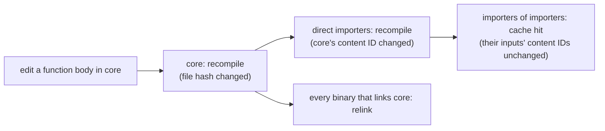

# 4. The go command's design

The go command is a build system that has no build files. It finds the build graph by reading
the source, keys every step by a hash of its inputs, and keeps the results in a cache under
your home directory. This chapter describes how it does that in Go 1.27 and which goals
produced each mechanism. The mechanisms matter later: each one is a choice that Bazel makes
differently, and Chapter 8 compares them one at a time.

Source references are to `src/` in the Go repository at tag `go1.27.3`. Most of the go command
lives in `cmd/go/internal`; below, `work/exec.go` means `src/cmd/go/internal/work/exec.go`.

## Goals: one language, no configuration

The go command was designed for one language whose import paths name directories. In "About
the go command" (go.dev/doc/articles/go_command), the Go team states the aim directly: the
command should get all the information it needs from the source, so that there are no
makefiles or build configuration files to write. An import path tells the go command
where a package's source is, and the import statements in that source say what the package
depends on. The graph is therefore never written down by anyone. It is derived again on every
invocation.

The compiler cooperates with this. Compiling a Go package needs only the *export data* of the
packages it imports directly: a compact description of their exported types, functions and
inlinable bodies, which also covers whatever those packages re-export from further down.
Rob Pike's 2012 talk "Go at Google" (go.dev/talks/2012/splash.article) makes this the point of
the design: in C, a source file includes headers that include more headers, so compile time
grows with the depth of the include tree. In Go, the compiler opens one file per import. That
choice makes the package the natural unit of work, and it keeps the number of files each step
reads small enough that rebuilding from source is cheap.

Three more assumptions follow from the setting the go command was built for. It runs on one
machine. It trusts its environment: the compiler on `PATH`, the C compiler `CC` names, the
files under the module root. And it is short-lived: each `go build` is a new process that
starts with nothing in memory.

## Step 1: loading packages

A command such as `go build ./...` starts by turning patterns into packages
(`load.PackagesAndErrors`, in `load/pkg.go`). For each directory it lists the files, applies
build constraints (`//go:build` lines and `_linux.go` suffixes), and reads each file's
package clause and imports.

Reading is deliberately shallow. `go/build/read.go:readGoInfo` stops at the end of the import
block. It reads further only when the file imports `embed`, because `//go:embed` directives
can appear anywhere. Modules add a resolution step (`modload`): an import path is mapped to a
module version using `go.mod`, and that module's directory is found in the module cache.

The result is a `load.Package` per package, with its files, imports and embedded files, plus
whatever errors were found. Nothing persists after the command exits. The next `go build`
lists the same directories and reads the same headers again. On a repository of a few
hundred packages this is too fast to notice. Its cost grows linearly with the number of
packages and files, and it is paid by every command, including one that finds nothing to do.

## Step 2: the action graph

The loaded packages become an *action graph* (`work/action.go`). An `Action` has a `Mode`
("build", "link", "vet", "run test", and so on), the package it works on, its dependencies,
and a function that performs it. One field stands out:

```go
Provider any // Additional information to be passed to successive actions. Similar to a Bazel provider.
```

The go command borrows Bazel's word for the same idea: data that an action hands to the
actions that depend on it.

For `go build ./...` the graph has one "build" action per package, which compiles it into an
archive, and one "link" action per main package. Each build action depends on the build
actions of the packages it imports. `go test` adds, for each package, the build of the test
variant of the package, the generation and build of a test main, a link of the test binary,
and an action that runs it. `go vet` adds a vet action per package that reads its
dependencies' analysis facts.

`Builder.Do` (`work/exec.go`) runs the graph. It numbers the actions in depth-first order,
uses that order as a priority, and starts `-p` goroutines (by default `GOMAXPROCS`, which is the
number of CPUs). Each goroutine pops the ready action with the highest priority. An action
becomes ready when all its dependencies are done. Everything runs as child processes of
this one go command, on this one machine.

## Step 3: action IDs

Before running an action, the go command computes its *action ID*: a SHA-256 hash of
everything that could change its output. If the cache holds an output for that ID, the action
is skipped. For a compile, `Builder.buildActionID` (`work/exec.go`) writes into the hash:

- the toolchain: the compiler's own build ID, obtained once per invocation by running
  `compile -V=full` (`Builder.toolID`), and for cgo packages the C compiler's identity and
  flags;
- the configuration: `GOOS`, `GOARCH`, the compiler flags, `GOEXPERIMENT`, the module's
  `go` version;
- the package: its import path and, **unless `-trimpath` is set, its absolute directory**,
  since debug information records it;
- every input file, by the SHA-256 of its contents (Go files, cgo, assembly, embedded files);
- every dependency, by its **content ID**.

Two of these lines shape how the cache behaves at scale.

The directory line means that the same package checked out at two paths gets two different
action IDs. A cache filled by one checkout gives no hits to another. The exceptions are the
standard library, whose path the compiler always hides, and third-party modules, provided
the module cache sits at the same path. A CI job that restores a `GOCACHE` from an earlier job
running in a different directory recompiles every package in the repository. With
`-trimpath`, the directory is left out and the cache carries over.

The file hashes mean that every invocation reads every input file in full. `cache.FileHash`
(`cache/hash.go`) memoizes hashes only for the life of the process. There is no record of
file sizes or modification times from the previous run, so a no-op `go build` costs
reading the source tree once, plus the loading of step 1.

## Step 4: content IDs and build IDs

A dependency enters its dependents' action IDs through its *content ID*, which is a hash of
the action's output, the archive itself (`work/buildid.go`). The output records its own
identity in a *build ID*, a string of the form `actionID/contentID` written into the
archive or binary. The long comment at the top of `work/buildid.go` gives two purposes:

1. **The action ID half is a one-element cache.** If `go build -o bin/` finds that the binary
   already in `bin/` carries the action ID it is about to compute, the binary is up to date
   and the link is skipped. This is the only way a link is avoided: the go command does
   not store linked binaries in `GOCACHE`. A comment in `test/test.go` says so directly:
   "we do not cache link outputs". (Since Go 1.24, binaries built by `go run` and `go tool`
   are the exception.) A consequence that surprises people: `go build ./...` without `-o`
   links every main package to a temporary directory and throws the result away, on every
   run, even when nothing changed.

2. **The content ID half makes the next step's key cheap.** Reading a dependency's content ID
   out of its build ID avoids hashing a large archive again.

The content ID is computed by `buildid.FindAndHash`, which hashes the file with every
occurrence of the build ID replaced by zeros. This gives the go command a form of *early
cutoff*. Suppose an edit to package `core` leaves its archive's bytes unchanged apart from
the build ID, for instance an edit to a comment that does not move any line. Then the
content ID is unchanged, and `core`'s importers get cache hits.

The cutoff is coarse, because the content ID covers the whole archive: export data and
object code together. Now change the body of a function in `core` that is not inlined. The
export data is the same, but the object code differs, so the content ID changes and every
package that imports `core` directly gets a new action ID and recompiles. Their archives
come out byte-identical apart from their build IDs, so the cutoff takes effect one level up,
and packages two levels away get hits. Every binary that links `core` is linked again.
Chapter 7 shows that rules_go draws this line in a different place, and Appendix A measures
the difference.



## Step 5: the cache

`GOCACHE` (by default `~/Library/Caches/go-build` on macOS and `~/.cache/go-build` on
Linux) is a directory of 256 shards (`cache/cache.go`). It holds two kinds of file:

- `<actionID>-a`: an index entry, mapping an action ID to the ID and size of its output;
- `<outputID>-d`: the output itself, stored under the hash of its content.

This is the same split Bazel makes between its action cache and its content-addressed store
(Chapter 6): one table answers "has this computation been done?", and a store keyed by
content holds the bytes. The difference is reach. `GOCACHE` belongs to one user on one
machine. The go command marks an entry as used at most once an hour, scans for old entries
at most once a day, and deletes entries unused for five days (`trimInterval`, `trimLimit`).
The cache does not grow without bound, and it has no size limit either.

`GOCACHEPROG` (`cache/prog.go`), stable since Go 1.24, replaces the disk cache with a child
process that speaks a small JSON protocol over stdin and stdout. The process can store
entries anywhere: a shared disk, an object store, a cache server. This is the go command's
answer to a shared cache. It does not change the keys, so the directory rule above still
applies, and it does not cache links.

## Step 6: test results

`go test` caches test results as well as compiled packages, and it decides what a test depends
on in a way that differs from everything above. A test's inputs cannot be read from its
source: it may read files, environment variables or anything else at run time. The go command
therefore observes the run. The test binary logs every `getenv`, `stat`, `open` and `chdir` it
performs to a test log (`testing/internal/testdeps`), and the cache key is built in two levels
(`test/test.go:tryCacheWithID`, `computeTestInputsID`):

1. **testID**: a hash of the test binary, standing in for it with the hash of the link's
   inputs so that a cached result needs no link, plus the test flags. Only a fixed list of
   flags (`-run`, `-skip`, `-short`, `-v`, `-timeout`, `-cpu` and a few more) keeps a run
   cacheable; any other flag, such as `-count=1`, turns caching off.
2. **testInputsID**: a hash of the current values of the environment variables and the
   current contents of the files that the previous run's log recorded. Files outside the
   module root are not checked.

A result is reused only if both levels match. This is *dynamic dependency discovery*: the
inputs are found by watching the test rather than by declaring them. It needs no work from
the author of the test, and it is right as long as the test reaches the world only through the
calls it logs. A test that talks to the network, reads a file outside the module, or depends
on the time is cached anyway. `-count=1` is how users opt out.

## What the design gives up

Each mechanism in this chapter follows from the goals at the start: no build files, one
language, one machine, a short-lived process. The same goals set the go command's limits.

| Choice | What it buys | What it costs as the repository grows |
|---|---|---|
| Graph derived from imports, every run | No build files; the graph is never stale | Loading cost on every command, linear in packages |
| No persistent process | Nothing to start, size or restart | Every run hashes every input file again |
| Directory in the action ID | Correct debug paths without `-trimpath` | Caches do not carry across checkouts |
| Content ID of the whole archive | One cheap key per dependency | A body change recompiles all direct importers |
| Links not cached | A smaller cache | Every changed binary is relinked on every machine |
| One machine, `-p` processes | No coordination | Throughput capped by one machine's cores and memory |
| Go only | One coherent tool | Generated code and other languages live outside the graph |
| Tests found by observation | Caching with no declarations | Correct only for inputs the test log can see |

None of these is a mistake. For a repository that one machine can build, they add up to a
system that is fast, needs no maintenance, and is hard to misconfigure. The table becomes
important only when the conditions behind it stop holding. That happens when there are more
packages than a no-op build can afford to read, more engineers than one machine's cache can
serve, or more languages than the go command can see. Bazel was designed for those conditions
from the start. Chapter 6 shows what that design looks like.

## What this means at scale

- A no-op `go build ./...` re-reads every package header and hashes every source file. Its
  cost grows with the size of the tree, not the size of the change.
- Build with `-trimpath` in CI. Without it, a restored `GOCACHE` misses on every package
  whenever the checkout path differs.
- Use `go build -o <dir>` and keep the directory. Without `-o`, every main package is linked
  again on every build.
- A change to a widely imported package recompiles all its direct importers, even when only
  a function body changed. The width of the import fan-in matters more than the depth of
  the graph.
- `GOCACHEPROG` shares compile results across machines, but not links, and not across
  checkout paths unless builds use `-trimpath`.
