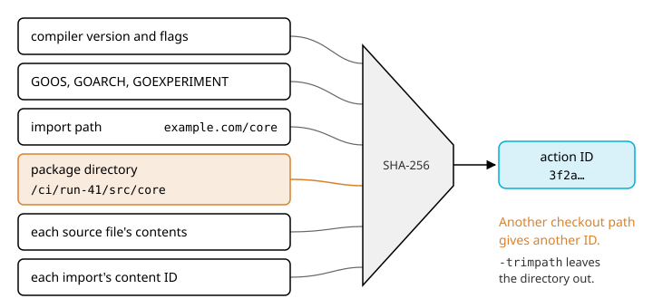
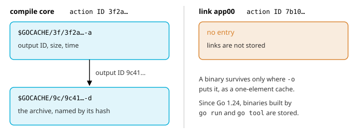
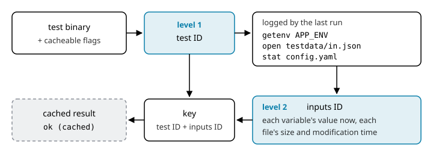

# 4. The go command's design

The go command derives the build graph from import statements, keys each step by a hash of its
inputs, and keeps the results in a per-user cache. Chapter 8 compares each mechanism with
Bazel's.

Five choices shape the design:

- **No build files.** Go code should build "using only the information found in the source
  itself".[^go-about]
- **One language.** The go command "does not attempt to build anything but Go
  packages".[^go-about]
- **A fast compiler.** To compile a package, the compiler reads only the export data of its
  direct imports: a summary of exported types, functions and inlinable function bodies (bodies
  the compiler may copy into callers), written into each package's output, that also covers
  what those imports expose from further down.[^go-exportdata] Rob Pike calls this "the single
  biggest reason why Go compilations are faster than C or C++ compilations".[^pike]
- **One machine.** Every compile and link runs as a child process of one go command.[^go-do]
- **A short-lived process.** Each command is a new process and keeps nothing in memory between
  runs.[^go-filehash]

## One build, step by step

The go command first turns patterns such as `./...` into packages.[^go-load] For each directory
it lists the files, applies build constraints (`//go:build` lines and suffixes such as
`_linux.go`), and reads only each file's header: the package clause and the imports. It reads
further only when a file imports `embed`, to find `//go:embed` lines.[^go-readgoinfo] Since Go
1.19 it keeps these headers in GOCACHE (the build cache, below), keyed by each directory's file
names, sizes and modification times.[^go-modindex] Every run still lists every directory and
checks each file's size and modification time, but it parses only the directories that changed.

The packages then become an action graph: one compile action per package, which writes an
archive (a `.a` file), and one link action per main package. Each compile depends on the
compiles of its direct imports.[^go-action]

`Builder.Do` runs the graph.[^go-do] It starts `-p` goroutines, by default one per available
CPU. Each takes the next action whose dependencies are done and runs its tool unless the output
is already cached.

## Action IDs

Before running an action, the go command computes its action ID, a SHA-256 hash of everything
that could change the output. If GOCACHE holds an output under that ID, the action is
skipped.[^go-lookup] For a compile, `buildActionID` hashes the compiler's version and flags,
the target platform and toolchain experiments (`GOEXPERIMENT`), the import path, the full
contents of every input file, and the content ID of every direct import (next
section).[^go-buildactionid] Unless `-trimpath` (which removes file system paths from the
output) is set, it also hashes the package's absolute directory, because the object file may
record that directory in its debug information.[^go-actionid-dir]

So a cache filled at one checkout path gives no hits at another. In our measurements on 1,000
packages, a second checkout with a warm GOCACHE recompiled all 891 of its own packages in the
build; when both checkouts built with `-trimpath`, it recompiled none.[^bench] And every
process hashes file contents afresh, remembering hashes only until it exits,[^go-filehash] so
even a build with nothing to do reads every source file in full.

## Content IDs and early cutoff

A dependency enters its dependents' action IDs through its content ID, a hash of its
output.[^go-buildid] Every archive and binary has a build ID, `actionID/contentID`, written into
the file. The content ID is a truncated SHA-256 of the file with the build ID replaced by
zeros.[^go-findandhash]

The action ID half makes each output a one-element cache. When `go build -o bin/` finds a binary
in `bin/` whose build ID starts with the action ID it just computed, it skips the
link.[^go-usecache] For `go build`, that is the only way to skip a link, because GOCACHE does
not store binaries: they are large and seldom reused.[^go-noexe] Go 1.24 made one exception, for
binaries built by `go run` and `go tool`.[^go124] Without `-o`, `go build ./...` links every
main package into a temporary directory and discards the result.[^go-discard] In our
measurements, a `go build ./...` with nothing to do on 1,000 packages compiled nothing and
relinked all 11 binaries.[^bench]

The content ID gives an early cutoff: a step that reruns with the same output does not rerun its
dependents. The cutoff is coarse, because the content ID covers the whole archive, export data
and object code together.[^go-archive] Figure 4.3 shows an edit to the body of a function in
`core` that the compiler does not inline. The export data stays the same: the function stays
non-inlinable, no declaration moves, and the same parameters escape to the
heap,[^go-exportfunc] but the object code changes, so `core`'s content ID changes and every
direct importer recompiles. In our measurements their archives came out identical, since an
importer's object code records only a fingerprint, a hash, of each import's export
data,[^go-fingerprint] so the packages above them hit the cache. Every binary that contains
`core` relinks, because a link's action ID includes the content ID of every package in the
binary.[^go-linkactionid] On 1,000 packages, such an edit to the most widely imported package
recompiled 299 packages, the package and its direct importers, and relinked all 10 binaries that
contain it. Adding an exported function recompiled 712: the new fingerprint changes the direct
importers' archives too, so their importers recompile, and the change stops there because the
direct importers' export data did not change.[^bench] rules_go stops the body edit at `core`
(Chapter 7).

## The cache

GOCACHE defaults to `~/Library/Caches/go-build` on macOS and `~/.cache/go-build` on
Linux.[^go-defaultdir] It holds 256 subdirectories, named by the first byte of a hash, and two
kinds of file:[^go-cachefiles]

- `<actionID>-a`, an entry that maps an action ID to the hash and size of its output;
- `<outputID>-d`, the output itself, named by the hash of its content.

Bazel splits its cache the same way (Chapter 6), but GOCACHE belongs to one user on one
machine. The go command looks for old entries at most once a day and deletes those unused for
five days.[^go-trim]

Since Go 1.24,[^go124] setting `GOCACHEPROG` to a program replaces the disk cache with that
program, which speaks JSON over standard input and output.[^go-cacheprog] It can keep entries
anywhere, such as a shared cache server. The keys stay the same, so the directory still splits
caches, and binaries are not stored at all, not even for `go run`.[^go-noexe-prog]

## Test results

A test can read any file or environment variable, so the go command watches it run: the test
binary's `os` package logs every `Getenv`, `Stat`, `Open` and `Chdir` call.[^go-testlog] The
lookup then has two levels:[^go-testcache]

1. The test ID hashes the test binary and the flags. It uses the link's inputs in place of the
   binary, so a hit needs no link. Any test flag outside a short list (`-run`, `-short`, `-v`,
   `-timeout` and a few more) turns caching off, and `-count=1` is the usual way to do
   that.[^go-testflags] The test ID finds the log of the last run.
2. The inputs ID hashes the current value of each environment variable in that log, and the
   path, size and modification time of each file. Files outside the module are not
   checked.[^go-testinputs]

A result is reused only if both match. Because the test ID covers the whole binary, a body edit
to `core` on 1,000 packages reran the tests of 927 packages: `core`'s and those of every package
that depends on it.[^bench] Observation needs no declarations, but is correct only if a test
reaches the world through calls it logs. A test that uses the network, reads outside the
module, or depends on the time is cached anyway.

## What the design gives up

| Choice | What it buys | What it costs as the repository grows |
|---|---|---|
| Graph derived from imports | No build files; the graph is never stale | Every command lists and checks every package it loads |
| No persistent process | Nothing to start, size or restart | Every run hashes every source file again |
| Directory in the action ID | Correct paths in debug information | Caches do not carry across checkout paths |
| Content ID of the whole archive | One cheap key per dependency | Any edit recompiles all direct importers; an export-data change, their importers too |
| Links not cached | A smaller cache | Every binary that contains a change relinks, on every machine |
| One machine, `-p` processes | No coordination | Throughput capped by one machine |
| Go only | One coherent tool | Generated code and other languages stay outside the graph[^go-generate] |
| Tests found by observation | Caching with no declarations | Correct only for inputs the test log sees |

## What this means at scale

- A build with nothing to do still lists every directory, checks every file and hashes every
  source file; in our measurements `go build -o` took about a second on 1,000 packages.[^bench]
  Its cost grows with the tree, not with the change.
- We recommend `-trimpath` in continuous integration. Without it, a cache restored at a
  different path misses on every package in the repository.
- We recommend `go build -o <dir>`, keeping the directory. Without it, every binary is relinked
  on every build.
- An edit to a widely imported package recompiles all its direct importers, and their importers
  too if it changes the package's export data; either way every binary that contains it relinks.
- A `GOCACHEPROG` program can share compiled packages across machines, but not binaries, and not
  across checkout paths without `-trimpath`.

## References

[^go-about]: Go, "About the go command", sections "Motivation" and "Configuration versus
    convention". <https://go.dev/doc/articles/go_command>

[^pike]: Rob Pike, "Go at Google: Language Design in the Service of Software Engineering",
    section "Dependencies in Go". <https://go.dev/talks/2012/splash.article>

[^go-exportdata]: Go, `cmd/compile/internal/noder/unified.go`: writing export data
    "handles re-exporting any transitive dependencies" and prunes "non-inlineable functions".
    <https://github.com/golang/go/blob/go1.27.3/src/cmd/compile/internal/noder/unified.go#L160-L169>

[^go-do]: Go, `cmd/go/internal/work/exec.go`, `Builder.Do`, which starts `-p` goroutines;
    `cmd/go/internal/cfg/cfg.go`, `BuildP`, which defaults to `GOMAXPROCS`;
    `cmd/go/internal/work/shell.go`, `Shell.runOut`, which runs each tool as a child process.
    <https://github.com/golang/go/blob/go1.27.3/src/cmd/go/internal/work/exec.go#L223-L229>
    <https://github.com/golang/go/blob/go1.27.3/src/cmd/go/internal/cfg/cfg.go#L87>
    <https://github.com/golang/go/blob/go1.27.3/src/cmd/go/internal/work/shell.go#L626>

[^go-filehash]: Go, `cmd/go/internal/cache/hash.go`, `FileHash`: hashes the whole file and
    remembers the result in a map that lives as long as the process.
    <https://github.com/golang/go/blob/go1.27.3/src/cmd/go/internal/cache/hash.go#L140-L158>

[^go-load]: Go, `cmd/go/internal/load/pkg.go`, `PackagesAndErrors`.
    <https://github.com/golang/go/blob/go1.27.3/src/cmd/go/internal/load/pkg.go#L2937>

[^go-readgoinfo]: Go, `go/build/read.go`, `readGoInfo`: reads up to the end of the imports,
    and reads the rest of the file only if it imports `embed`.
    <https://github.com/golang/go/blob/go1.27.3/src/go/build/read.go#L265-L272>
    <https://github.com/golang/go/blob/go1.27.3/src/go/build/read.go#L366-L391>

[^go-modindex]: Go, `cmd/go/internal/load/pkg.go`, `loadPackageData`, which asks the module
    index first; `cmd/go/internal/modindex/read.go`, `dirHash` and `openIndexPackage`. Added in
    commit 5a1c5b8ae7, first released in Go 1.19.
    <https://github.com/golang/go/blob/go1.27.3/src/cmd/go/internal/load/pkg.go#L952>
    <https://github.com/golang/go/blob/go1.27.3/src/cmd/go/internal/modindex/read.go#L80-L119>
    <https://github.com/golang/go/blob/go1.27.3/src/cmd/go/internal/modindex/read.go#L218-L245>
    <https://go.googlesource.com/go/+/5a1c5b8ae7>

[^go-action]: Go, `cmd/go/internal/work/action.go`, `Action`, `AutoAction` (link for a main
    package, compile otherwise) and `CompileAction` (one dependency per import).
    <https://github.com/golang/go/blob/go1.27.3/src/cmd/go/internal/work/action.go#L85-L94>
    <https://github.com/golang/go/blob/go1.27.3/src/cmd/go/internal/work/action.go#L451-L456>
    <https://github.com/golang/go/blob/go1.27.3/src/cmd/go/internal/work/action.go#L656-L658>

[^go-buildactionid]: Go, `cmd/go/internal/work/exec.go`, `buildActionID`: platform, compiler
    tool ID and flags, `GOEXPERIMENT`, input files, and each dependency's content ID; the tool
    ID comes from `compile -V=full` in `Builder.toolID`.
    <https://github.com/golang/go/blob/go1.27.3/src/cmd/go/internal/work/exec.go#L264-L442>
    <https://github.com/golang/go/blob/go1.27.3/src/cmd/go/internal/work/exec.go#L367>
    <https://github.com/golang/go/blob/go1.27.3/src/cmd/go/internal/work/exec.go#L376-L378>
    <https://github.com/golang/go/blob/go1.27.3/src/cmd/go/internal/work/exec.go#L428-L435>
    <https://github.com/golang/go/blob/go1.27.3/src/cmd/go/internal/work/buildid.go#L146-L184>

[^go-lookup]: Go, `cmd/go/internal/cache/hash.go`, `NewHash`, a SHA-256 hash;
    `cmd/go/internal/work/buildid.go`, `useCache`, the GOCACHE lookup.
    <https://github.com/golang/go/blob/go1.27.3/src/cmd/go/internal/cache/hash.go#L82-L83>
    <https://github.com/golang/go/blob/go1.27.3/src/cmd/go/internal/work/buildid.go#L565>

[^go-actionid-dir]: Go, `cmd/go/internal/work/exec.go`, `buildActionID`, the `dir` line.
    <https://github.com/golang/go/blob/go1.27.3/src/cmd/go/internal/work/exec.go#L275-L303>

[^go-buildid]: Go, `cmd/go/internal/work/buildid.go`, the "Build IDs" comment: the action ID
    half as a one-element cache, the content ID half as the key for the next step.
    <https://github.com/golang/go/blob/go1.27.3/src/cmd/go/internal/work/buildid.go#L26-L56>

[^go-findandhash]: Go, `cmd/internal/buildid/rewrite.go`, `FindAndHash`, called from
    `updateBuildID` in `cmd/go/internal/work/buildid.go`; `cmd/internal/buildid/buildid.go`,
    `HashToString`, which keeps the first 120 bits of the hash.
    <https://github.com/golang/go/blob/go1.27.3/src/cmd/internal/buildid/rewrite.go#L18-L23>
    <https://github.com/golang/go/blob/go1.27.3/src/cmd/go/internal/work/buildid.go#L696>
    <https://github.com/golang/go/blob/go1.27.3/src/cmd/internal/buildid/buildid.go#L320-L331>

[^go-usecache]: Go, `cmd/go/internal/work/buildid.go`, `useCache`, which reads the build ID of
    the existing target; `cmd/go/internal/work/exec.go`, the link's call to it.
    <https://github.com/golang/go/blob/go1.27.3/src/cmd/go/internal/work/buildid.go#L484-L494>
    <https://github.com/golang/go/blob/go1.27.3/src/cmd/go/internal/work/exec.go#L1630>

[^go-noexe]: Go, `cmd/go/internal/work/buildid.go`, `updateBuildID`: "Executables are not
    cached by default because they are not reused nearly as often as individual packages, and
    they're much larger".
    <https://github.com/golang/go/blob/go1.27.3/src/cmd/go/internal/work/buildid.go#L730-L742>

[^go124]: Go 1.24 release notes, section "Go command": executables created by `go run` and
    `go tool` "are now cached in the Go build cache" (commit 3ff868f2f5); section
    "GOCACHEPROG": a program named by the `GOCACHEPROG` environment variable can now implement
    the cache, which "was previously behind a GOEXPERIMENT". Unless the variable is set, the
    disk cache is used.
    <https://go.dev/doc/go1.24#go-command> <https://go.dev/doc/go1.24#gocacheprog>
    <https://go.googlesource.com/go/+/3ff868f2f5>

[^go-discard]: Go, `cmd/go/internal/work/build.go`, the `go build` documentation ("discards
    the resulting object") and `runBuild`, which adds an `AutoAction`, a link for a main
    package, for every package; `cmd/go/internal/work/action.go`, `LinkAction`, which links into
    the temporary work directory.
    <https://github.com/golang/go/blob/go1.27.3/src/cmd/go/internal/work/build.go#L52-L54>
    <https://github.com/golang/go/blob/go1.27.3/src/cmd/go/internal/work/build.go#L553-L556>
    <https://github.com/golang/go/blob/go1.27.3/src/cmd/go/internal/work/action.go#L955>

[^bench]: This book's measurements, `examples/bench/results/2026-11-15/results.jsonl`,
    configuration `n1000` (1,000 packages, 11 binaries): scenarios `noop`, `noop-discard`
    (repetitions 1 and 2), `core-body`, `core-api`, `test-core-body`, `clone-warmcache` and
    `clone-warmcache-trimpath`. With `-o` naming a directory, `go build` builds only the main
    packages and their dependencies, 891 packages here; 298 of `core`'s 332 direct importers
    are among them, counted from the generated repository's imports. `configs.jsonl` lists 926
    packages that depend on `core`, directly or not.
    [results.jsonl](../examples/bench/results/2026-11-15/results.jsonl)
    <https://github.com/golang/go/blob/go1.27.3/src/cmd/go/internal/work/build.go#L510-L531>

[^go-archive]: Go, `cmd/compile/internal/gc/obj.go`, `dumpobj1`: the archive holds the export
    data (`__.PKGDEF`) and the object code (`_go_.o`).
    <https://github.com/golang/go/blob/go1.27.3/src/cmd/compile/internal/gc/obj.go#L53-L71>

[^go-exportfunc]: Go, `cmd/compile/internal/noder/unified.go`: export data keeps only inlinable
    bodies; `noder/writer.go`, `pos`, which writes a line and column, called from `doObj` for
    each declaration; `noder/linker.go`, `relocFuncExt`, which writes each function's
    parameter escape results and, if it is inlinable, its inlining cost.
    <https://github.com/golang/go/blob/go1.27.3/src/cmd/compile/internal/noder/unified.go#L168-L169>
    <https://github.com/golang/go/blob/go1.27.3/src/cmd/compile/internal/noder/writer.go#L391-L404>
    <https://github.com/golang/go/blob/go1.27.3/src/cmd/compile/internal/noder/writer.go#L848-L859>
    <https://github.com/golang/go/blob/go1.27.3/src/cmd/compile/internal/noder/linker.go#L296-L307>

[^go-fingerprint]: Go, `internal/pkgbits/encoder.go`, `DumpTo`, which hashes the export data
    and appends the hash as its fingerprint; `cmd/compile/internal/noder/unified.go`,
    `writeUnifiedExport`; `noder/import.go`, `addFingerprint`, which records each import's
    fingerprint; `cmd/internal/obj/objfile.go` and `cmd/internal/goobj/objfile.go`, the
    `Autolib` table of imported packages and their fingerprints in the object file.
    <https://github.com/golang/go/blob/go1.27.3/src/internal/pkgbits/encoder.go#L57-L59>
    <https://github.com/golang/go/blob/go1.27.3/src/internal/pkgbits/encoder.go#L102-L105>
    <https://github.com/golang/go/blob/go1.27.3/src/cmd/compile/internal/noder/unified.go#L578>
    <https://github.com/golang/go/blob/go1.27.3/src/cmd/compile/internal/noder/import.go#L285-L297>
    <https://github.com/golang/go/blob/go1.27.3/src/cmd/internal/obj/objfile.go#L76-L80>
    <https://github.com/golang/go/blob/go1.27.3/src/cmd/internal/goobj/objfile.go#L42-L45>

[^go-linkactionid]: Go, `cmd/go/internal/work/exec.go`, `linkActionID`, the `packagefile`
    line. <https://github.com/golang/go/blob/go1.27.3/src/cmd/go/internal/work/exec.go#L1540-L1566>

[^go-defaultdir]: Go, `cmd/go/internal/cache/default.go`, `DefaultDir`; `os/file.go`,
    `UserCacheDir`.
    <https://github.com/golang/go/blob/go1.27.3/src/cmd/go/internal/cache/default.go#L74-L87>
    <https://github.com/golang/go/blob/go1.27.3/src/os/file.go#L495-L498>

[^go-cachefiles]: Go, `cmd/go/internal/cache/cache.go`, `fileName`, `putIndexEntry` and
    `OutputFile`.
    <https://github.com/golang/go/blob/go1.27.3/src/cmd/go/internal/cache/cache.go#L116-L119>
    <https://github.com/golang/go/blob/go1.27.3/src/cmd/go/internal/cache/cache.go#L469-L470>
    <https://github.com/golang/go/blob/go1.27.3/src/cmd/go/internal/cache/cache.go#L318-L320>

[^go-trim]: Go, `cmd/go/internal/cache/cache.go`, `mtimeInterval`, `trimInterval` and
    `trimLimit`.
    <https://github.com/golang/go/blob/go1.27.3/src/cmd/go/internal/cache/cache.go#L335-L351>

[^go-cacheprog]: Go, `cmd/go/internal/cache/prog.go`, `ProgCache`; `cache/default.go`, where a
    non-empty `GOCACHEPROG` replaces the disk cache.
    <https://github.com/golang/go/blob/go1.27.3/src/cmd/go/internal/cache/prog.go#L27-L31>
    <https://github.com/golang/go/blob/go1.27.3/src/cmd/go/internal/cache/default.go#L57-L59>

[^go-noexe-prog]: Go, `cmd/go/internal/work/buildid.go`, `updateBuildID`: a binary is stored
    only when the cache is the disk cache.
    <https://github.com/golang/go/blob/go1.27.3/src/cmd/go/internal/work/buildid.go#L756>

[^go-testlog]: Go, `testing/internal/testdeps/deps.go`, `testLog`; the `testlog` calls in
    `os.Getenv`, `os.OpenFile` and `os.Stat`.
    <https://github.com/golang/go/blob/go1.27.3/src/testing/internal/testdeps/deps.go#L82-L96>
    <https://github.com/golang/go/blob/go1.27.3/src/os/env.go#L102>
    <https://github.com/golang/go/blob/go1.27.3/src/os/file.go#L411>
    <https://github.com/golang/go/blob/go1.27.3/src/os/stat.go#L12>

[^go-testcache]: Go, `cmd/go/internal/test/test.go`, `tryCacheWithID`: "we do not cache link
    outputs", so the link's inputs stand in for the test binary.
    <https://github.com/golang/go/blob/go1.27.3/src/cmd/go/internal/test/test.go#L1882-L1909>

[^go-testflags]: Go, `cmd/go/internal/test/test.go`, the cacheable flags in `tryCacheWithID`
    and in the `go test` documentation.
    <https://github.com/golang/go/blob/go1.27.3/src/cmd/go/internal/test/test.go#L1841-L1875>
    <https://github.com/golang/go/blob/go1.27.3/src/cmd/go/internal/test/test.go#L127-L135>

[^go-testinputs]: Go, `cmd/go/internal/test/test.go`, `computeTestInputsID`, which hashes each
    file's absolute path with the result of `hashOpen`, which hashes a file's size and
    modification time rather than its contents.
    <https://github.com/golang/go/blob/go1.27.3/src/cmd/go/internal/test/test.go#L2018-L2071>
    <https://github.com/golang/go/blob/go1.27.3/src/cmd/go/internal/test/test.go#L2116-L2120>

[^go-generate]: Go, `cmd/go/internal/generate/generate.go`: "Go generate is never run
    automatically by go build, go test, and so on."
    <https://github.com/golang/go/blob/go1.27.3/src/cmd/go/internal/generate/generate.go#L43>
