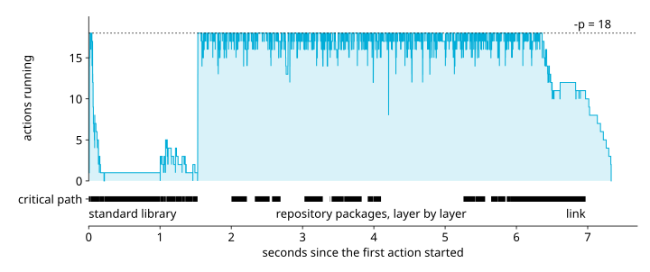

# 5. The toolchain's workloads

The go command and rules_go run the same programs: the compiler, the linker, the assembler, cgo
and the test binaries. This chapter measures what each process consumes and how that grows, so
that Chapter 9 can place each one on a suitable machine.

We wrapped every process of a cold (empty-cache) build of the repository's binaries and of
`go test ./...` with `-toolexec` and `-exec`, and recorded its wall time, its CPU time (user
plus system) and its peak RSS (resident set size: the most physical memory it held at once). The
synthetic repository has 1,000 packages of about 690 lines each in 12 layers (Appendix A), built
on an 18-core Apple M5 Pro.[^m-meta]

## compile: one process per package

The compiler compiles one package per process.[^go-compile-doc] Its front end runs on one
thread: it parses and type-checks the files, inlines calls, and runs escape analysis, which
decides what can live on the stack.[^go-frontend] The back end then compiles the functions,
longest first, on `-c` worker goroutines,[^go-backend] and the process ends by writing the
archive (the package's compiled code in one file).[^go-dumpobj] Besides its own sources, a
compile reads the export data (the summary of a package's exported types and functions that the
compiler writes for importers to read) of each direct import.[^go-importcfg]

The go command sets `-c` for each compile from a shared pool of tokens, so that 18 concurrent
compiles do not each start 18 workers. Each takes half the free tokens, at least 4 and at most
`GOMAXPROCS`, by default the number of cores.[^go-token-pool] rules_go passes no
`-c`,[^rules-go-compilego] so each compile starts one worker per core,[^go-lowerc] while Bazel's
scheduler counts each of rules_go's actions, which declare no resources, as one CPU and
250 MB.[^bazel-resources] We infer that a Bazel build can run more back-end threads than there
are cores; we did not measure this.

A compile of one of our packages used a median of 55 ms of CPU and 44 MB, with `-c` between 4
and 18.[^m-workload] Across these compiles, CPU time was only 1.2 times wall time. In our
reading, the serial front end dominates small packages, and on a busy machine extra workers find
no free core. With cores free, the back end does help: the runtime, the largest package,
compiled early with `-c=18` and used 2,025 ms of CPU in 579 ms, and 305 MB.[^m-workload]

## link: one process per binary

The linker's input is every package in the binary. The go command lists each transitive
dependency in the link's import configuration,[^go-link-deps] and rules_go declares every
transitive archive and the standard library as inputs of the link action.[^rules-go-link-inputs]
It loads them all, drops unreachable code and writes the binary; only a few phases, such as
writing the output, use several goroutines.[^go-link-phases]

The go build's 11 links, ten of them of about 800 packages, took a median of 0.58 s and 443 MB:
ten times a compile's memory, with CPU time 1.2 times wall time.[^m-workload] Test binaries,
linked without debug information, show how a link grows (Figure 5.2): a median of 96 MB and
50 ms below 10 of the repository's packages, 281 MB and 191 ms at 300 or more.[^m-workload] A
link reruns whenever any package in the binary changes: a body edit to the widely imported core
package relinked all ten applications under both tools.[^m-results][^m-profile]

On macOS, Go's own linker writes these binaries as position-independent executables
(PIE).[^go-internal-pie] rules_go hands any non-default link mode, PIE included, to the C
toolchain's linker.[^rules-go-pie] In the cold builds, where links overlapped other work, a link
action took a median of 2.2 s under Bazel and 0.83 s under the go command.[^m-profile][^m-graph]
The difference includes the external linker, Bazel's sandbox (a directory holding only an
action's declared inputs) and rules_go's builder (the program that wraps each compile and link);
we did not separate them.

## asm and cgo

The assembler runs once per assembly file, after one pass over all of them to collect
symbols.[^go-asm] Only the standard library has assembly here: 69 processes of 5 ms and 7 MB at
the median.[^m-workload]

For cgo (Go code that calls C), the go command runs the cgo tool, compiles each C file as a
separate action, then compiles the Go code.[^go-cgo] rules_go does all of this inside one
compile action.[^rules-go-cgo] Our repository has no cgo.

## Test binaries: a link plus a run

Each package's tests are compiled, linked into a binary of their own and run. The go command
leaves the symbol table and debug information out of test binaries it runs and
discards.[^go-test-strip]

Our tests do little: a run used a median of 5 ms of CPU, yet took 4.9 s, and `go test ./...`
took 284 s for 1,000 binaries on 18 cores, 0.28 s each.[^m-workload][^m-results] Bazel's first
test run took 502 s, though its longest chain of dependent actions took 12.7 s.[^m-results] The runs queued outside the
processes. We attribute this to macOS scanning each new executable on its first launch, on one
thread,[^cargo-xprotect] and expect Linux machines not to pay it. In a real repository, we
expect the run, not the link, to set a test's cost.

## vet, nogo and code generators

`go vet` runs one process per package, after the vet processes of its imports, because it reads
the facts (results that an analysis passes from a package to its importers) they wrote.[^go-vet]
`go test` runs a subset of vet's checks by default;[^go-test-vet] our measurements turned them
off. nogo, rules_go's counterpart, is a separate action per package that reads the sources and
its direct imports' export data and facts.[^rules-go-nogo] Both type-check the package again, so
we expect each to cost about as much as a compile's front end.

A code generator is a program, so it is compiled and linked before it runs. `go generate` is
never run by `go build`, and it has no cache;[^go-generate] rerunning the repository's 100
generators took 9.1 s.[^m-results] Under Bazel, a generator is a rule whose tool is built first
and whose command runs as an action,[^bazel-genrule] cached like any other.[^bazel-actions]

## The shape of a build

The critical path is the longest chain of actions that each wait for the one before. A build can
finish no faster than this chain, nor than its total CPU work divided by the cores. In the cold
go build (Figure 5.3), the actions used 65 s of CPU, 3.6 s on 18 cores, and the critical path
was 4.5 s, yet the build took 7.3 s.[^m-graph] The path starts in the standard library, where
the runtime package alone took 0.79 s, passes through one package in each of the 12 layers and a
main package, and ends in a 1.05 s link. The gaps in the bar are its actions waiting while work
off the path held all 18 cores. Its actions ran on a loaded machine and would be shorter alone;
in our view the path, not the core count, bounds what more machines can do.

Bazel's cold build had a longer path, 30.4 s, of which 23.6 s built rules_go's builder and the
standard library.[^m-profile]

## Four workload classes

- **compile**: many short, CPU-bound processes with a serial front end; 44 MB at the median,
  305 MB at most.[^m-workload] We recommend many cores and modest memory per core.
- **link**: one process per binary, mostly on one core, growing with the packages it links;
  443 MB at 800 packages.[^m-workload] It reads every archive in the binary, so we recommend
  fast cores, ample memory and a short path to the cache.
- **test**: a link and a run whose length only the test decides. We recommend isolation and a
  time limit.
- **Bazel server**: one Java virtual machine (JVM) per workspace that holds the graph in memory.
  Its heap grew from 88 MB after building the binaries to 129 MB after the tests.[^m-results] We
  recommend memory sized to the graph and a server that stays up.

## What this means at scale

- Size compile machines by cores and link machines by the largest binary: a link needed ten
  times a compile's memory.
- Past the critical path, more cores do not help a cold build. Shortening the chain from the
  runtime through the deepest import to the link does.
- A binary that links most of the repository is linked again after almost every change. Keep
  binaries as small as their purpose allows.
- Under Bazel, the compiler's threads and the scheduler's one CPU per compile disagree. We
  recommend making them match.
- On macOS, a test suite of many packages pays a launch cost per binary that more cores do not
  reduce. We recommend running large suites on Linux.
## References

[^m-meta]: Measurements, machine and versions:
    [`examples/bench/results/2026-11-15/meta.json`](../examples/bench/results/2026-11-15/meta.json);
    the repository's shape:
    [`configs.jsonl`](../examples/bench/results/2026-11-15/configs.jsonl).
[^m-workload]: Measurements, one record per process of `n1000`:
    [`examples/bench/results/2026-11-15/workload.jsonl`](../examples/bench/results/2026-11-15/workload.jsonl),
    summarized by [`examples/bench/analyze.py`](../examples/bench/analyze.py).
[^m-results]: Measurements, one record per command:
    [`examples/bench/results/2026-11-15/results.jsonl`](../examples/bench/results/2026-11-15/results.jsonl).
[^m-graph]: Measurements, the go command's action graph of the cold build:
    [`examples/bench/results/2026-11-15/n1000-go-cold-actiongraph.json.gz`](../examples/bench/results/2026-11-15/n1000-go-cold-actiongraph.json.gz).
[^m-profile]: Measurements, Bazel's JSON trace profiles of the cold build and of the core-body
    edit:
    [`examples/bench/results/2026-11-15/n1000-bazel-cold.profile.gz`](../examples/bench/results/2026-11-15/n1000-bazel-cold.profile.gz),
    [`n1000-bazel-core-body.profile.gz`](../examples/bench/results/2026-11-15/n1000-bazel-core-body.profile.gz).
[^go-compile-doc]: Go, `cmd/compile/doc.go`, package documentation.
    <https://github.com/golang/go/blob/go1.27.3/src/cmd/compile/doc.go#L6>
[^go-frontend]: Go, `cmd/compile/internal/gc/main.go`, `Main`: parsing and type checking,
    inlining, escape analysis.
    <https://github.com/golang/go/blob/go1.27.3/src/cmd/compile/internal/gc/main.go#L217-L294>
[^go-backend]: Go, `cmd/compile/internal/gc/compile.go`, `compileFunctions`.
    <https://github.com/golang/go/blob/go1.27.3/src/cmd/compile/internal/gc/compile.go#L132-L159>
[^go-dumpobj]: Go, `cmd/compile/internal/gc/main.go`, `Main`, writing the object data.
    <https://github.com/golang/go/blob/go1.27.3/src/cmd/compile/internal/gc/main.go#L377-L381>
[^go-importcfg]: Go, `cmd/go/internal/work/exec.go`, `Builder.build`, the import configuration.
    <https://github.com/golang/go/blob/go1.27.3/src/cmd/go/internal/work/exec.go#L881-L887>
[^go-token-pool]: Go, `cmd/go/internal/work/gc.go`, `compilerConcurrency` and
    `initCompilerConcurrencyPool`.
    <https://github.com/golang/go/blob/go1.27.3/src/cmd/go/internal/work/gc.go#L182-L253>
[^rules-go-compilego]: rules_go, `go/tools/builders/compilepkg.go`, `compileGo`, and
    `go/private/actions/compilepkg.bzl`, `emit_compilepkg`, the action.
    <https://github.com/bazel-contrib/rules_go/blob/v0.65.0/go/tools/builders/compilepkg.go#L560-L585>,
    <https://github.com/bazel-contrib/rules_go/blob/v0.65.0/go/private/actions/compilepkg.bzl#L201-L210>
[^go-lowerc]: Go, `cmd/compile/internal/base/flag.go`, `ParseFlags`.
    <https://github.com/golang/go/blob/go1.27.3/src/cmd/compile/internal/base/flag.go#L161>
[^bazel-resources]: Bazel, `AbstractAction.java`, `DEFAULT_RESOURCE_SET`, and
    `SpawnAction.java`, which uses it unless a rule sets its own.
    <https://github.com/bazelbuild/bazel/blob/9.3.2/src/main/java/com/google/devtools/build/lib/actions/AbstractAction.java#L70-L78>,
    <https://github.com/bazelbuild/bazel/blob/9.3.2/src/main/java/com/google/devtools/build/lib/analysis/actions/SpawnAction.java#L623>
[^go-link-deps]: Go, `cmd/go/internal/work/action.go`, `addTransitiveLinkDeps`, and
    `exec.go`, `writeLinkImportcfg`.
    <https://github.com/golang/go/blob/go1.27.3/src/cmd/go/internal/work/action.go#L1043-L1046>,
    <https://github.com/golang/go/blob/go1.27.3/src/cmd/go/internal/work/exec.go#L1670-L1678>
[^rules-go-link-inputs]: rules_go, `go/private/actions/link.bzl`, `emit_link`.
    <https://github.com/bazel-contrib/rules_go/blob/v0.65.0/go/private/actions/link.bzl#L217-L227>
[^go-link-phases]: Go, `cmd/link/internal/ld/main.go`, `Main`; `dwarf.go` and `data.go`, the
    parallel parts.
    <https://github.com/golang/go/blob/go1.27.3/src/cmd/link/internal/ld/main.go#L367-L374>,
    <https://github.com/golang/go/blob/go1.27.3/src/cmd/link/internal/ld/dwarf.go#L2264-L2265>,
    <https://github.com/golang/go/blob/go1.27.3/src/cmd/link/internal/ld/data.go#L1170-L1175>
[^go-internal-pie]: Go, `internal/platform/supported.go`, `InternalLinkPIESupported` and
    `DefaultPIE`.
    <https://github.com/golang/go/blob/go1.27.3/src/internal/platform/supported.go#L217-L243>
[^rules-go-pie]: rules_go, `go/private/context.bzl`, `_defaults_to_pie`, and
    `go/private/actions/link.bzl`, `emit_link`.
    <https://github.com/bazel-contrib/rules_go/blob/v0.65.0/go/private/context.bzl#L578-L583>,
    <https://github.com/bazel-contrib/rules_go/blob/v0.65.0/go/private/actions/link.bzl#L97-L120>
[^go-asm]: Go, `cmd/go/internal/work/gc.go`, `gcToolchain.asm` and `gcToolchain.symabis`.
    <https://github.com/golang/go/blob/go1.27.3/src/cmd/go/internal/work/gc.go#L410-L432>
[^go-cgo]: Go, `cmd/go/internal/work/action.go`, `cgoAction`.
    <https://github.com/golang/go/blob/go1.27.3/src/cmd/go/internal/work/action.go#L762-L797>
[^rules-go-cgo]: rules_go, `go/tools/builders/compilepkg.go`, `compileArchive`.
    <https://github.com/bazel-contrib/rules_go/blob/v0.65.0/go/tools/builders/compilepkg.go#L344-L346>
[^go-test-strip]: Go, `cmd/go/internal/test/test.go`, `OmitDebug`, and `work/gc.go`, `ld`.
    <https://github.com/golang/go/blob/go1.27.3/src/cmd/go/internal/test/test.go#L1220>,
    <https://github.com/golang/go/blob/go1.27.3/src/cmd/go/internal/work/gc.go#L605-L607>
[^cargo-xprotect]: Cargo, pull request 15908, "Detect when the initial binary launch may be
    slow on macOS", which describes the XProtect scan of a new binary on its first launch and
    its single thread (open, not merged, at the time of writing).
    <https://github.com/rust-lang/cargo/pull/15908>
[^go-vet]: Go, `cmd/go/internal/work/action.go`, `vetAction`, and `exec.go`, `Builder.vet`.
    <https://github.com/golang/go/blob/go1.27.3/src/cmd/go/internal/work/action.go#L881-L898>,
    <https://github.com/golang/go/blob/go1.27.3/src/cmd/go/internal/work/exec.go#L1409-L1413>
[^go-test-vet]: Go, `cmd/go/internal/test/test.go`, `defaultVetFlags`.
    <https://github.com/golang/go/blob/go1.27.3/src/cmd/go/internal/test/test.go#L654>
[^rules-go-nogo]: rules_go, `go/private/actions/compilepkg.bzl`, `_run_nogo`.
    <https://github.com/bazel-contrib/rules_go/blob/v0.65.0/go/private/actions/compilepkg.bzl#L226-L280>
[^go-generate]: Go, `cmd/go/internal/generate/generate.go`, package documentation.
    <https://github.com/golang/go/blob/go1.27.3/src/cmd/go/internal/generate/generate.go#L43-L44>
[^bazel-genrule]: Bazel, "General Rules", section "genrule".
    <https://bazel.build/reference/be/general#genrule>
[^bazel-actions]: Bazel, "Remote Caching", section "Overview".
    <https://bazel.build/remote/caching#overview>
