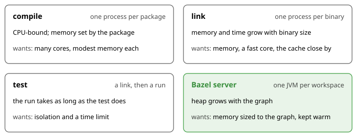

# 5. The toolchain's workloads

The go command and rules_go run the same programs: compiler, linker, assembler, cgo and test
binaries. This chapter measures what each consumes and how that grows, so that Chapter 9 can
place each on a suitable machine.

We ran a cold (empty-cache) build of the repository's binaries and `go test ./...` through a
wrapper (`-toolexec` and `-exec`) that recorded each process's wall time, CPU time (user plus
system) and peak RSS (resident set size: the most physical memory it held at once). The
synthetic repository has 1,000 packages of about 690 lines each in 12 layers (Appendix A), built
on an 18-core Apple M5 Pro running macOS 26.6.[^m-meta]

## compile: one process per package

The compiler compiles one package per process.[^go-compile-doc] Its front end is serial apart
from parsing, which runs one goroutine per file:[^go-parse] it type-checks the package, inlines
calls, and runs escape analysis, which decides what can live on the stack.[^go-frontend] The
back end then compiles the functions, longest first, on `-c` worker goroutines,[^go-backend] and
the process ends by writing the archive (the package's compiled code in one
file).[^go-dumpobj] Besides its own sources, a compile reads the export data (the summary of a
package's exported types and functions that the compiler writes for importers to read) of each
direct import.[^go-importcfg]

The go command runs up to `-p` actions at once, by default `GOMAXPROCS`, the number of threads
that run Go code at once (one per CPU unless set). It gives each compile a `-c` from a shared
pool of 2×`GOMAXPROCS` + 4×`-p` tokens, 108 here: half the tokens not held back for compiles yet
to start, at least 4 and at most `GOMAXPROCS`.[^go-token-pool] rules_go passes no
`-c`,[^rules-go-compilego] so each compile starts one worker per CPU,[^go-lowerc] while Bazel's
scheduler books each rules_go action, which declares no resources, as one CPU and
250 MB.[^bazel-resources] So 18 compiles may start 324 back-end workers under Bazel, against at
most 108 under the go command; we did not measure the effect.

A compile of one of our packages used a median of 55 ms of CPU and 44 MB, with `-c` between 4
and 18.[^m-workload] Across them, CPU time was only 1.2 times wall time. In our
reading, the serial front end dominates small packages, and on a busy machine extra workers find
no free core. With cores free, the back end does help: the runtime, the costliest compile, ran
early with `-c=18` and used 2,025 ms of CPU in 579 ms, and 305 MB.[^m-workload]

## link: one process per binary

The linker's input is every package in the binary. The go command lists each transitive
dependency in the link's import configuration,[^go-link-deps] and rules_go declares every
transitive archive and the standard library as inputs of the link action.[^rules-go-link-inputs]
The linker loads them all, drops unreachable code and writes the binary; only a few phases, such
as writing the output, use several goroutines.[^go-link-phases]

The go build's 11 links, ten of them of about 730 repository packages each, took a median of
0.58 s and 443 MB: ten times a compile's memory, with CPU time 1.2 times wall
time.[^m-workload] Test binaries, linked without debug information, show how a link grows
(Figure 5.2): a median of 96 MB and 50 ms below 10 of the repository's packages, 281 MB and
191 ms at 300 or more.[^m-workload] A link reruns whenever any package in the binary
changes:[^go-linkactionid] a body edit to `core`, the most widely imported package (Chapter 4),
relinked all ten applications under both tools.[^m-results][^m-profile]

On macOS both tools build position-independent executables (PIE, binaries that can load at any
address). Go's own linker writes them,[^go-internal-pie] but rules_go hands every PIE link to the
C toolchain's linker unless cgo is off.[^rules-go-pie] Timed as whole actions amid other work in
the cold builds, links took a median of 2.2 s under Bazel and 0.83 s under the go
command.[^m-profile][^m-graph] The difference includes the C linker, Bazel's sandbox (a
directory holding only an action's declared inputs) and rules_go's builder (the program that
wraps each compile and link); we did not separate them.

## asm and cgo

The assembler runs once per assembly file, after one pass over all of them to collect
symbols.[^go-asm] Only the standard library has assembly here: 69 processes of 5 ms and 7 MB at
the median.[^m-workload]

For cgo (Go code that calls C), the go command runs the cgo tool, compiles each C file as a
separate action, then compiles the Go code.[^go-cgo] rules_go does all of this inside one
compile action.[^rules-go-cgo] Our repository has no cgo.

## Test binaries: a link plus a run

Each package's tests are compiled, linked into a binary of their own and run. The go command
leaves the symbol table and debug information out of test binaries it runs and
discards.[^go-test-strip]

Our tests do little: a run used a median of 5 ms of CPU, yet took 4.9 s.[^m-workload] The first
18 runs to finish, as many as run at once, each took about 0.22 s longer than the one before,
and `go test ./...` took 284 s for 1,000 binaries, 0.28 s each,[^m-workload][^m-results] as if
the runs waited in one queue outside the processes. macOS checks an app for known malware on its
first launch;[^apple-xprotect] we infer that this check, made on each new test binary in turn,
is the queue, and expect Linux machines not to pay it. Bazel's first test run took 502 s, though
its longest chain of dependent actions took 12.7 s.[^m-results]

## vet, nogo and code generators

`go vet` runs one process per package, after the vet processes of its imports, because it reads
the facts (results that an analysis passes from a package to its importers) they wrote.[^go-vet]
`go test` runs a subset of vet's checks by default;[^go-test-vet] our measurements turned them
off. nogo, rules_go's counterpart, when configured, is a separate action per package that reads
the sources and its direct imports' export data and facts.[^rules-go-nogo] Both type-check the
package again, so we expect each to cost at least as much as a compile's front end.

`go generate` is never run by `go build`, and it has no cache;[^go-generate] rerunning the
repository's 100 generators took 9.1 s.[^m-results] Under Bazel, a generator is a rule whose
tool is built first and whose command runs as an action,[^bazel-genrule] cached like any
other.[^bazel-actions]

## The shape of a build

The critical path is the longest chain of actions that each wait for the one before. A build can
finish no faster than this chain, nor than its total CPU work divided by the cores. In the cold
go build (Figure 5.3), the actions used 65 s of CPU, 3.6 s on 18 cores, and the critical path
was 4.5 s, yet they spanned 7.3 s.[^m-graph] The path starts in the standard library, where the
runtime's compile action alone took 0.79 s, passes through one package in each of the 12 layers
and a main package, and ends in a 1.05 s link. We read the gaps in the bar as waits while work
off the path held all 18 of the go command's action slots. Its actions ran on a loaded machine
and would be shorter alone.

Bazel's cold build had a longer path, 30.4 s, of which 23.6 s built rules_go's builder and the
standard library.[^m-profile]

## Four workload classes

- **compile**: many short, CPU-bound processes with a serial front end; 44 MB at the median,
  305 MB at most.[^m-workload]
- **link**: one process per binary, mostly on one core, growing with the packages it links;
  443 MB at about 730 packages.[^m-workload]
- **test**: a link and a run whose length the test decides, plus, on macOS, a wait before
  launch.
- **Bazel server**: one Java virtual machine (JVM) per workspace that holds the graph in memory.
  Its heap grew from 88 MB after building the binaries to 129 MB after the tests.[^m-results]

## What this means at scale

- Size compile machines by cores and link machines by the largest binary: a link needed ten
  times a compile's memory.
- More cores speed a cold build only down to its critical path; beyond that, only a shorter chain
  from the runtime through the deepest import to the link helps.
- A binary that links most of the repository relinks after almost every change; keep binaries
  as small as their purpose allows.
- Under Bazel the compiler may use every core while the scheduler books one CPU per compile;
  Chapter 9 shows how to make them agree.
- On macOS, a test suite of many packages pays a launch cost per binary that more cores do not
  reduce. We recommend running large suites on Linux.

## References

[^m-meta]: Measurements, machine and versions:
    [`examples/bench/results/2026-11-15/meta.json`](../examples/bench/results/2026-11-15/meta.json);
    the repository's shape:
    [`configs.jsonl`](../examples/bench/results/2026-11-15/configs.jsonl).
[^m-workload]: Measurements, one record per process of `n1000`:
    [`examples/bench/results/2026-11-15/workload.jsonl`](../examples/bench/results/2026-11-15/workload.jsonl),
    summarized by [`examples/bench/analyze.py`](../examples/bench/analyze.py).
[^m-results]: Measurements, one record per command:
    [`examples/bench/results/2026-11-15/results.jsonl`](../examples/bench/results/2026-11-15/results.jsonl).
[^m-graph]: Measurements, the go command's action graph of the cold build:
    [`examples/bench/results/2026-11-15/n1000-go-cold-actiongraph.json.gz`](../examples/bench/results/2026-11-15/n1000-go-cold-actiongraph.json.gz).
[^m-profile]: Measurements, Bazel's JSON trace profiles of the cold build and of the core-body
    edit:
    [`examples/bench/results/2026-11-15/n1000-bazel-cold.profile.gz`](../examples/bench/results/2026-11-15/n1000-bazel-cold.profile.gz),
    [`n1000-bazel-core-body.profile.gz`](../examples/bench/results/2026-11-15/n1000-bazel-core-body.profile.gz).
[^go-compile-doc]: Go, `cmd/compile/doc.go`, package documentation.
    <https://github.com/golang/go/blob/go1.27.3/src/cmd/compile/doc.go#L6>
[^go-parse]: Go, `cmd/compile/internal/noder/noder.go`, `LoadPackage`, which parses each file in
    a goroutine of its own.
    <https://github.com/golang/go/blob/go1.27.3/src/cmd/compile/internal/noder/noder.go#L27-L61>
[^go-frontend]: Go, `cmd/compile/internal/gc/main.go`, `Main`: parsing and type checking,
    inlining, escape analysis.
    <https://github.com/golang/go/blob/go1.27.3/src/cmd/compile/internal/gc/main.go#L217-L294>
[^go-backend]: Go, `cmd/compile/internal/gc/compile.go`, `compileFunctions`.
    <https://github.com/golang/go/blob/go1.27.3/src/cmd/compile/internal/gc/compile.go#L132-L159>
[^go-dumpobj]: Go, `cmd/compile/internal/gc/main.go`, `Main`, writing the object data.
    <https://github.com/golang/go/blob/go1.27.3/src/cmd/compile/internal/gc/main.go#L377-L381>
[^go-importcfg]: Go, `cmd/go/internal/work/exec.go`, `Builder.build`, the import configuration.
    <https://github.com/golang/go/blob/go1.27.3/src/cmd/go/internal/work/exec.go#L881-L887>
[^go-token-pool]: Go, `cmd/go/internal/work/gc.go`, `compilerConcurrency` and
    `initCompilerConcurrencyPool`; `cmd/go/internal/cfg/cfg.go`, `BuildP`, the `-p` default.
    <https://github.com/golang/go/blob/go1.27.3/src/cmd/go/internal/work/gc.go#L182-L253>,
    <https://github.com/golang/go/blob/go1.27.3/src/cmd/go/internal/cfg/cfg.go#L87>
[^rules-go-compilego]: rules_go, `go/tools/builders/compilepkg.go`, `compileGo`, and
    `go/private/actions/compilepkg.bzl`, `emit_compilepkg`, the action.
    <https://github.com/bazel-contrib/rules_go/blob/v0.65.0/go/tools/builders/compilepkg.go#L560-L585>,
    <https://github.com/bazel-contrib/rules_go/blob/v0.65.0/go/private/actions/compilepkg.bzl#L201-L210>
[^go-lowerc]: Go, `cmd/compile/internal/base/flag.go`, `ParseFlags`.
    <https://github.com/golang/go/blob/go1.27.3/src/cmd/compile/internal/base/flag.go#L161>
[^bazel-resources]: Bazel, `AbstractAction.java`, `DEFAULT_RESOURCE_SET`, and
    `SpawnAction.java`, which uses it unless a rule sets its own.
    <https://github.com/bazelbuild/bazel/blob/9.3.2/src/main/java/com/google/devtools/build/lib/actions/AbstractAction.java#L70-L78>,
    <https://github.com/bazelbuild/bazel/blob/9.3.2/src/main/java/com/google/devtools/build/lib/analysis/actions/SpawnAction.java#L623>
[^go-link-deps]: Go, `cmd/go/internal/work/action.go`, `addTransitiveLinkDeps`, and
    `exec.go`, `writeLinkImportcfg`.
    <https://github.com/golang/go/blob/go1.27.3/src/cmd/go/internal/work/action.go#L1034-L1046>,
    <https://github.com/golang/go/blob/go1.27.3/src/cmd/go/internal/work/exec.go#L1670-L1678>
[^rules-go-link-inputs]: rules_go, `go/private/actions/link.bzl`, `emit_link`.
    <https://github.com/bazel-contrib/rules_go/blob/v0.65.0/go/private/actions/link.bzl#L217-L227>
[^go-linkactionid]: Go, `cmd/go/internal/work/exec.go`, `linkActionID`, the `packagefile`
    line. <https://github.com/golang/go/blob/go1.27.3/src/cmd/go/internal/work/exec.go#L1540-L1566>
[^go-link-phases]: Go, `cmd/link/internal/ld/main.go`, `Main`; `dwarf.go` and `data.go`, the
    parallel parts.
    <https://github.com/golang/go/blob/go1.27.3/src/cmd/link/internal/ld/main.go#L367-L374>,
    <https://github.com/golang/go/blob/go1.27.3/src/cmd/link/internal/ld/dwarf.go#L2264-L2265>,
    <https://github.com/golang/go/blob/go1.27.3/src/cmd/link/internal/ld/data.go#L1170-L1175>
[^go-internal-pie]: Go, `internal/platform/supported.go`, `InternalLinkPIESupported` and
    `DefaultPIE`.
    <https://github.com/golang/go/blob/go1.27.3/src/internal/platform/supported.go#L217-L243>
[^rules-go-pie]: rules_go, `go/private/context.bzl`, `_defaults_to_pie` and `_go_config_impl`,
    which pick PIE on macOS, and `go/private/actions/link.bzl`, `emit_link`.
    <https://github.com/bazel-contrib/rules_go/blob/v0.65.0/go/private/context.bzl#L578-L583>,
    <https://github.com/bazel-contrib/rules_go/blob/v0.65.0/go/private/context.bzl#L1089-L1094>,
    <https://github.com/bazel-contrib/rules_go/blob/v0.65.0/go/private/actions/link.bzl#L97-L120>
[^go-asm]: Go, `cmd/go/internal/work/gc.go`, `gcToolchain.asm` and `gcToolchain.symabis`.
    <https://github.com/golang/go/blob/go1.27.3/src/cmd/go/internal/work/gc.go#L410-L432>
[^go-cgo]: Go, `cmd/go/internal/work/action.go`, `cgoAction`.
    <https://github.com/golang/go/blob/go1.27.3/src/cmd/go/internal/work/action.go#L762-L797>
[^rules-go-cgo]: rules_go, `go/tools/builders/compilepkg.go`, `compileArchive`.
    <https://github.com/bazel-contrib/rules_go/blob/v0.65.0/go/tools/builders/compilepkg.go#L338-L341>
[^go-test-strip]: Go, `cmd/go/internal/test/test.go`, `OmitDebug`, and `work/gc.go`, `ld`.
    <https://github.com/golang/go/blob/go1.27.3/src/cmd/go/internal/test/test.go#L1220>,
    <https://github.com/golang/go/blob/go1.27.3/src/cmd/go/internal/work/gc.go#L605-L607>
[^apple-xprotect]: Apple, *Apple Platform Security*, "Protecting against malware in macOS",
    section "XProtect": XProtect checks for known malicious content when an app is first
    launched or has been changed in the file system.
    <https://support.apple.com/guide/security/protecting-against-malware-sec469d47bd8/web#secffa0f9b55>
[^go-vet]: Go, `cmd/go/internal/work/action.go`, `vetAction`, and `exec.go`, `Builder.vet`.
    <https://github.com/golang/go/blob/go1.27.3/src/cmd/go/internal/work/action.go#L881-L898>,
    <https://github.com/golang/go/blob/go1.27.3/src/cmd/go/internal/work/exec.go#L1409-L1413>
[^go-test-vet]: Go, `cmd/go/internal/test/test.go`, `defaultVetFlags`.
    <https://github.com/golang/go/blob/go1.27.3/src/cmd/go/internal/test/test.go#L654>
[^rules-go-nogo]: rules_go, `go/private/actions/compilepkg.bzl`, `_run_nogo`.
    <https://github.com/bazel-contrib/rules_go/blob/v0.65.0/go/private/actions/compilepkg.bzl#L226-L280>
[^go-generate]: Go, `cmd/go/internal/generate/generate.go`, package documentation, and
    `runGenerate`, which runs every directive in every file with no cache lookup.
    <https://github.com/golang/go/blob/go1.27.3/src/cmd/go/internal/generate/generate.go#L43-L44>,
    <https://github.com/golang/go/blob/go1.27.3/src/cmd/go/internal/generate/generate.go#L224-L234>
[^bazel-genrule]: Bazel, "General Rules", section "genrule".
    <https://bazel.build/reference/be/general#genrule>
[^bazel-actions]: Bazel, "Remote Caching", section "Overview".
    <https://bazel.build/remote/caching#overview>
