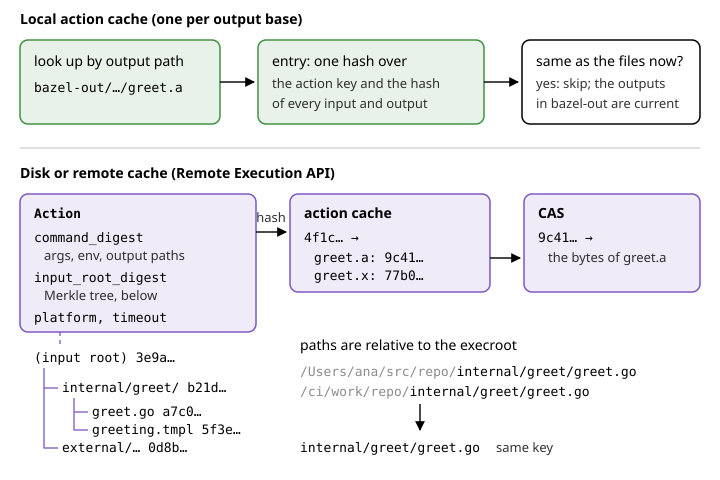
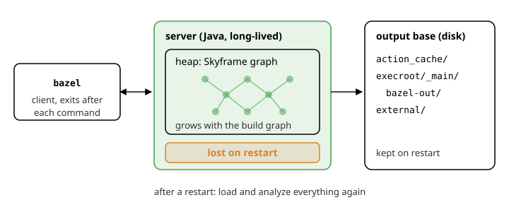

# 6. Bazel's design

Bazel builds one repository that holds many languages, builds and tests it on many machines,
and aims to give the result a clean build would.

Two statements set the goals. The vision: "Any software developer can efficiently build,
test, and package any project, of any size or complexity".[^vision] The README: "{Fast,
Correct} - Choose two".[^readme] In our reading, each goal forces a choice:

- **Many languages in one repository.** No one language's imports describe the whole graph, so
  the graph is declared in build files.
- **Many machines.** A result computed on one machine must hold on another, so actions are
  "isolated and can be offloaded",[^vision] and their keys must not depend on the machine.
- **Correct.** An incremental build must equal a clean one, so every input is declared and
  every change is found.

Bazel's answers to Chapter 1's six decisions, which Chapter 8 weighs for Go:

| Decision (Chapter 1) | Bazel's answer |
|---|---|
| Unit | One action per step declared in the build files; for Go, one compile per package |
| Graph | Declared in build files and kept in memory by a long-lived process |
| Change | Compare each known file's times with the last build, or ask the operating system |
| Key | The command, its environment and machine type, and the contents of every input, with paths relative to one directory |
| Sharing | One local cache per checkout; a shared cache on disk or on a server, across checkouts and machines |
| Execution | Locally, hidden from undeclared files, or on a pool of remote machines |

## The model


Figure 6.1 uses `examples/minimal` from Chapter 2. A **package** is a directory with a BUILD
file. A **target** is a named unit declared in it, such as `//internal/greet:greet`; its `deps`
are edges to other targets. A **rule** is a target's kind, such as `go_library`: a function,
written in Starlark (Bazel's Python-like language), that says how to build targets of that
kind.[^glossary]

To analyze a target, Bazel runs its rule's function, which does two things. It registers
**actions**: commands with declared inputs and outputs, such as "compile `greet.go` into
`greet.a`",[^rules-actions] plus `greet.x`, the export data that importers compile against
(Chapter 7). And it returns **providers**: data for the targets that depend on it. A rule reads
only its direct dependencies' providers, so each target passes on what its dependents
need.[^rules-providers] `go_library` returns `GoArchive`, "the compiled form ... with
everything needed to link it into a binary", and `GoInfo`, the inputs that a binary embedding
the library compiles itself.[^rules-go-providers] The files that actions read and write are
**artifacts**; each output is written by exactly one action.[^glossary]

A **configuration** is the set of settings outside the rules, such as the target platform (the
operating system and CPU to build for)[^platforms] and the command-line flags, that shapes the
actions a target produces. A target built in two configurations is analyzed twice and has two
sets of actions.[^glossary] Tools that run during the build are built in an exec configuration,
for the machine that runs the actions.[^rules-configurations] For `//cmd/hello` and its
dependencies, `bazel aquery`, which prints the actions analysis registers, lists 19 in the
target configuration and 21 in the exec configuration, which builds rules_go's builder program:

```text
$ bazel aquery 'deps(//cmd/hello)' --output=summary
Configurations:
  darwin_arm64-fastbuild: 19
  darwin_arm64-opt-exec: 21
```

A `go_binary` that sets `goos` and `goarch`, or `race`, moves itself and its dependencies into
another configuration (Chapter 7).[^rules-go-transition]

The inputs and outputs of every action "must be known during the analysis phase" and cannot
depend on the result of running anything.[^rules-actions] Everything below relies on that.

## Three phases


A command runs in three phases.[^phases] **Loading** evaluates BUILD files into targets.
**Analysis** runs the rules and produces the action graph. **Execution** runs the actions
whose outputs are needed and not up to date. Loading interleaves with analysis.[^phases] Since
Bazel 7.0, execution overlaps them too: Bazel "starts executing actions while it is still
analyzing other top-level targets", the targets named on the command line.[^skymeld]

## Skyframe


All three phases run on Skyframe, Bazel's framework for incremental evaluation: one graph of
nodes (files, packages, targets, actions, outputs), each holding a value and edges to the
nodes it read.[^skyframe] The graph lives in the memory of the Bazel server, a long-lived Java
process that the `bazel` command starts and then talks to. The server keeps "BUILD files,
dependency graphs, and other metadata from one build to the next".[^client-server] After
`bazel build //...` on a new server, the minimal example's graph held 48,623 nodes from 168
packages, only 3 of them the example's own:

```text
$ bazel dump --skyframe=summary
Node count: 48623
Edge count: 125532
$ bazel dump --skyframe=count
FILE              12679
FILE_STATE        12301
CONFIGURED_TARGET  9807
ARTIFACT           6151
PACKAGE             168
ACTION_EXECUTION    120
```

Before each command, Bazel looks for changed files. By default it runs `stat` on every file in
the graph and compares its modification time, change time and inode number with the stored
ones, without reading it.[^filestate] With `--watchfs`, off by default, it asks the operating
system which source files changed instead,[^watchfs] though by default it still checks every
output of the last build.[^output-check] Every node that depends on a changed file,
directly or not, is marked dirty.[^skyframe]

Bazel then recomputes the dirty nodes from the bottom, with change pruning: "if a node is
invalidated, but upon rebuild, it is discovered that its new value is the same as its old
value, the nodes that were invalidated due to a change in this node are
'resurrected'".[^skyframe][^pruning] An action that reruns and writes its outputs to local disk
does not count as unchanged even when the bytes are the same: its value records each output's
file times and inode number, not only its hash.[^action-value] Each action that reads those
outputs is then checked against the action cache (next section), which compares hashes only.
On a hit it does not run, its value is unchanged, and pruning resumes above it (Figure 6.3).
Together they give Chapter 1's early cutoff.

The graph is what makes a repeated build cheap. In our measurements on the 1,000-package synthetic
repository (Appendix A), a build
with nothing to do took 0.2–0.4 s with a warm server. A new server must load and analyze
everything again before it can tell that nothing changed: the same build took 3.6 s, and one
that stopped after analysis (`--nobuild`) took 3.1 s.[^bench]

## Action keys and two caches



Actions run in the **execroot**, a directory in which sources, external repositories and the
output tree `bazel-out` appear at fixed relative paths.[^output-dirs] Command lines name files
by those paths:

```text
$ bazel aquery //internal/greet:greet
action 'GoCompilePkg internal/greet/greet.a'
  ActionKey: 8387f06b6717d192100020b1f3016e4926447ca3b0f11ff995be97f3b9fdaf80
  Inputs: [..., internal/greet/greet.go, internal/greet/greeting.tmpl]
  Outputs: [bazel-out/darwin_arm64-fastbuild/bin/internal/greet/greet.a, ...]
```

Bazel's **action key** is only part of Chapter 1's key: it hashes the command line, environment
variables, mnemonic (a name for its kind, such as `GoCompilePkg`) and platform, but not the
contents of the inputs.[^action-key] Those enter the local **action cache**, a table in the
output base (the directory that holds a checkout's outputs and state). The entry for an action,
found by the path of its main output, holds one hash over the action key and the content hash
of every input and output.[^action-cache] If the hash computed from the current files matches,
the outputs already in `bazel-out` are current and the action is skipped. This cache stores no
file contents.

A remote cache speaks the Remote Execution API, an open gRPC protocol,[^rbe] or a simpler HTTP
protocol, and a disk cache (`--disk_cache`) is a local directory that Bazel uses as
one.[^remote-caching] In all of them, an action becomes an **Action** message: the hash of a
**Command** (arguments, environment, output paths), the hash of the input root, the platform
and a timeout.[^reapi] The input root's hash is a Merkle tree hash, a single hash computed over
the whole directory tree of inputs, so it changes when any input does. The hash of the Action
is the key. The cache has two parts: a remote action cache from an Action's hash to the hashes
of its outputs, and a content-addressed store (CAS) from each hash to the
bytes.[^remote-caching] GOCACHE makes the same split between action entries and content
entries (Chapter 4).

Every path in the Command and the tree is relative to the execroot, so the checkout's location
does not enter the key unless a rule writes an absolute path into a command.[^path-resolver] The
output base is named by a hash of the checkout's path, so each checkout has its own local action
cache,[^output-dirs] but checkouts and machines can share a disk or remote cache. In our
measurements (one run each), a second checkout of 1,000 packages at another path, with a new
output base and the first checkout's disk cache, ran none of the 1,127 actions that a cold build
runs in a sandbox: all were cache hits. It took 5.6 s, against 39.5 s for a cold build.[^bench]

## Sandboxes and persistent workers


By default Bazel runs each action with the first of these strategies that supports it: remote
(when a remote executor is set), worker, sandboxed, local.[^strategies] A **sandbox** gives an
action its own execroot holding only its declared inputs, confined by `sandbox-exec` on macOS
and containers on Linux. A tool then sees no undeclared file unless it knows the file's
absolute path. Setting up and tearing down each sandbox costs time; on Linux, sandboxed builds
are "rarely more than a few percent slower".[^sandboxing]

A **persistent worker** is a long-running process that serves many actions, saving a tool's
start-up on each one. The tool must speak Bazel's worker protocol.[^workers] rules_go's actions
do not ask for workers, so every Go compile and link is a new process.[^rules-go-workers]

## Remote caching and remote execution



With a remote cache, Bazel looks up each action's hash before running it and uploads the
results of the actions it runs.[^remote-caching] With remote execution it sends the Action to
an execution service instead: it uploads the inputs the CAS lacks, and an executor from the
service's pool runs the command and stores the outputs in the CAS.[^reapi-exec] An executor
gets no file of the checkout outside the input root, which is why every input must be
declared.[^reapi] Parallelism is then bounded by the pool rather than by one machine's cores.

Since 7.0, Bazel by default downloads only the outputs of top-level targets and those that
local actions need, and knows the rest by hash alone ("Build without the Bytes").[^bwob] The
remote cache may then evict an output that a later action needs. Since 9.3, rewinding is the
default: Bazel reruns only the actions that produced the lost outputs.[^rewind]

## What the design costs



| Cost | Cause | Grows with |
|---|---|---|
| A second description of the graph | The graph is declared, not derived | Every change to imports must reach the BUILD files (Chapter 3) |
| Server memory | Skyframe keeps every node in the server's heap[^client-server] | Targets and configurations |
| A fixed cost per action | A process, a sandbox, hashes and a cache entry for every action[^sandboxing][^rules-go-workers] | The number of actions |
| Loading and analysis after every start | The graph lives only in memory[^cache-issues] | The number of targets; paid by every new CI runner[^bench] |

The heap grows with the graph; Chapter 5 measures it. A build too big for the heap fails with
an `OutOfMemoryError`, and the flags that discard parts of the graph to save memory make
incremental builds slower.[^memory]

## What this means at scale

- Keep servers warm. A CI job that starts a new server pays again for starting it, loading and
  analysis: 3.1 s on 1,000 packages in our measurements.[^bench]
- Track server memory with `bazel info used-heap-size-after-gc` as the repository grows
  (Chapter 9 sets the limit).
- Share a disk or remote cache across checkouts and machines. The checkout path does not enter
  the key, but environment variables and the platform do, so keep them identical.
- Leave Build without the Bytes on; fetch more with `--remote_download_regex` only for files a
  person or a later job reads.[^bwob]

## References

[^vision]: Bazel, "Bazel Vision". <https://bazel.build/about/vision>

[^readme]: Bazel, `README.md`, the tagline.
    <https://github.com/bazelbuild/bazel/blob/9.3.2/README.md?plain=1#L3>

[^glossary]: Bazel, "Glossary", entries "Package", "Target", "Rule", "Artifact",
    "Configuration" and "Configured target". <https://bazel.build/reference/glossary#package>
    <https://bazel.build/reference/glossary#target>
    <https://bazel.build/reference/glossary#rule>
    <https://bazel.build/reference/glossary#artifact>
    <https://bazel.build/reference/glossary#configuration>
    <https://bazel.build/reference/glossary#configured-target>

[^rules-actions]: Bazel, "Rules", section "Actions".
    <https://bazel.build/extending/rules#actions>

[^rules-providers]: Bazel, "Rules", section "Providers".
    <https://bazel.build/extending/rules#providers>

[^rules-go-providers]: rules_go, `go/private/providers.bzl`, `GoInfo` and `GoArchive`; and
    `go/private/rules/library.bzl`, `_go_library_impl`, which returns both.
    <https://github.com/bazel-contrib/rules_go/blob/v0.65.0/go/private/providers.bzl#L15-L29>
    <https://github.com/bazel-contrib/rules_go/blob/v0.65.0/go/private/rules/library.bzl#L60-L62>

[^platforms]: Bazel, "Platforms". <https://bazel.build/concepts/platforms>

[^rules-configurations]: Bazel, "Rules", section "Configurations".
    <https://bazel.build/extending/rules#configurations>

[^rules-go-transition]: rules_go, `go/private/rules/binary.bzl`, the rule's `cfg`, and
    `go/private/rules/transition.bzl`, `_go_transition_impl` and `go_transition`.
    <https://github.com/bazel-contrib/rules_go/blob/v0.65.0/go/private/rules/binary.bzl#L262>
    <https://github.com/bazel-contrib/rules_go/blob/v0.65.0/go/private/rules/transition.bzl#L78-L170>
    <https://github.com/bazel-contrib/rules_go/blob/v0.65.0/go/private/rules/transition.bzl#L172-L180>

[^phases]: Bazel, "Extension Overview", section "Evaluation model"; "Glossary", entry
    "Loading phase". <https://bazel.build/extending/concepts#evaluation-model>
    <https://bazel.build/reference/glossary#loading-phase>

[^skymeld]: Bazel 7.0.0 release notes; `lib/buildtool/BuildRequestOptions.java`,
    `--experimental_merged_skyframe_analysis_execution`, default `true`.
    <https://github.com/bazelbuild/bazel/releases/tag/7.0.0>
    <https://github.com/bazelbuild/bazel/blob/9.3.2/src/main/java/com/google/devtools/build/lib/buildtool/BuildRequestOptions.java#L409-L416>

[^skyframe]: Bazel, "Skyframe", sections "Data model" and "Incrementality".
    <https://bazel.build/reference/skyframe#incrementality>

[^client-server]: Bazel, "Client/server implementation".
    <https://bazel.build/run/client-server>

[^filestate]: Bazel, `lib/actions/FileStateValue.java`, `createRegularFileStateValueFromPath`,
    and `lib/actions/FileContentsProxy.java`: file metadata stands in for contents unless the
    file system offers a fast digest.
    <https://github.com/bazelbuild/bazel/blob/9.3.2/src/main/java/com/google/devtools/build/lib/actions/FileStateValue.java#L137-L172>
    <https://github.com/bazelbuild/bazel/blob/9.3.2/src/main/java/com/google/devtools/build/lib/actions/FileContentsProxy.java#L20-L37>

[^watchfs]: Bazel, `lib/skyframe/LocalDiffAwareness.java`, the `--watchfs` option (default
    `false`) and `EVERYTHING_MODIFIED`, used when it is off; `lib/skyframe/SkyframeExecutor.java`,
    `handleDiffsWithMissingDiffInformation`, which then checks every known file.
    <https://github.com/bazelbuild/bazel/blob/9.3.2/src/main/java/com/google/devtools/build/lib/skyframe/LocalDiffAwareness.java#L51-L63>
    <https://github.com/bazelbuild/bazel/blob/9.3.2/src/main/java/com/google/devtools/build/lib/skyframe/LocalDiffAwareness.java#L118-L127>
    <https://github.com/bazelbuild/bazel/blob/9.3.2/src/main/java/com/google/devtools/build/lib/skyframe/SkyframeExecutor.java#L3943-L3958>

[^output-check]: Bazel, `lib/pkgcache/PackageOptions.java`, `--experimental_check_output_files`
    (default `true`), and `lib/buildtool/ExecutionTool.java`, which skips the output check only
    when it is `false`.
    <https://github.com/bazelbuild/bazel/blob/9.3.2/src/main/java/com/google/devtools/build/lib/pkgcache/PackageOptions.java#L181-L191>
    <https://github.com/bazelbuild/bazel/blob/9.3.2/src/main/java/com/google/devtools/build/lib/buildtool/ExecutionTool.java#L506-L511>
[^pruning]: Bazel, `skyframe/IncrementalInMemoryNodeEntry.java`, `setValue`, and
    `skyframe/DirtyBuildingState.java`, `unchangedFromLastBuild`.
    <https://github.com/bazelbuild/bazel/blob/9.3.2/src/main/java/com/google/devtools/build/skyframe/IncrementalInMemoryNodeEntry.java#L150-L160>
    <https://github.com/bazelbuild/bazel/blob/9.3.2/src/main/java/com/google/devtools/build/skyframe/DirtyBuildingState.java#L206-L219>

[^action-value]: Bazel, `lib/skyframe/ActionExecutionValue.java`, `equals`, which compares the
    outputs' metadata; `lib/actions/FileArtifactValue.java`, `RegularFileArtifactValue.equals`,
    which compares the hash, the contents proxy (file times and inode) and the size;
    `lib/skyframe/ActionOutputMetadataStore.java`, `fileArtifactValueFromStat`, which builds an
    output's metadata from `stat` and keeps the proxy; `lib/actions/FileStateValue.java`, which
    keeps the proxy unless the file system supplies a hash;
    `lib/skyframe/ActionExecutionFunction.java`, which on an action cache hit builds the value
    from the outputs' current metadata;
    and `FileArtifactValue.addTo`, which puts only the hash in the action cache: "Modifying a
    timestamp while keeping the contents of a file the same should not cause rebuilds."
    <https://github.com/bazelbuild/bazel/blob/9.3.2/src/main/java/com/google/devtools/build/lib/skyframe/ActionExecutionValue.java#L232-L245>
    <https://github.com/bazelbuild/bazel/blob/9.3.2/src/main/java/com/google/devtools/build/lib/actions/FileArtifactValue.java#L593-L603>
    <https://github.com/bazelbuild/bazel/blob/9.3.2/src/main/java/com/google/devtools/build/lib/skyframe/ActionOutputMetadataStore.java#L566-L589>
    <https://github.com/bazelbuild/bazel/blob/9.3.2/src/main/java/com/google/devtools/build/lib/actions/FileStateValue.java#L158-L171>
    <https://github.com/bazelbuild/bazel/blob/9.3.2/src/main/java/com/google/devtools/build/lib/skyframe/ActionExecutionFunction.java#L717-L724>
    <https://github.com/bazelbuild/bazel/blob/9.3.2/src/main/java/com/google/devtools/build/lib/actions/FileArtifactValue.java#L254-L264>

[^bench]: This book's measurements, `examples/bench/results/2026-11-15/results.jsonl`:
    configuration `n1000` (1,000 packages), tool `bazel`, scenarios `noop` (reps 0 to 2),
    `noop-cold-server`, `analysis-cold-server` (`bazel build --nobuild` on a new server),
    `cold` and `clone-diskcache` (1,127 disk cache hits, no sandboxed processes).
    [results.jsonl](../examples/bench/results/2026-11-15/results.jsonl)

[^output-dirs]: Bazel, "Output Directory Layout", sections "Current layout" and "Layout
    diagram". <https://bazel.build/remote/output-directories#layout-diagram>

[^action-key]: Bazel, `lib/analysis/actions/SpawnAction.java`, `computeKey`, and
    `lib/actions/ActionKeyComputer.java`, `getKey`.
    <https://github.com/bazelbuild/bazel/blob/9.3.2/src/main/java/com/google/devtools/build/lib/analysis/actions/SpawnAction.java#L396-L417>
    <https://github.com/bazelbuild/bazel/blob/9.3.2/src/main/java/com/google/devtools/build/lib/actions/ActionKeyComputer.java#L37-L57>

[^action-cache]: Bazel, `lib/actions/cache/ActionCache.java`, the interface comment and
    `Entry.Builder.computeDigest`; `lib/actions/ActionCacheUtils.java`, `getCacheEntry`;
    `lib/actions/ActionCacheChecker.java`, `mustExecute`; `lib/actions/FileArtifactValue.java`,
    `addTo`.
    <https://github.com/bazelbuild/bazel/blob/9.3.2/src/main/java/com/google/devtools/build/lib/actions/cache/ActionCache.java#L49-L58>
    <https://github.com/bazelbuild/bazel/blob/9.3.2/src/main/java/com/google/devtools/build/lib/actions/cache/ActionCache.java#L400-L418>
    <https://github.com/bazelbuild/bazel/blob/9.3.2/src/main/java/com/google/devtools/build/lib/actions/ActionCacheUtils.java#L39-L46>
    <https://github.com/bazelbuild/bazel/blob/9.3.2/src/main/java/com/google/devtools/build/lib/actions/ActionCacheChecker.java#L574-L593>
    <https://github.com/bazelbuild/bazel/blob/9.3.2/src/main/java/com/google/devtools/build/lib/actions/FileArtifactValue.java#L254-L264>

[^rbe]: Bazel, "Remote Execution Overview". <https://bazel.build/remote/rbe>

[^remote-caching]: Bazel, "Remote Caching", sections "Overview", "How a build uses remote
    caching", "HTTP caching protocol" and "Disk cache".
    <https://bazel.build/remote/caching#overview> <https://bazel.build/remote/caching#remote-caching>
    <https://bazel.build/remote/caching#http-caching> <https://bazel.build/remote/caching#disk-cache>

[^reapi]: Remote Execution API, `remote_execution.proto` as vendored in Bazel, messages
    `Action` and `Command`; Bazel, `lib/remote/RemoteExecutionService.java`,
    `buildRemoteAction`.
    <https://github.com/bazelbuild/bazel/blob/9.3.2/third_party/remoteapis/build/bazel/remote/execution/v2/remote_execution.proto#L608-L673>
    <https://github.com/bazelbuild/bazel/blob/9.3.2/third_party/remoteapis/build/bazel/remote/execution/v2/remote_execution.proto#L683-L820>
    <https://github.com/bazelbuild/bazel/blob/9.3.2/src/main/java/com/google/devtools/build/lib/remote/RemoteExecutionService.java#L511-L570>

[^path-resolver]: Bazel, `lib/remote/common/RemotePathResolver.java`,
    `DefaultRemotePathResolver`: the execroot is the input root, and output paths are relative
    to it.
    <https://github.com/bazelbuild/bazel/blob/9.3.2/src/main/java/com/google/devtools/build/lib/remote/common/RemotePathResolver.java#L78-L114>

[^strategies]: Bazel, `lib/bazel/rules/BazelStrategyModule.java`, `registerSpawnStrategies`.
    <https://github.com/bazelbuild/bazel/blob/9.3.2/src/main/java/com/google/devtools/build/lib/bazel/rules/BazelStrategyModule.java#L66-L79>

[^sandboxing]: Bazel, "Sandboxing", introduction and section "Downsides to sandboxing";
    `lib/sandbox/SymlinkedSandboxedSpawn.java`.
    <https://bazel.build/docs/sandboxing#sandboxing_downsides>
    <https://github.com/bazelbuild/bazel/blob/9.3.2/src/main/java/com/google/devtools/build/lib/sandbox/SymlinkedSandboxedSpawn.java#L35-L39>

[^workers]: Bazel, "Persistent Workers". <https://bazel.build/remote/persistent>

[^rules-go-workers]: rules_go, `go/private/actions/compilepkg.bzl`, the compile action, and
    `go/private/actions/utils.bzl`, `path_mapping_action_settings`: the only execution
    requirement is `supports-path-mapping`.
    <https://github.com/bazel-contrib/rules_go/blob/v0.65.0/go/private/actions/compilepkg.bzl#L201-L210>
    <https://github.com/bazel-contrib/rules_go/blob/v0.65.0/go/private/actions/utils.bzl#L10-L14>

[^reapi-exec]: Remote Execution API, `remote_execution.proto` as vendored in Bazel, services
    `Execution` (`Execute`) and `ContentAddressableStorage` (`FindMissingBlobs`).
    <https://github.com/bazelbuild/bazel/blob/9.3.2/third_party/remoteapis/build/bazel/remote/execution/v2/remote_execution.proto#L44-L53>
    <https://github.com/bazelbuild/bazel/blob/9.3.2/third_party/remoteapis/build/bazel/remote/execution/v2/remote_execution.proto#L350-L362>

[^bwob]: Bazel 7.0.0 release notes, which also name `--remote_download_regex`;
    `lib/remote/options/RemoteOptions.java`, `--remote_download_outputs`, default `toplevel`.
    <https://github.com/bazelbuild/bazel/releases/tag/7.0.0>
    <https://github.com/bazelbuild/bazel/blob/9.3.2/src/main/java/com/google/devtools/build/lib/remote/options/RemoteOptions.java#L519-L533>

[^rewind]: Bazel 9.3.0 release notes; `lib/buildtool/BuildRequestOptions.java`,
    `--rewind_lost_inputs`, default `true`; `lib/skyframe/rewinding/ActionRewindStrategy.java`.
    <https://github.com/bazelbuild/bazel/releases/tag/9.3.0>
    <https://github.com/bazelbuild/bazel/blob/9.3.2/src/main/java/com/google/devtools/build/lib/buildtool/BuildRequestOptions.java#L372-L378>
    <https://github.com/bazelbuild/bazel/blob/9.3.2/src/main/java/com/google/devtools/build/lib/skyframe/rewinding/ActionRewindStrategy.java#L86-L90>

[^cache-issues]: Bazel, "Remote Caching", section "Known issues".
    <https://bazel.build/remote/caching#known-issues>

[^memory]: Bazel, "Optimize Memory", section "Trade incremental build speeds for memory".
    <https://bazel.build/advanced/performance/memory#trade-incremental>
