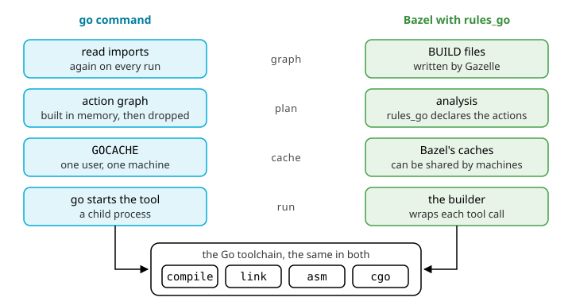

# 7. rules_go: where the designs meet

rules_go is the set of Bazel rules for Go. It replaces the half of the go command that decides
what to build and keeps the half that builds.

## Who does what



The go command reads imports to find the graph, plans an action graph in memory, looks each
action up in GOCACHE, its build cache, and starts the tool (Chapter 4). Under Bazel, each of
these steps changes hands. BUILD files declare the graph as targets (named things to build),
such as one `go_library` per package. Gazelle, a tool that generates BUILD files, writes them by
reading the same imports.[^gazelle] In Bazel's analysis phase, when it plans the build
(Chapter 6), rules_go's rules turn targets into actions, such as compiles and
links.[^rules-actions] Bazel's caches replace GOCACHE. What stays is the Go SDK (software
development kit: the Go distribution that rules_go downloads, Chapter 2) and its tools:
`compile`, `link`, `asm` (the assembler) and `cgo` (which lets Go call C).

**The standard library** has shipped without compiled archives since Go 1.20.[^go120] One
`GoStdlib` action compiles all of it from source for each configuration (a set of build settings,
such as the target platform or the race detector) that needs it.[^stdlib] Inside the action it runs
the go command itself, `go install std`, with a cache that it deletes afterwards.[^stdlib-go]
rules_go first resets every Go setting that cannot change the standard library, so that most targets
share one copy.[^stdlib-reset]

**The builder** is a Go program in rules_go that most Go actions run, with one subcommand per job:
`compilepkg`, `link`, `stdlib`, `nogo` and a few more. A compile needs work around the compiler:
filter the sources by build constraints (`//go:build` lines),[^builder-filter] check that every
import is a declared dependency ("missing strict dependencies" otherwise),[^builder-strict] write
the configuration files the compiler reads, run cgo and the assembler, and add their object files
to the compiled package.[^builder-compile] The go command does this work in its own process
(Chapter 4). Under Bazel it must happen inside an action, and one program for most jobs "reduces
the number of inputs needed for each action".[^builder] Bazel builds the builder from source, with
`go build`, for the machine that runs the actions (the execution platform) rather than the
target.[^builder-exec]

## Two files per compile


Under the go command, a compile writes one archive (a `.a` file) holding two parts: the export
data, the summary of the package that its importers' compiles read, and the object code, the
machine code and data that the linker reads. An importer's cache key includes a hash of the whole
archive (Chapter 4). The compiler can split the parts: given `-linkobj`, it writes the object code
there and only the export data to `-o`. Its source says that in a distributed build "it can be more
efficient to split the output into two files".[^gc-linkobj] rules_go does exactly that,[^compilego]
as the example repository from Chapter 2 shows:

```
$ ar t bazel-bin/internal/greet/greet.a
_go_.o
$ ar t bazel-bin/internal/greet/greet.x
__.PKGDEF
$ bazel aquery 'mnemonic("GoCompilePkg", //cmd/hello:hello)' --output=text
  Inputs: [.../stdlib_/pkg, .../internal/greet/greet.x, .../builder, ...]
  Outputs: [.../cmd/hello/hello.a, ..., .../cmd/hello/hello.x]
```

A compile reads its sources, the standard library (built as whole archives) and the `.x` of
each direct dependency.[^compile-inputs] A package's `.a` goes only to links.[^link-inputs]
Bazel's action cache compares the contents of an action's inputs (Chapter 6), so an edit that
leaves `core.x` unchanged does not reach `core`'s importers.


The top half of Figure 7.3 is the edit from Figure 4.3: a change to the body of a function that the
compiler does not inline (copy into its callers). `core.a` changes and `core.x` does not, so Bazel
finds every importer's compile in its action cache (its record of actions already run) and runs
only `core`'s compile and the links. The go command recompiles every direct importer.

The `.x` holds more than the API (the package's exported names and their types), though. It
records the file, line and column of each declaration it describes,[^export-pos] the bodies of
functions small enough to inline,[^export-inline] and whether each function's arguments may
outlive the call (escape to the heap).[^export-ext] So the edits that reach every direct
importer include a change to the API, a change to an inlinable body, a body edit that changes
what escapes, and anything that moves a described declaration to another line or column, such
as a comment line above it (bottom half). A comment at the end of a line moves nothing. An
importer's own `.x` copies every declaration and inlined body of `core` that its API or
inlinable functions use, positions included,[^export-reloc] so an edit to one of those reaches
the next level too.

The go command takes these edits one level further still. A package's object code records a
fingerprint, a hash of the export data, of every package it imports,[^go-fingerprint] so the
direct importers' archives change and their own importers recompile. Under Bazel the importers'
`.a` files change too, but their `.x` files change only if they copy what changed. In our
measurements none did: the synthetic packages use `core` only inside a function too large to
inline.[^bench]

On the 1,000-package synthetic repository (Appendix A):

| Edit to `core` | go command | Bazel |
|---|---|---|
| Body of a function that is not inlined | 299 compiles, 10 links | 1 compile, 10 links |
| A new exported function | 712 compiles, 10 links | 299 compiles, 10 links |
| A comment line above its exported types | 712 compiles, 10 links | 299 compiles, 10 links |

Both build only the packages the binaries need, which include 298 of `core`'s 332 direct
importers.

## From library to binary and test


A target passes data to the targets that depend on it in providers: structs that its rule returns
and its dependents' rules read during analysis. For its package, a `go_library` provides the `.a`,
the `.x` and the nogo facts file (below); from its dependencies it gathers every `.a` below it, for
the link.[^providers]

`go_test` builds three packages, as `go test` does for a package with external
tests.[^go-test] The first is the library compiled with its in-package test files. The second is
the external test package, the files that declare `package greet_test` and import the library
together with its in-package test files. The third is a main package that the builder generates,
which imports both and runs the tests. One link joins them into the test binary.

`go_binary` and `go_test` also set the configuration. Their `goos`, `goarch`, `race` and `pure` (no
cgo) attributes are applied by a transition: a rule's change to the configuration of itself and
everything it depends on. `go_library` has none,[^transition] so a library is compiled once for
each configuration that some binary or test asks for, as is the standard library.

nogo, rules_go's counterpart to `go vet`, runs the same kind of checks, called analyzers, as part
of the build. Once a `nogo` target is configured (the default analyzes nothing),[^nogo-default]
each package gets a `RunNogo` action, separate from its compile, that reads the same `.x`
files.[^nogo] Analyzers may record facts, conclusions about a package that the analysis of its
importers can use.[^analysis-facts] Each `RunNogo` writes a facts file and reads those of its
direct dependencies, so facts flow along the same edges as export data.[^nogo-facts] A separate
`ValidateNogo` action fails the build on findings.[^nogo-validate]

`go_binary` and `go_test` run their link in an exec group, a named set of a rule's actions that
Bazel may send to a different kind of machine.[^exec-groups] The group is `go_link`,[^go-link] so
`exec_properties` (settings that Bazel passes to whatever runs an action) with keys prefixed
`go_link.` can send links, whose memory grows with the binary (Chapter 5), to machines of their
own. Compiles stay in the default group. rules_go passes no `-c` and declares no resources, so
Bazel counts a compile as one CPU (one core) while the compiler may use every core
(Chapter 5).[^compilego][^bazel-cpu]

## What this means at scale

- A body edit that keeps a function too large to inline, moves no declaration and does not
  change what escapes, recompiles one package however widely it is imported: 1 compile against
  the go command's 299 in our measurements.
- Under Bazel, in a widely imported package, a comment that moves exported declarations costs
  as much as an API change, and so does an edit to an inlinable body the `.x` holds: every
  direct importer recompiles (299 compiles in our measurements), and so do the importers of
  every package whose `.x` copies what changed.
- Every binary that contains a changed package still relinks: 10 links in every row above. We
  recommend routing links through `go_link` to machines sized for them.
- Each new combination of `goos`, `goarch`, `race` and `pure` adds a standard library build and
  another compile of every library beneath it.

## References

[^gazelle]: Gazelle, `how-gazelle-works.md`, "Overview": load, generate, resolve (map imports
    to labels in `deps`), write.
    <https://github.com/bazel-contrib/bazel-gazelle/blob/v0.54.0/how-gazelle-works.md#overview>

[^rules-actions]: rules_go, `go/private/actions/compilepkg.bzl`, `emit_compilepkg`, and
    `go/private/actions/link.bzl`, `emit_link`: the `GoCompilePkg` and `GoLink` actions.
    <https://github.com/bazel-contrib/rules_go/blob/v0.65.0/go/private/actions/compilepkg.bzl#L201-L210>
    <https://github.com/bazel-contrib/rules_go/blob/v0.65.0/go/private/actions/link.bzl#L229-L238>

[^go120]: Go 1.20 release notes, "Go command": "The directory `$GOROOT/pkg` no longer stores
    pre-compiled package archives for the standard library". <https://go.dev/doc/go1.20#go-command>

[^stdlib]: rules_go, `go/private/actions/stdlib.bzl`, `emit_stdlib`, which always calls
    `_build_stdlib`, and `_build_stdlib`, the `GoStdlib` action over `std` (plus `runtime/cgo`
    and two `cmd/internal` packages).
    <https://github.com/bazel-contrib/rules_go/blob/v0.65.0/go/private/actions/stdlib.bzl#L36-L47>
    <https://github.com/bazel-contrib/rules_go/blob/v0.65.0/go/private/actions/stdlib.bzl#L111-L154>

[^stdlib-go]: rules_go, `go/tools/builders/stdlib.go`, `stdlib`: a temporary `GOCACHE`, removed
    on return, and `go install` with `-toolexec`.
    <https://github.com/bazel-contrib/rules_go/blob/v0.65.0/go/tools/builders/stdlib.go#L73-L76>
    <https://github.com/bazel-contrib/rules_go/blob/v0.65.0/go/tools/builders/stdlib.go#L123>

[^stdlib-reset]: rules_go, `go/private/rules/transition.bzl`, `_go_stdlib_transition_impl`,
    applied by the `stdlib` rule in `go/private/rules/stdlib.bzl`.
    <https://github.com/bazel-contrib/rules_go/blob/v0.65.0/go/private/rules/transition.bzl#L270-L284>
    <https://github.com/bazel-contrib/rules_go/blob/v0.65.0/go/private/rules/stdlib.bzl#L33-L35>

[^builder-filter]: rules_go, `go/tools/builders/filter.go`, `filterAndSplitFiles`.
    <https://github.com/bazel-contrib/rules_go/blob/v0.65.0/go/tools/builders/filter.go#L69-L71>

[^builder-strict]: rules_go, `go/tools/builders/importcfg.go`, `checkImports` and
    `depsError.Error`.
    <https://github.com/bazel-contrib/rules_go/blob/v0.65.0/go/tools/builders/importcfg.go#L34-L39>
    <https://github.com/bazel-contrib/rules_go/blob/v0.65.0/go/tools/builders/importcfg.go#L229-L231>

[^builder-compile]: rules_go, `go/tools/builders/compilepkg.go`, `compileArchive`: cgo, the
    import and embed configuration, assembly, the compile and the pack step.
    <https://github.com/bazel-contrib/rules_go/blob/v0.65.0/go/tools/builders/compilepkg.go#L341-L364>
    <https://github.com/bazel-contrib/rules_go/blob/v0.65.0/go/tools/builders/compilepkg.go#L391-L453>
    <https://github.com/bazel-contrib/rules_go/blob/v0.65.0/go/tools/builders/compilepkg.go#L457-L482>
    <https://github.com/bazel-contrib/rules_go/blob/v0.65.0/go/tools/builders/compilepkg.go#L488-L494>

[^builder]: rules_go, `go/tools/builders/builder.go`, the package comment and the subcommands
    in `main`.
    <https://github.com/bazel-contrib/rules_go/blob/v0.65.0/go/tools/builders/builder.go#L15-L18>
    <https://github.com/bazel-contrib/rules_go/blob/v0.65.0/go/tools/builders/builder.go#L49-L76>

[^builder-exec]: rules_go, `go/private/go_toolchain.bzl`, the `builder` attribute with
    `cfg = "exec"`; `go/private/sdk_build_defs.bzl`, which declares the builder as a
    `go_tool_binary`; `go/private/rules/binary_wrapper.sh`, which that rule runs:
    `go build -trimpath`.
    <https://github.com/bazel-contrib/rules_go/blob/v0.65.0/go/private/go_toolchain.bzl#L62-L64>
    <https://github.com/bazel-contrib/rules_go/blob/v0.65.0/go/private/sdk_build_defs.bzl#L65-L67>
    <https://github.com/bazel-contrib/rules_go/blob/v0.65.0/go/private/rules/binary_wrapper.sh#L18-L23>

[^gc-linkobj]: Go, `cmd/compile/internal/gc/obj.go`, the comment above `modeCompilerObj` and
    `dumpobj`.
    <https://github.com/golang/go/blob/go1.27.3/src/cmd/compile/internal/gc/obj.go#L26-L51>

[^compilego]: rules_go, `go/tools/builders/compilepkg.go`, `compileGo`: `-o` for the export
    data, `-linkobj` for the object code, and no `-c`; `go/private/actions/compilepkg.bzl`, the
    `GoCompilePkg` action, which sets no resource set.
    <https://github.com/bazel-contrib/rules_go/blob/v0.65.0/go/tools/builders/compilepkg.go#L560-L585>
    <https://github.com/bazel-contrib/rules_go/blob/v0.65.0/go/private/actions/compilepkg.bzl#L201-L210>

[^compile-inputs]: rules_go, `go/private/actions/compilepkg.bzl`, `emit_compilepkg`: the
    `export_file` of each direct dependency and the standard library; `_archive`, which passes
    the `.x` path to the builder.
    <https://github.com/bazel-contrib/rules_go/blob/v0.65.0/go/private/actions/compilepkg.bzl#L100-L103>
    <https://github.com/bazel-contrib/rules_go/blob/v0.65.0/go/private/actions/compilepkg.bzl#L22-L29>

[^link-inputs]: rules_go, `go/private/actions/link.bzl`, `emit_link`: `archive.libs`, the `.a`
    of every package in the binary.
    <https://github.com/bazel-contrib/rules_go/blob/v0.65.0/go/private/actions/link.bzl#L212-L227>

[^export-pos]: Go, `cmd/compile/internal/noder/writer.go`, `pos`, called for each object in
    `doObj`.
    <https://github.com/golang/go/blob/go1.27.3/src/cmd/compile/internal/noder/writer.go#L391-L404>
    <https://github.com/golang/go/blob/go1.27.3/src/cmd/compile/internal/noder/writer.go#L848-L958>

[^export-inline]: Go, `cmd/compile/internal/noder/linker.go`, `exportBody`: a body is exported
    if the function is inlinable and declared in, or inlined into, the package.
    <https://github.com/golang/go/blob/go1.27.3/src/cmd/compile/internal/noder/linker.go#L214-L251>

[^export-ext]: Go, `cmd/compile/internal/noder/linker.go`, `relocFuncExt`: the escape-analysis
    tag of each parameter and the inlining cost of each inlinable function.
    <https://github.com/golang/go/blob/go1.27.3/src/cmd/compile/internal/noder/linker.go#L296-L307>

[^export-reloc]: Go, `cmd/compile/internal/noder/linker.go`, the `linker` comment ("a single,
    self-contained export data file") and `relocObj`, which copies an imported object's
    definition and calls `exportBody`.
    <https://github.com/golang/go/blob/go1.27.3/src/cmd/compile/internal/noder/linker.go#L36-L38>
    <https://github.com/golang/go/blob/go1.27.3/src/cmd/compile/internal/noder/linker.go#L137-L212>

[^go-fingerprint]: Go, `internal/pkgbits/encoder.go`, `DumpTo`, which hashes the export data and
    appends the hash as its fingerprint; `cmd/compile/internal/noder/unified.go`,
    `writeUnifiedExport`; `noder/import.go`, `addFingerprint`; `cmd/internal/goobj/objfile.go`,
    the `Autolib` table of imported packages and their fingerprints.
    <https://github.com/golang/go/blob/go1.27.3/src/internal/pkgbits/encoder.go#L57-L59>
    <https://github.com/golang/go/blob/go1.27.3/src/internal/pkgbits/encoder.go#L102-L105>
    <https://github.com/golang/go/blob/go1.27.3/src/cmd/compile/internal/noder/unified.go#L578>
    <https://github.com/golang/go/blob/go1.27.3/src/cmd/compile/internal/noder/import.go#L285-L297>
    <https://github.com/golang/go/blob/go1.27.3/src/cmd/internal/goobj/objfile.go#L42-L45>

[^bench]: This book's measurements, `examples/bench/results/2026-11-16/results.jsonl`:
    configuration `n1000`, scenarios `core-body`, `core-api` and `core-comment`, three runs
    each with identical counts. For the go command, its `compile` and `link` processes. For
    Bazel, its sandboxed processes: 11 for the body edit (one `GoCompilePkg` and ten `GoLink` in
    `n1000-bazel-core-body.profile.gz`), and 309 for the other two, which is `core`, the 298
    direct importers built and the ten links. Bazel's `action cache hit` counts match the grey
    boxes in Figure 7.3: 298 for the body edit, the number of `core`'s direct importers built,
    and 413 for the comment, the number of packages built two levels above `core`, counted from
    `n1000-go-cold-actiongraph.json.gz`. `go build -o <dir>` builds only main packages and their
    dependencies (`cmd/go/internal/work/build.go`), and Bazel builds the same main packages
    (`build_targets.txt`, written by `examples/bench/gen.go`, `Repo.write`). The
    generated packages call their imports only inside `Compute`, which is too large to inline,
    and declare their own types (`examples/bench/gen.go`, `writePkg`).
    [results.jsonl](../examples/bench/results/2026-11-16/results.jsonl)
    [n1000-go-cold-actiongraph.json.gz](../examples/bench/results/2026-11-16/n1000-go-cold-actiongraph.json.gz)
    [gen.go](../examples/bench/gen.go)
    <https://github.com/golang/go/blob/go1.27.3/src/cmd/go/internal/work/build.go#L510-L531>

[^providers]: rules_go, `go/private/providers.bzl`, `GoInfo`, `GoArchiveData` and `GoArchive`;
    `go/private/actions/archive.bzl`, the fields `file`, `export_file`, `facts_file`, `libs` and
    `transitive`.
    <https://github.com/bazel-contrib/rules_go/blob/v0.65.0/go/private/providers.bzl#L15-L43>
    <https://github.com/bazel-contrib/rules_go/blob/v0.65.0/go/private/actions/archive.bzl#L210-L213>
    <https://github.com/bazel-contrib/rules_go/blob/v0.65.0/go/private/actions/archive.bzl#L235-L240>

[^go-test]: rules_go, `go/private/rules/test.bzl`, `_go_test_impl`: the internal and external
    archives, `GoTestGenTest`, and the compile and link of the test main; the docstring of
    `_recompile_external_deps`: "go_test, like 'go test', splits tests into two separate
    archives". Go, `cmd/go/internal/load/test.go`, `TestPackagesAndErrors`, which builds the
    external test package only if there are files that declare it (`XTestGoFiles`).
    <https://github.com/bazel-contrib/rules_go/blob/v0.65.0/go/private/rules/test.bzl#L548-L550>
    <https://github.com/bazel-contrib/rules_go/blob/v0.65.0/go/private/rules/test.bzl#L77-L105>
    <https://github.com/bazel-contrib/rules_go/blob/v0.65.0/go/private/rules/test.bzl#L143-L152>
    <https://github.com/bazel-contrib/rules_go/blob/v0.65.0/go/private/rules/test.bzl#L171-L198>
    <https://github.com/golang/go/blob/go1.27.3/src/cmd/go/internal/load/test.go#L264-L265>

[^transition]: rules_go, `go/private/rules/transition.bzl`, `_go_transition_impl`, attached to
    `go_binary` and `go_test` as `cfg`; `go/private/rules/library.bzl`, `go_library`, which sets
    no `cfg`.
    <https://github.com/bazel-contrib/rules_go/blob/v0.65.0/go/private/rules/transition.bzl#L78-L124>
    <https://github.com/bazel-contrib/rules_go/blob/v0.65.0/go/private/rules/binary.bzl#L262>
    <https://github.com/bazel-contrib/rules_go/blob/v0.65.0/go/private/rules/test.bzl#L242>
    <https://github.com/bazel-contrib/rules_go/blob/v0.65.0/go/private/rules/library.bzl#L81-L83>

[^nogo-default]: rules_go, `BUILD.bazel`, `default_nogo`: "does not analyze anything, which
    means no binary is built or run".
    <https://github.com/bazel-contrib/rules_go/blob/v0.65.0/BUILD.bazel#L45-L51>

[^nogo]: rules_go, `go/nogo.rst`, introduction ("the same analyses as vet");
    `go/private/actions/compilepkg.bzl`, `_run_nogo`: the `RunNogo` action and its inputs.
    <https://github.com/bazel-contrib/rules_go/blob/v0.65.0/go/nogo.rst?plain=1#L30-L32>
    <https://github.com/bazel-contrib/rules_go/blob/v0.65.0/go/private/actions/compilepkg.bzl#L226-L283>

[^analysis-facts]: `golang.org/x/tools/go/analysis`, package documentation, "Modular analysis
    with Facts". <https://pkg.go.dev/golang.org/x/tools/go/analysis#hdr-Modular_analysis_with_Facts>

[^nogo-facts]: rules_go, `go/private/actions/compilepkg.bzl`, the `-facts` arguments of
    `_run_nogo`; `go/tools/builders/nogo_main.go`, which writes the facts file.
    <https://github.com/bazel-contrib/rules_go/blob/v0.65.0/go/private/actions/compilepkg.bzl#L241-L252>
    <https://github.com/bazel-contrib/rules_go/blob/v0.65.0/go/tools/builders/nogo_main.go#L100-L110>

[^nogo-validate]: rules_go, `go/private/actions/compilepkg.bzl`, the `ValidateNogo` action.
    <https://github.com/bazel-contrib/rules_go/blob/v0.65.0/go/private/actions/compilepkg.bzl#L285-L303>

[^exec-groups]: Bazel, "Execution Groups", section "Using execution groups to set execution
    properties". <https://bazel.build/extending/exec-groups#using-exec-groups-for-exec-properties>

[^go-link]: rules_go, `go/private/rules/binary.bzl` and `go/private/rules/test.bzl`, the
    `go_link` exec group and the `link_exec_group` passed to the link;
    `go/private/actions/link.bzl`, where `GoLink` uses it.
    <https://github.com/bazel-contrib/rules_go/blob/v0.65.0/go/private/rules/binary.bzl#L507-L511>
    <https://github.com/bazel-contrib/rules_go/blob/v0.65.0/go/private/rules/binary.bzl#L179>
    <https://github.com/bazel-contrib/rules_go/blob/v0.65.0/go/private/rules/test.bzl#L499-L503>
    <https://github.com/bazel-contrib/rules_go/blob/v0.65.0/go/private/rules/test.bzl#L197>
    <https://github.com/bazel-contrib/rules_go/blob/v0.65.0/go/private/actions/link.bzl#L237>

[^bazel-cpu]: Bazel, `AbstractAction.java`, `DEFAULT_RESOURCE_SET`: 250 MB and 1 CPU;
    `SpawnAction.java`, `Builder`, which starts from it; `StarlarkActionFactory.java`,
    `registerStarlarkAction`, which replaces it only when a rule passes `resource_set`.
    <https://github.com/bazelbuild/bazel/blob/9.3.2/src/main/java/com/google/devtools/build/lib/actions/AbstractAction.java#L70-L78>
    <https://github.com/bazelbuild/bazel/blob/9.3.2/src/main/java/com/google/devtools/build/lib/analysis/actions/SpawnAction.java#L623>
    <https://github.com/bazelbuild/bazel/blob/9.3.2/src/main/java/com/google/devtools/build/lib/analysis/starlark/StarlarkActionFactory.java#L845-L854>
