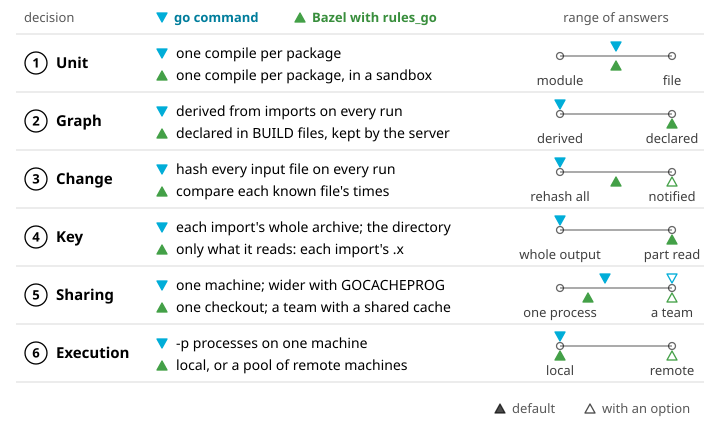
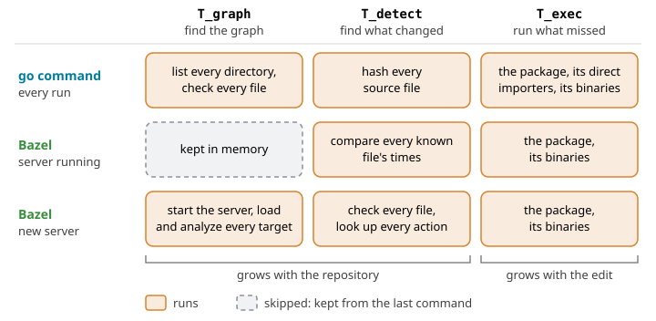

# 8. The designs side by side

This chapter sets the go command's answer to each of Chapter 1's six decisions beside that of
Bazel with rules_go (Bazel's rules for Go): why each chose as it did, and what the choice costs
as the repository grows.

## Six decisions, two answers

An action is one run of one tool, such as a compile; its key hashes everything that can change
its output.

### 1. Unit

Both run one compile per package, the compiler's unit, and one link per
binary.[^go-compile][^go-compileaction][^rules-go-actions] Bazel adds a fixed cost to every
action: it starts rules_go's builder, a program that wraps the compiler,[^rules-go-builder] in a
sandbox, a directory holding only the declared inputs,[^bazel-sandboxing] and hashes inputs and
outputs for its action cache, its record of actions already run.[^bazel-action-cache] In our
view, the cost buys the isolation that remote machines and shared caches need, and weighs most
where packages are many and small.

### 2. Graph

The go command derives the graph from imports, as its goal of building from "the information
found in the source itself" requires.[^go-about] Every run lists every directory and checks
every file; since Go 1.19 it reparses only directories that changed.[^go-load][^go-modindex]
Bazel reads the graph from BUILD files, which list each package's sources and dependencies, and
keeps it in the memory of its server, a long-lived process behind each `bazel`
command.[^bazel-client-server] In our reading, it declares the graph because no one language's
imports describe a repository of many. The go command thus pays T_graph, the time to obtain the
graph, on every run; Bazel pays it after each server start, by loading the BUILD files and
analyzing them into actions, and maintains a second description: Gazelle, a tool that writes
BUILD files from the imports, must rerun whenever imports change, and continuous integration
(CI) must check that it did.[^gazelle][^gazelle-diff]

### 3. Change

Keeping no process between runs, the go command hashes every source file in the build
again.[^go-filehash] That needs no saved state but reads every byte. Bazel's server compares
each known file's timestamps and inode number (the file's identifier on disk) with the last
build's, without reading it, or, with `--watchfs`, asks the operating system what
changed.[^bazel-filestate][^bazel-watchfs] T_detect, the time to find what changed, thus grows
with the bytes of source under the go command, with the number of files under Bazel, and with
the change only under `--watchfs`.

### 4. Key

A go compile's key, its action ID, hashes the sources, flags and tools, the package's directory
unless `-trimpath` removes paths from the output, and each direct import's content ID: a hash of
that import's whole compiled archive, cheap to read because the archive stores
it.[^go-buildactionid][^go-actionid-dir][^go-buildid] But the archive holds both the export
data, the summary that importers' compiles read, and the object code that only links
read.[^go-archive] So a body edit to a function that the compiler does not inline (copy into its
callers) recompiles every direct importer, and an edit to the package's API, its exported names,
reaches two levels, because object code records a hash of each import's export
data.[^go-fingerprint]

rules_go splits the two, as the compiler's source suggests for "a distributed build setting":
object code to a `.a` file for links, export data to a `.x` file for
importers.[^gc-linkobj][^rules-go-compilego] Bazel keys an action by the contents of its
inputs,[^bazel-action-cache] and an importer reads only the `.x`,[^rules-go-compile-inputs] so
the same body edit stops at the edited package (Figure 7.3). The `.x` also records declaration
positions and inlinable bodies, so moving a declaration or editing a small function still
reaches every direct importer.[^go-export-pos][^go-export-inline]

Both relink every binary that contains a changed
package,[^go-linkactionid][^rules-go-link-inputs] but GOCACHE keeps no binary from `go build`
(since Go 1.24, only those of `go run` and `go tool`),[^go-noexe][^go124] while Bazel caches a
link like any other action.[^rules-go-actions][^bazel-remote-caching]

### 5. Sharing

GOCACHE, the go command's build cache, belongs to one user on one machine.[^go-defaultdir] Since
Go 1.24, `GOCACHEPROG` can hand it to a program that stores entries anywhere; the keys stay the
same, so without `-trimpath` a checkout at another path misses, and binaries are not
stored.[^go-cacheprog][^go-noexe-prog] Bazel runs every action in the execroot, a directory
under which all paths are relative, so its keys ignore where the checkout
lies.[^bazel-path-resolver] Its local action cache serves one checkout,[^bazel-output-dirs] but
a disk cache, a local directory, serves every checkout on a machine, and a remote cache a team,
links included.[^bazel-remote-caching] Environment variables and the platform, the kind of
machine that runs the action, enter the key and must match.[^bazel-reapi][^bazel-cache-issues]
In our reading, the go command was built for one machine, Bazel for many.

### 6. Execution

The go command runs every action as a child process on one machine, `-p` at a time, by default
one per CPU core,[^go-do] and rations the compiler's back-end workers (`-c`) among the compiles
running at once.[^go-tokens] One machine's cores then bound T_exec, the time to run the actions
that missed the cache. Bazel runs actions locally by default; with remote execution it sends
them to a pool of machines, uploading the inputs they lack,[^bazel-reapi-exec] so the pool
bounds parallelism. That adds T_transfer, the time to move bytes, which Build without the Bytes
(default since Bazel 7.0) limits by downloading only the outputs asked for on the command line
and those local actions need.[^bazel-bwob]

## End to end

Table 8.1: Wall time in seconds, at 1,000 and 3,000 packages.[^bench]

<!--
Fill from examples/bench/results/2026-11-16/results.jsonl, configs n1000 and n3000.
Row                         go scenario       bazel scenario
Cold build                  cold              cold
No-op build                 noop (reps 0-2)   noop (reps 0-2; rep 3 only re-warms the server)
Body edit to core           core-body         core-body
API edit to core            core-api          core-api
Test after the body edit    test-core-body    test-core-body
Fresh checkout, warm cache  clone-warmcache   clone-diskcache
go clone-warmcache has no -trimpath; clone-warmcache-trimpath is the same build with it.
-->

| Scenario | go, 1,000 | Bazel, 1,000 | go, 3,000 | Bazel, 3,000 |
|---|---|---|---|---|
| Cold build | TBD | TBD | TBD | TBD |
| No-op build | TBD | TBD | TBD | TBD |
| Body edit to `core` | TBD | TBD | TBD | TBD |
| API edit to `core` | TBD | TBD | TBD | TBD |
| Test after the body edit | TBD | TBD | TBD | TBD |
| Fresh checkout, warm cache | TBD | TBD | TBD | TBD |

The repository is Chapter 5's synthetic one, `core` its most widely imported package, and the
builds are `go build -o <dir> ./...` and `bazel build` of the same binaries:

- **Cold build:** both compile everything, the standard library
  included.[^go-no-prebuilt-std][^rules-go-stdlib] Bazel also starts its server, loads,
  analyzes, builds rules_go's builder,[^rules-go-builder-exec] and pays its cost per action.
- **No-op build:** the go command loads and hashes the whole tree; Bazel's running server
  compares file times.
- **Edits to `core`:** after a body or an API edit, the go command recompiles one level of
  importers more than Bazel; both relink.
- **Test after the body edit:** both rerun every test whose binary contains `core`, since each
  keys a test result by its binary.[^go-testcache][^bazel-cache-tests] In our view, the `.x`
  saves compiles here, not links or test runs.
- **Fresh checkout:** a copy at another path, given the first build's cache. Without
  `-trimpath`, the action ID of every package in the checkout changes with its directory.
  Bazel's keys match, but its new server must load and analyze first.

## Where each stops scaling

In our analysis, the go command stops scaling where a run's work grows with the repository
rather than the change: every invocation pays T_graph and T_detect over the whole tree (Figure
8.2). Its cache ends at one machine unless `GOCACHEPROG` and `-trimpath` extend it, and binaries
are relinked on every machine. Generated code and other languages stay outside the graph and
uncached: the go command builds only Go and never runs `go generate`
itself.[^go-about][^go-generate]

Bazel, in our analysis, stops scaling where its fixed costs grow with the graph. Server memory
grows with the graph; a heap too small fails the build, and the flags that save memory slow
incremental builds.[^bazel-client-server][^bazel-memory] Every server start, as on each new CI
runner, repeats loading and analysis,[^bazel-cache-issues] and, as Chapter 2's restart shows,
checks every action against the action cache again. Per-action costs multiply with the actions.
And every import change must reach the BUILD files.

## What this means at scale

- Time a no-op build as the repository grows. If it grows with the tree, T_graph and T_detect
  are the limit; we expect a warm Bazel server with `--watchfs` to make both follow the change.
- Before sharing a cache across machines, make keys path-independent: `-trimpath` with
  `GOCACHEPROG`, or a matching environment and platform under Bazel. Only Bazel's shared cache
  holds links.
- Under the go command, any body edit to a widely imported package recompiles every direct
  importer; under Bazel, only edits to its API, declaration positions or inlinable bodies do.
  Under both, its binaries relink, so keep binaries small.
- Budget for Bazel's fixed costs: server memory, analysis per server start, a cost per action,
  BUILD files per import change. We recommend warm servers and a Gazelle check in CI (Chapter
  3).
- If generated code or other languages are a large share of the build, we expect only a declared
  graph to bring them into the cache.

## References

[^go-compile]: Go, `cmd/compile/doc.go`, package documentation.
    <https://github.com/golang/go/blob/go1.27.3/src/cmd/compile/doc.go#L6>
[^go-compileaction]: Go, `cmd/go/internal/work/action.go`, `CompileAction`.
    <https://github.com/golang/go/blob/go1.27.3/src/cmd/go/internal/work/action.go#L628>
[^rules-go-actions]: rules_go, `go/private/actions/compilepkg.bzl`, `emit_compilepkg`, and
    `go/private/actions/link.bzl`, `emit_link`: the `GoCompilePkg` and `GoLink` actions.
    <https://github.com/bazel-contrib/rules_go/blob/v0.65.0/go/private/actions/compilepkg.bzl#L201-L210>
    <https://github.com/bazel-contrib/rules_go/blob/v0.65.0/go/private/actions/link.bzl#L229-L238>
[^rules-go-builder]: rules_go, `go/tools/builders/builder.go`, the package comment; the compile
    action's `executable` is the builder.
    <https://github.com/bazel-contrib/rules_go/blob/v0.65.0/go/tools/builders/builder.go#L15-L18>
    <https://github.com/bazel-contrib/rules_go/blob/v0.65.0/go/private/actions/compilepkg.bzl#L205>
[^bazel-sandboxing]: Bazel, "Sandboxing", section "Downsides to sandboxing";
    `lib/sandbox/SymlinkedSandboxedSpawn.java`.
    <https://bazel.build/docs/sandboxing#sandboxing_downsides>
    <https://github.com/bazelbuild/bazel/blob/9.3.2/src/main/java/com/google/devtools/build/lib/sandbox/SymlinkedSandboxedSpawn.java#L35-L39>
[^bazel-action-cache]: Bazel, `lib/actions/cache/ActionCache.java`, the interface comment and
    `Entry.Builder.computeDigest`: the action key and the contents of every input and output.
    <https://github.com/bazelbuild/bazel/blob/9.3.2/src/main/java/com/google/devtools/build/lib/actions/cache/ActionCache.java#L49-L58>
    <https://github.com/bazelbuild/bazel/blob/9.3.2/src/main/java/com/google/devtools/build/lib/actions/cache/ActionCache.java#L400-L418>
[^go-about]: Go, "About the go command", sections "Motivation" and "Configuration versus
    convention". <https://go.dev/doc/articles/go_command>
[^go-load]: Go, `cmd/go/internal/load/pkg.go`, `PackagesAndErrors`.
    <https://github.com/golang/go/blob/go1.27.3/src/cmd/go/internal/load/pkg.go#L2937>
[^go-modindex]: Go, `cmd/go/internal/load/pkg.go`, `loadPackageData`, which asks the module
    index first; `cmd/go/internal/modindex/read.go`, `dirHash` and `openIndexPackage`. Added in
    commit 5a1c5b8ae7, first released in Go 1.19.
    <https://github.com/golang/go/blob/go1.27.3/src/cmd/go/internal/load/pkg.go#L952>
    <https://github.com/golang/go/blob/go1.27.3/src/cmd/go/internal/modindex/read.go#L80-L119>
    <https://github.com/golang/go/blob/go1.27.3/src/cmd/go/internal/modindex/read.go#L218-L245>
    <https://go.googlesource.com/go/+/5a1c5b8ae7>
[^bazel-client-server]: Bazel, "Client/server implementation".
    <https://bazel.build/run/client-server>
[^gazelle]: Gazelle, `how-gazelle-works.md`, "Overview".
    <https://github.com/bazel-contrib/bazel-gazelle/blob/v0.54.0/how-gazelle-works.md#overview>
[^gazelle-diff]: Gazelle, `gazelle-reference.md`, `-mode`: diff mode prints what it would change.
    <https://github.com/bazel-contrib/bazel-gazelle/blob/v0.54.0/gazelle-reference.md?plain=1#L53-L59>
[^go-filehash]: Go, `cmd/go/internal/cache/hash.go`, `FileHash`: hashes the whole file and
    remembers the result in a map that lives as long as the process.
    <https://github.com/golang/go/blob/go1.27.3/src/cmd/go/internal/cache/hash.go#L140-L158>
[^bazel-filestate]: Bazel, `lib/actions/FileStateValue.java`,
    `createRegularFileStateValueFromPath`, and `lib/actions/FileContentsProxy.java`: file
    metadata stands in for contents unless the file system offers a fast digest.
    <https://github.com/bazelbuild/bazel/blob/9.3.2/src/main/java/com/google/devtools/build/lib/actions/FileStateValue.java#L137-L145>
    <https://github.com/bazelbuild/bazel/blob/9.3.2/src/main/java/com/google/devtools/build/lib/actions/FileContentsProxy.java#L20-L37>
[^bazel-watchfs]: Bazel, `lib/skyframe/LocalDiffAwareness.java`, the `--watchfs` option (default
    `false`) and `EVERYTHING_MODIFIED`, used when it is off; `lib/skyframe/SkyframeExecutor.java`,
    `handleDiffsWithMissingDiffInformation`, which then checks every known file.
    <https://github.com/bazelbuild/bazel/blob/9.3.2/src/main/java/com/google/devtools/build/lib/skyframe/LocalDiffAwareness.java#L51-L63>
    <https://github.com/bazelbuild/bazel/blob/9.3.2/src/main/java/com/google/devtools/build/lib/skyframe/LocalDiffAwareness.java#L118-L127>
    <https://github.com/bazelbuild/bazel/blob/9.3.2/src/main/java/com/google/devtools/build/lib/skyframe/SkyframeExecutor.java#L3943-L3958>
[^go-buildactionid]: Go, `cmd/go/internal/work/exec.go`, `buildActionID`: platform, compiler
    tool ID and flags, input files, and each dependency's content ID.
    <https://github.com/golang/go/blob/go1.27.3/src/cmd/go/internal/work/exec.go#L264-L442>
[^go-actionid-dir]: Go, `cmd/go/internal/work/exec.go`, `buildActionID`, the `dir` line.
    <https://github.com/golang/go/blob/go1.27.3/src/cmd/go/internal/work/exec.go#L275-L303>
[^go-buildid]: Go, `cmd/go/internal/work/buildid.go`, the "Build IDs" comment: the content ID
    is read "from the file with minimal I/O, instead of reading and hashing the entire file".
    <https://github.com/golang/go/blob/go1.27.3/src/cmd/go/internal/work/buildid.go#L26-L56>
[^go-archive]: Go, `cmd/compile/internal/gc/obj.go`, `dumpobj1`: the archive holds the export
    data (`__.PKGDEF`) and the object code (`_go_.o`).
    <https://github.com/golang/go/blob/go1.27.3/src/cmd/compile/internal/gc/obj.go#L53-L71>
[^go-fingerprint]: Go, `cmd/compile/internal/noder/unified.go`, where the fingerprint is the
    hash of the export data; `noder/import.go`, `addFingerprint`; `cmd/internal/goobj/objfile.go`,
    the `Autolib` table of imported packages and their fingerprints.
    <https://github.com/golang/go/blob/go1.27.3/src/cmd/compile/internal/noder/unified.go#L578>
    <https://github.com/golang/go/blob/go1.27.3/src/cmd/compile/internal/noder/import.go#L285-L297>
    <https://github.com/golang/go/blob/go1.27.3/src/cmd/internal/goobj/objfile.go#L42-L45>
[^gc-linkobj]: Go, `cmd/compile/internal/gc/obj.go`, the comment above `modeCompilerObj`.
    <https://github.com/golang/go/blob/go1.27.3/src/cmd/compile/internal/gc/obj.go#L26-L51>
[^rules-go-compilego]: rules_go, `go/tools/builders/compilepkg.go`, `compileGo`: `-o` for the
    export data, `-linkobj` for the object code.
    <https://github.com/bazel-contrib/rules_go/blob/v0.65.0/go/tools/builders/compilepkg.go#L560-L585>
[^rules-go-compile-inputs]: rules_go, `go/private/actions/compilepkg.bzl`, `emit_compilepkg`:
    the `export_file` of each direct dependency; `_archive`, which passes the `.x` path to the
    builder.
    <https://github.com/bazel-contrib/rules_go/blob/v0.65.0/go/private/actions/compilepkg.bzl#L100-L103>
    <https://github.com/bazel-contrib/rules_go/blob/v0.65.0/go/private/actions/compilepkg.bzl#L22-L29>
[^go-export-pos]: Go, `cmd/compile/internal/noder/writer.go`, `pos`, called for each object in
    `doObj`.
    <https://github.com/golang/go/blob/go1.27.3/src/cmd/compile/internal/noder/writer.go#L391-L404>
    <https://github.com/golang/go/blob/go1.27.3/src/cmd/compile/internal/noder/writer.go#L848-L859>
[^go-export-inline]: Go, `cmd/compile/internal/noder/linker.go`, `exportBody`: a body is
    exported if the function is inlinable.
    <https://github.com/golang/go/blob/go1.27.3/src/cmd/compile/internal/noder/linker.go#L214-L251>
[^go-linkactionid]: Go, `cmd/go/internal/work/exec.go`, `linkActionID`, the `packagefile`
    line. <https://github.com/golang/go/blob/go1.27.3/src/cmd/go/internal/work/exec.go#L1540-L1566>
[^rules-go-link-inputs]: rules_go, `go/private/actions/link.bzl`, `emit_link`: `archive.libs`,
    the `.a` of every package in the binary.
    <https://github.com/bazel-contrib/rules_go/blob/v0.65.0/go/private/actions/link.bzl#L212-L227>
[^go-noexe]: Go, `cmd/go/internal/work/buildid.go`, `updateBuildID`: "Executables are not
    cached by default".
    <https://github.com/golang/go/blob/go1.27.3/src/cmd/go/internal/work/buildid.go#L730-L742>
[^go124]: Go 1.24 release notes, "Go command" and "GOCACHEPROG"; commits 3ff868f2f5 (cache
    executables built for `go run`) and 83a7626687 (enable `GOCACHEPROG` by default).
    <https://go.dev/doc/go1.24> <https://go.googlesource.com/go/+/3ff868f2f5>
    <https://go.googlesource.com/go/+/83a7626687>
[^bazel-remote-caching]: Bazel, "Remote Caching", sections "Overview" (action outputs are what
    is cached) and "Disk cache" (shared across checkouts).
    <https://bazel.build/remote/caching#overview> <https://bazel.build/remote/caching#disk-cache>
[^go-defaultdir]: Go, `cmd/go/internal/cache/default.go`, `DefaultDir`.
    <https://github.com/golang/go/blob/go1.27.3/src/cmd/go/internal/cache/default.go#L74-L87>
[^go-cacheprog]: Go, `cmd/go/internal/cache/prog.go`, `ProgCache`; `cache/default.go`, where
    `GOCACHEPROG` replaces the disk cache.
    <https://github.com/golang/go/blob/go1.27.3/src/cmd/go/internal/cache/prog.go#L27-L31>
    <https://github.com/golang/go/blob/go1.27.3/src/cmd/go/internal/cache/default.go#L57-L59>
[^go-noexe-prog]: Go, `cmd/go/internal/work/buildid.go`, `updateBuildID`: a binary is stored
    only when the cache is the disk cache.
    <https://github.com/golang/go/blob/go1.27.3/src/cmd/go/internal/work/buildid.go#L756>
[^bazel-path-resolver]: Bazel, `lib/remote/common/RemotePathResolver.java`,
    `DefaultRemotePathResolver`: the execroot is the input root, and output paths are relative
    to it.
    <https://github.com/bazelbuild/bazel/blob/9.3.2/src/main/java/com/google/devtools/build/lib/remote/common/RemotePathResolver.java#L78-L114>
[^bazel-output-dirs]: Bazel, "Output Directory Layout", sections "Current layout" and "Layout
    diagram". <https://bazel.build/remote/output-directories#layout-diagram>
[^bazel-reapi]: Remote Execution API, `remote_execution.proto` as vendored in Bazel, messages
    `Action` (with the platform) and `Command` (with the environment variables).
    <https://github.com/bazelbuild/bazel/blob/9.3.2/third_party/remoteapis/build/bazel/remote/execution/v2/remote_execution.proto#L608-L673>
    <https://github.com/bazelbuild/bazel/blob/9.3.2/third_party/remoteapis/build/bazel/remote/execution/v2/remote_execution.proto#L683-L820>
[^bazel-cache-issues]: Bazel, "Remote Caching", section "Known issues": environment variables
    leaking into an action, and in-memory state lost when the server does not survive.
    <https://bazel.build/remote/caching#known-issues>
[^go-do]: Go, `cmd/go/internal/work/exec.go`, `Builder.Do`, which starts `-p` goroutines;
    `cmd/go/internal/cfg/cfg.go`, `BuildP`, which defaults to `GOMAXPROCS`.
    <https://github.com/golang/go/blob/go1.27.3/src/cmd/go/internal/work/exec.go#L223-L229>
    <https://github.com/golang/go/blob/go1.27.3/src/cmd/go/internal/cfg/cfg.go#L87>
[^go-tokens]: Go, `cmd/go/internal/work/gc.go`, `compilerConcurrency`.
    <https://github.com/golang/go/blob/go1.27.3/src/cmd/go/internal/work/gc.go#L184-L235>
[^bazel-reapi-exec]: Remote Execution API, `remote_execution.proto` as vendored in Bazel,
    services `Execution` (`Execute`) and `ContentAddressableStorage` (`FindMissingBlobs`).
    <https://github.com/bazelbuild/bazel/blob/9.3.2/third_party/remoteapis/build/bazel/remote/execution/v2/remote_execution.proto#L44-L53>
    <https://github.com/bazelbuild/bazel/blob/9.3.2/third_party/remoteapis/build/bazel/remote/execution/v2/remote_execution.proto#L350-L362>
[^bazel-bwob]: Bazel 7.0.0 release notes; `lib/remote/options/RemoteOptions.java`,
    `--remote_download_outputs`, default `toplevel`.
    <https://github.com/bazelbuild/bazel/releases/tag/7.0.0>
    <https://github.com/bazelbuild/bazel/blob/9.3.2/src/main/java/com/google/devtools/build/lib/remote/options/RemoteOptions.java#L519-L533>
[^bench]: This book's measurements, `examples/bench/results/2026-11-16/results.jsonl`,
    configurations `n1000` and `n3000`; Appendix A describes the repository and the harness.
    [results.jsonl](../examples/bench/results/2026-11-16/results.jsonl)
[^go-no-prebuilt-std]: Go, `cmd/go/internal/work/exec.go`, `buildActionID`: "we no longer ship
    precompiled archive files as of Go 1.20".
    <https://github.com/golang/go/blob/go1.27.3/src/cmd/go/internal/work/exec.go#L289-L292>
[^rules-go-stdlib]: rules_go, `go/private/actions/stdlib.bzl`, `emit_stdlib`, which always
    calls `_build_stdlib`.
    <https://github.com/bazel-contrib/rules_go/blob/v0.65.0/go/private/actions/stdlib.bzl#L36-L47>
[^rules-go-builder-exec]: rules_go, `go/private/go_toolchain.bzl`, the `builder` attribute with
    `cfg = "exec"`, built from source.
    <https://github.com/bazel-contrib/rules_go/blob/v0.65.0/go/private/go_toolchain.bzl#L62-L64>
[^go-testcache]: Go, `cmd/go/internal/test/test.go`, `tryCacheWithID`: the test ID uses the
    link's inputs as a proxy for the test binary.
    <https://github.com/golang/go/blob/go1.27.3/src/cmd/go/internal/test/test.go#L1882-L1909>
[^bazel-cache-tests]: Bazel, `TestConfiguration.java`, the `cache_test_results` option: a test
    reruns when "Bazel detects changes in the test or its dependencies".
    <https://github.com/bazelbuild/bazel/blob/9.3.2/src/main/java/com/google/devtools/build/lib/analysis/test/TestConfiguration.java#L169-L183>
[^go-generate]: Go, `cmd/go/internal/generate/generate.go`: "Go generate is never run
    automatically by go build, go test, and so on."
    <https://github.com/golang/go/blob/go1.27.3/src/cmd/go/internal/generate/generate.go#L43-L44>
[^bazel-memory]: Bazel, "Optimize Memory", section "Trade incremental build speeds for memory".
    <https://bazel.build/advanced/performance/memory#trade-incremental>
