# 9. Optimizing a Bazel Go build

Chapter 1 split a build's time into finding the graph, finding changes, running actions and
moving bytes. This chapter lowers each in a Bazel Go build: measure which one dominates, keep
cache keys stable, put each kind of work on machines that suit it, and run fewer tests.

## Measure first

Bazel writes a JSON trace profile of every build into its output base (the directory that holds
a checkout's outputs and state), or to the file that `--profile` names. Opened in
`chrome://tracing`, its `Critical Path` row shows one block for each action on the critical
path, the longest chain of actions that each wait for the one before.[^profile] Bazel 9 removed
`analyze-profile`, the command that summarized a profile;[^analyze-profile] the file is plain
JSON, and the critical path is its events of category `critical path component`.[^profile-task]
Bazel merges short events unless `--noslim_profile` is set,[^profile-format] so count actions in
the execution log (next section), not in the profile.

Figure 9.1 draws the critical path from two profiles of the 1,000-package repository from
Chapter 5.[^bench] On a cold build, 23.6 s of its 30.4 s went to rules_go's own setup. One
action built the builder, the Go program that runs most of rules_go's actions (Chapter 7), with
`GOMAXPROCS=1`, so its `go build` commands compiled one package at a time.[^builder-env] Another
built the standard library for tools, programs that run during the build, here the repository's
code generator. Neither depends on the repository's code, so a shared cache can serve both to
every machine of the same platform after the first. After an edit to a function body in `core`,
3.2 s of the 3.3 s was one link.

Bazel's documentation suggests splitting a slow action that sits on the critical
path.[^profile-issues] For Go the smallest unit is a package: the compiler compiles one per run,
and Gazelle writes one `go_library` per directory (Chapter 7).[^gazelle-one] So the only finer
grain is a smaller package. A large package costs three ways: any edit recompiles all of it, its
compile is one long step on every chain through it, and every importer recompiles when any part
of its export data changes, even a part that importer does not use (Chapter 7). We recommend
splitting packages that the critical path names often and that many packages import.

## Keep keys stable

The execution log shows why an action ran. `--execution_log_compact_file` records each action
that ran or came from a disk or remote cache: its command line, environment, platform, the hash
of every input, its outputs and, with a disk or remote cache, its key.[^exec-log] Actions found
in the local action cache, Bazel's per-checkout record of actions already run, are left
out.[^spawn-proto] So Bazel's guide runs `bazel clean` before each of two builds, converts both
logs to text with its `execlog` parser, and diffs them.[^compare-logs] The input or setting that
differs is the cause (Figure 9.2). In a Go build it is usually one of these:

- **Stamping.** rules_go's `x_defs` sets string variables at link time, and a value can name a
  workspace status key, a fact about the checkout such as `{STABLE_GIT_COMMIT}`, which
  `--stamp`, off by default, fills in.[^stamp] `GoLink` then reads `stable-status.txt` if a
  value names a stable key and `volatile-status.txt` if it names any other.[^rg-stamp] The
  stable file always holds
  `BUILD_HOST` and `BUILD_USER`, so links that read it share no results across machines or
  users. Bazel's manual recommends `--nostamp` for caching.[^status] We recommend stamping only
  release builds.
- **Environment.** rules_go gives its actions their own environment, so neither the caller's
  `PATH` nor `--action_env` reaches its compiles and links.[^rg-env] A `genrule` takes the
  build's action environment.[^genrule-env] Since 9.0 that has a fixed `PATH`, but
  `--action_env=NAME` copies the caller's value into its key.[^strict-env]
- **Machine-dependent or nondeterministic outputs.** An action whose output records where or when
  it ran, through absolute paths, timestamps or build IDs, changes the key of every action that
  reads it.[^hermeticity] rules_go's compiles trim absolute paths, and its links replace the build
  ID with a hash of the binary.[^rg-determinism] A `genrule` that writes the date does not.
- **Execution properties.** The properties sent with an action (next section) are part of its
  remote key, so routing the same action to two pools gives two cache entries.[^reapi-platform]
- **Tools on the host.** Bazel does not track a tool found outside the workspace, such as a
  system C compiler used for cgo or external linking. Machines with different compilers then
  share results they should not.[^cache-issues] That is a wrong hit, not a miss (Chapter 1's
  "Key"), and no log shows it.

## Place work on machines

Chapter 5 sorts a Go build's work into four classes: compiles, links, test runs and the Bazel
server. Each wants a different machine. An **exec group** is a named set of a rule's actions that
may run on a different kind of machine. **Execution properties** (`exec_properties`) are
settings that Bazel sends with each action to the remote executors, the machines that run
actions remotely (Chapter 6), which use them to choose a machine. A property prefixed with a
group's name applies to that group only. Properties can be set on the execution platform, the
description of the machines that run actions, for every target, or on one target, which
wins.[^exec-groups] Which names the executors accept, such as a pool, is up to their
service.[^reapi-platform]

| Class | Actions | Exec group | Route with | Machine (our view) |
|---|---|---|---|---|
| Compile | `GoCompilePkg`, one per package | default | the platform's properties | many cores, modest memory |
| Link | `GoLink`, one per binary or test | `go_link`[^go-link] | `go_link.<name>` | memory and fast cores |
| Test run | `TestRunner`, one per test or shard | `test`[^test-group] | `test.<name>` | what the test needs, with a time limit |
| Server | the Bazel server | none | where `bazel` runs | memory for the graph, kept warm |

Bazel can also choose by mnemonic, the name of an action's kind: `--strategy=<mnemonic>=...`
lists where that kind may run, in order of preference.[^strategy]
`--modify_execution_info=GoLink=+no-remote-exec` keeps links local but lets them use the remote
cache; `no-remote` would bypass the cache too.[^exec-info] A local action needs its inputs on
local disk,[^bwob] which for a link is every archive in the binary. We recommend local links only
where the compiles also run locally.

**Dynamic execution** starts an action locally and remotely at once and keeps the first
result.[^dynamic] It suits actions so short that remote overhead dominates;[^dynamic-when] most
Go compiles take a fraction of a second (Chapter 5). We recommend trying
`--strategy=GoCompilePkg=dynamic` on developer machines and keeping it if the critical path
shrinks. In 9.3.2 the flag that adds the `dynamic`
strategy is on by default.[^dynamic-flag]

**CPU accounting.** Locally, Bazel starts an action only when its declared CPUs and memory fit;
a rule's action that declares none counts as one CPU and 250 MB.[^bazel-cpu] rules_go declares
none and passes no `-c`, so a compile's back end may run one thread per core (Chapter 7). Since
9.2, a `resources:cpu` entry in `exec_properties` or tags changes what Bazel books locally; in
`exec_properties` it also enters the remote key.[^resources] On Linux, Go caps `GOMAXPROCS`, and
with it the compiler's default `-c`, at the cgroup CPU limit (the kernel's limit on a
container's CPU),[^gomaxprocs] so an executor that limits each action's CPU also limits its
compiler.

**Bytes.** Under Build without the Bytes, the default since 7.0, Bazel downloads only top-level
outputs and the inputs of local actions. Since 9.3 it reruns the actions whose outputs the cache
evicted (Chapter 6). Bazel trims a disk cache, a local directory used as a remote cache, only if
`--experimental_disk_cache_gc_max_size` or `--experimental_disk_cache_gc_max_age` is set, and
only while the server is idle.[^disk-gc]

**The server.** Bazel sets no maximum heap,[^no-xmx] so Java takes a quarter of physical
memory.[^jvm-heap] We recommend measuring the heap (Chapter 6) and setting
`--host_jvm_args=-Xmx...` with headroom. A server restarts, losing its graph, when startup
options (those given before the command) change,[^startup] and a new server analyzes everything
before its first cache hit (Chapter 6). So keep startup options fixed and runners long-lived;
the server exits after `--max_idle_secs`, three hours by default.[^max-idle] Where memory is
short, `--discard_analysis_cache`, `--notrack_incremental_state` and `--nokeep_state_after_build`
trade incremental speed for memory,[^memory] and Bazel drops temporary state once the heap
retained after a collection passes `--skyframe_high_water_mark_threshold`, 85% by
default.[^high-water]

## Tests and the local loop

`bazel test` reruns a test only if the test or its dependencies changed, it failed last time,
it is marked `external`, or more than one run was asked for.[^cache-test] Other results come
from the cache, so testing `//...` on every change costs, beyond analysis, only the tests the
change reaches. `shard_count = N`
runs a test as N processes, possibly on N machines.[^test-sharding] rules_go's generated test
main gives each shard every N-th top-level `Test` function,[^rg-shard] so one slow function
cannot be split. `--test_sharding_strategy` defaults to `explicit`: only targets that set
`shard_count` shard.[^shard-strategy] We recommend sharding only packages with many slow test
functions.

On a laptop the server is warm and few actions rerun, so finding changes takes a large share
(Chapter 1). `--watchfs`, off by default, takes changes from the operating system instead of
checking every file.[^watchfs] gopls, Go's language server, asks Bazel about packages through
`GOPACKAGESDRIVER` (Chapter 2). Each request runs Bazel commands, and a server runs one command
at a time,[^client-server] so a long build delays the editor. `ibazel`, a separate tool, reruns a
build or test when a file changes.[^ibazel]

## What this means at scale

- Read the critical path before buying machines. A cold path dominated by rules_go's setup needs
  a shared cache; an incremental path dominated by links needs link machines with fast cores.
- When the hit rate drops, diff two execution logs. Stamp only release builds, and give every
  `--action_env` an explicit value.
- Route links through `go_link` and test runs through `test`. Keep routing identical for every
  build that shares a cache, because execution properties are part of the key.
- Set the server's heap explicitly, keep startup options fixed, and keep CI servers warm across
  jobs.
- Shard only tests with many slow test functions; caching handles the rest.

## References

[^profile]: Bazel, "JSON Trace Profile", introduction and "Profile information".
    <https://bazel.build/advanced/performance/json-trace-profile#profile-information>

[^analyze-profile]: Bazel, commit 0fd3ae4f, "Delete analyze-profile command" (2025-01-30); the
    command is present at 8.4.0 and absent at 9.3.2.
    <https://github.com/bazelbuild/bazel/commit/0fd3ae4f66e7fb0e1449d1a736693a00b78a3439>

[^profile-task]: Bazel, `lib/profiler/ProfilerTask.java`, `CRITICAL_PATH_COMPONENT`.
    <https://github.com/bazelbuild/bazel/blob/9.3.2/src/main/java/com/google/devtools/build/lib/profiler/ProfilerTask.java#L68>

[^profile-format]: Bazel, "JSON Trace Profile", "Profile file format";
    `lib/runtime/CommonCommandOptions.java`, `--slim_profile`, default `true`.
    <https://bazel.build/advanced/performance/json-trace-profile#profile-file-format>
    <https://github.com/bazelbuild/bazel/blob/9.3.2/src/main/java/com/google/devtools/build/lib/runtime/CommonCommandOptions.java#L315-L318>

[^bench]: This book's measurements, `examples/bench/results/2026-11-15/`, configuration `n1000`.
    `n1000-bazel-cold.profile.gz`: critical path 30.4 s, of which `GoToolchainBinaryBuild` 14.1 s
    and `GoStdlib ... [for tool]` 9.5 s; wall time 39.5 s (`results.jsonl`, scenario `cold`).
    `n1000-bazel-core-body.profile.gz`: critical path 3.3 s, of which `GoLink` 3.2 s. Bazel marks
    actions in the tool configuration with `[for tool]` (`lib/actions/AbstractAction.java`).
    [results.jsonl](../examples/bench/results/2026-11-15/results.jsonl)
    <https://github.com/bazelbuild/bazel/blob/9.3.2/src/main/java/com/google/devtools/build/lib/actions/AbstractAction.java#L381>

[^builder-env]: rules_go, `go/private/rules/binary.bzl`, the `GoToolchainBinaryBuild` action and
    its environment; Go, `cmd/go/internal/cfg/cfg.go`, where `-p` defaults to `GOMAXPROCS`.
    <https://github.com/bazel-contrib/rules_go/blob/v0.65.0/go/private/rules/binary.bzl#L617-L639>
    <https://github.com/golang/go/blob/go1.27.3/src/cmd/go/internal/cfg/cfg.go#L87>

[^profile-issues]: Bazel, "JSON Trace Profile", "Common performance issues".
    <https://bazel.build/advanced/performance/json-trace-profile#common-performance-issues>

[^gazelle-one]: Gazelle, `language/go/generate.go`, `GenerateRules` and `selectPackage`: one
    package, and one library, per directory.
    <https://github.com/bazel-contrib/bazel-gazelle/blob/v0.54.0/language/go/generate.go#L157-L160>
    <https://github.com/bazel-contrib/bazel-gazelle/blob/v0.54.0/language/go/generate.go#L460-L463>

[^exec-log]: Bazel, `lib/exec/ExecutionOptions.java`, `--execution_log_compact_file`;
    `src/main/protobuf/spawn.proto`, `SpawnExec`.
    <https://github.com/bazelbuild/bazel/blob/9.3.2/src/main/java/com/google/devtools/build/lib/exec/ExecutionOptions.java#L473-L488>
    <https://github.com/bazelbuild/bazel/blob/9.3.2/src/main/protobuf/spawn.proto#L129-L204>

[^spawn-proto]: Bazel, `src/main/protobuf/spawn.proto`, `SpawnExec.runner`: "spawns whose owning
    action hits the persistent action cache are never reported at all".
    <https://github.com/bazelbuild/bazel/blob/9.3.2/src/main/protobuf/spawn.proto#L163-L176>

[^compare-logs]: Bazel, "Debugging Remote Cache Hits for Remote Execution", "Ensure caching
    across machines" and "Comparing the execution logs".
    <https://bazel.build/remote/cache-remote#caching-across-machines>
    <https://bazel.build/remote/cache-remote#compare-logs>

[^stamp]: Bazel, `lib/analysis/config/CoreOptions.java`, `--stamp`, default `false`; rules_go,
    `docs/go/core/defines_and_stamping.md`.
    <https://github.com/bazelbuild/bazel/blob/9.3.2/src/main/java/com/google/devtools/build/lib/analysis/config/CoreOptions.java#L349-L355>
    <https://github.com/bazel-contrib/rules_go/blob/v0.65.0/docs/go/core/defines_and_stamping.md>

[^rg-stamp]: rules_go, `go/private/actions/link.bzl`, `emit_link`: `x_defs` and the status
    files as inputs.
    <https://github.com/bazel-contrib/rules_go/blob/v0.65.0/go/private/actions/link.bzl#L170-L192>
    <https://github.com/bazel-contrib/rules_go/blob/v0.65.0/go/private/actions/link.bzl#L212>

[^status]: Bazel, "Command-Line Reference" (user manual), "Workspace status" and `--[no]stamp`.
    <https://bazel.build/docs/user-manual#workspace-status>
    <https://bazel.build/docs/user-manual#stamp>

[^rg-env]: rules_go, `go/private/context.bzl`, the `env` of the Go context; `GoCompilePkg` and
    `GoLink` pass it as `env`. Bazel, `starlarkbuildapi/StarlarkActionFactoryApi.java`, `run`:
    only `use_default_shell_env`, default `False`, adds `--action_env`.
    <https://github.com/bazel-contrib/rules_go/blob/v0.65.0/go/private/context.bzl#L674-L702>
    <https://github.com/bazel-contrib/rules_go/blob/v0.65.0/go/private/actions/compilepkg.bzl#L207>
    <https://github.com/bazel-contrib/rules_go/blob/v0.65.0/go/private/actions/link.bzl#L235>
    <https://github.com/bazelbuild/bazel/blob/9.3.2/src/main/java/com/google/devtools/build/lib/starlarkbuildapi/StarlarkActionFactoryApi.java#L498-L508>

[^genrule-env]: Bazel, `lib/rules/genrule/GenRuleBase.java`, the `GenRuleAction` with the
    configuration's action environment.
    <https://github.com/bazelbuild/bazel/blob/9.3.2/src/main/java/com/google/devtools/build/lib/rules/genrule/GenRuleBase.java#L209-L217>

[^strict-env]: Bazel 9.0.0 release notes, flipped flags; `lib/bazel/rules/BazelRuleClassProvider.java`,
    `--incompatible_strict_action_env`, default `true`, and its help text on `--action_env`.
    <https://github.com/bazelbuild/bazel/releases/tag/9.0.0>
    <https://github.com/bazelbuild/bazel/blob/9.3.2/src/main/java/com/google/devtools/build/lib/bazel/rules/BazelRuleClassProvider.java#L73-L87>

[^hermeticity]: Bazel, "Hermeticity", "Identifying non-hermeticity".
    <https://bazel.build/basics/hermeticity#nonhermeticity>

[^rg-determinism]: rules_go, `go/tools/builders/compilepkg.go`, `compileArchive`, the
    `-trimpath` rewrite; `go/tools/builders/link.go` and `buildid.go`, `setContentBuildID`.
    <https://github.com/bazel-contrib/rules_go/blob/v0.65.0/go/tools/builders/compilepkg.go#L332-L336>
    <https://github.com/bazel-contrib/rules_go/blob/v0.65.0/go/tools/builders/link.go#L184-L189>
    <https://github.com/bazel-contrib/rules_go/blob/v0.65.0/go/tools/builders/buildid.go#L67-L72>

[^reapi-platform]: Remote Execution API, `remote_execution.proto` as vendored in Bazel,
    `Platform`: the server names the properties it accepts, and "the platform is implicitly part
    of the action digest".
    <https://github.com/bazelbuild/bazel/blob/9.3.2/third_party/remoteapis/build/bazel/remote/execution/v2/remote_execution.proto#L868-L890>

[^cache-issues]: Bazel, "Remote Caching", "Known issues": "Bazel does not track tools outside a
    workspace". <https://bazel.build/remote/caching#known-issues>

[^exec-groups]: Bazel, "Execution Groups", "Using execution groups to set execution properties"
    and "Execution groups and platform execution properties".
    <https://bazel.build/extending/exec-groups#using-exec-groups-for-exec-properties>
    <https://bazel.build/extending/exec-groups#platform-execution-properties>

[^go-link]: rules_go, `go/private/rules/binary.bzl` and `go/private/rules/test.bzl`, the
    `go_link` exec group; `go/private/actions/link.bzl`, where `GoLink` uses it.
    <https://github.com/bazel-contrib/rules_go/blob/v0.65.0/go/private/rules/binary.bzl#L507-L511>
    <https://github.com/bazel-contrib/rules_go/blob/v0.65.0/go/private/rules/test.bzl#L499-L503>
    <https://github.com/bazel-contrib/rules_go/blob/v0.65.0/go/private/actions/link.bzl#L237>

[^test-group]: Bazel, `lib/analysis/starlark/StarlarkRuleClassFunctions.java`, which gives every
    test rule the `test` exec group; `lib/analysis/test/TestActionBuilder.java`,
    `getTestExecGroupName`; `lib/analysis/test/TestRunnerAction.java`, the mnemonic.
    <https://github.com/bazelbuild/bazel/blob/9.3.2/src/main/java/com/google/devtools/build/lib/analysis/starlark/StarlarkRuleClassFunctions.java#L1078-L1082>
    <https://github.com/bazelbuild/bazel/blob/9.3.2/src/main/java/com/google/devtools/build/lib/analysis/test/TestActionBuilder.java#L151-L155>
    <https://github.com/bazelbuild/bazel/blob/9.3.2/src/main/java/com/google/devtools/build/lib/analysis/test/TestRunnerAction.java#L112>

[^strategy]: Bazel, "Command-Line Reference" (user manual), `--strategy mnemonic=strategy`;
    `lib/exec/ExecutionOptions.java`, `--strategy`.
    <https://bazel.build/docs/user-manual#strategy>
    <https://github.com/bazelbuild/bazel/blob/9.3.2/src/main/java/com/google/devtools/build/lib/exec/ExecutionOptions.java#L89-L103>

[^exec-info]: Bazel, `lib/analysis/config/CoreOptions.java`, `--modify_execution_info`;
    `lib/actions/ExecutionRequirements.java`, `no-remote-exec` and `no-remote`.
    <https://github.com/bazelbuild/bazel/blob/9.3.2/src/main/java/com/google/devtools/build/lib/analysis/config/CoreOptions.java#L963-L989>
    <https://github.com/bazelbuild/bazel/blob/9.3.2/src/main/java/com/google/devtools/build/lib/actions/ExecutionRequirements.java#L323-L333>

[^bwob]: Bazel, `lib/remote/options/RemoteOptions.java`, `--remote_download_outputs`: nothing is
    downloaded "except the ones required by local actions".
    <https://github.com/bazelbuild/bazel/blob/9.3.2/src/main/java/com/google/devtools/build/lib/remote/options/RemoteOptions.java#L519-L533>

[^dynamic]: Bazel, "Dynamic Execution", introduction.
    <https://bazel.build/remote/dynamic>

[^dynamic-when]: Bazel, "Dynamic Execution", "When should I use dynamic execution?".
    <https://bazel.build/remote/dynamic#when-to-use>

[^dynamic-flag]: Bazel, `lib/dynamic/DynamicExecutionOptions.java`, `--internal_spawn_scheduler`,
    default `true`; "Dynamic Execution", "Enabling dynamic execution", on what the flag adds.
    <https://github.com/bazelbuild/bazel/blob/9.3.2/src/main/java/com/google/devtools/build/lib/dynamic/DynamicExecutionOptions.java#L59-L67>
    <https://bazel.build/remote/dynamic#enabling-dynamic-execution>

[^bazel-cpu]: Bazel, `lib/actions/ResourceManager.java`, `areResourcesAvailable`;
    `lib/analysis/starlark/StarlarkActionFactory.java`, `DEFAULT_RESOURCE_SET`: 250 MB and 1 CPU.
    <https://github.com/bazelbuild/bazel/blob/9.3.2/src/main/java/com/google/devtools/build/lib/actions/ResourceManager.java#L644-L693>
    <https://github.com/bazelbuild/bazel/blob/9.3.2/src/main/java/com/google/devtools/build/lib/analysis/starlark/StarlarkActionFactory.java#L114>

[^resources]: Bazel 9.2.0 release notes; `lib/actions/ResourceSetOrBuilder.java`,
    `buildLocalResources`; `lib/analysis/platform/PlatformUtils.java`, `getPlatformProto`, which
    sends every execution property to the remote executors.
    <https://github.com/bazelbuild/bazel/releases/tag/9.2.0>
    <https://github.com/bazelbuild/bazel/blob/9.3.2/src/main/java/com/google/devtools/build/lib/actions/ResourceSetOrBuilder.java#L31-L46>
    <https://github.com/bazelbuild/bazel/blob/9.3.2/src/main/java/com/google/devtools/build/lib/analysis/platform/PlatformUtils.java#L115-L125>

[^gomaxprocs]: Go, `runtime/debug.go`, `GOMAXPROCS`: the default follows "the process's average
    CPU throughput limit based on cgroup CPU quota"; `cmd/compile/internal/base/flag.go`,
    `ParseFlags`: `-c` defaults to `runtime.GOMAXPROCS(0)`.
    <https://github.com/golang/go/blob/go1.27.3/src/runtime/debug.go#L18-L25>
    <https://github.com/golang/go/blob/go1.27.3/src/cmd/compile/internal/base/flag.go#L161>

[^disk-gc]: Bazel, "Remote Caching", "Garbage collection"; `lib/remote/options/RemoteOptions.java`,
    the `--experimental_disk_cache_gc_*` options, default off.
    <https://bazel.build/remote/caching#disk-cache-gc>
    <https://github.com/bazelbuild/bazel/blob/9.3.2/src/main/java/com/google/devtools/build/lib/remote/options/RemoteOptions.java#L408-L447>

[^no-xmx]: Bazel, `src/main/cpp/startup_options.cc`, `AddJVMMemoryArguments`, which adds no
    arguments.
    <https://github.com/bazelbuild/bazel/blob/9.3.2/src/main/cpp/startup_options.cc#L657-L660>

[^jvm-heap]: Oracle, Java SE 25 "Garbage Collection Tuning Guide", "Ergonomics": "Maximum heap
    size of 1/4 of physical memory".
    <https://docs.oracle.com/en/java/javase/25/gctuning/ergonomics.html>

[^startup]: Bazel, "Command-Line Reference" (user manual), "Startup options".
    <https://bazel.build/docs/user-manual#startup-options>

[^max-idle]: Bazel, "Command-Line Reference" (user manual), `--max_idle_secs`.
    <https://bazel.build/docs/user-manual#max-idle-secs>

[^memory]: Bazel, "Optimize Memory", "Trade incremental build speeds for memory".
    <https://bazel.build/advanced/performance/memory#trade-incremental>

[^high-water]: Bazel, `lib/runtime/MemoryPressureOptions.java`,
    `--skyframe_high_water_mark_threshold`.
    <https://github.com/bazelbuild/bazel/blob/9.3.2/src/main/java/com/google/devtools/build/lib/runtime/MemoryPressureOptions.java#L36-L48>

[^cache-test]: Bazel, `lib/analysis/test/TestConfiguration.java`, `--cache_test_results`, default
    `auto`.
    <https://github.com/bazelbuild/bazel/blob/9.3.2/src/main/java/com/google/devtools/build/lib/analysis/test/TestConfiguration.java#L168-L181>

[^test-sharding]: Bazel, "Test encyclopedia", "Test sharding".
    <https://bazel.build/reference/test-encyclopedia#test-sharding>

[^rg-shard]: rules_go, `go/tools/builders/generate_test_main.go`, `testsInShard`.
    <https://github.com/bazel-contrib/rules_go/blob/v0.65.0/go/tools/builders/generate_test_main.go#L135-L155>

[^shard-strategy]: Bazel, `lib/analysis/test/TestConfiguration.java`, `--test_sharding_strategy`,
    default `explicit`.
    <https://github.com/bazelbuild/bazel/blob/9.3.2/src/main/java/com/google/devtools/build/lib/analysis/test/TestConfiguration.java#L243-L258>

[^watchfs]: Bazel, `lib/skyframe/LocalDiffAwareness.java`, the `--watchfs` option, default
    `false`.
    <https://github.com/bazelbuild/bazel/blob/9.3.2/src/main/java/com/google/devtools/build/lib/skyframe/LocalDiffAwareness.java#L51-L63>

[^client-server]: Bazel, "Client/server implementation": "Each server can handle at most one
    invocation at a time". <https://bazel.build/run/client-server>

[^ibazel]: bazel-watcher, `README.md`: "Note: This is not an official Google product. A source
    file watcher for Bazel projects".
    <https://github.com/bazelbuild/bazel-watcher/blob/v0.33.0/README.md?plain=1#L5-L18>
