# 9. Optimizing a Bazel Go build

Chapter 1 split a build's time into finding the graph, finding changes, running actions and
moving bytes; this chapter lowers each in a Bazel Go build.

## Measure first

Bazel writes a JSON trace profile of every build into its output base (the directory that holds
a checkout's outputs and state), or to the file that `--profile` names. Opened in
`chrome://tracing`, its `Critical Path` row shows one block for each action on the critical
path, the longest chain of actions that each wait for the one before.[^profile] Bazel 9 removed
`analyze-profile`, the command that summarized a profile;[^analyze-profile] the file is gzipped
JSON, and the critical path is its events of category `critical path component`.[^profile-task]
Bazel merges short events unless `--noslim_profile` is set,[^profile-format] so we count actions
in the execution log (next section), not in the profile.

In two profiles of the 1,000-package synthetic repository (Appendix A), drawn in Figure
9.1,[^bench] 24.2 s of the cold build's 29.9 s critical path went to rules_go's own setup. One
action built the builder, the Go program that runs most of rules_go's actions (Chapter 7), with
`GOMAXPROCS=1`, so its `go build` commands compiled one package at a time.[^builder-env] Another
built the standard library for tools, programs that run during the build, here the repository's
code generator. Neither depends on the repository's code, so, in our reading, a shared cache can
serve both to every machine of the same platform after the first. After the first edit to a
function body in `core`, 2.26 s of the 2.32 s was one link.

Bazel's documentation suggests splitting a slow action that sits on the critical
path.[^profile-issues] For Go the smallest unit is a package: the compiler compiles one per run,
and Gazelle writes one `go_library` per directory (Chapter 7).[^gazelle-one] So the only finer
grain is a smaller package. A large package costs three ways: any edit recompiles all of it, its
compile is one long step on every chain through it, and every importer recompiles when any part
of its export data (the summary of its exported declarations that importers' compiles read)
changes, even a part that importer does not use (Chapter 7). We recommend splitting packages
that the critical path names often and that many packages import.

## Keep keys stable

The execution log shows why an action ran. `--execution_log_compact_file` records each action
that ran or came from a disk cache (a local directory used as a remote cache) or a remote cache:
its command line, environment, platform, the hash of every input, its outputs and, with a disk
or remote cache, its key.[^exec-log] Actions found
in the local action cache, Bazel's per-checkout record of actions already run, are left
out.[^spawn-proto] So Bazel's guide runs `bazel clean` before each of two builds, converts both
logs to text with its `execlog` parser, and diffs them.[^compare-logs] The input or setting that
differs is the cause (Figure 9.2). In a Go build it is usually one of these:

- **Stamping.** rules_go's `x_defs` sets string variables at link time, and a value can name a
  workspace status key, a line printed by the `--workspace_status_command` script such as
  `{STABLE_GIT_COMMIT}`, which `--stamp`, off by default, fills in.[^stamp] `GoLink` then reads
  `stable-status.txt` if a value names a stable key (`STABLE_*`, `BUILD_HOST`, `BUILD_USER` or
  `BUILD_EMBED_LABEL`) and `volatile-status.txt` otherwise.[^rg-stamp] The stable file always
  holds `BUILD_HOST` and `BUILD_USER`, so links that read it share no results across machines or
  users. Bazel's manual recommends `--nostamp` for caching.[^status] We recommend stamping only
  release builds.
- **Environment.** rules_go gives its actions their own environment, so neither the caller's
  `PATH` nor `--action_env` reaches its compiles and links.[^rg-env] A `genrule` takes the
  build's action environment, a few OS-dependent variables plus those `--action_env`
  sets.[^genrule-env] Since 9.0 that has a fixed `PATH`, but `--action_env=NAME` copies the
  caller's value into its key; `--action_env=NAME=value` fixes the value.[^strict-env]
- **Machine-dependent or nondeterministic outputs.** An action whose output records where or when
  it ran, through absolute paths, timestamps or build IDs, changes the key of every action that
  reads it.[^hermeticity] rules_go's compiles trim absolute paths, and its links replace the build
  ID with a hash of the binary.[^rg-determinism] A `genrule` that writes the date does not.
- **Execution properties.** The properties sent with an action (next section) are part of its
  remote key, so routing the same action to two sets of machines gives two cache
  entries.[^reapi-platform]
- **Tools on the host.** Bazel does not track a tool found outside the workspace, such as a
  system C compiler used for cgo or external linking. Machines with different compilers then
  share results they should not.[^cache-issues] That is a wrong hit, not a miss (Chapter 1's
  "Key"), and the two execution logs match, so diffing them cannot show it.

## Place work on machines

Chapter 5 sorts a Go build's work into four classes: compiles, links, test runs and the Bazel
server. In our view (Chapter 5), each wants a different machine. An **exec group** is a named set
of a rule's actions that may run on a different kind of machine. **Execution properties**
(`exec_properties`) are settings that Bazel sends with each action to the remote executors, the
machines that run actions remotely (Chapter 6), which use them to choose a machine. A property
prefixed with a group's name applies to that group only and overrides an unprefixed one.
Properties set on the execution platform (the description of the machines that run actions)
apply to every target; properties set on one target override them.[^exec-groups] Which names the
executors accept, such as a pool, is up to their service.[^reapi-platform]

| Class | Actions | Exec group | Route with | Machine (our view) |
|---|---|---|---|---|
| Compile | `GoCompilePkg` (`GoCompilePkgExternal` for a test's `_test` package),[^compile-mnemonic] one per package | default | the platform's properties | many cores, modest memory |
| Link | `GoLink`, one per binary or test | `go_link`[^go-link] | `go_link.<name>` | memory and fast cores |
| Test run | `TestRunner`, one per test or shard | `test`[^test-group] | `test.<name>` | what the test needs, with a time limit |
| Server | the Bazel server | none | where `bazel` runs | memory for the graph, kept warm |

Bazel can also choose by mnemonic, the name of an action's kind: `--strategy=<mnemonic>=...`
lists where that kind may run, in order of preference.[^strategy]
`--modify_execution_info=GoLink=+no-remote-exec` keeps links local but lets them use the remote
cache; `no-remote` would bypass the cache too.[^exec-info] A local action needs its inputs on
local disk,[^bwob] which for a link is every archive in the binary. We recommend local links only
where the compiles also run locally.

**Dynamic execution** starts an action locally and remotely at once and keeps the first
result.[^dynamic] It needs remote execution, not only a remote cache, and suits actions so short
that remote overhead dominates;[^dynamic-when] most Go compiles take a fraction of a second
(Chapter 5). Bazel 9.3.2 provides the `dynamic` strategy by default,[^dynamic-flag] so on developer
machines `--strategy=GoCompilePkg=dynamic` and `--strategy=GoCompilePkgExternal=dynamic` would
race every compile. We have not measured this, and would keep it only if the critical path
shrinks.

**CPU accounting.** Locally, Bazel starts an action only when its declared CPUs and memory fit,
or when nothing else holds them; a rule's action that declares none counts as one CPU and
250 MB.[^bazel-cpu] rules_go declares none and passes no `-c` (the number of the compiler's
back-end workers, which compile functions in parallel), so a compile may start one worker per
core (Chapter 5). We recommend making the two agree. `--@rules_go//go/config:gc_goopts=-c=<n>`
passes `-c` to every compile,[^gc-goopts] and `-c=1` matches the one CPU that Bazel books.
<!-- rerun: bazel aquery ... to confirm -c reaches GoCompilePkg -->
In the other direction, since 9.2 a `resources:cpu` entry in `exec_properties`
(`{"resources:cpu": "4"}`) or tags (`resources:cpu:4`) changes what Bazel books locally; in
`exec_properties` it is also sent to the remote executors, which may reject a name they do not
accept, and enters the remote key.[^resources] On Linux, Go caps `GOMAXPROCS`, and with it the
compiler's default `-c`, at the cgroup CPU limit (the kernel's limit on a container's CPU),
rounded up and at least 2,[^gomaxprocs] so an executor that limits each action's CPU also limits
its compiler.

**Disk cache.** Bazel trims a disk cache only if `--experimental_disk_cache_gc_max_size` or
`--experimental_disk_cache_gc_max_age` is set, and only while the server is idle.[^disk-gc]

**The server.** Bazel sets no maximum heap,[^no-xmx] so the Java virtual machine running the
server caps it at a quarter of physical memory.[^jvm-heap] We recommend measuring the heap
(Chapter 6) and setting `--host_jvm_args=-Xmx...` with headroom. A server restarts, losing its
graph, when startup options (those given before the command) change,[^startup] and a new server
must load and analyze the graph again (Chapter 6). So we recommend fixed startup options and
long-lived runners; the server exits after `--max_idle_secs`, three hours by
default.[^max-idle] Where memory is short, `--discard_analysis_cache`,
`--notrack_incremental_state` and `--nokeep_state_after_build` trade incremental speed for
memory.[^memory]

## Tests and the local loop

`bazel test` reruns a test only if the test or its dependencies changed, it failed last time,
it is marked `external`, or more than one run was asked for.[^cache-test] Other results come
from the cache, so testing `//...` on every change costs, beyond loading and analyzing the
graph, only the tests the change reaches. `shard_count = N` runs a test as N processes, possibly
on N machines.[^test-sharding] rules_go's generated test main gives each shard every N-th
top-level `Test` function,[^rg-shard] so one slow function cannot be split.
`--test_sharding_strategy` defaults to `explicit`: only targets that set `shard_count`
shard.[^shard-strategy] We recommend sharding only packages with many slow test functions.

On a laptop the server is warm and few actions rerun, so finding changes takes a large share
(Chapter 1). `--watchfs`, off by default, takes changes to source files from the operating system
instead of checking each one;[^watchfs] the outputs of the last build are still checked
(Chapter 6). gopls, Go's language server, asks Bazel about packages through
`GOPACKAGESDRIVER` (Chapter 2). Each request runs Bazel commands, and a server runs one command
at a time,[^client-server] so a long build delays the editor. rules_go's driver passes
`GOPACKAGESDRIVER_BAZEL_FLAGS` before the command,[^gpd-flags] so `--output_base=<dir>` there
would give the editor a server of its own, at the cost of a second server's memory; we have not
tested this.

## What this means at scale

- Read the critical path before buying machines. A cold path dominated by rules_go's setup calls
  for a shared cache; an incremental path dominated by links, in our view, for link machines
  with fast cores.
- When the hit rate drops, diff two execution logs. Stamp only release builds, and give every
  `--action_env` an explicit value.
- Route links through `go_link` and test runs through `test`. Keep routing identical for every
  build that shares a cache, because execution properties are part of the key.
- Set the server's heap explicitly, keep startup options fixed, and keep CI servers warm across
  jobs.
- Shard only tests with many slow test functions; caching handles the rest.

## References

[^profile]: Bazel, "JSON Trace Profile", introduction and "Profile information".
    <https://bazel.build/advanced/performance/json-trace-profile#profile-information>

[^analyze-profile]: Bazel, commit 0fd3ae4f, "Delete analyze-profile command" (2025-01-30); the
    command is present at 8.4.0 and absent at 9.3.2.
    <https://github.com/bazelbuild/bazel/commit/0fd3ae4f66e7fb0e1449d1a736693a00b78a3439>

[^profile-task]: Bazel, `lib/profiler/ProfilerTask.java`, `CRITICAL_PATH_COMPONENT`.
    <https://github.com/bazelbuild/bazel/blob/9.3.2/src/main/java/com/google/devtools/build/lib/profiler/ProfilerTask.java#L68>

[^profile-format]: Bazel, "JSON Trace Profile", "Profile file format";
    `lib/runtime/CommonCommandOptions.java`, `--slim_profile`, default `true`.
    <https://bazel.build/advanced/performance/json-trace-profile#profile-file-format>
    <https://github.com/bazelbuild/bazel/blob/9.3.2/src/main/java/com/google/devtools/build/lib/runtime/CommonCommandOptions.java#L315-L318>

[^bench]: This book's measurements, `examples/bench/results/2026-11-16/`, configuration `n1000`.
    `n1000-bazel-cold.profile.gz`: critical path 29.9 s, of which `GoToolchainBinaryBuild` 12.6 s
    and `GoStdlib ... [for tool]` 11.6 s; wall time 37.4 s (`results.jsonl`, scenario `cold`).
    `n1000-bazel-core-body.profile.gz`: critical path 2.32 s, of which `GoLink` 2.26 s. Bazel marks
    actions in the tool configuration with `[for tool]` (`lib/actions/AbstractAction.java`).
    [results.jsonl](../examples/bench/results/2026-11-16/results.jsonl)
    <https://github.com/bazelbuild/bazel/blob/9.3.2/src/main/java/com/google/devtools/build/lib/actions/AbstractAction.java#L381>

[^builder-env]: rules_go, `go/private/rules/binary.bzl`, the `GoToolchainBinaryBuild` action and
    its environment; Go, `cmd/go/internal/cfg/cfg.go`, where `-p` defaults to `GOMAXPROCS`.
    <https://github.com/bazel-contrib/rules_go/blob/v0.65.0/go/private/rules/binary.bzl#L617-L639>
    <https://github.com/golang/go/blob/go1.27.3/src/cmd/go/internal/cfg/cfg.go#L87>

[^profile-issues]: Bazel, "JSON Trace Profile", "Common performance issues".
    <https://bazel.build/advanced/performance/json-trace-profile#common-performance-issues>

[^gazelle-one]: Gazelle, `language/go/generate.go`, `GenerateRules` and `selectPackage`: one
    package, and one library, per directory.
    <https://github.com/bazel-contrib/bazel-gazelle/blob/v0.54.0/language/go/generate.go#L157-L160>
    <https://github.com/bazel-contrib/bazel-gazelle/blob/v0.54.0/language/go/generate.go#L460-L463>

[^exec-log]: Bazel, `lib/exec/ExecutionOptions.java`, `--execution_log_compact_file`;
    `src/main/protobuf/spawn.proto`, `ExecLogEntry.Spawn`, whose fields mirror `SpawnExec`.
    <https://github.com/bazelbuild/bazel/blob/9.3.2/src/main/java/com/google/devtools/build/lib/exec/ExecutionOptions.java#L473-L488>
    <https://github.com/bazelbuild/bazel/blob/9.3.2/src/main/protobuf/spawn.proto#L365-L421>
    <https://github.com/bazelbuild/bazel/blob/9.3.2/src/main/protobuf/spawn.proto#L129-L204>

[^spawn-proto]: Bazel, `src/main/protobuf/spawn.proto`, `SpawnExec.runner`: "spawns whose owning
    action hits the persistent action cache are never reported at all".
    <https://github.com/bazelbuild/bazel/blob/9.3.2/src/main/protobuf/spawn.proto#L163-L176>

[^compare-logs]: Bazel, "Debugging Remote Cache Hits for Remote Execution", "Ensure caching
    across machines" and "Comparing the execution logs".
    <https://bazel.build/remote/cache-remote#caching-across-machines>
    <https://bazel.build/remote/cache-remote#compare-logs>

[^stamp]: Bazel, `lib/analysis/config/CoreOptions.java`, `--stamp`, default `false`; rules_go,
    `docs/go/core/defines_and_stamping.md`.
    <https://github.com/bazelbuild/bazel/blob/9.3.2/src/main/java/com/google/devtools/build/lib/analysis/config/CoreOptions.java#L349-L355>
    <https://github.com/bazel-contrib/rules_go/blob/v0.65.0/docs/go/core/defines_and_stamping.md>

[^rg-stamp]: rules_go, `go/private/actions/link.bzl`, `emit_link`: `x_defs` and the status
    files as inputs.
    <https://github.com/bazel-contrib/rules_go/blob/v0.65.0/go/private/actions/link.bzl#L170-L192>
    <https://github.com/bazel-contrib/rules_go/blob/v0.65.0/go/private/actions/link.bzl#L212>

[^status]: Bazel, "Commands and Options" (user manual), "Workspace status" and `--[no]stamp`.
    <https://bazel.build/docs/user-manual#workspace-status>
    <https://bazel.build/docs/user-manual#stamp>

[^rg-env]: rules_go, `go/private/context.bzl`, the `env` of the Go context; `GoCompilePkg` and
    `GoLink` pass it as `env`. Bazel, `starlarkbuildapi/StarlarkActionFactoryApi.java`, `run`:
    only `use_default_shell_env`, default `False`, adds `--action_env`.
    <https://github.com/bazel-contrib/rules_go/blob/v0.65.0/go/private/context.bzl#L674-L702>
    <https://github.com/bazel-contrib/rules_go/blob/v0.65.0/go/private/actions/compilepkg.bzl#L207>
    <https://github.com/bazel-contrib/rules_go/blob/v0.65.0/go/private/actions/link.bzl#L235>
    <https://github.com/bazelbuild/bazel/blob/9.3.2/src/main/java/com/google/devtools/build/lib/starlarkbuildapi/StarlarkActionFactoryApi.java#L498-L508>

[^genrule-env]: Bazel, `lib/rules/genrule/GenRuleBase.java`, the `GenRuleAction` with the
    configuration's action environment.
    <https://github.com/bazelbuild/bazel/blob/9.3.2/src/main/java/com/google/devtools/build/lib/rules/genrule/GenRuleBase.java#L209-L217>

[^strict-env]: Bazel 9.0.0 release notes, flipped flags; `lib/bazel/rules/BazelRuleClassProvider.java`,
    `--incompatible_strict_action_env`, default `true`, and its help text on `--action_env`;
    `lib/analysis/config/CoreOptions.java`, `--action_env`: `name` takes the value "from the
    invocation environment", `name=value` sets it "independent of the invocation environment".
    <https://github.com/bazelbuild/bazel/releases/tag/9.0.0>
    <https://github.com/bazelbuild/bazel/blob/9.3.2/src/main/java/com/google/devtools/build/lib/bazel/rules/BazelRuleClassProvider.java#L73-L87>
    <https://github.com/bazelbuild/bazel/blob/9.3.2/src/main/java/com/google/devtools/build/lib/analysis/config/CoreOptions.java#L525-L545>

[^hermeticity]: Bazel, "Hermeticity", "Identifying non-hermeticity".
    <https://bazel.build/basics/hermeticity#nonhermeticity>

[^rg-determinism]: rules_go, `go/tools/builders/compilepkg.go`, `compileArchive`, the
    `-trimpath` rewrite; `go/tools/builders/link.go` and `buildid.go`, `setContentBuildID`.
    <https://github.com/bazel-contrib/rules_go/blob/v0.65.0/go/tools/builders/compilepkg.go#L332-L336>
    <https://github.com/bazel-contrib/rules_go/blob/v0.65.0/go/tools/builders/link.go#L184-L189>
    <https://github.com/bazel-contrib/rules_go/blob/v0.65.0/go/tools/builders/buildid.go#L67-L72>

[^reapi-platform]: Remote Execution API, `remote_execution.proto` as vendored in Bazel,
    `Platform`: the server names the properties it accepts, and "the platform is implicitly part
    of the action digest".
    <https://github.com/bazelbuild/bazel/blob/9.3.2/third_party/remoteapis/build/bazel/remote/execution/v2/remote_execution.proto#L868-L890>

[^cache-issues]: Bazel, "Remote Caching", "Known issues": "Bazel does not track tools outside a
    workspace". <https://bazel.build/remote/caching#known-issues>

[^exec-groups]: Bazel, "Execution Groups", "Using execution groups to set execution properties"
    and "Execution groups and platform execution properties".
    <https://bazel.build/extending/exec-groups#using-exec-groups-for-exec-properties>
    <https://bazel.build/extending/exec-groups#platform-execution-properties>

[^compile-mnemonic]: rules_go, `go/private/actions/compilepkg.bzl`, the compile's mnemonic;
    `go/private/rules/test.bzl`, `_go_test_impl`, which compiles the `_test` package with
    `is_external_pkg = True`.
    <https://github.com/bazel-contrib/rules_go/blob/v0.65.0/go/private/actions/compilepkg.bzl#L204>
    <https://github.com/bazel-contrib/rules_go/blob/v0.65.0/go/private/rules/test.bzl#L105>

[^go-link]: rules_go, `go/private/rules/binary.bzl` and `go/private/rules/test.bzl`, the
    `go_link` exec group and the `link_exec_group = "go_link"` passed to the link;
    `go/private/actions/link.bzl`, where `GoLink` uses it.
    <https://github.com/bazel-contrib/rules_go/blob/v0.65.0/go/private/rules/binary.bzl#L507-L511>
    <https://github.com/bazel-contrib/rules_go/blob/v0.65.0/go/private/rules/binary.bzl#L179>
    <https://github.com/bazel-contrib/rules_go/blob/v0.65.0/go/private/rules/test.bzl#L499-L503>
    <https://github.com/bazel-contrib/rules_go/blob/v0.65.0/go/private/rules/test.bzl#L197>
    <https://github.com/bazel-contrib/rules_go/blob/v0.65.0/go/private/actions/link.bzl#L237>

[^test-group]: Bazel, `lib/analysis/starlark/StarlarkRuleClassFunctions.java`, which gives every
    test rule the `test` exec group; `lib/analysis/test/TestActionBuilder.java`,
    `getTestExecGroupName`; `lib/analysis/test/TestRunnerAction.java`, the mnemonic.
    <https://github.com/bazelbuild/bazel/blob/9.3.2/src/main/java/com/google/devtools/build/lib/analysis/starlark/StarlarkRuleClassFunctions.java#L1078-L1082>
    <https://github.com/bazelbuild/bazel/blob/9.3.2/src/main/java/com/google/devtools/build/lib/analysis/test/TestActionBuilder.java#L151-L155>
    <https://github.com/bazelbuild/bazel/blob/9.3.2/src/main/java/com/google/devtools/build/lib/analysis/test/TestRunnerAction.java#L112>

[^strategy]: Bazel, "Commands and Options" (user manual), `--strategy mnemonic=strategy`;
    `lib/exec/ExecutionOptions.java`, `--strategy`.
    <https://bazel.build/docs/user-manual#strategy>
    <https://github.com/bazelbuild/bazel/blob/9.3.2/src/main/java/com/google/devtools/build/lib/exec/ExecutionOptions.java#L89-L103>

[^exec-info]: Bazel, `lib/analysis/config/CoreOptions.java`, `--modify_execution_info`;
    `lib/actions/ExecutionRequirements.java`, `no-remote-exec` and `no-remote`.
    <https://github.com/bazelbuild/bazel/blob/9.3.2/src/main/java/com/google/devtools/build/lib/analysis/config/CoreOptions.java#L963-L989>
    <https://github.com/bazelbuild/bazel/blob/9.3.2/src/main/java/com/google/devtools/build/lib/actions/ExecutionRequirements.java#L323-L333>

[^bwob]: Bazel, `lib/remote/options/RemoteOptions.java`, `--remote_download_outputs`: nothing is
    downloaded "except the ones required by local actions".
    <https://github.com/bazelbuild/bazel/blob/9.3.2/src/main/java/com/google/devtools/build/lib/remote/options/RemoteOptions.java#L519-L533>

[^dynamic]: Bazel, "Dynamic Execution", introduction.
    <https://bazel.build/remote/dynamic>

[^dynamic-when]: Bazel, "Dynamic Execution", "When should I use dynamic execution?".
    <https://bazel.build/remote/dynamic#when-to-use>

[^dynamic-flag]: Bazel, `lib/dynamic/DynamicExecutionOptions.java`, `--internal_spawn_scheduler`,
    default `true`; "Dynamic Execution", "Enabling dynamic execution", on what the flag adds.
    <https://github.com/bazelbuild/bazel/blob/9.3.2/src/main/java/com/google/devtools/build/lib/dynamic/DynamicExecutionOptions.java#L59-L67>
    <https://bazel.build/remote/dynamic#enabling-dynamic-execution>

[^bazel-cpu]: Bazel, `lib/actions/ResourceManager.java`, `areResourcesAvailable` and
    `isAvailable`; `lib/exec/ExecutionOptions.java`, `--allow_one_action_on_resource_unavailable`,
    default `true`; `lib/actions/AbstractAction.java`, `DEFAULT_RESOURCE_SET`: 250 MB and 1 CPU;
    `lib/analysis/actions/SpawnAction.java`, `Builder`, which starts from it;
    `lib/analysis/starlark/StarlarkActionFactory.java`, which replaces it only when a rule passes
    `resource_set`.
    <https://github.com/bazelbuild/bazel/blob/9.3.2/src/main/java/com/google/devtools/build/lib/actions/ResourceManager.java#L630-L693>
    <https://github.com/bazelbuild/bazel/blob/9.3.2/src/main/java/com/google/devtools/build/lib/exec/ExecutionOptions.java#L517-L525>
    <https://github.com/bazelbuild/bazel/blob/9.3.2/src/main/java/com/google/devtools/build/lib/actions/AbstractAction.java#L70-L78>
    <https://github.com/bazelbuild/bazel/blob/9.3.2/src/main/java/com/google/devtools/build/lib/analysis/actions/SpawnAction.java#L623>
    <https://github.com/bazelbuild/bazel/blob/9.3.2/src/main/java/com/google/devtools/build/lib/analysis/starlark/StarlarkActionFactory.java#L845-L854>

[^gc-goopts]: rules_go, `go/config/BUILD.bazel`, the `gc_goopts` flag;
    `go/private/actions/compilepkg.bzl`, which adds it to every compile's flags.
    <https://github.com/bazel-contrib/rules_go/blob/v0.65.0/go/config/BUILD.bazel#L84-L88>
    <https://github.com/bazel-contrib/rules_go/blob/v0.65.0/go/private/actions/compilepkg.bzl#L155>

[^resources]: Bazel 9.2.0 release notes; pull request 29426, "Make local scheduling respect
    exec_properties resources", on the tag form; `lib/actions/ResourceSetOrBuilder.java`,
    `buildLocalResources`; `lib/analysis/platform/PlatformUtils.java`, `getPlatformProto`, which
    sends every execution property to the remote executors; the Remote Execution API's
    `Platform`, where a server "SHOULD reject" a name it does not know.
    <https://github.com/bazelbuild/bazel/releases/tag/9.2.0>
    <https://github.com/bazelbuild/bazel/pull/29426>
    <https://github.com/bazelbuild/bazel/blob/9.3.2/src/main/java/com/google/devtools/build/lib/actions/ResourceSetOrBuilder.java#L31-L46>
    <https://github.com/bazelbuild/bazel/blob/9.3.2/src/main/java/com/google/devtools/build/lib/analysis/platform/PlatformUtils.java#L115-L125>
    <https://github.com/bazelbuild/bazel/blob/9.3.2/third_party/remoteapis/build/bazel/remote/execution/v2/remote_execution.proto#L869-L873>

[^gomaxprocs]: Go, `runtime/debug.go`, `GOMAXPROCS`: the default follows "the process's average
    CPU throughput limit based on cgroup CPU quota"; `runtime/cgroup_linux.go`,
    `adjustCgroupGOMAXPROCS`, which rounds the limit up and to at least 2;
    `cmd/compile/internal/base/flag.go`, `ParseFlags`: `-c` defaults to `runtime.GOMAXPROCS(0)`.
    <https://github.com/golang/go/blob/go1.27.3/src/runtime/debug.go#L18-L25>
    <https://github.com/golang/go/blob/go1.27.3/src/runtime/cgroup_linux.go#L109-L113>
    <https://github.com/golang/go/blob/go1.27.3/src/cmd/compile/internal/base/flag.go#L161>

[^disk-gc]: Bazel, "Remote Caching", "Garbage collection"; `lib/remote/options/RemoteOptions.java`,
    the `--experimental_disk_cache_gc_*` options, default off.
    <https://bazel.build/remote/caching#disk-cache-gc>
    <https://github.com/bazelbuild/bazel/blob/9.3.2/src/main/java/com/google/devtools/build/lib/remote/options/RemoteOptions.java#L408-L447>

[^no-xmx]: Bazel, `src/main/cpp/startup_options.cc`, `AddJVMMemoryArguments`, which adds no
    arguments.
    <https://github.com/bazelbuild/bazel/blob/9.3.2/src/main/cpp/startup_options.cc#L657-L660>

[^jvm-heap]: Oracle, Java SE 25 "Garbage Collection Tuning Guide", "Ergonomics": "Maximum heap
    size of 1/4 of physical memory".
    <https://docs.oracle.com/en/java/javase/25/gctuning/ergonomics.html>

[^startup]: Bazel, "Commands and Options" (user manual), "Startup options".
    <https://bazel.build/docs/user-manual#startup-options>

[^max-idle]: Bazel, "Commands and Options" (user manual), `--max_idle_secs`.
    <https://bazel.build/docs/user-manual#max-idle-secs>

[^memory]: Bazel, "Optimize Memory", "Trade incremental build speeds for memory".
    <https://bazel.build/advanced/performance/memory#trade-incremental>

[^cache-test]: Bazel, `lib/analysis/test/TestConfiguration.java`, `--cache_test_results`, default
    `auto`.
    <https://github.com/bazelbuild/bazel/blob/9.3.2/src/main/java/com/google/devtools/build/lib/analysis/test/TestConfiguration.java#L168-L181>

[^test-sharding]: Bazel, "Test encyclopedia", "Test sharding".
    <https://bazel.build/reference/test-encyclopedia#test-sharding>

[^rg-shard]: rules_go, `go/tools/builders/generate_test_main.go`, `testsInShard`.
    <https://github.com/bazel-contrib/rules_go/blob/v0.65.0/go/tools/builders/generate_test_main.go#L135-L155>

[^shard-strategy]: Bazel, `lib/analysis/test/TestConfiguration.java`, `--test_sharding_strategy`,
    default `explicit`.
    <https://github.com/bazelbuild/bazel/blob/9.3.2/src/main/java/com/google/devtools/build/lib/analysis/test/TestConfiguration.java#L243-L258>

[^watchfs]: Bazel, `lib/skyframe/LocalDiffAwareness.java`, the `--watchfs` option, default
    `false`.
    <https://github.com/bazelbuild/bazel/blob/9.3.2/src/main/java/com/google/devtools/build/lib/skyframe/LocalDiffAwareness.java#L51-L63>

[^client-server]: Bazel, "Client/server implementation": "Each server can handle at most one
    invocation at a time". <https://bazel.build/run/client-server>

[^gpd-flags]: rules_go, `go/tools/gopackagesdriver/main.go`, `GOPACKAGESDRIVER_BAZEL_FLAGS`;
    `go/tools/gopackagesdriver/bazel.go`, `run`, which puts them before the command.
    <https://github.com/bazel-contrib/rules_go/blob/v0.65.0/go/tools/gopackagesdriver/main.go#L59>
    <https://github.com/bazel-contrib/rules_go/blob/v0.65.0/go/tools/gopackagesdriver/bazel.go#L86-L92>
