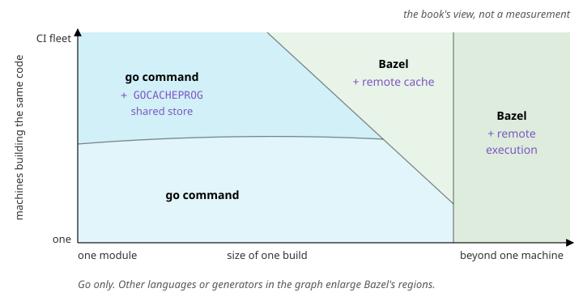
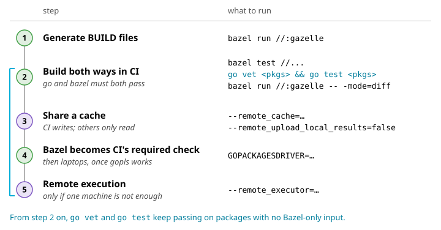

# 10. Deciding

## Where each tool fits

Figure 10.1 places a Go repository by how many machines build the same code and how large one
build is. In our view, a shared Go cache pays once several machines share builds (the curve);
Bazel pays once work that cache cannot share (listed below) dominates continuous integration (CI)
time (the diagonal), as that work grows with the build and recurs on every machine.

### How far the go command goes

The go command is already an incremental build system. It splits a build into actions, single
tool runs such as one compile, keys each by an action ID, a hash of everything that can change
its output, and keeps the outputs in GOCACHE, a per-user cache on disk (Chapter 4). Since
Go 1.24, `GOCACHEPROG` replaces that cache with an external program that speaks a JSON
protocol.[^go-cacheprog] Go defines only the protocol; a program the team supplies can keep
entries in a store shared by every CI machine.[^go-cacheprog-doc]

A shared store helps only when action IDs match. An action ID covers the compiler's version, the
flags, the target platform and the contents of every input. Unless `-trimpath` removes file
system paths from the output,[^go-trimpath] it also covers the package's
directory.[^go-actionid] A cgo package (Go code that calls C) adds the C compiler's command,
flags and version.[^go-actionid-cgo]

What a shared store does not change:

- Every command still loads its packages and hashes their source files again, so its cost grows
  with the tree.[^go-load][^go-filehash]
- Binaries are not stored: a machine without the previous output links every binary
  again.[^go-noexe]
- A stored test result is reused only if the test's binary, its flags, the environment variables
  it read, and the absolute path, size and modification time of each file it opened in its
  module all match.[^go-testinputs] We expect a fresh checkout to rerun every test that reads
  files.
- Each hit arrives as a local file, so every machine downloads what it uses.[^go-cacheprog-disk]
- `go generate` and other non-Go steps stay outside the graph.[^go-generate]
- Every action runs on the machine that started the command.[^go-do]

For a CI fleet whose time goes to compiling, we recommend `-trimpath`, one Go version and a
shared `GOCACHEPROG` store first, written only by CI as Bazel advises for its
cache.[^bazel-cache-rw]

### Where Bazel pays for itself

In our view, Bazel pays when one or more of these hold:

- **Many machines build the same code, and time beyond compiling goes to links, tests or
  generators.** Bazel caches each, test runs included,[^bazel-test-spawn] as an action keyed by
  its declared inputs (Chapter 6), in a remote cache: a server shared by every machine.
- **Other languages or code generators share the graph.** Bazel's declared graph can hold
  actions in any language (Chapters 6 and 8).
- **One build outgrows one machine.** Remote execution runs actions on a pool of
  machines,[^bazel-rbe] though no pool shortens the critical path, the longest chain of dependent
  actions (Chapter 5).
- **Release builds must be hermetic**, giving the same output whatever else is
  installed.[^bazel-hermetic] For Go without cgo, we expect `-trimpath`,
  `-buildvcs=true`,[^go-buildvcs] a pinned Go version and `CGO_ENABLED=0` to be enough; without
  the last, a native Linux build that imports `net` uses cgo whenever a C compiler is on the
  `PATH`.[^go-cgo-default] Bazel can declare generators and a registered C toolchain as inputs,
  but by default uses the host's C compiler, which it does not track
  (Chapter 3).[^bazel-cache-issues]

Bazel's finer cutoff, where an edit stops spreading, also saves compiles: after a body edit that
changes nothing a widely imported package's importers read, Bazel recompiles that package
alone, the go command every direct importer (Chapter 7). In our view that alone rarely repays
Bazel's costs: a shared store runs those compiles once per fleet, and both tools relink every
binary that contains the package.

What it costs (Chapters 3 and 6): BUILD files, a second description of the graph, which Gazelle,
the tool that writes them from Go source, must keep current; a server, the long-lived process
holding the graph, whose memory grows with it; loading and analysis (reading BUILD files,
planning actions) after every server start; a fixed cost per action; two commands to know; and,
Chapter 3 expects, migration work mostly in tests.

Table 10.1: Situations, the tool we recommend, and what to try before switching.

| Situation | In our view | Why | Try first |
|---|---|---|---|
| One Go module, one team | go command | Incremental, with a cache keyed by content hashes (Chapter 4); Bazel adds a second graph and a server | `go build -o <dir>`; keep `<dir>` and GOCACHE between CI runs, with `-trimpath` and `-buildvcs=false`[^go-buildvcs] |
| One Go repository, many services, CI time spent compiling | go command with a shared `GOCACHEPROG` store | Compiles are shared once action IDs match;[^go-actionid] Bazel's finer cutoff saves compiles that the store already runs once per fleet (Chapter 7) | `-trimpath` and one Go version everywhere |
| One Go repository on many machines, CI time spent relinking or retesting unchanged code, or loading on long-lived runners | Bazel with a remote cache | Links (Chapter 8) and test runs[^bazel-test-spawn] are cached actions; those an edit reaches rerun under both tools, slower under Bazel in our measurements (Chapters 5 and 8); a warm server keeps the graph in memory, but a new one loads and analyzes everything (Chapter 6) | Split `go test` packages across parallel jobs |
| Go with generated code | go command if generated files are checked in; Bazel if generation is slow or falls out of date | Bazel runs generators as cached actions (Chapter 3) | Check generated files in; regenerate and diff in CI |
| Go with cgo | Either, with one C compiler on every machine; under Bazel, a pinned C toolchain (Chapter 3) | The C compiler's version enters the go command's action ID;[^go-actionid-cgo] Bazel does not track a compiler outside the workspace[^bazel-cache-issues] | One build image for every machine |
| Go with other languages in one repository | Bazel | One declared graph across languages; the go command builds only Go packages[^go-about] | Gazelle on one service, to see what BUILD files cost to keep |
| One build exceeds one machine | Bazel with remote execution | Parallelism is bounded by the pool, not one machine's cores;[^bazel-rbe] the critical path still bounds build time | Shorten the critical path; keep binaries small (Chapter 5) |
| Hermetic release builds | Go without cgo: go command; with C or generators: Bazel, with a pinned C toolchain | Without `CGO_ENABLED=0`, a host C compiler can enter the build;[^go-cgo-default] without `-buildvcs=true`, a missing `git` silently drops the commit stamp;[^go-buildvcs] Bazel declares generators and a registered C toolchain as inputs (Chapter 3) | `-trimpath`, `-buildvcs=true`, `CGO_ENABLED=0` and a pinned Go version; build twice and compare |

## A migration path

Bazel's Maven migration guide advises running both build tools until the team, CI and other
systems have moved.[^bazel-migrate] We recommend this order:

1. **Generate BUILD files:** set up rules_go (Bazel's Go rules) and Gazelle and run
   `bazel run //:gazelle` (Chapter 2).[^rg-gazelle]
2. **Build both ways in CI:** `bazel test //...` beside `go vet` and `go test` on packages that
   need no Bazel-only input (Chapter 3). Require a clean Gazelle diff, which exits with status 1
   on a stale BUILD file,[^gz-diff] so each change carries its BUILD file updates.
3. **Share a cache before CI depends on Bazel**, so its runs do not start cold. Bazel's
   documentation suggests that only CI write: every machine sets `--remote_cache`; the others
   add `--remote_upload_local_results=false`.[^bazel-cache-rw] With cgo, the race detector, or
   links on macOS, pin the C toolchain first (Chapter 3).
4. **Make Bazel CI's required check**, then move laptops once gopls, Go's language server, works
   through Bazel (Chapter 2).
5. **Add remote execution last** (`--remote_executor`),[^bazel-remote-executor] and only when
   builds wait on cores rather than on the critical path (Chapters 1 and 5), or some actions
   need bigger machines (Chapter 9).

In our view, until step 4 stopping costs only the BUILD files, test changes, the Gazelle check
and the cache server.

## What this means at scale

- Find where CI time goes first: time loading, compiling, linking and tests as separate CI
  steps; under Bazel, read the profile's critical path (Chapter 9).
- Try a `GOCACHEPROG` store first: reversible, and enough for compiles. Budget for a program
  and a store.
- Choose Bazel for links and test results shared across fresh checkouts, other languages in the
  graph, or execution beyond one machine; not for one module on a laptop.
- Keep CI runners and their Bazel servers long-lived: a new server loads and analyzes everything
  again (Chapter 6).

## References

[^go-cacheprog]: Go 1.24 release notes, section "GOCACHEPROG": previously behind a
    `GOEXPERIMENT`; Go, `cmd/go/internal/cache/prog.go`, `ProgCache`; `cache/default.go`,
    where `GOCACHEPROG` replaces the disk cache.
    <https://go.dev/doc/go1.24#gocacheprog>
    <https://github.com/golang/go/blob/go1.27.3/src/cmd/go/internal/cache/prog.go#L27-L31>
    <https://github.com/golang/go/blob/go1.27.3/src/cmd/go/internal/cache/default.go#L57-L59>
[^go-cacheprog-doc]: Go, `cmd/go/internal/cacheprog/cacheprog.go`, the package comment: the
    package "defines the protocol for a GOCACHEPROG program", which "implements the go command
    build cache externally. This permits defining a different cache policy."
    <https://github.com/golang/go/blob/go1.27.3/src/cmd/go/internal/cacheprog/cacheprog.go#L5-L19>
[^go-trimpath]: Go, `cmd/go/internal/work/build.go`, the `-trimpath` flag in the `go build`
    documentation.
    <https://github.com/golang/go/blob/go1.27.3/src/cmd/go/internal/work/build.go#L197-L201>
[^go-actionid]: Go, `cmd/go/internal/work/exec.go`, `buildActionID`: the directory unless
    `-trimpath` is set, the platform and `-trimpath` itself; the compiler's tool ID and flags; each
    input file's contents and each import's content ID.
    <https://github.com/golang/go/blob/go1.27.3/src/cmd/go/internal/work/exec.go#L275-L313>
    <https://github.com/golang/go/blob/go1.27.3/src/cmd/go/internal/work/exec.go#L367>
    <https://github.com/golang/go/blob/go1.27.3/src/cmd/go/internal/work/exec.go#L428-L435>
[^go-actionid-cgo]: Go, `cmd/go/internal/work/exec.go`, `buildActionID`, the cgo case: the C
    compiler command, its flags and its tool ID.
    <https://github.com/golang/go/blob/go1.27.3/src/cmd/go/internal/work/exec.go#L317-L329>
[^go-load]: Go, `cmd/go/internal/load/pkg.go`, `PackagesAndErrors`.
    <https://github.com/golang/go/blob/go1.27.3/src/cmd/go/internal/load/pkg.go#L2937>
[^go-filehash]: Go, `cmd/go/internal/cache/hash.go`, `FileHash`: the hashes it remembers live
    only as long as the process.
    <https://github.com/golang/go/blob/go1.27.3/src/cmd/go/internal/cache/hash.go#L140-L158>
[^go-noexe]: Go, `cmd/go/internal/work/buildid.go`: `useCache` skips a link only if the output
    file already holds a matching build ID or the cache holds the output; `updateBuildID` stores
    executables only on request, and only when the cache is the disk cache.
    <https://github.com/golang/go/blob/go1.27.3/src/cmd/go/internal/work/buildid.go#L484-L485>
    <https://github.com/golang/go/blob/go1.27.3/src/cmd/go/internal/work/buildid.go#L565>
    <https://github.com/golang/go/blob/go1.27.3/src/cmd/go/internal/work/buildid.go#L730-L736>
    <https://github.com/golang/go/blob/go1.27.3/src/cmd/go/internal/work/buildid.go#L756>
[^go-testinputs]: Go, `cmd/go/internal/test/test.go`: the test ID hashes the test binary (or the
    link's inputs) and the flags; results are looked up in the configured cache;
    `computeTestInputsID` hashes each environment variable the test read by its value, and each
    opened file by its absolute name and `hashOpen`, which records size and modification time
    through `hashWriteStat`.
    <https://github.com/golang/go/blob/go1.27.3/src/cmd/go/internal/test/test.go#L1907-L1908>
    <https://github.com/golang/go/blob/go1.27.3/src/cmd/go/internal/test/test.go#L1942>
    <https://github.com/golang/go/blob/go1.27.3/src/cmd/go/internal/test/test.go#L2042-L2071>
    <https://github.com/golang/go/blob/go1.27.3/src/cmd/go/internal/test/test.go#L2148-L2149>
[^go-cacheprog-disk]: Go, `cmd/go/internal/cacheprog/cacheprog.go`, `CmdPut` and `CmdGet`: the
    program returns each body as a path in the local file system.
    <https://github.com/golang/go/blob/go1.27.3/src/cmd/go/internal/cacheprog/cacheprog.go#L34-L52>
[^go-generate]: Go, `cmd/go/internal/generate/generate.go`: "Go generate is never run
    automatically by go build, go test, and so on."
    <https://github.com/golang/go/blob/go1.27.3/src/cmd/go/internal/generate/generate.go#L43-L44>
[^go-do]: Go, `cmd/go/internal/work/exec.go`, `Builder.Do`, which starts `-p` goroutines that run
    the actions as local processes.
    <https://github.com/golang/go/blob/go1.27.3/src/cmd/go/internal/work/exec.go#L223-L229>
[^go-about]: Go, "About the go command", section "Configuration versus convention": the go
    command "does not attempt to build anything but Go packages".
    <https://go.dev/doc/articles/go_command>
[^go-buildvcs]: Go, `cmd/go/internal/work/build.go`, the `-buildvcs` flag: `false` omits
    version control information, and `true` errors out if it "cannot be included due to a
    missing tool"; `load/pkg.go`, `setBuildInfo`: under the default `auto`, a missing tool
    means "we should silently drop the VCS metadata", which names the commit
    (`vcs.revision`); `work/exec.go`, `buildActionID`: the metadata enters the main package's
    action ID. So `true` makes a missing `git` an error rather than a different binary, and
    `false` drops the commit stamp, so a new commit no longer relinks every binary.
    <https://github.com/golang/go/blob/go1.27.3/src/cmd/go/internal/work/build.go#L124-L131>
    <https://github.com/golang/go/blob/go1.27.3/src/cmd/go/internal/load/pkg.go#L2577-L2582>
    <https://github.com/golang/go/blob/go1.27.3/src/cmd/go/internal/load/pkg.go#L2624-L2632>
    <https://github.com/golang/go/blob/go1.27.3/src/cmd/go/internal/work/exec.go#L358-L359>
[^go-cgo-default]: Go, `cmd/go/internal/cfg/cfg.go`, `defaultContext`: "starting in Go 1.20 …
    if CC is unset and the default C compiler we'd look for is not in the PATH, we automatically
    default cgo to off", so cgo is on when one is; `net/cgo_unix_cgo.go`, whose constraint
    `cgo && !netgo && unix && !darwin` compiles C into `net` on Linux when cgo is on.
    <https://github.com/golang/go/blob/go1.27.3/src/cmd/go/internal/cfg/cfg.go#L165-L176>
    <https://github.com/golang/go/blob/go1.27.3/src/net/cgo_unix_cgo.go#L5>
[^bazel-test-spawn]: Bazel, `lib/exec/StandaloneTestStrategy.java`, `createTestRunnerSpawn`,
    which runs a test as a spawn over the test action's inputs, and `extractExecutionInfo`, which
    marks a cache hit as remotely cached.
    <https://github.com/bazelbuild/bazel/blob/9.3.2/src/main/java/com/google/devtools/build/lib/exec/StandaloneTestStrategy.java#L131-L139>
    <https://github.com/bazelbuild/bazel/blob/9.3.2/src/main/java/com/google/devtools/build/lib/exec/StandaloneTestStrategy.java#L374-L376>
[^bazel-rbe]: Bazel, "Remote Execution Overview". <https://bazel.build/remote/rbe>
[^bazel-hermetic]: Bazel, "Hermeticity", section "Overview".
    <https://bazel.build/basics/hermeticity#overview>
[^bazel-cache-issues]: Bazel, "Remote Caching", section "Known issues": "Bazel does not track
    tools outside a workspace", such as a compiler in `/usr/bin`.
    <https://bazel.build/remote/caching#known-issues>
[^bazel-migrate]: Bazel, "Migrating from Maven to Bazel", introduction: "When migrating from any
    build tool to Bazel, it's best to have both build tools running in parallel".
    <https://bazel.build/migrate/maven>
[^rg-gazelle]: rules_go, `docs/go/core/bzlmod.md`, "Generating BUILD files".
    <https://github.com/bazel-contrib/rules_go/blob/v0.65.0/docs/go/core/bzlmod.md?plain=1#L120-L136>
[^gz-diff]: Gazelle, `gazelle-reference.md`, `-mode`; `v2/cmd/gazelle/update/diff.go`, `ErrDiff`,
    returned when diff mode finds a change; `cmd/gazelle/main.go`, `main`, which exits with
    status 1 on `ErrDiff`.
    <https://github.com/bazel-contrib/bazel-gazelle/blob/v0.54.0/gazelle-reference.md?plain=1#L53-L59>
    <https://github.com/bazel-contrib/bazel-gazelle/blob/v0.54.0/v2/cmd/gazelle/update/diff.go#L30>
    <https://github.com/bazel-contrib/bazel-gazelle/blob/v0.54.0/cmd/gazelle/main.go#L92-L95>
[^bazel-cache-rw]: Bazel, "Remote Caching", section "Read from and write to the remote cache":
    "You may want only your CI system to be able to write to the remote cache."
    <https://bazel.build/remote/caching#read-write-remote-cache>
[^bazel-remote-executor]: Bazel, `lib/remote/options/RemoteOptions.java`, `--remote_executor`.
    <https://github.com/bazelbuild/bazel/blob/9.3.2/src/main/java/com/google/devtools/build/lib/remote/options/RemoteOptions.java#L90-L99>
