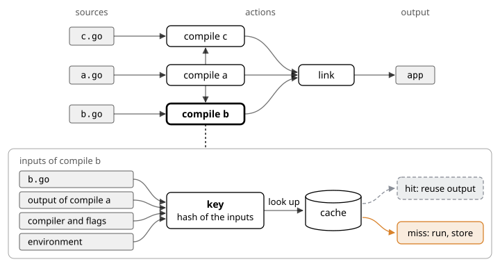
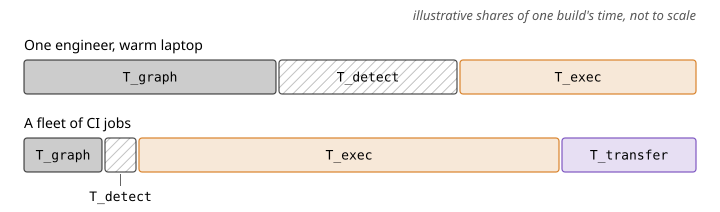

# 1. 构建系统决定什么
<!-- 译自 b8f649d -->

go 命令与 Bazel 都把 Go 源码变成二进制，但二者在六个地方做出了不同的选择。

## 动作与键



构建把源码变成输出。每次修改后都把它全部重新运行一遍太慢，因此构建系统把它拆分成若干步骤，
并跳过结果已经存在的步骤。

- **动作**（action）是一个步骤：一个工具的一次运行，例如编译一个包，其输入与输出都是已知的。[^bazel-actions]
  动作构成一张**图**（graph，图 1.1）：边从每个动作指向读取其输出的那些动作。
- 动作的**键**（key）是所有可能改变其输出的因素的哈希：它的输入文件、它从先前动作读取的内容、工具、
  命令行标志以及环境。[^bazel-actions]
- **缓存命中**（cache hit）指该键下已经存有输出，因此跳过这个动作。[^bazel-actions]
- 如果无论机器上还有什么，相同的输入总是给出相同的输出，构建就是**封闭的**（hermetic）。[^bazel-hermetic]
  只有这样，已存储的输出才能代替动作的运行。[^bazel-remote-caching]

## 截断与关键路径



源文件改变时，读取它的动作重新运行，其新输出又改变了使用该输出的动作的键。改动沿着图传播，
直到被**提前截断**（early cutoff）阻止：某个动作重新运行后，若输出与上次完全相同，
其后的动作便无需运行（图 1.2）。[^alacarte-cutoff]

**关键路径**（critical path）是运行时间最长的一条动作链，链上每个动作都需要前一个动作的输出。
无论有多少核心或机器，构建都不可能比它的关键路径更快完成。

## 六项决策


我们用构建系统对六个问题的回答来描述它（图 1.3）。第 8 章把 go 命令的回答与 Bazel 的回答并列对照。

### 1. 单元

一个动作做多少工作？单元大（例如一个模块），重新运行的部分就会超出一处修改所需。
单元小（例如一个文件），重新运行的部分很少，但启动每个动作的固定开销会成倍累积。
就 Go 而言，编译器每次运行编译一个包，[^go-compile]
go 命令和 rules_go（Bazel 对 Go 的支持）也都为每个包生成一个编译动作。[^go-compileaction][^rules-go-compile]

### 2. 图

图可以从源码推导出来，go 命令就是根据导入语句推导的；[^go-command]
也可以在构建文件中声明，Bazel 要求这样做。[^bazel-build-files]
推导出的图无需维护，但只能描述语言本身能表达的内容；[^go-command]
go 命令每次运行都会重新推导它（第 4 章）。声明式的图可以描述任何东西，例如代码生成器或 C 库，[^bazel-build-files]
并且可以由长期运行的进程保存在内存中。[^bazel-server]代价是必须有人让它与代码保持同步。

### 3. 变化

为找出自上次构建以来有什么变化，构建系统可以重新哈希每个输入，[^go-filehash]
可以比较每个文件保存下来的元数据，例如修改时间，[^bazel-filestate]
也可以由操作系统告知。[^bazel-watchfs]重新哈希要读取每个字节。比较元数据要访问每个文件，
但不读取任何文件的内容。通知的开销与变化的大小成正比。后两种方法需要在构建之间保存状态。

### 4. 键

键若遗漏了某个输入，就会放过过时的输出，造成错误命中。[^bazel-cache-issues]
键若包含了不影响输出的东西，例如在不同机器上取值不同的环境变量，就会造成未命中。[^bazel-cache-issues]
一个更微妙的选择是：依赖的哪一部分进入其依赖者的键。若是依赖的源码，就不存在提前截断。[^alacarte-traces]
若是依赖的全部输出，该输出的任何变化都会让每个直接依赖者重新运行。若只是依赖者读取的那一部分，
其他部分的变化不会让任何依赖者重新运行（第 7 章）。

### 5. 共享

缓存可以属于一个进程、一台机器，或者整个团队及其持续集成（CI）作业。共享的范围越广，
一次计算得到的结果被复用得就越频繁，但前提是构建是封闭的，且各台机器上的键一致。[^bazel-remote-caching]

### 6. 执行

动作可以在发起构建的机器上运行，也可以在一个远程机器池上运行。
远程执行把并行度的上限从一台机器的核心数提高到机器池的规模，[^bazel-rbe]
同时也增加了通过网络传输输入与输出的时间。[^bazel-reapi-exec]此时每个动作都必须声明全部输入，
因为远程机器上除此之外一无所有。[^bazel-remote-execution][^bazel-reapi-exec]

## 成本模型



我们用四项为一次构建的时间建模：

```text
T ≤ T_graph + T_detect + T_exec + T_transfer
```

- **T_graph**：获取图。对每次构建后就退出的工具，每次运行都要付出；对保存图的长期运行进程，
  每次重启后付出。
- **T_detect**：找出发生了变化的内容。
- **T_exec**：运行未命中缓存的动作。它至少等于这些动作的关键路径，
  也至少等于它们的总工作量除以可用的核心数或机器数。
- **T_transfer**：与共享缓存或远程机器之间来回传输字节。

各项可以相互重叠（第 6 章），因此等待时间 T 可以短于它们之和。一个机群（fleet）的成本是其所有构建的 T 之和。
不同种类的规模推高的是不同的项：

| 规模 | 推高的项 | 有帮助的手段 |
|---|---|---|
| 仓库中的包与文件 | T_graph、T_detect | 保存在内存中的图；与变化成正比的检测 |
| 修改 × 依赖于变化内容的动作 | T_exec | 精确的键，使截断尽早发生 |
| 工程师 × 机器 × CI 作业 | 所有构建的 T_exec 与 T_transfer 之和 | 跨机器共享的缓存 |
| 最大一次构建的规模 | T_exec | 远程执行；更短的关键路径 |
| 多种语言与生成的代码 | 图之外未被缓存的步骤，不计入 T | 能声明任何动作的图 |

图 1.4 描绘了笔者的预期。在缓存中保有上次构建结果的笔记本电脑上，一次修改只会重新运行少数动作，
因此在没有长期运行的进程时，获取图与找出变化占主导；有这样的进程时，占主导的是运行动作。
没有共享缓存的全新 CI 运行器要从头获取图，[^bazel-cache-issues]并运行每个动作，因此 T_exec 占主导；
在机群范围内，共享结果可以降低这一项。[^bazel-remote-caching]在笔者看来，go 命令是为这样的场景设计的：
单个工程师、单台机器、仓库小到每次运行都能重新扫描；Bazel 则是为在许多机器上构建的大型仓库设计的。
第 4 至 8 章说明原因。

## 规模变大时意味着什么

- 笔者建议依据六项决策而不是功能清单来比较构建系统。
- 优化之前，先找出哪一项占主导：在笔记本电脑上按单次构建看，在机群中按所有构建之和看（第 9 章）。
- 为共享缓存付费之前，先检查哪些内容进入了键：遗漏的输入会造成错误命中，
  在不同机器上取值不同的值会造成未命中。
- 一旦构建受限于关键路径，笔者建议缩短关键路径，而不是增加核心或机器。

## 参考文献

[^bazel-actions]: Bazel，「Remote Caching」，「Overview」与「How a build uses remote
    caching」两节。<https://bazel.build/remote/caching#overview>
[^bazel-hermetic]: Bazel，「Hermeticity」，「Overview」一节。
    <https://bazel.build/basics/hermeticity#overview>
[^bazel-remote-caching]: Bazel，「Distributed Builds」，「Remote caching」一节。
    <https://bazel.build/basics/distributed-builds#remote-caching>
[^alacarte-cutoff]: Mokhov、Mitchell 与 Peyton Jones，「Build Systems à la Carte」，ICFP 2018，
    第 2.3 节与该文的图 3。<https://doi.org/10.1145/3236774>（作者自存版本：
    <https://github.com/snowleopard/build/releases/download/icfp-final/build-systems.pdf>）
[^go-compile]: Go，`cmd/compile/doc.go`，包文档。
    <https://github.com/golang/go/blob/go1.27.3/src/cmd/compile/doc.go#L6>
[^go-compileaction]: Go，`cmd/go/internal/work/action.go`，`CompileAction`。
    <https://github.com/golang/go/blob/go1.27.3/src/cmd/go/internal/work/action.go#L628>
[^rules-go-compile]: rules_go，`go/private/actions/compilepkg.bzl`，`emit_compilepkg`：每个包一个
    `GoCompilePkg` 动作。
    <https://github.com/bazel-contrib/rules_go/blob/v0.65.0/go/private/actions/compilepkg.bzl#L201-L210>
[^go-command]: Go，「About the go command」，「Motivation」与「Configuration versus
    convention」两节。<https://go.dev/doc/articles/go_command>
[^bazel-build-files]: Bazel，「Artifact-Based Build Systems」，引言以及
    「Understanding artifact-based build systems」与「Extending the build system」两节。
    <https://bazel.build/basics/artifact-based-builds#understanding-artifact-based-build-systems>
[^bazel-server]: Bazel，「Client/server implementation」。
    <https://bazel.build/run/client-server>
[^go-filehash]: Go，`cmd/go/internal/cache/hash.go`，`FileHash`：对整个文件求哈希，
    且只在进程存活期间记住结果。
    <https://github.com/golang/go/blob/go1.27.3/src/cmd/go/internal/cache/hash.go#L140-L183>
[^bazel-filestate]: Bazel，`lib/actions/FileStateValue.java`，
    `createRegularFileStateValueFromPath`，以及 `lib/actions/FileContentsProxy.java`：
    除非文件系统提供快速摘要，否则以文件的时间与 inode 号代替文件内容。
    <https://github.com/bazelbuild/bazel/blob/9.3.2/src/main/java/com/google/devtools/build/lib/actions/FileStateValue.java#L137-L147>
    <https://github.com/bazelbuild/bazel/blob/9.3.2/src/main/java/com/google/devtools/build/lib/actions/FileContentsProxy.java#L21-L38>
[^bazel-watchfs]: Bazel，`lib/skyframe/LocalDiffAwareness.java`，`--watchfs` 选项，默认值为
    `false`：使用操作系统的文件监视服务，「而不是扫描每个文件来查找变化」。
    <https://github.com/bazelbuild/bazel/blob/9.3.2/src/main/java/com/google/devtools/build/lib/skyframe/LocalDiffAwareness.java#L51-L63>
[^bazel-cache-issues]: Bazel，「Remote Caching」，「Known issues」一节：环境变量泄漏进动作、
    工作区之外的工具，以及在 CI 容器中丢失的内存状态。<https://bazel.build/remote/caching#known-issues>
[^alacarte-traces]: Mokhov、Mitchell 与 Peyton Jones，「Build Systems à la Carte」，第 4.2.4 节，
    深层构造性追踪（deep constructive traces）。<https://doi.org/10.1145/3236774>（作者自存版本：
    <https://github.com/snowleopard/build/releases/download/icfp-final/build-systems.pdf>）
[^bazel-rbe]: Bazel，「Remote Execution Overview」。
    <https://bazel.build/remote/rbe>
[^bazel-reapi-exec]: Remote Execution API，Bazel 中收录的 `remote_execution.proto`，服务
    `Execution` 的 `Execute`：「客户端必须先上传全部输入」；消息 `Action` 的
    `input_root_digest`：在构建机器上可用的输入文件。
    <https://github.com/bazelbuild/bazel/blob/9.3.2/third_party/remoteapis/build/bazel/remote/execution/v2/remote_execution.proto#L44-L53>
    <https://github.com/bazelbuild/bazel/blob/9.3.2/third_party/remoteapis/build/bazel/remote/execution/v2/remote_execution.proto#L614-L621>
[^bazel-remote-execution]: Bazel，「Distributed Builds」，「Remote execution」一节。
    <https://bazel.build/basics/distributed-builds#remote-execution>
