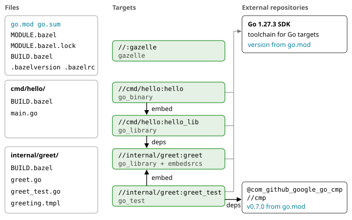

# 2. 一个最小的 Bazel Go 仓库
<!-- 译自 d9d1c21 -->

`examples/minimal` 是一个 Go 模块，包含一个命令行程序、一个库和一个测试，用 Bazel
9.3.2、rules_go 0.65.0（Bazel 的 Go 规则）与 Gazelle 0.54.0（根据 Go 源码写出 Bazel 构建文件的工具）构建。
每份代码清单都与仓库中的文件完全一致，每条命令都在 macOS/arm64 上运行过。

## 文件



`MODULE.bazel` 声明仓库的外部依赖。`BUILD.bazel` 文件使其所在目录成为一个*包*（package），
并声明若干*目标*（target），即 Bazel 所构建的、有名字的东西。[^bazel-glossary]
*标签*（label）为目标命名：`//cmd/hello:hello` 是包 `cmd/hello` 中的目标 `hello`，
`//cmd/hello` 是它的简写。[^bazel-labels]

### `.bazelversion`

```text
9.3.2
```

Bazelisk 是一个以 `bazel` 为名安装的启动器，它读取这个文件并运行其中指定的版本，必要时先下载该版本。[^bazelisk]

### `MODULE.bazel`

```starlark
module(name = "minimal")

bazel_dep(name = "rules_go", version = "0.65.0")
bazel_dep(name = "gazelle", version = "0.54.0")

# The Go SDK version comes from go.mod's toolchain or go line.
go_sdk = use_extension("@rules_go//go:extensions.bzl", "go_sdk")
go_sdk.from_file(go_mod = "//:go.mod")

# Third-party modules come from go.mod and go.sum.
go_deps = use_extension("@gazelle//:extensions.bzl", "go_deps")
go_deps.from_file(go_mod = "//:go.mod")
use_repo(go_deps, "com_github_google_go_cmp")
```

`bazel_dep` 引入 rules_go 与 Gazelle。`use_extension` 加载一个*模块扩展*（module extension），
即根据*标记*（tag，形如 `go_sdk.from_file(...)` 的调用）创建外部仓库（获取到本地的目录，以 `@name` 命名）的代码。[^bazel-extension]
`go_sdk.from_file` 从 `go.mod` 的 `toolchain` 行读取 Go 版本，没有该行时则从 `go` 行读取，[^rg-from-file]
然后下载这个版本的 Go 软件开发包（SDK），并把它注册为 Bazel 的*工具链*（toolchain），
即每个 Go 目标都要用到的编译器、链接器和标准库。Bazel 严格使用这个版本；go 命令则把它视为最低版本，
本地的 Go 若更新就继续使用本地的。[^go-toolchain]`go_deps.from_file` 把 `go.mod` 中的每个模块变成一个仓库，
并依据 `go.sum` 校验。[^gz-go-deps]仓库名把域名倒过来：`github.com/google/go-cmp` 变为
`com_github_google_go_cmp`。[^gz-repo-name]`use_repo` 列出直接依赖，`bazel mod tidy` 负责让这份列表保持最新。[^rg-bzlmod-use-repo]
`MODULE.bazel.lock` 应当纳入版本控制，它记录解析出的 Bazel 模块以及 Go SDK 的校验和；
其余内容由 `go.mod` 与 `go.sum` 固定。[^bazel-lockfile]

### `go.mod`

```text
module example.com/minimal

go 1.27.3

require github.com/google/go-cmp v0.7.0
```

`go.mod` 是唯一需要手动编辑的 Go 模块版本列表：go 命令与 Bazel 都读取它，
因此 `go get` 会同时改变二者的依赖。[^rg-bzlmod-go-mod]
`go_deps` 还会读取其他 Bazel 模块声明的 Go 依赖（这里是 Gazelle 的），对每个模块取最高版本，
并在该版本高于本文件所写版本时发出警告。[^gz-mvs]

### 根目录的 `BUILD.bazel`

```starlark
load("@gazelle//:def.bzl", "gazelle")

gazelle(name = "gazelle")
```

`//:gazelle` 在整个仓库上运行 Gazelle，根目录的导入路径取自 `go.mod`。[^gz-prefix]

### 生成的 `internal/greet/BUILD.bazel`

```starlark
load("@rules_go//go:def.bzl", "go_library", "go_test")

go_library(
    name = "greet",
    srcs = ["greet.go"],
    embedsrcs = ["greeting.tmpl"],
    importpath = "example.com/minimal/internal/greet",
    visibility = ["//:__subpackages__"],
)

go_test(
    name = "greet_test",
    srcs = ["greet_test.go"],
    embed = [":greet"],
    deps = ["@com_github_google_go_cmp//cmp"],
)
```

这个文件由 Gazelle 根据 Go 文件写出。标准库之外的每个导入都变成了 `deps` 中的一个标签，
`//go:embed greeting.tmpl` 则变成了 `embedsrcs`。[^gz-embed]编译只能看到列出的文件，
因此缺少这一行时，编译会失败并报错 `could not embed greeting.tmpl: no matching files found`。[^rg-embedcfg]
测试的 `embed` 属性（与 `//go:embed` 无关）把库的源码编译进测试，正如 `go test` 把测试文件放进被测的包中编译；
在 `cmd/hello` 中，`go_binary` 以同样的方式嵌入 `hello_lib`。[^rg-embed]

### `.bazelrc`

```text
# Show test output only for failures.
test --test_output=errors
```

`.bazelrc` 中以 `test` 开头的行为 `bazel test` 设置默认选项；[^bazel-rc]
这一行让失败测试的日志被打印出来，而不是只打印概要。[^bazel-test-output]

## 构建、测试与运行


`bazel` 命令是一个客户端。它把每条命令交给一个长期运行的服务进程（server），若没有正在运行的服务进程，就先启动一个；
服务进程在命令之间把已加载的包和依赖图保存在内存中。[^bazel-client-server]服务进程的工作分为三个阶段：
*加载*（loading）读取 BUILD 文件，*分析*（analysis）把目标转换为*动作*（action，单次工具运行，例如一次编译），
*执行*（execution）运行结果未被缓存的动作。[^bazel-phases]
每个动作的进程都在沙箱（sandbox）中运行（在 macOS 上是 `sandbox-exec`），
沙箱是一个只包含该动作所声明输入的工作目录。[^bazel-sandbox]
第 6 章讲解其中的机制，包括各阶段如何重叠。

BUILD 文件已是最新时，Gazelle 不做任何改动：

<!-- rerun: bazel run //:gazelle (confirm it still changes nothing without the gazelle:prefix
directive; refresh the package and target counts) -->

```console
$ bazel run //:gazelle
INFO: Analyzed target //:gazelle (52 packages loaded, 257 targets configured).
INFO: Running command line: bazel-bin/gazelle
```

对这个命令行程序做一次干净构建，会运行图 2.2 中的五个进程：

<!-- rerun: bazel clean; bazel build //cmd/hello --execution_log_json_file=/tmp/exec.json;
jq -r '[.mnemonic, .targetLabel, .metrics.totalTime] | @tsv' /tmp/exec.json
(Elapsed 55.112s, Critical Path 52.52s, every per-process time) -->

```console
$ bazel clean
$ bazel build //cmd/hello --execution_log_json_file=/tmp/exec.json
INFO: Analyzed target //cmd/hello:hello (105 packages loaded, 8446 targets configured).
INFO: Elapsed time: 55.112s, Critical Path: 52.52s
INFO: 13 processes: 8 internal, 5 darwin-sandbox.
$ jq -r '[.mnemonic, .targetLabel, .metrics.totalTime] | @tsv' /tmp/exec.json
GoStdlib                @@rules_go+//:stdlib                                         36.688s
GoCompilePkg            //internal/greet:greet                                        0.113s
GoCompilePkg            //cmd/hello:hello                                             0.033s
GoLink                  //cmd/hello:hello                                             0.304s
GoToolchainBinaryBuild  @@rules_go++go_sdk+main___download_0_darwin_arm64//:builder  14.213s
```

编译并链接示例代码用了不到半秒。<!-- rerun: sum of the
GoCompilePkg and GoLink times in the jq output above -->编译标准库以及 rules_go 的构建器（builder，
一个包装 Go 各工具的程序）占了 55 秒中的 51 秒；<!-- rerun:
GoStdlib + GoToolchainBinaryBuild in the jq output vs Elapsed time -->第 7 章解释这两者。
`hello_lib` 没有被单独编译，因为二进制会一并编译它所嵌入的源码。

即使每个动作都已缓存，新启动的服务进程也要重新加载和分析；已在运行的服务进程则两者都不需要做：

<!-- rerun: bazel shutdown && bazel build //cmd/hello (9.320s, 0.07s); bazel build //cmd/hello
(0.170s, 0.00s) -->

```console
$ bazel shutdown && bazel build //cmd/hello
Starting local Bazel server (9.3.2) and connecting to it...
INFO: Analyzed target //cmd/hello:hello (105 packages loaded, 8446 targets configured).
INFO: Elapsed time: 9.320s, Critical Path: 0.07s
INFO: 1 process: 12 action cache hit, 1 internal.
$ bazel build //cmd/hello
INFO: Analyzed target //cmd/hello:hello (0 packages loaded, 0 targets configured).
INFO: Elapsed time: 0.170s, Critical Path: 0.00s
```

`//...` 指所有未带 `manual` 标记的目标，其中包括 `//:gazelle` 背后那个未带标记的运行器，
因此第一次完整构建也会编译 Gazelle。[^bazel-target-patterns][^gz-macro]
默认情况下，Bazel 只在以下情况重新运行测试：测试本身或其依赖发生了变化，上次运行失败，
测试被标记为 `external`，或者 `--runs_per_test` 要求运行多次。[^bazel-cache-tests]
在这台 Mac 上，新测试二进制的首次运行用了 8.4 s，强制重新运行用了 0.1 s；<!-- rerun: first
bazel test //... and bazel test //... --nocache_test_results; isolate the first-launch cost by
copying bazel-bin/internal/greet/greet_test_/greet_test to a new path and timing two launches -->
笔者将这一差异归因于 macOS 在新可执行文件首次启动时对其进行的扫描。第 5 章会再讨论这项首次启动的开销。

<!-- rerun: bazel build //... (47.101s, 46.63s, process counts); bazel test //... (8.4s);
bazel test //... (cached); bazel test //... --nocache_test_results (0.1s);
bazel run //cmd/hello -- Ada -->

```console
$ bazel build //...
INFO: Analyzed 5 targets (64 packages loaded, 311 targets configured).
INFO: Elapsed time: 47.101s, Critical Path: 46.63s
INFO: 109 processes: 6 action cache hit, 32 internal, 77 darwin-sandbox.
$ bazel test //...
//internal/greet:greet_test                                              PASSED in 8.4s
$ bazel test //...
//internal/greet:greet_test                                     (cached) PASSED in 8.4s
Executed 0 out of 1 test: 1 test passes.
$ bazel test //... --nocache_test_results
//internal/greet:greet_test                                              PASSED in 0.1s
$ bazel run //cmd/hello -- Ada
INFO: Running command line: bazel-bin/cmd/hello/hello_/hello <args omitted>
Hello, Ada!
```

### gopls

gopls 是 Go 的语言服务器（language server，即编辑器的补全与诊断背后的进程），它通过运行 `go list` 获取包的信息。
如果 `GOPACKAGESDRIVER` 指定了一个程序，gopls 就改为向这个程序询问。[^xtools-driver][^rg-editors]
示例中的启动器就是 rules_go 编辑器指南给出的那个，只多了一行注释：

```bash
#!/usr/bin/env bash
# gopls asks this script for package data instead of running "go list".
exec bazel run -- @rules_go//go/tools/gopackagesdriver "${@}"
```

驱动程序先向 Bazel 查询包含某个文件的目标，再用一个*切面*（aspect，附加在已有目标上的额外动作）构建这些目标，
该切面把每个包的文件与导入写成 JSON。[^rg-driver]按照指南为调试给出的建议直接调用它，
可以看到这两个步骤：[^rg-editors-debug]

```console
$ echo {} | ./tools/gopackagesdriver.sh file=internal/greet/greet.go
Running: [bazel query ... same_pkg_direct_rdeps("internal/greet/greet.go"))]
Running: [bazel build ... --aspects=@@rules_go+//go/tools/gopackagesdriver:aspect.bzl%go_pkg_info_aspect ... @@//internal/greet:greet]
{"NotHandled":false,"Compiler":"","Arch":"","Roots":["@@//internal/greet:greet"],"Packages":[...]}
```

把 `greet.go` 中的 `b.String()` 改为 `b.Len()` 后，gopls 通过驱动程序报告了类型错误：

```console
$ GOPACKAGESDRIVER=$PWD/tools/gopackagesdriver.sh gopls check internal/greet/greet.go
.../internal/greet/greet.go:21:9-16: cannot use b.Len() (value of type int) as string value in return statement
```

编辑器设置的也是这个变量；rules_go 的指南涵盖六种编辑器，并提醒首次加载会比较耗时。[^rg-editors-setup]

## 规模变大时意味着什么

- `go.mod` 仍然是唯一需要手动编辑的 Go 版本列表，SDK 与每个模块的版本都在其中。
  笔者建议设置 `go_deps.config(check_direct_dependencies = "error")`，
  使其他 Bazel 模块抬高某个版本时构建直接失败，而不只是发出警告。[^gz-mvs]
  有了 `.bazelversion` 和纳入版本控制的 `MODULE.bazel.lock`，每台机器解析出的构建都相同。
- 这里的一次干净构建在 55 秒中有 51 秒花在工具链上，而不是代码上。<!-- rerun: bazel
  clean; bazel build //cmd/hello, as above -->除非有共享缓存提供这些结果，否则每台新机器都要再付出一次这项开销，
  因此笔者建议从一开始就使用共享缓存（第 9 章）。
- 即使每个动作都已缓存，服务进程重启后仍要重新加载和分析。笔者建议不仅在笔记本电脑上，
  也在持续集成（CI）运行器上让服务进程保持热状态。
- BUILD 文件是生成的。每次改动若新增了包或导入，都应运行 `bazel run //:gazelle`；
  第 3 章会加上一项 CI 检查。
- gopls 仍能正常工作，但每次加载包都是一条 Bazel 命令，而服务进程一次只运行一条命令，[^bazel-client-server]
  因此耗时较长的构建会拖慢编辑器（第 9 章）。

## 参考文献

[^bazel-glossary]: Bazel，「Glossary」中的 *package*、*target*、*toolchain* 词条。
    <https://bazel.build/reference/glossary>
[^bazel-labels]: Bazel，「Labels」。
    <https://bazel.build/concepts/labels>
[^bazelisk]: Bazel，「Installing Bazel using Bazelisk」。
    <https://bazel.build/install/bazelisk>
[^bazel-extension]: Bazel，「Module extensions」。
    <https://bazel.build/external/extension>
[^rg-from-file]: rules_go，`go/private/go_mod.bzl`，`_version_from_go_file`，由
    `version_from_go_mod` 调用。
    <https://github.com/bazel-contrib/rules_go/blob/v0.65.0/go/private/go_mod.bzl#L76-L79>
[^go-toolchain]: Go，`cmd/go/internal/toolchain/select.go`，`Select`：只有在目标版本更新时，
    才会从本地工具链切换出去。
    <https://github.com/golang/go/blob/go1.27.3/src/cmd/go/internal/toolchain/select.go#L202-L217>
[^gz-go-deps]: Gazelle，`internal/bzlmod/go_deps.bzl`，`go_deps_impl`：为每个模块声明一个
    `go_repository`，附带其版本与校验和；`cmd/fetch_repo/module.go`，`fetchModule`：
    让 `go mod download` 验证校验和。
    <https://github.com/bazel-contrib/bazel-gazelle/blob/v0.54.0/internal/bzlmod/go_deps.bzl#L802-L814>，
    <https://github.com/bazel-contrib/bazel-gazelle/blob/v0.54.0/cmd/fetch_repo/module.go#L47-L48>
[^gz-repo-name]: Gazelle，`internal/bzlmod/go_deps.bzl`，`_repo_name`。
    <https://github.com/bazel-contrib/bazel-gazelle/blob/v0.54.0/internal/bzlmod/go_deps.bzl#L190-L194>
[^rg-bzlmod-use-repo]: rules_go，`docs/go/core/bzlmod.md`，「Specifying external dependencies」。
    <https://github.com/bazel-contrib/rules_go/blob/v0.65.0/docs/go/core/bzlmod.md?plain=1#L155-L166>
[^bazel-lockfile]: Bazel，「Bazel Lockfile」，「Module Extensions」与「Best Practices」；rules_go，
    `go/private/extensions.bzl`，`_go_sdk_impl`：把 SDK 的校验和保存在锁文件中；
    Gazelle，`internal/bzlmod/go_deps.bzl`，`go_deps_impl`：返回 `reproducible = True`。
    <https://bazel.build/external/lockfile>，
    <https://github.com/bazel-contrib/rules_go/blob/v0.65.0/go/private/extensions.bzl#L205-L207>，
    <https://github.com/bazel-contrib/bazel-gazelle/blob/v0.54.0/internal/bzlmod/go_deps.bzl#L895>
[^rg-bzlmod-go-mod]: rules_go，`docs/go/core/bzlmod.md`，「Specifying external dependencies」。
    <https://github.com/bazel-contrib/rules_go/blob/v0.65.0/docs/go/core/bzlmod.md?plain=1#L146-L147>
[^gz-mvs]: Gazelle，`internal/bzlmod/go_deps.bzl`，`go_deps_impl`：在所有使用 `go_deps` 的
    Bazel 模块中为每个模块保留最高版本，打印根模块的隐式升级，
    并在 `check_direct_dependencies = "error"` 时改为失败。
    <https://github.com/bazel-contrib/bazel-gazelle/blob/v0.54.0/internal/bzlmod/go_deps.bzl#L596>，
    <https://github.com/bazel-contrib/bazel-gazelle/blob/v0.54.0/internal/bzlmod/go_deps.bzl#L737-L739>，
    <https://github.com/bazel-contrib/bazel-gazelle/blob/v0.54.0/internal/bzlmod/go_deps.bzl#L418-L424>
[^gz-prefix]: Gazelle，`language/go/config.go`，`Configure`：没有指令设置前缀时，
    从 `go.mod` 读取模块路径。
    <https://github.com/bazel-contrib/bazel-gazelle/blob/v0.54.0/language/go/config.go#L747-L760>
[^gz-embed]: Gazelle，`language/go/fileinfo.go`，`goFileInfo`：读取 `//go:embed`
    模式；`language/go/generate.go`，`setCommonAttrs`：写出 `embedsrcs`。
    <https://github.com/bazel-contrib/bazel-gazelle/blob/v0.54.0/language/go/fileinfo.go#L312-L328>，
    <https://github.com/bazel-contrib/bazel-gazelle/blob/v0.54.0/language/go/generate.go#L827-L828>
[^rg-embedcfg]: rules_go，`go/tools/builders/embedcfg.go`，`resolveEmbed`。
    <https://github.com/bazel-contrib/rules_go/blob/v0.65.0/go/tools/builders/embedcfg.go#L279-L282>，
    <https://github.com/bazel-contrib/rules_go/blob/v0.65.0/go/tools/builders/embedcfg.go#L362>
[^rg-embed]: rules_go，`docs/go/core/rules.md`，`go_binary` 与 `go_test` 的 `embed` 属性。
    <https://github.com/bazel-contrib/rules_go/blob/v0.65.0/docs/go/core/rules.md?plain=1#L153>，
    <https://github.com/bazel-contrib/rules_go/blob/v0.65.0/docs/go/core/rules.md?plain=1#L409>
[^bazel-rc]: Bazel，「Write bazelrc configuration files」，「Option defaults」。
    <https://bazel.build/run/bazelrc#option-defaults>
[^bazel-test-output]: Bazel，`ExecutionOptions.java`，`test_output` 选项，默认值为
    `summary`。
    <https://github.com/bazelbuild/bazel/blob/9.3.2/src/main/java/com/google/devtools/build/lib/exec/ExecutionOptions.java#L272-L273>
[^bazel-client-server]: Bazel，「Client/server implementation」。
    <https://bazel.build/run/client-server>
[^bazel-phases]: Bazel，「Build programs with Bazel」，「Phases of a build」。
    <https://bazel.build/run/build#build-phases>
[^bazel-sandbox]: Bazel，「Sandboxing」。
    <https://bazel.build/docs/sandboxing>
[^bazel-target-patterns]: Bazel，「Build programs with Bazel」，「Specifying targets to build」。
    <https://bazel.build/run/build#specifying-build-targets>
[^gz-macro]: Gazelle，`def.bzl`，`gazelle`：运行器规则不带标记，包装它的 `sh_binary` 带有
    `manual` 标记。
    <https://github.com/bazel-contrib/bazel-gazelle/blob/v0.54.0/def.bzl#L225-L244>
[^bazel-cache-tests]: Bazel，`TestConfiguration.java`，`cache_test_results` 选项。
    <https://github.com/bazelbuild/bazel/blob/9.3.2/src/main/java/com/google/devtools/build/lib/analysis/test/TestConfiguration.java#L169-L183>
[^xtools-driver]: golang.org/x/tools（gopls v0.24.0 构建所基于的提交），
    `go/packages/doc.go`，「The driver protocol」。
    <https://github.com/golang/tools/blob/24a65270771e7a9b6b3385b45eefaf454a2439d2/go/packages/doc.go#L82-L87>
[^rg-editors]: rules_go，`docs/editors.md`，「General setup」。
    <https://github.com/bazel-contrib/rules_go/blob/v0.65.0/docs/editors.md?plain=1#L3-L4>
[^rg-driver]: rules_go，`go/tools/gopackagesdriver/bazel_json_builder.go`，`fileQuery` 与
    `Build`。
    <https://github.com/bazel-contrib/rules_go/blob/v0.65.0/go/tools/gopackagesdriver/bazel_json_builder.go#L80>，
    <https://github.com/bazel-contrib/rules_go/blob/v0.65.0/go/tools/gopackagesdriver/bazel_json_builder.go#L205-L213>
[^rg-editors-debug]: rules_go，`docs/editors.md`，「Debugging」。
    <https://github.com/bazel-contrib/rules_go/blob/v0.65.0/docs/editors.md?plain=1#L338-L343>
[^rg-editors-setup]: rules_go，`docs/editors.md`，「Editor Setup」。
    <https://github.com/bazel-contrib/rules_go/blob/v0.65.0/docs/editors.md?plain=1#L31-L34>
