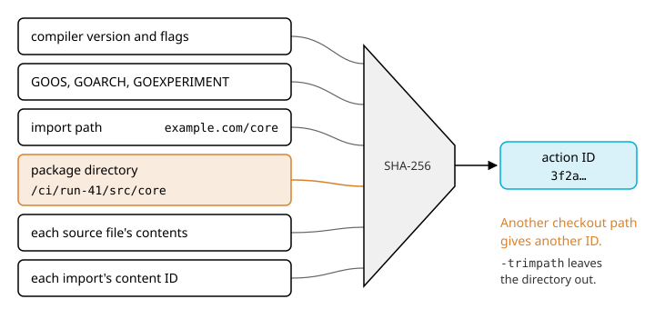
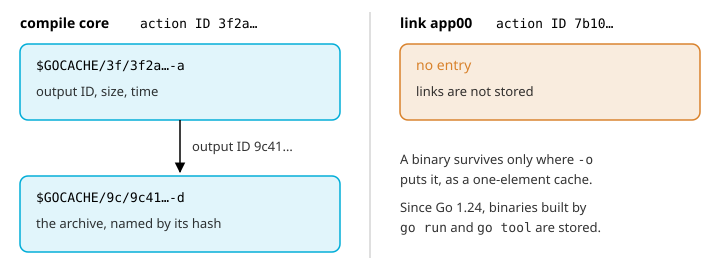
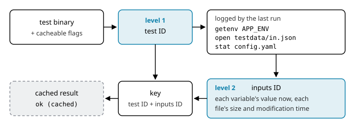

# 4. go 命令的设计
<!-- 译自 d9d1c21 -->

go 命令从导入语句推导构建图，以每个步骤输入的哈希作为该步骤的键，
并把结果保存在每个用户各自的缓存中。第 8 章把其中的每个机制与 Bazel 的对应机制逐一比较。

这一设计由五项选择决定：

- **没有构建文件**。Go 代码应当「只用源码本身所含的信息」构建。[^go-about]
- **只有一种语言**。go 命令「除 Go 包之外，不尝试构建任何东西」。[^go-about]
- **快速的编译器**。编译一个包时，编译器只读取它直接导入的包的导出数据（export data）：
  这是一份关于导出的类型、函数和可内联函数体（编译器可以复制到调用者中的函数体）的概要，
  写在每个包的输出中，并且也涵盖这些导入包从更下层暴露出来的内容。[^go-exportdata]
  Rob Pike 称之为「Go 的编译比 C 或 C++ 的编译更快的最大原因」。[^pike]
- **单台机器**。每次编译和链接都作为同一个 go 命令的子进程运行。[^go-do]
- **短生命周期的进程**。每条命令都是一个新进程，两次运行之间不在内存中保留任何东西。[^go-filehash]

## 一次构建的步骤

go 命令首先把 `./...` 这样的模式转换为包。[^go-load]对每个目录，它列出其中的文件，
应用构建约束（`//go:build` 行以及 `_linux.go` 这样的文件名后缀），并且只读取每个文件的头部：
包子句与导入声明。只有当文件导入了 `embed` 时，它才继续往后读，以找到 `//go:embed` 行。[^go-readgoinfo]
从 Go 1.19 起，它把这些头部保存在 GOCACHE（即构建缓存，见下文）中，
以各目录中文件的名称、大小与修改时间为键。[^go-modindex]每次运行仍会列出每个目录，
并检查每个文件的大小与修改时间，但只解析发生了变化的目录。

这些包随后变成一张动作图（action graph）：每个包一个编译动作，写出一个归档（archive，即 `.a` 文件）；
每个 main 包一个链接动作。每个编译动作都依赖于其直接导入包的编译动作。[^go-action]

`Builder.Do` 执行这张图。[^go-do]它启动 `-p` 个 goroutine，默认每个可用 CPU 一个。
每个 goroutine 取出下一个依赖已全部完成的动作，并运行它的工具，除非输出已经在缓存中。

## 动作 ID

在运行一个动作之前，go 命令先计算它的动作 ID（action ID），
即对一切可能改变输出的内容求出的 SHA-256 哈希。如果 GOCACHE 中有以该 ID 保存的输出，
就跳过这个动作。[^go-lookup]对于编译动作，`buildActionID` 会哈希编译器的版本与标志、
目标平台与工具链实验特性（`GOEXPERIMENT`）、导入路径、每个输入文件的完整内容，
以及每个直接导入包的内容 ID（见下一节）。[^go-buildactionid]
除非设置了 `-trimpath`（它从输出中去除文件系统路径），
它还会哈希包的绝对目录，因为目标文件可能在调试信息中记录这个目录。[^go-actionid-dir]

因此，在一个检出路径下填充的缓存，在另一个检出路径下不会产生任何命中。
在笔者对 1000 个包的测量中（附录 A），使用热的（已填充的）GOCACHE 的第二个检出，
重新编译了这次构建中属于它自己的全部 891 个包；当两个检出都使用 `-trimpath` 构建时，
它一个包也没有重新编译。[^bench]而且每个进程都会重新哈希文件内容，只在退出之前记住哈希值，[^go-filehash]
因此即使是空构建（什么都不需要做的构建），也要完整读取每个源文件。

main 包的动作 ID 还涵盖作为戳记写入其二进制的构建信息，[^go-modinfo]默认情况下，
其中包括当前提交，以及检出中是否有未提交的修改（`-buildvcs`）。[^go-buildvcs]
因此每个提交都会重新编译每个 main 包，并重新链接每个二进制。

## 内容 ID 与提前截断

一个依赖通过它的内容 ID（content ID，即其输出的哈希）进入依赖它的包的动作 ID。[^go-buildid]
每个归档和二进制都有一个写入文件中的构建 ID（build ID），形式为 `actionID/contentID`。
内容 ID 是把构建 ID 替换为零之后，对文件求出的截断的 SHA-256 哈希。[^go-findandhash]

动作 ID 这一半使每个输出成为一个只有一个条目的缓存。当 `go build -o bin/` 在 `bin/`
中找到一个二进制，而它的构建 ID 以刚刚算出的动作 ID 开头时，就跳过链接。[^go-usecache]
对 `go build` 来说，这是跳过链接的唯一途径，因为 GOCACHE 不存储二进制：
它们体积大，又很少被重用。[^go-noexe]Go 1.24 设了一个例外，针对 `go run` 与 `go tool`
构建的二进制。[^go124]不带 `-o` 时，`go build ./...` 会把每个 main 包链接到一个临时目录中，
然后丢弃结果。[^go-discard]在 1000 个包上，一次空构建 `go build ./...` 没有编译任何包，
却重新链接了全部 11 个二进制。[^bench]

内容 ID 带来了提前截断（early cutoff）：一个步骤重新运行后，如果输出不变，
就不会重新运行依赖它的步骤。这种截断的粒度较粗，因为内容 ID 覆盖整个归档，
即导出数据与目标代码二者。[^go-archive]
图 4.3 展示了对 `core` 中一个编译器不会内联的函数的函数体修改（body edit）。导出数据保持不变：
该函数仍然不可内联，没有任何声明移动位置，逃逸到堆上的参数也相同；[^go-exportfunc]但目标代码变了，所以 `core` 的内容 ID 改变，
每个直接导入者都要重新编译。在笔者的测量中，这些导入者的归档结果完全相同，
因为导入者的目标代码只记录每个导入包导出数据的指纹（fingerprint，即一个哈希），[^go-fingerprint]
所以更上层的包命中缓存。每个包含 `core` 的二进制都要重新链接，
因为链接动作的动作 ID 包含二进制中每个包的内容 ID。[^go-linkactionid]在 1000 个包上，
对被导入最广的包做这样的修改，重新编译了 299 个包，并重新链接了包含它的全部 10 个二进制。
添加一个导出函数则重新编译了 712 个包：新的指纹也改变了直接导入者的归档，
所以它们的导入者要重新编译；传播到此为止，因为直接导入者的导出数据没有改变。[^bench]
rules_go 会把函数体修改截断在 `core` 处（第 7 章）。

## 缓存

GOCACHE 在 macOS 上默认为 `~/Library/Caches/go-build`，在 Linux 上默认为
`~/.cache/go-build`。[^go-defaultdir]它包含 256 个以哈希首字节命名的子目录，以及两类文件：[^go-cachefiles]

- `<actionID>-a`，一个条目，把动作 ID 映射到其输出的哈希与大小；
- `<outputID>-d`，输出本身，以其内容的哈希命名。

Bazel 的缓存也按同样的方式划分（第 6 章），但 GOCACHE 属于一台机器上的一个用户。
go 命令每天至多查找一次旧条目，并删除五天内未被使用的条目。[^go-trim]

从 Go 1.24 起，[^go124]把 `GOCACHEPROG` 设为一个程序，就会用该程序取代磁盘缓存，
它通过标准输入与标准输出以 JSON 通信。[^go-cacheprog]它可以把条目保存在任何地方，
例如共享的缓存服务器。键保持不变，所以目录仍会把缓存分隔开；而二进制根本不会被存储，
`go run` 构建的也不例外。[^go-noexe-prog]

## 测试结果

测试可以读取任何文件或环境变量，因此 go 命令会观察测试的运行：
测试二进制中的 `os` 包会记录每一次 `Getenv`、`Stat`、`Open` 与 `Chdir` 调用。[^go-testlog]
查找因此分为两级：[^go-testcache]

1. 测试 ID 对测试二进制与标志求哈希。它用链接动作的输入代替二进制，因此命中时无需链接。
   任何不在一个简短列表（`-run`、`-short`、`-v`、`-timeout` 以及另外几个）中的测试标志，
   都会关闭缓存，通常用 `-count=1` 来做到这一点。[^go-testflags]测试 ID 用来找到上一次运行的日志。
2. 输入 ID 对该日志中每个环境变量的当前值，以及每个文件的路径、大小与修改时间求哈希。
   模块之外的文件不做检查。[^go-testinputs]

只有两者都匹配时，结果才会被重用。由于测试 ID 覆盖整个二进制，在 1000 个包上对 `core`
做一次函数体修改，重新运行了 927 个包的测试：`core` 自身的，以及每个依赖它的包的。[^bench]
观测不需要任何声明，但只有当测试通过会被记录的调用接触外部世界时，它才是正确的。
使用网络、读取模块之外的内容或者依赖时间的测试，照样会被缓存。

## 这种设计放弃了什么

| 选择 | 换来什么 | 仓库变大时的代价 |
|---|---|---|
| 图由导入推导 | 没有构建文件；图永远不会过时 | 每条命令都要列出并检查它加载的每个包 |
| 没有持久进程 | 无需启动、调整大小或重启 | 每次运行都重新哈希每个源文件 |
| 动作 ID 中包含目录 | 调试信息中的路径正确 | 缓存无法跨检出路径复用 |
| 提交作为戳记写入二进制 | 每个二进制都标明它来自哪个提交 | 每个提交都重新编译每个 main 包、重新链接每个二进制 |
| 整个归档的内容 ID | 每个依赖只需一个廉价的键 | 任何修改都会重新编译所有直接导入者；若导出数据改变，还要重新编译它们的导入者 |
| 不缓存链接 | 缓存更小 | 每个包含改动的二进制都要重新链接，在每台机器上都是如此 |
| 单台机器、`-p` 个进程 | 无需协调 | 吞吐量以单台机器为上限 |
| 只有 Go | 一个自洽的工具 | 生成的代码与其他语言留在图之外[^go-generate] |
| 测试的输入靠观测得出 | 无需声明即可缓存 | 只对测试日志能看到的输入是正确的 |

## 规模变大时意味着什么

- 空构建仍会列出每个目录、检查每个文件并哈希每个源文件；在笔者的测量中，
  `go build -o` 在 1000 个包上耗时 0.86 s。[^bench]它的开销随源码树增长，而不随改动增长。
- 笔者建议在持续集成中使用 `-trimpath`。否则，在不同路径下恢复的缓存，
  对仓库中的每个包都会未命中。
- 笔者建议使用 `go build -o <dir>`，并保留该目录。否则，每次构建都会重新链接每个二进制；
  即便使用了它，除非设置 `-buildvcs=false`，每个提交仍会重新链接每个二进制。

## 参考文献

[^go-about]: Go，「About the go command」，「Motivation」与「Configuration versus
    convention」两节。<https://go.dev/doc/articles/go_command>

[^pike]: Rob Pike，「Go at Google: Language Design in the Service of Software
    Engineering」，「Dependencies in Go」一节。<https://go.dev/talks/2012/splash.article>

[^go-exportdata]: Go，`cmd/compile/internal/noder/unified.go`：
    写出导出数据时「handles re-exporting any transitive dependencies」，并剪除「non-inlineable functions」。
    <https://github.com/golang/go/blob/go1.27.3/src/cmd/compile/internal/noder/unified.go#L160-L169>

[^go-do]: Go，`cmd/go/internal/work/exec.go`，`Builder.Do`，它启动 `-p` 个 goroutine；
    `cmd/go/internal/cfg/cfg.go`，`BuildP`，其默认值为 `GOMAXPROCS`；
    `cmd/go/internal/work/shell.go`，`Shell.runOut`，它把每个工具作为子进程运行。
    <https://github.com/golang/go/blob/go1.27.3/src/cmd/go/internal/work/exec.go#L223-L229>
    <https://github.com/golang/go/blob/go1.27.3/src/cmd/go/internal/cfg/cfg.go#L87>
    <https://github.com/golang/go/blob/go1.27.3/src/cmd/go/internal/work/shell.go#L626>

[^go-filehash]: Go，`cmd/go/internal/cache/hash.go`，`FileHash`：对整个文件求哈希，
    并把结果记在一个与进程同生命周期的 map 中。
    <https://github.com/golang/go/blob/go1.27.3/src/cmd/go/internal/cache/hash.go#L140-L158>

[^go-modinfo]: Go，`cmd/go/internal/work/exec.go`，`buildActionID` 中的 `modinfo` 一行。
    <https://github.com/golang/go/blob/go1.27.3/src/cmd/go/internal/work/exec.go#L358-L360>

[^go-buildvcs]: Go，`cmd/go/internal/work/build.go`，`-buildvcs` 标志的帮助文本；`load/pkg.go`，
    `setBuildInfo` 中的 `vcs.revision`、`vcs.time` 与 `vcs.modified` 设置。
    <https://github.com/golang/go/blob/go1.27.3/src/cmd/go/internal/work/build.go#L124-L131>，
    <https://github.com/golang/go/blob/go1.27.3/src/cmd/go/internal/load/pkg.go#L2624-L2632>

[^go-load]: Go，`cmd/go/internal/load/pkg.go`，`PackagesAndErrors`。
    <https://github.com/golang/go/blob/go1.27.3/src/cmd/go/internal/load/pkg.go#L2937>

[^go-readgoinfo]: Go，`go/build/read.go`，`readGoInfo`：读到导入声明结束为止，
    只有当文件导入了 `embed` 时，才读取文件的其余部分。
    <https://github.com/golang/go/blob/go1.27.3/src/go/build/read.go#L265-L272>
    <https://github.com/golang/go/blob/go1.27.3/src/go/build/read.go#L366-L391>

[^go-modindex]: Go，`cmd/go/internal/load/pkg.go`，`loadPackageData`，它首先查询模块索引；
    `cmd/go/internal/modindex/read.go`，`dirHash` 与 `openIndexPackage`。
    由提交 5a1c5b8ae7 加入，首次随 Go 1.19 发布。
    <https://github.com/golang/go/blob/go1.27.3/src/cmd/go/internal/load/pkg.go#L952>
    <https://github.com/golang/go/blob/go1.27.3/src/cmd/go/internal/modindex/read.go#L80-L119>
    <https://github.com/golang/go/blob/go1.27.3/src/cmd/go/internal/modindex/read.go#L218-L245>
    <https://go.googlesource.com/go/+/5a1c5b8ae7>

[^go-action]: Go，`cmd/go/internal/work/action.go`，`Action`、`AutoAction`（对 main 包为链接，
    否则为编译）与 `CompileAction`（每个导入对应一个依赖）。
    <https://github.com/golang/go/blob/go1.27.3/src/cmd/go/internal/work/action.go#L85-L94>
    <https://github.com/golang/go/blob/go1.27.3/src/cmd/go/internal/work/action.go#L451-L456>
    <https://github.com/golang/go/blob/go1.27.3/src/cmd/go/internal/work/action.go#L656-L658>

[^go-buildactionid]: Go，`cmd/go/internal/work/exec.go`，`buildActionID`：平台、
    编译器的工具 ID 与标志、`GOEXPERIMENT`、输入文件，以及每个依赖的内容 ID；
    工具 ID 来自 `Builder.toolID` 中的 `compile -V=full`。
    <https://github.com/golang/go/blob/go1.27.3/src/cmd/go/internal/work/exec.go#L264-L442>
    <https://github.com/golang/go/blob/go1.27.3/src/cmd/go/internal/work/exec.go#L367>
    <https://github.com/golang/go/blob/go1.27.3/src/cmd/go/internal/work/exec.go#L376-L378>
    <https://github.com/golang/go/blob/go1.27.3/src/cmd/go/internal/work/exec.go#L428-L435>
    <https://github.com/golang/go/blob/go1.27.3/src/cmd/go/internal/work/buildid.go#L146-L184>

[^go-lookup]: Go，`cmd/go/internal/cache/hash.go`，`NewHash`，一个 SHA-256 哈希；
    `cmd/go/internal/work/buildid.go`，`useCache`，即 GOCACHE 查找。
    <https://github.com/golang/go/blob/go1.27.3/src/cmd/go/internal/cache/hash.go#L82-L83>
    <https://github.com/golang/go/blob/go1.27.3/src/cmd/go/internal/work/buildid.go#L565>

[^go-actionid-dir]: Go，`cmd/go/internal/work/exec.go`，`buildActionID` 中的 `dir` 一行。
    <https://github.com/golang/go/blob/go1.27.3/src/cmd/go/internal/work/exec.go#L275-L303>

[^go-buildid]: Go，`cmd/go/internal/work/buildid.go`，「Build IDs」注释：
    动作 ID 这一半作为只有一个条目的缓存，内容 ID 这一半作为下一个步骤的键。
    <https://github.com/golang/go/blob/go1.27.3/src/cmd/go/internal/work/buildid.go#L26-L56>

[^go-findandhash]: Go，`cmd/internal/buildid/rewrite.go`，`FindAndHash`，由
    `cmd/go/internal/work/buildid.go` 中的 `updateBuildID` 调用；`cmd/internal/buildid/buildid.go`，
    `HashToString`，它保留哈希的前 120 位。
    <https://github.com/golang/go/blob/go1.27.3/src/cmd/internal/buildid/rewrite.go#L18-L23>
    <https://github.com/golang/go/blob/go1.27.3/src/cmd/go/internal/work/buildid.go#L696>
    <https://github.com/golang/go/blob/go1.27.3/src/cmd/internal/buildid/buildid.go#L320-L331>

[^go-usecache]: Go，`cmd/go/internal/work/buildid.go`，`useCache`，
    它读取已存在的目标的构建 ID；`cmd/go/internal/work/exec.go`，链接动作对它的调用。
    <https://github.com/golang/go/blob/go1.27.3/src/cmd/go/internal/work/buildid.go#L484-L494>
    <https://github.com/golang/go/blob/go1.27.3/src/cmd/go/internal/work/exec.go#L1630>

[^go-noexe]: Go，`cmd/go/internal/work/buildid.go`，`updateBuildID`：「Executables are not
    cached by default because they are not reused nearly as often as individual packages, and
    they're much larger」。
    <https://github.com/golang/go/blob/go1.27.3/src/cmd/go/internal/work/buildid.go#L730-L742>

[^go124]: Go 1.24 发布说明，「Go command」一节：`go run` 与 `go tool`
    创建的可执行文件「现在会缓存在 Go 构建缓存中」（提交 3ff868f2f5）；「GOCACHEPROG」一节：
    由 `GOCACHEPROG` 环境变量指定的程序现在可以实现缓存，
    这一功能「此前需要通过 GOEXPERIMENT 启用」。除非设置了该变量，否则使用磁盘缓存。
    <https://go.dev/doc/go1.24#go-command> <https://go.dev/doc/go1.24#gocacheprog>
    <https://go.googlesource.com/go/+/3ff868f2f5>

[^go-discard]: Go，`cmd/go/internal/work/build.go`，`go build` 的文档（「丢弃生成的结果」）
    与 `runBuild`，
    它为每个包添加一个 `AutoAction`（对 main 包即为链接动作）；`cmd/go/internal/work/action.go`，`LinkAction`，
    它链接到临时工作目录中。
    <https://github.com/golang/go/blob/go1.27.3/src/cmd/go/internal/work/build.go#L52-L54>
    <https://github.com/golang/go/blob/go1.27.3/src/cmd/go/internal/work/build.go#L553-L556>
    <https://github.com/golang/go/blob/go1.27.3/src/cmd/go/internal/work/action.go#L955>

[^bench]: 本书的测量，`examples/bench/results/2026-11-16/results.jsonl`，
    配置 `n1000`（1000 个包、11 个二进制）：场景 `noop`、`noop-discard`（第 1 次与第 2 次重复）、
    `core-body`、`core-api`、`test-core-body`、`clone-warmcache` 与 `clone-warmcache-trimpath`。
    当 `-o` 指定一个目录时，`go build` 只构建 main 包及其依赖，这里是 891 个包；
    `core` 的 332 个直接导入者中有 298 个在其中，这一数字根据生成的仓库中的导入关系统计得出。
    `configs.jsonl` 列出了 926 个依赖 `core` 的包，包括直接依赖与间接依赖。
    [results.jsonl](../../examples/bench/results/2026-11-16/results.jsonl)
    <https://github.com/golang/go/blob/go1.27.3/src/cmd/go/internal/work/build.go#L510-L531>

[^go-archive]: Go，`cmd/compile/internal/gc/obj.go`，`dumpobj1`：
    归档包含导出数据（`__.PKGDEF`）与目标代码（`_go_.o`）。
    <https://github.com/golang/go/blob/go1.27.3/src/cmd/compile/internal/gc/obj.go#L53-L71>

[^go-exportfunc]: Go，`cmd/compile/internal/noder/unified.go`：导出数据只保留可内联的函数体；
    `noder/writer.go`，`pos`，它写入行号与列号，由 `doObj` 对每个声明调用；
    `noder/linker.go`，`relocFuncExt`，它写入每个函数参数的逃逸分析结果，
    若函数可内联，还写入它的内联成本。
    <https://github.com/golang/go/blob/go1.27.3/src/cmd/compile/internal/noder/unified.go#L168-L169>
    <https://github.com/golang/go/blob/go1.27.3/src/cmd/compile/internal/noder/writer.go#L391-L404>
    <https://github.com/golang/go/blob/go1.27.3/src/cmd/compile/internal/noder/writer.go#L848-L859>
    <https://github.com/golang/go/blob/go1.27.3/src/cmd/compile/internal/noder/linker.go#L296-L307>

[^go-fingerprint]: Go，`internal/pkgbits/encoder.go`，`DumpTo`，它对导出数据求哈希，
    并把哈希作为指纹追加在后面；`cmd/compile/internal/noder/unified.go`，`writeUnifiedExport`；
    `noder/import.go`，`addFingerprint`，它记录每个导入包的指纹；`cmd/internal/obj/objfile.go`
    与 `cmd/internal/goobj/objfile.go`，目标文件中记录导入包及其指纹的 `Autolib` 表。
    <https://github.com/golang/go/blob/go1.27.3/src/internal/pkgbits/encoder.go#L57-L59>
    <https://github.com/golang/go/blob/go1.27.3/src/internal/pkgbits/encoder.go#L102-L105>
    <https://github.com/golang/go/blob/go1.27.3/src/cmd/compile/internal/noder/unified.go#L578>
    <https://github.com/golang/go/blob/go1.27.3/src/cmd/compile/internal/noder/import.go#L285-L297>
    <https://github.com/golang/go/blob/go1.27.3/src/cmd/internal/obj/objfile.go#L76-L80>
    <https://github.com/golang/go/blob/go1.27.3/src/cmd/internal/goobj/objfile.go#L42-L45>

[^go-linkactionid]: Go，`cmd/go/internal/work/exec.go`，`linkActionID` 中的 `packagefile`
    一行。<https://github.com/golang/go/blob/go1.27.3/src/cmd/go/internal/work/exec.go#L1540-L1566>

[^go-defaultdir]: Go，`cmd/go/internal/cache/default.go`，`DefaultDir`；`os/file.go`，
    `UserCacheDir`。
    <https://github.com/golang/go/blob/go1.27.3/src/cmd/go/internal/cache/default.go#L74-L87>
    <https://github.com/golang/go/blob/go1.27.3/src/os/file.go#L495-L498>

[^go-cachefiles]: Go，`cmd/go/internal/cache/cache.go`，`fileName`、`putIndexEntry` 与
    `OutputFile`。
    <https://github.com/golang/go/blob/go1.27.3/src/cmd/go/internal/cache/cache.go#L116-L119>
    <https://github.com/golang/go/blob/go1.27.3/src/cmd/go/internal/cache/cache.go#L469-L470>
    <https://github.com/golang/go/blob/go1.27.3/src/cmd/go/internal/cache/cache.go#L318-L320>

[^go-trim]: Go，`cmd/go/internal/cache/cache.go`，`mtimeInterval`、`trimInterval` 与
    `trimLimit`。
    <https://github.com/golang/go/blob/go1.27.3/src/cmd/go/internal/cache/cache.go#L335-L351>

[^go-cacheprog]: Go，`cmd/go/internal/cache/prog.go`，`ProgCache`；`cache/default.go`，
    其中非空的 `GOCACHEPROG` 会取代磁盘缓存。
    <https://github.com/golang/go/blob/go1.27.3/src/cmd/go/internal/cache/prog.go#L27-L31>
    <https://github.com/golang/go/blob/go1.27.3/src/cmd/go/internal/cache/default.go#L57-L59>

[^go-noexe-prog]: Go，`cmd/go/internal/work/buildid.go`，`updateBuildID`：只有当缓存是磁盘缓存时，
    才存储二进制。
    <https://github.com/golang/go/blob/go1.27.3/src/cmd/go/internal/work/buildid.go#L756>

[^go-testlog]: Go，`testing/internal/testdeps/deps.go`，`testLog`；`os.Getenv`、`os.OpenFile`
    与 `os.Stat` 中的 `testlog` 调用。
    <https://github.com/golang/go/blob/go1.27.3/src/testing/internal/testdeps/deps.go#L82-L96>
    <https://github.com/golang/go/blob/go1.27.3/src/os/env.go#L102>
    <https://github.com/golang/go/blob/go1.27.3/src/os/file.go#L411>
    <https://github.com/golang/go/blob/go1.27.3/src/os/stat.go#L12>

[^go-testcache]: Go，`cmd/go/internal/test/test.go`，`tryCacheWithID`：「we do not cache link
    outputs」，因此用链接动作的输入代替测试二进制。
    <https://github.com/golang/go/blob/go1.27.3/src/cmd/go/internal/test/test.go#L1882-L1909>

[^go-testflags]: Go，`cmd/go/internal/test/test.go`，`tryCacheWithID` 与 `go test`
    文档中的可缓存标志。
    <https://github.com/golang/go/blob/go1.27.3/src/cmd/go/internal/test/test.go#L1841-L1875>
    <https://github.com/golang/go/blob/go1.27.3/src/cmd/go/internal/test/test.go#L127-L135>

[^go-testinputs]: Go，`cmd/go/internal/test/test.go`，`computeTestInputsID`，
    它把每个文件的绝对路径与 `hashOpen` 的结果一起求哈希；
    后者对文件的大小与修改时间求哈希，而不是对其内容。
    <https://github.com/golang/go/blob/go1.27.3/src/cmd/go/internal/test/test.go#L2018-L2071>
    <https://github.com/golang/go/blob/go1.27.3/src/cmd/go/internal/test/test.go#L2116-L2120>

[^go-generate]: Go，`cmd/go/internal/generate/generate.go`：
    「go build、go test 等命令从不自动运行 Go generate。」
    <https://github.com/golang/go/blob/go1.27.3/src/cmd/go/internal/generate/generate.go#L43>
