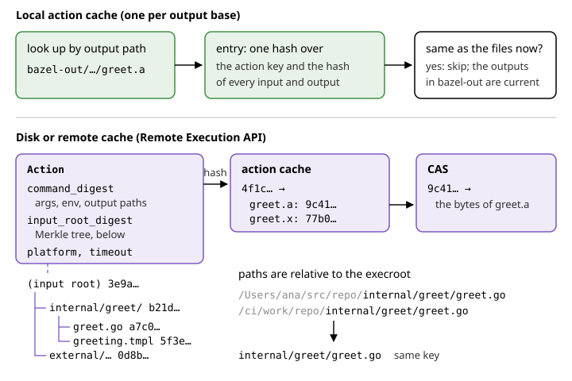
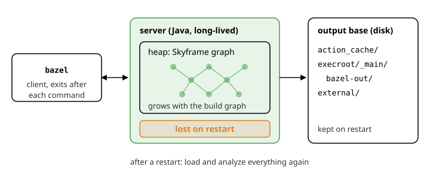

# 6. Bazel 的设计
<!-- 译自 5be0d60 -->

Bazel 构建一个包含多种语言的仓库，在多台机器上构建并测试它，并力求给出与干净构建相同的结果。

两段表述确立了它的目标。愿景是：「任何软件开发者都能高效地构建、测试和打包任何项目，无论其规模
与复杂度如何」。[^vision]README 中的标语是：「{快速，正确}：两个都选」。[^readme]按笔者的理解，每个
目标都迫使 Bazel 做出一项选择：

- **一个仓库中的多种语言**。没有哪一种语言的导入能描述整个图，因此图在构建文件中声明。
- **多台机器**。在一台机器上算出的结果必须在另一台机器上同样成立，因此动作「相互隔离，并且可以
  转移到别处执行」，[^vision]动作的键也不能依赖于机器。
- **正确**。增量构建必须等同于干净构建，因此每个输入都要声明，每处变化都要被发现。

Bazel 对第 1 章六项决策的回答如下，第 8 章将针对 Go 对它们加以权衡：

| 决策（第 1 章） | Bazel 的回答 |
|---|---|
| 单元 | 构建文件中声明的每个步骤对应一个动作；对 Go 而言，每个包一次编译 |
| 图 | 在构建文件中声明，由一个长期运行的进程保存在内存中 |
| 变化 | 将每个已知文件的时间与上一次构建时比较，或询问操作系统 |
| 键 | 命令、命令的环境与机器类型，以及每个输入的内容，路径都相对于同一个目录 |
| 共享 | 每个检出一份本地缓存；另有位于磁盘或服务器上、跨检出与机器共享的缓存 |
| 执行 | 在本地一个只含已声明输入的目录中运行；或在远程机器池上运行 |

## 模型


图 6.1 使用第 2 章的 `examples/minimal`。**包**（package）是含有 BUILD 文件的目录。**目标**（target）
是在其中声明的具名单元，例如 `//internal/greet:greet`；它的 `deps` 是指向其他目标的边。**规则**（rule）
是目标的种类，例如 `go_library`：它是一个用 Starlark（Bazel 所用的类似 Python 的语言）编写的函数，
说明如何构建这一种类的目标。[^glossary]

分析一个目标时，Bazel 运行其规则的函数，这个函数做两件事。其一，它注册**动作**（action），即声明了
输入和输出的命令，例如把 `greet.go` 编译为 `greet.a`，[^rules-actions]外加 `greet.x`，即导入者编译时
所依据的导出数据（第 7 章）。其二，它返回**提供者**（provider），即供依赖它的目标使用的数据。规则只
读取其直接依赖的提供者，因此每个目标都要把依赖它的目标所需的内容传递给它们。[^rules-providers]
`go_library` 返回 `GoArchive` 与 `GoInfo`：前者是「the compiled form ... with everything needed to link it into a binary」，
后者是「构建 GoArchive 所需的、经过筛选的输入与依赖」。[^rules-go-providers]动作读写的文件称为**产物**
（artifact）；每个输出都恰好由一个动作写出。[^glossary][^rules-actions]

**配置**（configuration）是规则之外、影响一个目标所产生动作的一组设置，例如目标平台（target
platform，即要为之构建的操作系统与 CPU）[^platforms]和命令行标志。在两种配置下构建的目标会被分析
两次，产生两组动作。[^glossary]构建期间运行的工具在执行配置（exec configuration）中构建，面向运行
动作的机器。[^rules-configurations]对于 `//cmd/hello` 及其依赖，`bazel aquery`（它打印分析阶段注册的
动作）在目标配置中列出 19 个动作，在执行配置中列出 21 个，后者用于构建 rules_go 的构建器（builder）程序：

```text
$ bazel aquery 'deps(//cmd/hello)' --output=summary
Configurations:
  darwin_arm64-fastbuild: 19
  darwin_arm64-opt-exec: 21
```

设置了 `goos` 和 `goarch`，或设置了 `race` 的 `go_binary`，会把自身及其依赖移入另一种配置
（第 7 章）。[^rules-go-transition]

每个动作的输入与输出「必须在分析阶段就已知」，也不能依赖于任何程序的运行结果。[^rules-actions]下文的
一切都依赖于这一点。

## 三个阶段


一条命令分三个阶段运行。[^phases]**加载**（loading）把 BUILD 文件求值为目标。**分析**（analysis）运行
规则，产生动作图。**执行**（execution）运行那些输出需要用到且不是最新的动作。加载与分析交错进行。[^phases]
自 Bazel 7.0 起，执行也与它们重叠：Bazel「在仍在分析其他顶层目标时就开始执行动作」，顶层目标即命令行
上指定的目标。[^skymeld]

## Skyframe


三个阶段都运行在 Skyframe 之上。Skyframe 是 Bazel 的增量求值框架：一张由节点（文件、包、目标、动作、
输出）构成的图，每个节点保存一个值，以及指向它所读取节点的边。[^skyframe]这张图位于 Bazel 服务进程（server）的
内存中。服务进程是一个长期运行的 Java 进程，由 `bazel` 命令启动，此后该命令与它通信。服务进程
「从一次构建到下一次构建保留 BUILD 文件、依赖图和其他元数据」。[^client-server]在新启动的服务进程上
执行 `bazel build //...` 之后，最小示例的图中有 48623 个节点，来自 168 个包，其中只有 3 个是示例自己的
包：

```text
$ bazel dump --skyframe=summary
Node count: 48623
Edge count: 125532
$ bazel dump --skyframe=count
FILE              12679
FILE_STATE        12301
CONFIGURED_TARGET  9807
ARTIFACT           6151
PACKAGE             168
ACTION_EXECUTION    120
```

每条命令执行之前，Bazel 都要查找发生变化的文件。默认情况下，它用 `stat` 读取图中每个文件的元数据，把
文件的修改时间、状态变更时间和 inode 号（文件在磁盘上的标识）与保存的值比较，而不读取文件内容。[^filestate]启用 `--watchfs`
（默认关闭）时，它改为询问操作系统哪些源文件发生了变化，[^watchfs]但默认情况下仍会检查上一次构建的
每个输出。[^output-check]直接或间接依赖于变化文件的每个节点都被标记为脏（dirty）。[^skyframe]

随后，Bazel 自底向上重新计算脏节点，并进行变更剪枝（change pruning）：「如果一个节点被置为失效，但在
重新构建时发现它的新值与旧值相同，那么因这个节点的变化而被置为失效的节点会被『复活』」。[^skyframe][^pruning]
重新运行并把输出写到本地磁盘的动作，即使输出的字节没有变化，也不算未改变：它的值记录了每个输出的文件
时间和 inode 号，而不只是哈希。[^action-value]于是，读取这些输出的每个动作都要与动作缓存（见下一节）
核对，而动作缓存只比较哈希。命中时，该动作不运行，其值不变，剪枝在它之上恢复（图 6.3）。二者合起来
实现了第 1 章的提前截断。

正是这张图使重复构建变得廉价。在笔者对 1000 个包的合成仓库（附录 A）的测量中，服务进程处于热状态时，
一次无事可做的构建耗时 0.16 s。新的服务进程必须重新加载并分析一切，才能确定什么都没有变：同样
的构建耗时 3.3 s，在分析之后即停止的构建（`--nobuild`）耗时 2.8 s。[^bench]

## 动作键与两种缓存



动作在 **execroot** 中运行。execroot 是一个目录，源文件、外部仓库和输出目录树 `bazel-out` 在其中位于
固定的相对路径上。[^output-dirs]命令行按这些路径指称文件：

```text
$ bazel aquery //internal/greet:greet
action 'GoCompilePkg internal/greet/greet.a'
  ActionKey: 8387f06b6717d192100020b1f3016e4926447ca3b0f11ff995be97f3b9fdaf80
  Inputs: [..., internal/greet/greet.go, internal/greet/greeting.tmpl]
  Outputs: [bazel-out/darwin_arm64-fastbuild/bin/internal/greet/greet.a, ...]
```

Bazel 的**动作键**（action key）只是第 1 章所说的键的一部分：它对命令行、环境变量、助记符（mnemonic，
表示动作种类的名字，例如 `GoCompilePkg`）和平台做哈希，但不包括输入的内容。[^action-key]输入的内容
进入本地的**动作缓存**（action cache），即输出根目录（output base，存放一个检出的输出与状态的目录）中
的一张表。一个动作的条目按其主输出的路径查找，其中保存一个哈希，它是对动作键以及每个输入和输出的
内容哈希一并计算出的。[^action-cache]如果根据当前文件算出的哈希与之相符，`bazel-out` 中已有的输出
就是最新的，该动作被跳过。这一缓存不存储任何文件内容。

远程缓存使用 Remote Execution API，即一个基于 gRPC（一种远程过程调用框架）的开放协议，[^rbe]或一个更简单的
HTTP 协议通信，磁盘缓存（`--disk_cache`）则是 Bazel 当作远程缓存使用的一个本地目录。[^remote-caching]在所有这些缓存中，
一个动作都变成一条 **Action** 消息，其中包括一个 **Command**（参数、环境、输出路径）的哈希、输入根目录的
哈希、平台和超时。[^reapi]输入根目录的哈希是一个 Merkle 树哈希，即对整个输入目录树计算出的单个哈希，因此
任何一个输入变化，它都会变化。Action 的哈希就是键。缓存分为两部分：远程动作缓存把 Action 的哈希映射
到其输出的哈希，内容寻址存储（CAS）把每个哈希映射到相应的字节。[^remote-caching]go 命令的
构建缓存（GOCACHE）同样把条目分为动作条目和内容条目（第 4 章）。

Command 与目录树中的每个路径都相对于 execroot，因此除非某个规则把绝对路径写进命令，检出的位置不会
进入键。[^path-resolver]输出根目录以检出路径的哈希命名，因此每个检出都有自己的本地动作缓存，[^output-dirs]
但不同的检出和机器可以共享磁盘缓存或远程缓存。在笔者的测量中（两次运行中各运行一次），在另一路径上对 1000 个
包的仓库做第二份检出，使用新的输出根目录和第一份检出的磁盘缓存构建：冷构建在沙箱中运行的 999 个动作，
这次一个也没有运行，全部命中缓存。这次构建耗时 9.4 s，而冷构建耗时 37.4 s。[^bench]

## 沙箱与持久工作进程


默认情况下，Bazel 对每个动作使用下列策略中第一个支持该动作的策略来运行它：远程（设置了远程执行器
时）、工作进程、沙箱、本地。[^strategies]**沙箱**（sandbox）为动作提供一个独立的 execroot，其中只含
该动作声明的输入，在 macOS 上由 `sandbox-exec` 限制，在 Linux 上由容器限制。这样一来，工具看不到
任何未声明的文件，除非它知道该文件的绝对路径。建立和拆除每个沙箱都要花费时间；在 Linux 上，沙箱构建
「很少会慢几个百分点以上」。[^sandboxing]

**持久工作进程**（persistent worker）是一个为许多动作服务的长期运行的进程，省去了每个动作都要启动一次
工具的开销。工具本身或其包装程序必须支持 Bazel 的工作进程协议。[^workers]rules_go 的动作不请求工作进程，因此每次 Go
编译和链接都是一个新进程。[^rules-go-workers]

## 远程缓存与远程执行



使用远程缓存时，Bazel 在运行每个动作之前先查找它的哈希，并上传它所运行动作的结果。[^remote-caching]
使用远程执行时，Bazel 改为把 Action 发送给执行服务：它上传 CAS 中缺少的输入，由服务的执行器池中的
一个执行器运行命令，并把输出存入 CAS。[^rbe][^reapi-exec]执行器无法获得检出中位于输入根目录之外的任何文件，
这正是每个输入都必须声明的原因。[^reapi]调高 `--jobs`（同时运行的动作数上限，默认为本机的核心数）之后，并行度的
上限便取决于执行器池。[^jobs]

自 7.0 起，Bazel 默认只下载顶层目标的输出以及本地动作需要的输出，对其余输出只掌握其哈希（即「Build
without the Bytes」）。[^bwob]这样一来，远程缓存可能会逐出某个后续动作需要的输出。自 9.3 起，回溯
（rewinding）成为默认行为：Bazel 重新运行产生了那些丢失输出的动作。[^rewind]

## 设计的代价



| 代价 | 原因 | 随什么增长 |
|---|---|---|
| 对图的第二份描述 | 图是声明的，而不是推导出来的 | 每次对导入的修改都必须同步到 BUILD 文件（第 3 章） |
| 服务进程内存 | Skyframe 把每个节点都保存在服务进程的堆中[^client-server][^memory] | 目标与配置 |
| 每个动作的固定开销 | 每个动作都有一个进程、一个沙箱、若干哈希计算和一个缓存条目[^sandboxing][^rules-go-workers] | 动作的数量 |
| 每次启动后的加载与分析 | 图只存在于内存中[^cache-issues] | 目标的数量；每个新的持续集成（CI）运行器都要付出[^bench] |

堆随图增长，第 5 章测量了它。超出堆容量的构建会以 `OutOfMemoryError` 失败，而那些为节省内存而丢弃
部分图的标志会使增量构建变慢。[^memory]

## 规模变大时意味着什么

- 让服务进程保持热状态。启动新服务进程的 CI 作业要为启动、加载和分析再付一次代价：在笔者的测量中，
  1000 个包为 2.8 s。[^bench]
- 随着仓库增长，用 `bazel info used-heap-size-after-gc` 跟踪服务进程的内存（第 9 章设定上限）。
- 在不同的检出与机器之间共享磁盘缓存或远程缓存。检出路径不进入键，但环境变量和平台会进入，因此要让
  它们保持一致。
- 保持 Build without the Bytes 开启；只为有人或后续作业要读取的文件，用 `--remote_download_regex`
  多下载一些输出。[^bwob]

## 参考文献

[^vision]: Bazel，「Bazel Vision」。<https://bazel.build/about/vision>

[^readme]: Bazel，`README.md`，其中的标语。
    <https://github.com/bazelbuild/bazel/blob/9.3.2/README.md?plain=1#L3>

[^glossary]: Bazel，「Glossary」，词条「Package」「Target」「Rule」「Artifact」「Configuration」与
    「Configured target」。<https://bazel.build/reference/glossary#package>
    <https://bazel.build/reference/glossary#target>
    <https://bazel.build/reference/glossary#rule>
    <https://bazel.build/reference/glossary#artifact>
    <https://bazel.build/reference/glossary#configuration>
    <https://bazel.build/reference/glossary#configured-target>

[^rules-actions]: Bazel，「Rules」，「Actions」一节。
    <https://bazel.build/extending/rules#actions>

[^rules-providers]: Bazel，「Rules」，「Providers」一节。
    <https://bazel.build/extending/rules#providers>

[^rules-go-providers]: rules_go，`go/private/providers.bzl`，`GoInfo` 与 `GoArchive`；以及
    `go/private/rules/library.bzl`，`_go_library_impl`，它返回这两者。
    <https://github.com/bazel-contrib/rules_go/blob/v0.65.0/go/private/providers.bzl#L15-L29>
    <https://github.com/bazel-contrib/rules_go/blob/v0.65.0/go/private/rules/library.bzl#L60-L62>

[^platforms]: Bazel，「Platforms」。<https://bazel.build/concepts/platforms>

[^rules-configurations]: Bazel，「Rules」，「Configurations」一节。
    <https://bazel.build/extending/rules#configurations>

[^rules-go-transition]: rules_go，`go/private/rules/binary.bzl`，该规则的 `cfg`；以及
    `go/private/rules/transition.bzl`，`_go_transition_impl` 与 `go_transition`。
    <https://github.com/bazel-contrib/rules_go/blob/v0.65.0/go/private/rules/binary.bzl#L262>
    <https://github.com/bazel-contrib/rules_go/blob/v0.65.0/go/private/rules/transition.bzl#L78-L170>
    <https://github.com/bazel-contrib/rules_go/blob/v0.65.0/go/private/rules/transition.bzl#L172-L180>

[^phases]: Bazel，「Extension Overview」，「Evaluation model」一节；「Glossary」，词条
    「Loading phase」。<https://bazel.build/extending/concepts#evaluation-model>
    <https://bazel.build/reference/glossary#loading-phase>

[^skymeld]: Bazel 7.0.0 发布说明；`lib/buildtool/BuildRequestOptions.java`，
    `--experimental_merged_skyframe_analysis_execution`，默认值为 `true`。
    <https://github.com/bazelbuild/bazel/releases/tag/7.0.0>
    <https://github.com/bazelbuild/bazel/blob/9.3.2/src/main/java/com/google/devtools/build/lib/buildtool/BuildRequestOptions.java#L409-L416>

[^skyframe]: Bazel，「Skyframe」，「Data model」与「Incrementality」两节。
    <https://bazel.build/reference/skyframe#incrementality>

[^client-server]: Bazel，「Client/server implementation」。
    <https://bazel.build/run/client-server>

[^filestate]: Bazel，`lib/actions/FileStateValue.java`，`createRegularFileStateValueFromPath`，以及
    `lib/actions/FileContentsProxy.java`：除非文件系统提供快速摘要，否则以文件元数据代替内容。
    <https://github.com/bazelbuild/bazel/blob/9.3.2/src/main/java/com/google/devtools/build/lib/actions/FileStateValue.java#L137-L172>
    <https://github.com/bazelbuild/bazel/blob/9.3.2/src/main/java/com/google/devtools/build/lib/actions/FileContentsProxy.java#L21-L38>

[^watchfs]: Bazel，`lib/skyframe/LocalDiffAwareness.java`，`--watchfs` 选项（默认值为
    `false`）以及该选项关闭时使用的 `EVERYTHING_MODIFIED`；`lib/skyframe/SkyframeExecutor.java`，
    `handleDiffsWithMissingDiffInformation`，此时它检查每个已知的文件。
    <https://github.com/bazelbuild/bazel/blob/9.3.2/src/main/java/com/google/devtools/build/lib/skyframe/LocalDiffAwareness.java#L51-L63>
    <https://github.com/bazelbuild/bazel/blob/9.3.2/src/main/java/com/google/devtools/build/lib/skyframe/LocalDiffAwareness.java#L118-L127>
    <https://github.com/bazelbuild/bazel/blob/9.3.2/src/main/java/com/google/devtools/build/lib/skyframe/SkyframeExecutor.java#L3941-L3958>

[^output-check]: Bazel，`lib/pkgcache/PackageOptions.java`，`--experimental_check_output_files`
    （默认值为 `true`）；以及 `lib/buildtool/ExecutionTool.java`，它仅在该选项为 `false` 时跳过对
    输出的检查。
    <https://github.com/bazelbuild/bazel/blob/9.3.2/src/main/java/com/google/devtools/build/lib/pkgcache/PackageOptions.java#L181-L191>
    <https://github.com/bazelbuild/bazel/blob/9.3.2/src/main/java/com/google/devtools/build/lib/buildtool/ExecutionTool.java#L506-L511>
[^pruning]: Bazel，`skyframe/IncrementalInMemoryNodeEntry.java`，`setValue`；以及
    `skyframe/DirtyBuildingState.java`，`unchangedFromLastBuild`。
    <https://github.com/bazelbuild/bazel/blob/9.3.2/src/main/java/com/google/devtools/build/skyframe/IncrementalInMemoryNodeEntry.java#L150-L160>
    <https://github.com/bazelbuild/bazel/blob/9.3.2/src/main/java/com/google/devtools/build/skyframe/DirtyBuildingState.java#L206-L219>

[^action-value]: Bazel，`lib/skyframe/ActionExecutionValue.java`，`equals`，它比较输出的元数据；
    `lib/actions/FileArtifactValue.java`，`RegularFileArtifactValue.equals`，它比较哈希、内容代理
    （文件时间与 inode）和大小；`lib/skyframe/ActionOutputMetadataStore.java`，
    `fileArtifactValueFromStat`，它根据 `stat` 构建输出的元数据，并保留内容代理；
    `lib/actions/FileStateValue.java`，除非文件系统提供哈希，否则它保留内容代理；
    `ActionOutputMetadataStore.constructFileArtifactValue` 与
    `FileArtifactValue.createFromInjectedDigest`，它们加入计算出的哈希并保留内容代理；
    `lib/skyframe/ActionExecutionFunction.java`，它在动作缓存命中时根据输出当前的元数据构建值；
    以及 `FileArtifactValue.addTo`，它只把哈希放入动作缓存：「Modifying a timestamp while keeping
    the contents of a file the same should not cause rebuilds」。
    <https://github.com/bazelbuild/bazel/blob/9.3.2/src/main/java/com/google/devtools/build/lib/skyframe/ActionExecutionValue.java#L232-L245>
    <https://github.com/bazelbuild/bazel/blob/9.3.2/src/main/java/com/google/devtools/build/lib/actions/FileArtifactValue.java#L593-L603>
    <https://github.com/bazelbuild/bazel/blob/9.3.2/src/main/java/com/google/devtools/build/lib/skyframe/ActionOutputMetadataStore.java#L566-L589>
    <https://github.com/bazelbuild/bazel/blob/9.3.2/src/main/java/com/google/devtools/build/lib/actions/FileStateValue.java#L158-L171>
    <https://github.com/bazelbuild/bazel/blob/9.3.2/src/main/java/com/google/devtools/build/lib/skyframe/ActionOutputMetadataStore.java#L441-L453>
    <https://github.com/bazelbuild/bazel/blob/9.3.2/src/main/java/com/google/devtools/build/lib/actions/FileArtifactValue.java#L335-L338>
    <https://github.com/bazelbuild/bazel/blob/9.3.2/src/main/java/com/google/devtools/build/lib/skyframe/ActionExecutionFunction.java#L717-L724>
    <https://github.com/bazelbuild/bazel/blob/9.3.2/src/main/java/com/google/devtools/build/lib/actions/FileArtifactValue.java#L254-L264>

[^bench]: 本书的测量，`examples/bench/results/2026-11-16/results.jsonl`：配置 `n1000`（1000 个包），
    工具 `bazel`，场景 `noop`（第 0 至 2 次重复）、`noop-cold-server`、`analysis-cold-server`（在新的
    服务进程上运行 `bazel build --nobuild`）、`cold` 和 `clone-diskcache`（999 次磁盘缓存命中，没有
    沙箱进程）。第二次运行（附录 A，表 A.7）：`noop` 0.13 s，`noop-cold-server` 4.1 s，
    `analysis-cold-server` 3.4 s，`cold` 48.2 s，`clone-diskcache` 5.9 s，命中同样是 999 次。
    [results.jsonl](../../examples/bench/results/2026-11-16/results.jsonl)，
    [第二次运行](../../examples/bench/results/2026-11-16-n1000-check/results.jsonl)

[^output-dirs]: Bazel，「Output Directory Layout」，「Current layout」与「Layout diagram」两节。
    <https://bazel.build/remote/output-directories#layout-diagram>

[^action-key]: Bazel，`lib/analysis/actions/SpawnAction.java`，`computeKey`；以及
    `lib/actions/ActionKeyComputer.java`，`getKey`。
    <https://github.com/bazelbuild/bazel/blob/9.3.2/src/main/java/com/google/devtools/build/lib/analysis/actions/SpawnAction.java#L396-L417>
    <https://github.com/bazelbuild/bazel/blob/9.3.2/src/main/java/com/google/devtools/build/lib/actions/ActionKeyComputer.java#L37-L57>

[^action-cache]: Bazel，`lib/actions/cache/ActionCache.java`，接口注释与
    `Entry.Builder.computeDigest`；`lib/actions/ActionCacheUtils.java`，`getCacheEntry`；
    `lib/actions/ActionCacheChecker.java`，`mustExecute`；`lib/actions/FileArtifactValue.java`，
    `addTo`。
    <https://github.com/bazelbuild/bazel/blob/9.3.2/src/main/java/com/google/devtools/build/lib/actions/cache/ActionCache.java#L49-L58>
    <https://github.com/bazelbuild/bazel/blob/9.3.2/src/main/java/com/google/devtools/build/lib/actions/cache/ActionCache.java#L400-L418>
    <https://github.com/bazelbuild/bazel/blob/9.3.2/src/main/java/com/google/devtools/build/lib/actions/ActionCacheUtils.java#L39-L46>
    <https://github.com/bazelbuild/bazel/blob/9.3.2/src/main/java/com/google/devtools/build/lib/actions/ActionCacheChecker.java#L574-L593>
    <https://github.com/bazelbuild/bazel/blob/9.3.2/src/main/java/com/google/devtools/build/lib/actions/FileArtifactValue.java#L254-L264>

[^rbe]: Bazel，「Remote Execution Overview」。<https://bazel.build/remote/rbe>

[^remote-caching]: Bazel，「Remote Caching」，「Overview」「How a build uses remote caching」
    「HTTP caching protocol」与「Disk cache」各节。
    <https://bazel.build/remote/caching#overview> <https://bazel.build/remote/caching#remote-caching>
    <https://bazel.build/remote/caching#http-caching> <https://bazel.build/remote/caching#disk-cache>

[^reapi]: Remote Execution API，Bazel 中收录的 `remote_execution.proto`，消息 `Action` 与 `Command`；
    Bazel，`lib/remote/RemoteExecutionService.java`，`buildRemoteAction`。
    <https://github.com/bazelbuild/bazel/blob/9.3.2/third_party/remoteapis/build/bazel/remote/execution/v2/remote_execution.proto#L608-L673>
    <https://github.com/bazelbuild/bazel/blob/9.3.2/third_party/remoteapis/build/bazel/remote/execution/v2/remote_execution.proto#L683-L820>
    <https://github.com/bazelbuild/bazel/blob/9.3.2/src/main/java/com/google/devtools/build/lib/remote/RemoteExecutionService.java#L511-L570>

[^path-resolver]: Bazel，`lib/remote/common/RemotePathResolver.java`，
    `DefaultRemotePathResolver`：execroot 即输入根目录，输出路径相对于它。
    <https://github.com/bazelbuild/bazel/blob/9.3.2/src/main/java/com/google/devtools/build/lib/remote/common/RemotePathResolver.java#L78-L114>

[^strategies]: Bazel，`lib/bazel/rules/BazelStrategyModule.java`，`registerSpawnStrategies`。
    <https://github.com/bazelbuild/bazel/blob/9.3.2/src/main/java/com/google/devtools/build/lib/bazel/rules/BazelStrategyModule.java#L66-L79>

[^sandboxing]: Bazel，「Sandboxing」，引言与「Downsides to sandboxing」一节；
    `lib/sandbox/SymlinkedSandboxedSpawn.java`。
    <https://bazel.build/docs/sandboxing#sandboxing_downsides>
    <https://github.com/bazelbuild/bazel/blob/9.3.2/src/main/java/com/google/devtools/build/lib/sandbox/SymlinkedSandboxedSpawn.java#L35-L39>

[^workers]: Bazel，「Persistent Workers」。<https://bazel.build/remote/persistent>

[^rules-go-workers]: rules_go，`go/private/actions/compilepkg.bzl`，编译动作；以及
    `go/private/actions/utils.bzl`，`path_mapping_action_settings`：唯一的执行要求是
    `supports-path-mapping`；`go/private/actions/link.bzl`，链接动作，它不设任何执行要求。
    <https://github.com/bazel-contrib/rules_go/blob/v0.65.0/go/private/actions/compilepkg.bzl#L201-L210>
    <https://github.com/bazel-contrib/rules_go/blob/v0.65.0/go/private/actions/utils.bzl#L10-L14>
    <https://github.com/bazel-contrib/rules_go/blob/v0.65.0/go/private/actions/link.bzl#L229-L238>

[^reapi-exec]: Remote Execution API，Bazel 中收录的 `remote_execution.proto`，服务
    `Execution`（`Execute`）与 `ContentAddressableStorage`（`FindMissingBlobs`），以及关于 CAS 的
    注释：CAS「用于存储执行服务的输入与输出」。
    <https://github.com/bazelbuild/bazel/blob/9.3.2/third_party/remoteapis/build/bazel/remote/execution/v2/remote_execution.proto#L44-L53>
    <https://github.com/bazelbuild/bazel/blob/9.3.2/third_party/remoteapis/build/bazel/remote/execution/v2/remote_execution.proto#L350-L362>
    <https://github.com/bazelbuild/bazel/blob/9.3.2/third_party/remoteapis/build/bazel/remote/execution/v2/remote_execution.proto#L198-L200>

[^jobs]: Bazel，`lib/buildtool/BuildRequestOptions.java`，`--jobs`（默认值为 `auto`）与
    `JobsConverter`，后者把 `auto` 换算为 `HOST_CPUS_SUPPLIER`，即主机的 CPU 数
    （`lib/util/ResourceConverter.java`）；以及 `--experimental_async_execution`
    （默认值为 `false`），启用它时「同时执行的动作数仍受 `--jobs` 限制」。
    <https://github.com/bazelbuild/bazel/blob/9.3.2/src/main/java/com/google/devtools/build/lib/buildtool/BuildRequestOptions.java#L51-L67>
    <https://github.com/bazelbuild/bazel/blob/9.3.2/src/main/java/com/google/devtools/build/lib/buildtool/BuildRequestOptions.java#L533-L536>
    <https://github.com/bazelbuild/bazel/blob/9.3.2/src/main/java/com/google/devtools/build/lib/buildtool/BuildRequestOptions.java#L69-L80>
    <https://github.com/bazelbuild/bazel/blob/9.3.2/src/main/java/com/google/devtools/build/lib/util/ResourceConverter.java#L51-L52>

[^bwob]: Bazel 7.0.0 发布说明，其中也提到 `--remote_download_regex`；
    `lib/remote/options/RemoteOptions.java`，`--remote_download_outputs`，默认值为 `toplevel`。
    <https://github.com/bazelbuild/bazel/releases/tag/7.0.0>
    <https://github.com/bazelbuild/bazel/blob/9.3.2/src/main/java/com/google/devtools/build/lib/remote/options/RemoteOptions.java#L519-L533>

[^rewind]: Bazel 9.3.0 发布说明；`lib/buildtool/BuildRequestOptions.java`，`--rewind_lost_inputs`，
    默认值为 `true`；`lib/skyframe/rewinding/ActionRewindStrategy.java`。
    <https://github.com/bazelbuild/bazel/releases/tag/9.3.0>
    <https://github.com/bazelbuild/bazel/blob/9.3.2/src/main/java/com/google/devtools/build/lib/buildtool/BuildRequestOptions.java#L372-L378>
    <https://github.com/bazelbuild/bazel/blob/9.3.2/src/main/java/com/google/devtools/build/lib/skyframe/rewinding/ActionRewindStrategy.java#L86-L90>

[^memory]: Bazel，「Optimize Memory」，「Trade incremental build speeds for memory」一节。
    <https://bazel.build/advanced/performance/memory#trade-incremental>

[^cache-issues]: Bazel，「Remote Caching」，「Known issues」一节。
    <https://bazel.build/remote/caching#known-issues>
