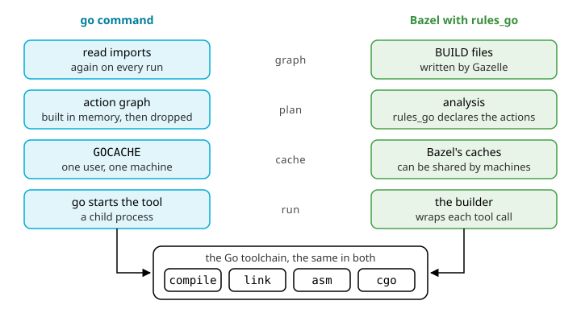

# 7. rules_go：两种设计的交汇处
<!-- 译自 d9d1c21 -->

rules_go 是 Bazel 中用于 Go 的一组规则。它取代了 go 命令中决定构建什么的那一半，保留了执行构建的
那一半。

## 谁负责什么



go 命令读取导入来获取图，在内存中规划动作图，在构建缓存 GOCACHE 中查找每个动作，然后启动
工具（第 4 章）。在 Bazel 下，这些步骤各自换了负责者。BUILD 文件把图声明为目标（target，即有
名字的构建对象），例如每个包一个 `go_library`。Gazelle 是生成 BUILD 文件的工具，它读取同样的导入
来写出 BUILD 文件。[^gazelle]在 Bazel 规划构建的分析阶段（第 6 章），rules_go 的规则把目标变成
动作，例如编译和链接。[^rules-actions]Bazel 的缓存取代了 GOCACHE。保留下来的是 Go SDK（软件开发包，
即 rules_go 下载的 Go 发行版，见第 2 章）及其工具：`compile`、`link`、`asm`（汇编器）和 `cgo`
（让 Go 能够调用 C）。

**标准库**自 Go 1.20 起不再附带编译好的归档。[^go120]对每个需要标准库的配置（configuration，一组
构建设置，例如目标平台或竞态检测器），一个 `GoStdlib` 动作从源码编译整个标准库。[^stdlib]这个动作
内部运行的正是 go 命令本身，即 `go install std`，所用的缓存随后删除。[^stdlib-go]rules_go
事先把所有不可能改变标准库的设置重置，使大多数目标共用同一份标准库。[^stdlib-reset]

**构建器**（builder）是 rules_go 中的一个 Go 程序，大多数 Go 动作运行的都是它，每种工作对应一个
子命令：`compilepkg`、`link`、`stdlib`、`nogo` 以及其他几个。一次编译在编译器之外还需要一些
工作：按构建约束（`//go:build` 行）过滤源文件，[^builder-filter]检查每个导入是否都是已声明的依赖
（否则报「missing strict dependencies」），[^builder-strict]写出编译器读取的配置文件，运行 cgo 和
汇编器，并把它们产生的目标文件加入编译出的包。[^builder-compile]go 命令在自己的进程中完成这些工作
（第 4 章）。
在 Bazel 下，这些工作必须在动作内部完成，而用一个程序承担所有工作「reduces the number of inputs
needed for each action」。[^builder]Bazel 用 `go build` 从源码构建构建器，面向的是运行动作的机器，即执行平台（execution
platform），而不是目标平台。[^builder-exec]

## 每次编译产出两个文件


在 go 命令下，一次编译写出一个归档（archive，即 `.a` 文件），其中包含两部分：导出数据（export data），即导入者
编译时读取的包概要；目标代码（object code），即链接器读取的机器码和数据。导入者的缓存键包含整个
归档的哈希（第 4 章）。编译器可以把两部分分开：给定 `-linkobj` 时，它把目标代码写到该文件，只把
导出数据写到 `-o`。编译器源码中写道，在分布式构建中「it can be more efficient to split the output into two files」。[^gc-linkobj]
rules_go 正是这样做的，[^compilego]如第 2 章的示例仓库所示：

```
$ ar t bazel-bin/internal/greet/greet.a
_go_.o
$ ar t bazel-bin/internal/greet/greet.x
__.PKGDEF
$ bazel aquery 'mnemonic("GoCompilePkg", //cmd/hello:hello_lib)' --output=text
  Inputs: [.../stdlib_/pkg, .../internal/greet/greet.x, .../builder, ...]
  Outputs: [.../cmd/hello/hello_lib.a, .../cmd/hello/hello_lib.imports, .../cmd/hello/hello_lib.x]
```

一次编译读取自己的源文件、标准库（以完整归档的形式构建）以及每个直接依赖的 `.x`。[^compile-inputs]
包的 `.a` 只交给链接。[^link-inputs]Bazel 的动作缓存比较动作输入的内容（第 6 章），因此一次没有
改变 `core.x` 的修改不会波及 `core` 的导入者。


图 7.3 的上半部分是图 4.3 中的那次修改：修改一个编译器不内联（inline，即复制到调用者中）的函数的函数体。
`core.a` 改变而 `core.x` 不变，因此 Bazel 在动作缓存（action cache，它对已运行动作的记录）中找到每个导入者的编译，
只运行 `core` 的编译以及各次链接。go 命令则重新编译每个直接导入者。

不过，`.x` 包含的不只是 API（包导出的名字及其类型）。它记录了所描述的每个声明所在的文件、行和
列，[^export-pos]小到可以内联的函数的函数体，[^export-inline]以及每个函数的参数是否可能在调用结束后
仍然存活（即逃逸到堆上）。[^export-ext]因此，会波及每个直接导入者的修改包括：API 修改、对可内联
函数体的修改、改变了逃逸结果的函数体修改（body edit），以及任何把所描述的声明移到另一行或另一列的修改，例如
它上方的一行注释（下半部分）。行尾注释不会移动任何东西。导入者自己的 `.x` 会复制其 API 或可内联
函数用到的 `core` 的每个声明和内联函数体，连同位置一起，[^export-reloc]因此对其中任何一个的修改还会
再波及下一层。

go 命令还会把这些修改再向上传一层。包的目标代码记录了它导入的每个包的指纹（fingerprint，即导出
数据的哈希），[^go-fingerprint]因此直接导入者的归档会改变，它们自己的导入者也要重新编译。在 Bazel
下，导入者的 `.a` 文件同样会改变，但它们的 `.x` 文件只有在复制了被移动的声明时才会改变。在笔者的
测量中，没有一个导入者如此：合成仓库中的包只在一个大到无法内联的函数里使用 `core`。[^bench]

在包含 1000 个包的合成仓库（附录 A）上：

| 对 `core` 的修改 | go 命令 | Bazel |
|---|---|---|
| 一个不被内联的函数的函数体 | 299 次编译，10 次链接 | 1 次编译，10 次链接 |
| 一个新的导出函数 | 712 次编译，10 次链接 | 299 次编译，10 次链接 |
| 其导出类型上方的一行注释 | 712 次编译，10 次链接 | 299 次编译，10 次链接 |

两者都只构建二进制所需的包，其中包括 `core` 的 332 个直接导入者中的 298 个。

## 从库到二进制与测试


目标通过提供者（provider）把数据传给依赖它的目标。提供者是一种结构体，由目标的规则返回，在分析
阶段由依赖它的目标的规则读取。对于自身的包，`go_library` 提供 `.a`、`.x` 和 nogo 的事实文件（见
下文）；它还从依赖中收集其下所有的 `.a`，供链接使用。[^providers]

`go_test` 与 `go test` 一样构建三个包。[^go-test]第一个是连同包内测试文件一起编译的库。第二个是外部
测试包（external test package），即声明 `package greet_test` 的那些文件，它们导入的是连同包内测试文件一起编译的库。第三个是
构建器生成的 main 包，它导入前两者并运行测试。一次链接把它们合成测试二进制。

`go_binary` 和 `go_test` 还负责设定配置。它们的 `goos`、`goarch`、`race` 和 `pure`（不使用 cgo）
属性通过转换（transition）生效：转换是规则对自身及其所有依赖的配置所做的修改。`go_library` 没有
转换，[^transition]因此对于某个二进制或测试所要求的每种配置，库都会编译一次，标准库也是如此。

nogo 是 rules_go 中与 `go vet` 对应的工具，它在构建过程中运行同类的检查，这些检查称为分析器（analyzer）。配置了
`nogo` 目标之后（默认的 nogo 什么也不分析），[^nogo-default]每个包都会得到一个独立于编译的 `RunNogo`
动作，读取同样的 `.x` 文件。[^nogo]分析器可以记录事实（fact），即关于一个包、可供分析其导入者时
使用的结论。[^analysis-facts]每个 `RunNogo` 写出一个事实文件，并读取其直接依赖的事实文件，因此事实
沿着与导出数据相同的边流动。[^nogo-facts]另有一个 `ValidateNogo` 动作在发现问题时使构建
失败。[^nogo-validate]

`go_binary` 和 `go_test` 在一个执行组（exec group）中运行链接。执行组是规则中一组有名字的动作，
Bazel 可以把它们发往另一类机器。[^exec-groups]这个组名为 `go_link`，[^go-link]因此键以 `go_link.`
为前缀的 `exec_properties`（Bazel 传给动作执行者的设置）可以把链接发往专门的机器，链接的内存随
二进制增长（第 5 章）。编译留在默认组中。rules_go 既不传 `-c`，也不声明资源，因此 Bazel 把一次
编译计为一个 CPU（一个核心），而编译器可能用上所有核心（第 5 章）。[^compilego][^bazel-cpu]

## 规模变大时意味着什么

- 如果一次函数体修改后函数仍然大到无法内联，且逃逸结果不变，那么无论这个包被导入得多广，都只
  重新编译这一个包：在笔者的测量中是 1 次编译，而 go 命令是 299 次。
- 在被广泛导入的包中，移动了导出声明的注释与 API 修改的代价相同，对可内联小函数的修改也是如此：
  每个直接导入者都要重新编译（在笔者的测量中为 299 次编译），API 中提到被移动声明的每个包，其
  导入者也要重新编译。
- 包含已修改包的每个二进制仍要重新链接：上表每一行都是 10 次链接。笔者建议通过 `go_link` 把链接
  发往规格与之相称的机器。
- `goos`、`goarch`、`race` 和 `pure` 的每一种新组合，都会增加一次标准库构建，并让其下的每个库再
  编译一次。

## 参考文献

[^gazelle]: Gazelle，`how-gazelle-works.md`，「Overview」：加载、生成、解析（把导入映射为 `deps`
    中的标签）、写出。
    <https://github.com/bazel-contrib/bazel-gazelle/blob/v0.54.0/how-gazelle-works.md#overview>

[^rules-actions]: rules_go，`go/private/actions/compilepkg.bzl`，`emit_compilepkg`，以及
    `go/private/actions/link.bzl`，`emit_link`：`GoCompilePkg` 与 `GoLink` 动作。
    <https://github.com/bazel-contrib/rules_go/blob/v0.65.0/go/private/actions/compilepkg.bzl#L201-L210>
    <https://github.com/bazel-contrib/rules_go/blob/v0.65.0/go/private/actions/link.bzl#L229-L238>

[^go120]: Go 1.20 发布说明，「Go command」：「`$GOROOT/pkg` 目录不再存放标准库的
    预编译包归档」。<https://go.dev/doc/go1.20#go-command>

[^stdlib]: rules_go，`go/private/actions/stdlib.bzl`，`emit_stdlib`，它总是调用 `_build_stdlib`；
    以及 `_build_stdlib`，即针对 `std`（另加 `runtime/cgo` 和两个 `cmd/internal` 包）的 `GoStdlib`
    动作。
    <https://github.com/bazel-contrib/rules_go/blob/v0.65.0/go/private/actions/stdlib.bzl#L36-L47>
    <https://github.com/bazel-contrib/rules_go/blob/v0.65.0/go/private/actions/stdlib.bzl#L111-L154>

[^stdlib-go]: rules_go，`go/tools/builders/stdlib.go`，`stdlib`：一个临时的 `GOCACHE`，函数返回时
    删除；以及带 `-toolexec` 的 `go install`。
    <https://github.com/bazel-contrib/rules_go/blob/v0.65.0/go/tools/builders/stdlib.go#L73-L76>
    <https://github.com/bazel-contrib/rules_go/blob/v0.65.0/go/tools/builders/stdlib.go#L123>

[^stdlib-reset]: rules_go，`go/private/rules/transition.bzl`，`_go_stdlib_transition_impl`，由
    `go/private/rules/stdlib.bzl` 中的 `stdlib` 规则应用。
    <https://github.com/bazel-contrib/rules_go/blob/v0.65.0/go/private/rules/transition.bzl#L270-L284>
    <https://github.com/bazel-contrib/rules_go/blob/v0.65.0/go/private/rules/stdlib.bzl#L33-L35>

[^builder]: rules_go，`go/tools/builders/builder.go`，包注释与 `main` 中的子命令。
    <https://github.com/bazel-contrib/rules_go/blob/v0.65.0/go/tools/builders/builder.go#L15-L18>
    <https://github.com/bazel-contrib/rules_go/blob/v0.65.0/go/tools/builders/builder.go#L49-L76>

[^builder-filter]: rules_go，`go/tools/builders/filter.go`，`filterAndSplitFiles`。
    <https://github.com/bazel-contrib/rules_go/blob/v0.65.0/go/tools/builders/filter.go#L69-L71>

[^builder-strict]: rules_go，`go/tools/builders/importcfg.go`，`checkImports` 与
    `depsError.Error`。
    <https://github.com/bazel-contrib/rules_go/blob/v0.65.0/go/tools/builders/importcfg.go#L34-L39>
    <https://github.com/bazel-contrib/rules_go/blob/v0.65.0/go/tools/builders/importcfg.go#L229-L231>

[^builder-compile]: rules_go，`go/tools/builders/compilepkg.go`，`compileArchive`：cgo、导入与嵌入
    配置、汇编、编译以及打包步骤。
    <https://github.com/bazel-contrib/rules_go/blob/v0.65.0/go/tools/builders/compilepkg.go#L341-L364>
    <https://github.com/bazel-contrib/rules_go/blob/v0.65.0/go/tools/builders/compilepkg.go#L391-L453>
    <https://github.com/bazel-contrib/rules_go/blob/v0.65.0/go/tools/builders/compilepkg.go#L457-L482>
    <https://github.com/bazel-contrib/rules_go/blob/v0.65.0/go/tools/builders/compilepkg.go#L488-L494>

[^builder-exec]: rules_go，`go/private/go_toolchain.bzl`，带 `cfg = "exec"` 的 `builder` 属性；
    `go/private/rules/binary_wrapper.sh`，它运行 `go build -trimpath`。
    <https://github.com/bazel-contrib/rules_go/blob/v0.65.0/go/private/go_toolchain.bzl#L62-L64>
    <https://github.com/bazel-contrib/rules_go/blob/v0.65.0/go/private/rules/binary_wrapper.sh#L18-L23>

[^gc-linkobj]: Go，`cmd/compile/internal/gc/obj.go`，`modeCompilerObj` 上方的注释以及
    `dumpobj`。
    <https://github.com/golang/go/blob/go1.27.3/src/cmd/compile/internal/gc/obj.go#L26-L51>

[^compilego]: rules_go，`go/tools/builders/compilepkg.go`，`compileGo`：`-o` 用于导出数据，
    `-linkobj` 用于目标代码，且不传 `-c`；`go/private/actions/compilepkg.bzl`，`GoCompilePkg` 动作，
    它没有设置资源集。
    <https://github.com/bazel-contrib/rules_go/blob/v0.65.0/go/tools/builders/compilepkg.go#L560-L585>
    <https://github.com/bazel-contrib/rules_go/blob/v0.65.0/go/private/actions/compilepkg.bzl#L201-L210>

[^compile-inputs]: rules_go，`go/private/actions/compilepkg.bzl`，`emit_compilepkg`：每个直接依赖的
    `export_file` 与标准库；`_archive`，它把 `.x` 的路径传给构建器。
    <https://github.com/bazel-contrib/rules_go/blob/v0.65.0/go/private/actions/compilepkg.bzl#L100-L103>
    <https://github.com/bazel-contrib/rules_go/blob/v0.65.0/go/private/actions/compilepkg.bzl#L22-L29>

[^link-inputs]: rules_go，`go/private/actions/link.bzl`，`emit_link`：`archive.libs`，即二进制中
    每个包的 `.a`。
    <https://github.com/bazel-contrib/rules_go/blob/v0.65.0/go/private/actions/link.bzl#L212-L227>

[^export-pos]: Go，`cmd/compile/internal/noder/writer.go`，`pos`，`doObj` 对每个对象都调用它。
    <https://github.com/golang/go/blob/go1.27.3/src/cmd/compile/internal/noder/writer.go#L391-L404>
    <https://github.com/golang/go/blob/go1.27.3/src/cmd/compile/internal/noder/writer.go#L848-L859>

[^export-inline]: Go，`cmd/compile/internal/noder/linker.go`，`exportBody`：若函数可内联，且声明于
    该包或被内联进该包，则导出其函数体。
    <https://github.com/golang/go/blob/go1.27.3/src/cmd/compile/internal/noder/linker.go#L214-L251>

[^export-ext]: Go，`cmd/compile/internal/noder/linker.go`，`relocFuncExt`：每个参数的逃逸分析标签
    与每个函数的内联成本。
    <https://github.com/golang/go/blob/go1.27.3/src/cmd/compile/internal/noder/linker.go#L296-L307>

[^export-reloc]: Go，`cmd/compile/internal/noder/linker.go`，`linker` 的注释（「a single,
    self-contained export data file」）与 `relocObj`，后者复制被导入对象的定义并调用 `exportBody`。
    <https://github.com/golang/go/blob/go1.27.3/src/cmd/compile/internal/noder/linker.go#L36-L38>
    <https://github.com/golang/go/blob/go1.27.3/src/cmd/compile/internal/noder/linker.go#L137-L212>

[^go-fingerprint]: Go，`internal/pkgbits/encoder.go`，`DumpTo`，它对导出数据求哈希，并把哈希作为
    指纹追加在后面；`cmd/compile/internal/noder/unified.go`，`writeUnifiedExport`；
    `noder/import.go`，`addFingerprint`；`cmd/internal/goobj/objfile.go`，记录被导入包及其指纹的
    `Autolib` 表。
    <https://github.com/golang/go/blob/go1.27.3/src/internal/pkgbits/encoder.go#L57-L59>
    <https://github.com/golang/go/blob/go1.27.3/src/internal/pkgbits/encoder.go#L102-L105>
    <https://github.com/golang/go/blob/go1.27.3/src/cmd/compile/internal/noder/unified.go#L578>
    <https://github.com/golang/go/blob/go1.27.3/src/cmd/compile/internal/noder/import.go#L285-L297>
    <https://github.com/golang/go/blob/go1.27.3/src/cmd/internal/goobj/objfile.go#L42-L45>

[^bench]: 本书的测量，`examples/bench/results/2026-11-16/results.jsonl`：配置 `n1000`，场景
    `core-body`、`core-api` 和 `core-comment`，各运行三次，计数完全相同。go 命令统计其 `compile` 与
    `link` 进程。Bazel 统计其沙箱中的进程：函数体修改为 11 个（`n1000-bazel-core-body.profile.gz`
    中的一个 `GoCompilePkg` 和十个 `GoLink`），另外两种修改为 309 个，即 `core`、被构建的 298 个
    直接导入者和十次链接。Bazel 的 `action cache hit` 计数与图 7.3 中的灰色方框一致：函数体修改为
    298，即被构建的 `core` 直接导入者的数量；注释修改为 413，即比 `core` 高两层、被构建的包的数量，
    由 `n1000-go-cold-actiongraph.json.gz` 统计得出。`go build -o <dir>` 只构建 main 包及其依赖
    （`cmd/go/internal/work/build.go`），Bazel 构建同样的 main 包（`build_targets.txt`，由
    `examples/bench/gen.go` 的 `Repo.write` 写出）。生成的包只在大到无法内联的 `Compute` 中调用
    其导入，并且各自声明自己的类型（`examples/bench/gen.go`，`writePkg`）。
    [results.jsonl](../../examples/bench/results/2026-11-16/results.jsonl)
    [n1000-go-cold-actiongraph.json.gz](../../examples/bench/results/2026-11-16/n1000-go-cold-actiongraph.json.gz)
    [gen.go](../../examples/bench/gen.go)
    <https://github.com/golang/go/blob/go1.27.3/src/cmd/go/internal/work/build.go#L510-L531>

[^providers]: rules_go，`go/private/providers.bzl`，`GoInfo`、`GoArchiveData` 与 `GoArchive`；
    `go/private/actions/archive.bzl`，字段 `file`、`export_file`、`facts_file`、`libs` 与
    `transitive`。
    <https://github.com/bazel-contrib/rules_go/blob/v0.65.0/go/private/providers.bzl#L15-L43>
    <https://github.com/bazel-contrib/rules_go/blob/v0.65.0/go/private/actions/archive.bzl#L210-L213>
    <https://github.com/bazel-contrib/rules_go/blob/v0.65.0/go/private/actions/archive.bzl#L235-L240>

[^go-test]: rules_go，`go/private/rules/test.bzl`，`_go_test_impl`：内部与外部归档、
    `GoTestGenTest`，以及测试 main 包的编译与链接；`_recompile_external_deps` 的文档字符串：
    「go_test, like 'go test', splits tests into two separate archives」。
    <https://github.com/bazel-contrib/rules_go/blob/v0.65.0/go/private/rules/test.bzl#L548-L550>
    <https://github.com/bazel-contrib/rules_go/blob/v0.65.0/go/private/rules/test.bzl#L77-L105>
    <https://github.com/bazel-contrib/rules_go/blob/v0.65.0/go/private/rules/test.bzl#L143-L152>
    <https://github.com/bazel-contrib/rules_go/blob/v0.65.0/go/private/rules/test.bzl#L171-L198>

[^transition]: rules_go，`go/private/rules/transition.bzl`，`_go_transition_impl`，作为 `cfg` 挂在
    `go_binary` 和 `go_test` 上；`go/private/rules/library.bzl`，`go_library`，它没有设置 `cfg`。
    <https://github.com/bazel-contrib/rules_go/blob/v0.65.0/go/private/rules/transition.bzl#L78-L124>
    <https://github.com/bazel-contrib/rules_go/blob/v0.65.0/go/private/rules/binary.bzl#L262>
    <https://github.com/bazel-contrib/rules_go/blob/v0.65.0/go/private/rules/test.bzl#L242>
    <https://github.com/bazel-contrib/rules_go/blob/v0.65.0/go/private/rules/library.bzl#L81-L83>

[^nogo-default]: rules_go，`BUILD.bazel`，`default_nogo`：「does not analyze anything, which
    means no binary is built or run」。
    <https://github.com/bazel-contrib/rules_go/blob/v0.65.0/BUILD.bazel#L45-L51>

[^nogo]: rules_go，`go/nogo.rst`，引言（「与 vet 相同的分析」）；
    `go/private/actions/compilepkg.bzl`，`_run_nogo`：`RunNogo` 动作及其输入。
    <https://github.com/bazel-contrib/rules_go/blob/v0.65.0/go/nogo.rst?plain=1#L30-L32>
    <https://github.com/bazel-contrib/rules_go/blob/v0.65.0/go/private/actions/compilepkg.bzl#L226-L283>

[^analysis-facts]: `golang.org/x/tools/go/analysis`，包文档，「Modular analysis with Facts」。
    <https://pkg.go.dev/golang.org/x/tools/go/analysis#hdr-Modular_analysis_with_Facts>

[^nogo-facts]: rules_go，`go/private/actions/compilepkg.bzl`，`_run_nogo` 的 `-facts` 参数；
    `go/tools/builders/nogo_main.go`，它写出事实文件。
    <https://github.com/bazel-contrib/rules_go/blob/v0.65.0/go/private/actions/compilepkg.bzl#L241-L252>
    <https://github.com/bazel-contrib/rules_go/blob/v0.65.0/go/tools/builders/nogo_main.go#L100-L110>

[^nogo-validate]: rules_go，`go/private/actions/compilepkg.bzl`，`ValidateNogo` 动作。
    <https://github.com/bazel-contrib/rules_go/blob/v0.65.0/go/private/actions/compilepkg.bzl#L285-L303>

[^bazel-cpu]: Bazel，`AbstractAction.java`，`DEFAULT_RESOURCE_SET`：250 MB 与 1 个 CPU；
    `SpawnAction.java`，`Builder`，它以此为初始值；`StarlarkActionFactory.java`，
    `registerStarlarkAction`，只有当规则传入 `resource_set` 时才替换它。
    <https://github.com/bazelbuild/bazel/blob/9.3.2/src/main/java/com/google/devtools/build/lib/actions/AbstractAction.java#L70-L78>
    <https://github.com/bazelbuild/bazel/blob/9.3.2/src/main/java/com/google/devtools/build/lib/analysis/actions/SpawnAction.java#L623>
    <https://github.com/bazelbuild/bazel/blob/9.3.2/src/main/java/com/google/devtools/build/lib/analysis/starlark/StarlarkActionFactory.java#L845-L854>

[^exec-groups]: Bazel，「Execution Groups」，「Using execution groups to set execution
    properties」一节。<https://bazel.build/extending/exec-groups#using-exec-groups-for-exec-properties>

[^go-link]: rules_go，`go/private/rules/binary.bzl` 与 `go/private/rules/test.bzl`，`go_link` 执行组，
    以及传给链接的 `link_exec_group`；`go/private/actions/link.bzl`，`GoLink` 在此使用它。
    <https://github.com/bazel-contrib/rules_go/blob/v0.65.0/go/private/rules/binary.bzl#L507-L511>
    <https://github.com/bazel-contrib/rules_go/blob/v0.65.0/go/private/rules/binary.bzl#L179>
    <https://github.com/bazel-contrib/rules_go/blob/v0.65.0/go/private/rules/test.bzl#L499-L503>
    <https://github.com/bazel-contrib/rules_go/blob/v0.65.0/go/private/rules/test.bzl#L197>
    <https://github.com/bazel-contrib/rules_go/blob/v0.65.0/go/private/actions/link.bzl#L237>
