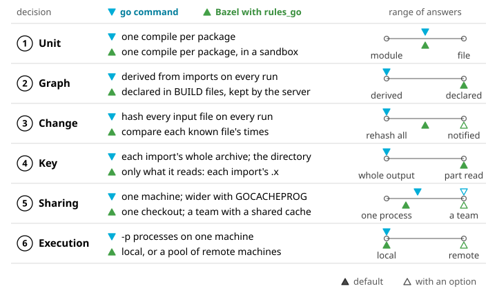
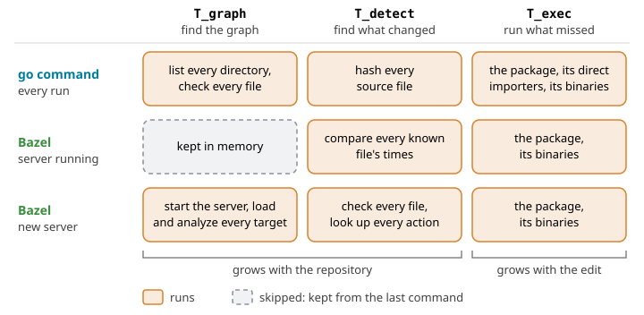

# 8. 两种设计并排比较
<!-- 译自 d9d1c21 -->

本章把 go 命令与 Bazel 配合 rules_go 对第 1 章六项决策的回答并排放在一起，并说明随着仓库增长，
各自要付出什么代价。

## 六项决策，两种回答

一个动作是某个工具的一次运行，例如一次编译；动作的键对一切可能改变其输出的东西求哈希。

### 1. 单元

两者都为每个包（编译器的单元）运行一次编译，为每个二进制运行一次
链接。[^go-compile][^go-compileaction][^rules-go-actions]Bazel 给每个动作增加了固定开销：它把
rules_go 的构建器（builder，包装编译器的程序）[^rules-go-builder]放进沙箱（sandbox，只包含已声明输入的
目录）中运行，[^bazel-sandboxing]并为动作缓存（action cache，已运行动作的记录）对输入和输出求
哈希。[^bazel-action-cache]在笔者看来，这笔开销换来了远程机器和共享缓存所需的隔离，在包多而小的
地方分量最重。

### 2. 图

go 命令从导入推导出图，这是它根据「源码本身所含的信息」进行构建这一目标的要求。[^go-about]
每次运行都会列出每个目录并检查每个文件；自 Go 1.19 起，它只重新解析发生变化的
目录。[^go-load][^go-modindex]Bazel 从 BUILD 文件读取图（BUILD 文件列出每个包的源文件和依赖），
并把图保存在服务进程（server）的内存中；服务进程是每条 `bazel` 命令背后长期运行的
进程。[^bazel-client-server]按笔者的理解，Bazel 之所以声明图，是因为任何一种语言的导入都无法
描述包含多种语言的仓库。因此，go 命令每次运行都要付出 T_graph，即获取图的时间；Bazel 则在每次
服务进程启动后付出这笔时间，用于加载 BUILD 文件并把它们分析为动作，而且还需要另一份保持同步的
描述：Gazelle 是根据导入写出 BUILD 文件的工具，每当导入改变时都必须重新运行，笔者建议在持续集成
（CI）中检查它是否已经运行。[^gazelle][^gazelle-diff]

### 3. 变化

go 命令在两次运行之间不保留任何进程，因此要重新对构建中的每个源文件求哈希。[^go-filehash]这样做
不需要保存状态，但要读取每个字节。Bazel 的服务进程把每个已知文件的时间戳和 inode 号（文件在
磁盘上的标识）与上次构建时的值比较，不读取文件内容；或者在启用 `--watchfs` 时，向操作系统询问
哪些文件发生了变化。[^bazel-filestate][^bazel-watchfs]因此，T_detect（找出变化所需的时间）在 go
命令下随源码的字节数增长，在 Bazel 下随文件数增长。`--watchfs` 使 Bazel 对源文件的检查随变化而定，
但默认情况下它仍会对上次构建的每个输出执行 stat。[^bazel-output-check]

### 4. 键

go 命令中一次编译的键是它的动作 ID，它对以下内容求哈希：源文件、标志和工具；包所在的目录，除非
`-trimpath` 从输出中去掉了路径；以及每个直接导入的内容 ID（content ID），即整个归档的哈希，由归档自身
保存。[^go-buildactionid][^go-actionid-dir][^go-buildid]归档中既有导出数据（export data，导入者编译时读取的
概要），也有只供链接读取的目标代码。[^go-archive]因此，对编译器不内联（inline，即复制到调用者中）的函数做
函数体修改（body edit），会使每个直接导入者重新编译。改变导出数据的修改会波及两层：每个导入者的目标代码记录了
导出数据的哈希，因此导入者的归档也会改变。[^go-fingerprint]

rules_go 按照编译器源码针对「a distributed build setting」的建议，把两部分拆开：目标代码写入供链接使用的 `.a`
文件，导出数据写入供导入者使用的 `.x` 文件。[^gc-linkobj][^rules-go-compilego]Bazel 的动作缓存
比较动作输入的内容，[^bazel-action-cache]而导入者只读取 `.x`，[^rules-go-compile-inputs]因此只要
`.x` 不变，这次函数体修改就止于被修改的包（图 7.3）。除 API 之外，`.x` 还记录了它所描述的每个声明
的位置、可内联的函数体以及哪些参数逃逸到堆上，[^go-export-pos][^go-export-inline][^go-export-ext]
因此对其中任何一项的修改都会波及每个直接导入者；若某个导入者的 `.x` 复制了被修改的声明，还会波及
再下一层。[^go-export-reloc]

两者都会重新链接包含已修改包的每个二进制，[^go-linkactionid][^rules-go-link-inputs]但 GOCACHE
不保存 `go build` 产生的二进制，[^go-noexe]而 Bazel 像缓存其他动作一样缓存
链接。[^rules-go-actions][^bazel-remote-caching]

### 5. 共享

go 命令的构建缓存 GOCACHE 属于一台机器上的一个用户。[^go-defaultdir]自 Go 1.24 起，[^go124]
`GOCACHEPROG` 可以把缓存交给一个程序，由它把条目存放在任何地方；键保持不变，因此在没有 `-trimpath`
时，位于另一路径的检出会未命中，而且二进制不会被存储。[^go-cacheprog][^go-noexe-prog]Bazel 在
execroot（动作运行的根目录）中运行每个动作，其中每个输入和输出都有固定的相对路径，因此它的键与
检出所在的位置无关，除非某条规则把绝对路径写进了命令。[^bazel-path-resolver]它的本地动作缓存服务于
单个检出，[^bazel-output-dirs]但磁盘缓存（disk cache，一个本地目录）服务于一台机器上的所有检出，远程缓存则服务
于一个团队，链接也包括在内。[^bazel-remote-caching]环境变量和平台（platform，运行动作的机器类型）都会进入键，
必须一致。[^bazel-reapi][^bazel-cache-issues]

### 6. 执行

go 命令在一台机器上以子进程的形式运行每个动作，同时运行 `-p` 个，默认每个 CPU 核心一个。[^go-do]
于是，一台机器的核心数决定了 T_exec 的下限；T_exec 是运行未命中缓存的动作所需的时间。Bazel 默认在
本地运行动作；启用远程执行时，它把动作发往一个机器池，并上传远程缓存中缺少的
输入，[^bazel-reapi-exec]因此并行度的上限由机器池决定。这会增加 T_transfer，即与远程机器和缓存之间
传输字节的时间；Build without the Bytes（自 Bazel 7.0 起默认启用）只下载命令行上请求的输出和本地
动作需要的输出，以此限制这部分时间。[^bazel-bwob]

## 端到端

表 8.1：墙钟时间（秒），包数为 1000 和 3000。[^bench]

<!--
Fill from examples/bench/results/2026-11-16/results.jsonl, configs n1000 and n3000.
Row                         go scenario       bazel scenario
Cold build                  cold              cold
No-op build                 noop (reps 0-2)   noop (reps 0-2; rep 3 only re-warms the server)
Body edit to core           core-body         core-body
API edit to core            core-api          core-api
Test after the body edit    test-core-body    test-core-body
Fresh checkout, warm cache  clone-warmcache   clone-diskcache
go clone-warmcache has no -trimpath; clone-warmcache-trimpath is the same build with it.
-->

| 场景 | go，1000 | Bazel，1000 | go，3000 | Bazel，3000 |
|---|---|---|---|---|
| 冷构建 | 6.9 | 37 | 28 | 84 |
| 空构建 | 0.86 | 0.16 | 2.5 | 0.20 |
| 对 `core` 的函数体修改 | 3.0 | 1.7 | 14 | 12 |
| 对 `core` 的 API 修改 | 5.3 | 5.1 | 24 | 21 |
| 函数体修改后的测试 | 260 | 460 | 1200 | TBD |
| 全新检出，热缓存 | 5.0 | 9.4 | 22 | TBD |

仓库是包含 1000 个包的合成仓库（附录 A），另外也生成了 3000 个包的版本，`core` 是其中被导入最广的
包。构建分别是 `go build -o <dir> ./...` 和对同样二进制的 `bazel build`；测试一行运行的是
`go test -vet=off ./...` 和 `bazel test //...`：

- **冷构建**：两者都编译全部代码，包括标准库。[^go-no-prebuilt-std][^rules-go-stdlib]Bazel 还要
  启动服务进程、加载、分析、构建 rules_go 的构建器，[^rules-go-builder-exec]并付出每个动作的开销。
- **空构建**：go 命令加载整棵源码树并对其求哈希；Bazel 正在运行的服务进程比较文件时间。
- **对 `core` 的修改**：无论是函数体修改还是 API 修改，go 命令都比 Bazel 多重新编译一层导入者；
  两者都要重新链接。
- **函数体修改后的测试**：两者都会重新运行二进制中包含 `core` 的每个测试，因为两者都以测试的二进制
  为键记录测试结果。[^go-testcache][^bazel-cache-tests]在笔者看来，`.x` 在这里省下的是编译，而不是
  链接或测试运行。Bazel 首次运行时的链接和测试运行更慢（第 5 章）。
- **全新检出**：位于另一路径的副本，使用第一次构建的缓存（对 Bazel 而言是其磁盘缓存）。没有
  `-trimpath` 时，检出中每个包的动作 ID 都随其目录而改变。Bazel 磁盘缓存的键能够匹配，但新的服务
  进程必须先加载和分析。

## 各自在何处不再随规模扩展

按笔者的分析，go 命令在一次运行的工作量随仓库而非变化增长之处不再随规模扩展：每次调用都要在整棵
源码树上付出 T_graph 和 T_detect（图 8.2）。除非用 `GOCACHEPROG` 和 `-trimpath` 加以扩展，它的缓存
止于一台机器，而且二进制在每台机器上都要重新链接。生成的代码和其他语言留在图之外，也不被
缓存：go 命令只构建 Go，从不自行运行 `go generate`。[^go-about][^go-generate]

按笔者的分析，Bazel 在其开销随图增长之处不再随规模扩展。服务进程的内存随图增长；堆太小会
使构建失败，而节省内存的标志会拖慢增量构建。[^bazel-client-server][^bazel-memory]每次服务进程启动
（例如在每个新的 CI 运行器上）都要重新加载和分析，[^bazel-cache-issues]并且如第 2 章的重启所示，
要把每个动作重新与动作缓存核对一遍。

## 规模变大时意味着什么

- 随着仓库增长，测量空构建的耗时。如果它随源码树增长，限制就在于 T_graph 和 T_detect。热的 Bazel
  服务进程保留着图，`--watchfs` 使它不再重新扫描源文件，但它仍会检查上次构建的每个输出。
- 在跨机器共享缓存之前，先让各机器上的键一致：`-trimpath` 配合 `GOCACHEPROG`；在 Bazel 下，环境和
  平台一致。只有 Bazel 的共享缓存保存链接的结果。
- 在 go 命令下，对被广泛导入的包的任何修改都会使每个直接导入者重新编译，改变其导出数据的修改还会
  使这些导入者的导入者重新编译。在 Bazel 下，只有改变其 `.x`（API、声明位置、可内联的函数体、逃逸
  结果）的修改才会使导入者重新编译。无论哪一种，包含该包的每个二进制都要重新链接。
- 为 Bazel 的开销做好预算：服务进程的内存、每次服务进程启动时的分析、每个动作的开销，以及随每次
  导入变化保持同步的 BUILD 文件。
- 如果生成的代码或其他语言在构建中占很大比重，笔者预计只有声明式的图才能把它们纳入缓存。

## 参考文献

[^go-compile]: Go，`cmd/compile/doc.go`，包文档。
    <https://github.com/golang/go/blob/go1.27.3/src/cmd/compile/doc.go#L6>
[^go-compileaction]: Go，`cmd/go/internal/work/action.go`，`CompileAction`。
    <https://github.com/golang/go/blob/go1.27.3/src/cmd/go/internal/work/action.go#L628>
[^rules-go-actions]: rules_go，`go/private/actions/compilepkg.bzl`，`emit_compilepkg`，以及
    `go/private/actions/link.bzl`，`emit_link`：`GoCompilePkg` 与 `GoLink` 动作。
    <https://github.com/bazel-contrib/rules_go/blob/v0.65.0/go/private/actions/compilepkg.bzl#L201-L210>
    <https://github.com/bazel-contrib/rules_go/blob/v0.65.0/go/private/actions/link.bzl#L229-L238>
[^rules-go-builder]: rules_go，`go/tools/builders/builder.go`，包注释；编译动作的 `executable` 就是
    构建器。
    <https://github.com/bazel-contrib/rules_go/blob/v0.65.0/go/tools/builders/builder.go#L15-L18>
    <https://github.com/bazel-contrib/rules_go/blob/v0.65.0/go/private/actions/compilepkg.bzl#L205>
[^bazel-sandboxing]: Bazel，「Sandboxing」，「Downsides to sandboxing」一节；
    `lib/sandbox/SymlinkedSandboxedSpawn.java`。
    <https://bazel.build/docs/sandboxing#sandboxing_downsides>
    <https://github.com/bazelbuild/bazel/blob/9.3.2/src/main/java/com/google/devtools/build/lib/sandbox/SymlinkedSandboxedSpawn.java#L35-L39>
[^bazel-action-cache]: Bazel，`lib/actions/cache/ActionCache.java`，接口注释与
    `Entry.Builder.computeDigest`：动作键以及每个输入和输出的内容。
    <https://github.com/bazelbuild/bazel/blob/9.3.2/src/main/java/com/google/devtools/build/lib/actions/cache/ActionCache.java#L49-L58>
    <https://github.com/bazelbuild/bazel/blob/9.3.2/src/main/java/com/google/devtools/build/lib/actions/cache/ActionCache.java#L400-L418>
[^go-about]: Go，「About the go command」，「Motivation」与「Configuration versus
    convention」两节。<https://go.dev/doc/articles/go_command>
[^go-load]: Go，`cmd/go/internal/load/pkg.go`，`PackagesAndErrors`。
    <https://github.com/golang/go/blob/go1.27.3/src/cmd/go/internal/load/pkg.go#L2937>
[^go-modindex]: Go，`cmd/go/internal/load/pkg.go`，`loadPackageData`，它首先查询模块索引；
    `cmd/go/internal/modindex/read.go`，`dirHash` 与 `openIndexPackage`。
    由提交 5a1c5b8ae7 加入，首次随 Go 1.19 发布。
    <https://github.com/golang/go/blob/go1.27.3/src/cmd/go/internal/load/pkg.go#L952>
    <https://github.com/golang/go/blob/go1.27.3/src/cmd/go/internal/modindex/read.go#L80-L119>
    <https://github.com/golang/go/blob/go1.27.3/src/cmd/go/internal/modindex/read.go#L218-L245>
    <https://go.googlesource.com/go/+/5a1c5b8ae7>
[^bazel-client-server]: Bazel，「Client/server implementation」。
    <https://bazel.build/run/client-server>
[^gazelle]: Gazelle，`how-gazelle-works.md`，「Overview」。
    <https://github.com/bazel-contrib/bazel-gazelle/blob/v0.54.0/how-gazelle-works.md#overview>
[^gazelle-diff]: Gazelle，`gazelle-reference.md`，`-mode`：diff 模式打印它将做出的修改。
    <https://github.com/bazel-contrib/bazel-gazelle/blob/v0.54.0/gazelle-reference.md?plain=1#L53-L59>
[^go-filehash]: Go，`cmd/go/internal/cache/hash.go`，`FileHash`：对整个文件求哈希，并把结果记在
    一个与进程同生命周期的 map 中。
    <https://github.com/golang/go/blob/go1.27.3/src/cmd/go/internal/cache/hash.go#L140-L183>
[^bazel-filestate]: Bazel，`lib/actions/FileStateValue.java`，
    `createRegularFileStateValueFromPath`，以及 `lib/actions/FileContentsProxy.java`：除非文件系统
    提供快速摘要，否则以文件元数据代替内容。
    <https://github.com/bazelbuild/bazel/blob/9.3.2/src/main/java/com/google/devtools/build/lib/actions/FileStateValue.java#L137-L147>
    <https://github.com/bazelbuild/bazel/blob/9.3.2/src/main/java/com/google/devtools/build/lib/actions/FileContentsProxy.java#L20-L37>
[^bazel-watchfs]: Bazel，`lib/skyframe/LocalDiffAwareness.java`，`--watchfs` 选项（默认值为
    `false`）以及该选项关闭时使用的 `EVERYTHING_MODIFIED`；`lib/skyframe/SkyframeExecutor.java`，
    `handleDiffsWithMissingDiffInformation`，此时它检查每个已知的文件。
    <https://github.com/bazelbuild/bazel/blob/9.3.2/src/main/java/com/google/devtools/build/lib/skyframe/LocalDiffAwareness.java#L51-L63>
    <https://github.com/bazelbuild/bazel/blob/9.3.2/src/main/java/com/google/devtools/build/lib/skyframe/LocalDiffAwareness.java#L118-L127>
    <https://github.com/bazelbuild/bazel/blob/9.3.2/src/main/java/com/google/devtools/build/lib/skyframe/SkyframeExecutor.java#L3943-L3958>
[^bazel-output-check]: Bazel，`lib/pkgcache/PackageOptions.java`，
    `--experimental_check_output_files`，默认值为 `true`；`lib/buildtool/ExecutionTool.java`，它仅在该
    选项为 false 时跳过检查；`lib/vfs/LocalOutputService.java`，`startBuild`，它把每个输出都报告为
    可能已修改；`lib/skyframe/FilesystemValueChecker.java`，`getDirtyActionValues`，它对图中每个
    动作的输出执行 stat。
    <https://github.com/bazelbuild/bazel/blob/9.3.2/src/main/java/com/google/devtools/build/lib/pkgcache/PackageOptions.java#L181-L191>
    <https://github.com/bazelbuild/bazel/blob/9.3.2/src/main/java/com/google/devtools/build/lib/buildtool/ExecutionTool.java#L506-L512>
    <https://github.com/bazelbuild/bazel/blob/9.3.2/src/main/java/com/google/devtools/build/lib/vfs/LocalOutputService.java#L59-L85>
    <https://github.com/bazelbuild/bazel/blob/9.3.2/src/main/java/com/google/devtools/build/lib/skyframe/FilesystemValueChecker.java#L213-L264>
[^go-buildactionid]: Go，`cmd/go/internal/work/exec.go`，`buildActionID`：平台、编译器工具 ID 与
    标志、输入文件，以及每个依赖的内容 ID。
    <https://github.com/golang/go/blob/go1.27.3/src/cmd/go/internal/work/exec.go#L264-L442>
[^go-actionid-dir]: Go，`cmd/go/internal/work/exec.go`，`buildActionID` 中的 `dir` 一行。
    <https://github.com/golang/go/blob/go1.27.3/src/cmd/go/internal/work/exec.go#L275-L303>
[^go-buildid]: Go，`cmd/go/internal/work/buildid.go`，「Build IDs」注释：内容 ID 的读取方式是
    「from the file with minimal I/O, instead of reading and hashing the entire file」。
    <https://github.com/golang/go/blob/go1.27.3/src/cmd/go/internal/work/buildid.go#L26-L56>
[^go-archive]: Go，`cmd/compile/internal/gc/obj.go`，`dumpobj1`：归档包含导出数据（`__.PKGDEF`）
    与目标代码（`_go_.o`）。
    <https://github.com/golang/go/blob/go1.27.3/src/cmd/compile/internal/gc/obj.go#L53-L71>
[^go-fingerprint]: Go，`cmd/compile/internal/noder/unified.go`，其中指纹是导出数据的哈希；
    `noder/import.go`，`addFingerprint`；`cmd/internal/goobj/objfile.go`，记录被导入包及其指纹的
    `Autolib` 表。
    <https://github.com/golang/go/blob/go1.27.3/src/cmd/compile/internal/noder/unified.go#L578>
    <https://github.com/golang/go/blob/go1.27.3/src/cmd/compile/internal/noder/import.go#L285-L297>
    <https://github.com/golang/go/blob/go1.27.3/src/cmd/internal/goobj/objfile.go#L42-L45>
[^gc-linkobj]: Go，`cmd/compile/internal/gc/obj.go`，`modeCompilerObj` 上方的注释。
    <https://github.com/golang/go/blob/go1.27.3/src/cmd/compile/internal/gc/obj.go#L26-L51>
[^rules-go-compilego]: rules_go，`go/tools/builders/compilepkg.go`，`compileGo`：`-o` 用于导出
    数据，`-linkobj` 用于目标代码。
    <https://github.com/bazel-contrib/rules_go/blob/v0.65.0/go/tools/builders/compilepkg.go#L560-L585>
[^rules-go-compile-inputs]: rules_go，`go/private/actions/compilepkg.bzl`，`emit_compilepkg`：
    每个直接依赖的 `export_file`；`_archive`，它把 `.x` 的路径传给构建器。
    <https://github.com/bazel-contrib/rules_go/blob/v0.65.0/go/private/actions/compilepkg.bzl#L100-L103>
    <https://github.com/bazel-contrib/rules_go/blob/v0.65.0/go/private/actions/compilepkg.bzl#L22-L29>
[^go-export-pos]: Go，`cmd/compile/internal/noder/writer.go`，`pos`，`doObj` 对每个对象都调用它。
    <https://github.com/golang/go/blob/go1.27.3/src/cmd/compile/internal/noder/writer.go#L391-L404>
    <https://github.com/golang/go/blob/go1.27.3/src/cmd/compile/internal/noder/writer.go#L848-L859>
[^go-export-inline]: Go，`cmd/compile/internal/noder/linker.go`，`exportBody`：若函数可内联，则
    导出其函数体。
    <https://github.com/golang/go/blob/go1.27.3/src/cmd/compile/internal/noder/linker.go#L214-L251>
[^go-export-ext]: Go，`cmd/compile/internal/noder/linker.go`，`relocFuncExt`：每个参数的逃逸分析
    标签与每个函数的内联成本。
    <https://github.com/golang/go/blob/go1.27.3/src/cmd/compile/internal/noder/linker.go#L296-L307>
[^go-export-reloc]: Go，`cmd/compile/internal/noder/linker.go`，`linker` 的注释（「a single,
    self-contained export data file」）与 `relocObj`，后者复制被导入对象的定义。
    <https://github.com/golang/go/blob/go1.27.3/src/cmd/compile/internal/noder/linker.go#L36-L38>
    <https://github.com/golang/go/blob/go1.27.3/src/cmd/compile/internal/noder/linker.go#L137-L212>
[^go-linkactionid]: Go，`cmd/go/internal/work/exec.go`，`linkActionID` 中的 `packagefile` 一行。
    <https://github.com/golang/go/blob/go1.27.3/src/cmd/go/internal/work/exec.go#L1540-L1566>
[^rules-go-link-inputs]: rules_go，`go/private/actions/link.bzl`，`emit_link`：`archive.libs`，即
    二进制中每个包的 `.a`。
    <https://github.com/bazel-contrib/rules_go/blob/v0.65.0/go/private/actions/link.bzl#L212-L227>
[^go-noexe]: Go，`cmd/go/internal/work/buildid.go`，`updateBuildID`：「Executables are not
    cached by default」。
    <https://github.com/golang/go/blob/go1.27.3/src/cmd/go/internal/work/buildid.go#L730-L742>
[^go124]: Go 1.24 发布说明，「Go command」一节：`go run` 与 `go tool`
    创建的可执行文件「现在会缓存在 Go 构建缓存中」（提交 3ff868f2f5）；「GOCACHEPROG」一节：
    由 `GOCACHEPROG` 环境变量指定的程序现在可以实现缓存，
    这一功能「此前需要通过 GOEXPERIMENT 启用」。除非设置了该变量，否则使用磁盘缓存。
    <https://go.dev/doc/go1.24#go-command> <https://go.dev/doc/go1.24#gocacheprog>
    <https://go.googlesource.com/go/+/3ff868f2f5>
[^bazel-remote-caching]: Bazel，「Remote Caching」，「Overview」一节（被缓存的是动作的输出）与
    「Disk cache」一节（在多个检出之间共享）。
    <https://bazel.build/remote/caching#overview> <https://bazel.build/remote/caching#disk-cache>
[^go-defaultdir]: Go，`cmd/go/internal/cache/default.go`，`DefaultDir`。
    <https://github.com/golang/go/blob/go1.27.3/src/cmd/go/internal/cache/default.go#L74-L87>
[^go-cacheprog]: Go，`cmd/go/internal/cache/prog.go`，`ProgCache`；`cache/default.go`，其中
    `GOCACHEPROG` 取代磁盘缓存。
    <https://github.com/golang/go/blob/go1.27.3/src/cmd/go/internal/cache/prog.go#L27-L31>
    <https://github.com/golang/go/blob/go1.27.3/src/cmd/go/internal/cache/default.go#L57-L59>
[^go-noexe-prog]: Go，`cmd/go/internal/work/buildid.go`，`updateBuildID`：只有当缓存是磁盘缓存时，
    才存储二进制。
    <https://github.com/golang/go/blob/go1.27.3/src/cmd/go/internal/work/buildid.go#L756>
[^bazel-path-resolver]: Bazel，`lib/remote/common/RemotePathResolver.java`，
    `DefaultRemotePathResolver`：execroot 即输入根目录，输出路径相对于它。
    <https://github.com/bazelbuild/bazel/blob/9.3.2/src/main/java/com/google/devtools/build/lib/remote/common/RemotePathResolver.java#L78-L114>
[^bazel-output-dirs]: Bazel，「Output Directory Layout」，「Current layout」与「Layout
    diagram」两节。<https://bazel.build/remote/output-directories#layout-diagram>
[^bazel-reapi]: Remote Execution API，Bazel 中收录的 `remote_execution.proto`，消息 `Action`
    （含平台）与 `Command`（含环境变量）。
    <https://github.com/bazelbuild/bazel/blob/9.3.2/third_party/remoteapis/build/bazel/remote/execution/v2/remote_execution.proto#L608-L673>
    <https://github.com/bazelbuild/bazel/blob/9.3.2/third_party/remoteapis/build/bazel/remote/execution/v2/remote_execution.proto#L683-L820>
[^bazel-cache-issues]: Bazel，「Remote Caching」，「Known issues」一节：环境变量泄漏进动作，以及
    服务进程未能存活时丢失的内存状态。
    <https://bazel.build/remote/caching#known-issues>
[^go-do]: Go，`cmd/go/internal/work/exec.go`，`Builder.Do`，它启动 `-p` 个 goroutine；
    `cmd/go/internal/cfg/cfg.go`，`BuildP`，其默认值为 `GOMAXPROCS`；
    `cmd/go/internal/work/shell.go`，`Shell.runOut`，它把每个工具作为子进程运行。
    <https://github.com/golang/go/blob/go1.27.3/src/cmd/go/internal/work/exec.go#L223-L229>
    <https://github.com/golang/go/blob/go1.27.3/src/cmd/go/internal/cfg/cfg.go#L87>
    <https://github.com/golang/go/blob/go1.27.3/src/cmd/go/internal/work/shell.go#L626>
[^bazel-reapi-exec]: Remote Execution API，Bazel 中收录的 `remote_execution.proto`，服务
    `Execution`（`Execute`）与 `ContentAddressableStorage`（`FindMissingBlobs`）。
    <https://github.com/bazelbuild/bazel/blob/9.3.2/third_party/remoteapis/build/bazel/remote/execution/v2/remote_execution.proto#L44-L53>
    <https://github.com/bazelbuild/bazel/blob/9.3.2/third_party/remoteapis/build/bazel/remote/execution/v2/remote_execution.proto#L350-L362>
[^bazel-bwob]: Bazel 7.0.0 发布说明；`lib/remote/options/RemoteOptions.java`，
    `--remote_download_outputs`，默认值为 `toplevel`。
    <https://github.com/bazelbuild/bazel/releases/tag/7.0.0>
    <https://github.com/bazelbuild/bazel/blob/9.3.2/src/main/java/com/google/devtools/build/lib/remote/options/RemoteOptions.java#L519-L533>
[^bench]: 本书的测量，`examples/bench/results/2026-11-16/results.jsonl`，配置 `n1000` 与
    `n3000`；附录 A 介绍了仓库与测量框架。
    [results.jsonl](../../examples/bench/results/2026-11-16/results.jsonl)
[^go-no-prebuilt-std]: Go 1.20 发布说明，「Go command」：「`$GOROOT/pkg` 目录不再存放标准库的
    预编译包归档」。
    <https://go.dev/doc/go1.20#go-command>
[^rules-go-stdlib]: rules_go，`go/private/actions/stdlib.bzl`，`emit_stdlib`，它总是调用
    `_build_stdlib`。
    <https://github.com/bazel-contrib/rules_go/blob/v0.65.0/go/private/actions/stdlib.bzl#L36-L47>
[^rules-go-builder-exec]: rules_go，`go/private/go_toolchain.bzl`，带 `cfg = "exec"` 的 `builder`
    属性；`go/private/rules/binary_wrapper.sh`，它用 `go build -trimpath` 从源码构建构建器。
    <https://github.com/bazel-contrib/rules_go/blob/v0.65.0/go/private/go_toolchain.bzl#L62-L64>
    <https://github.com/bazel-contrib/rules_go/blob/v0.65.0/go/private/rules/binary_wrapper.sh#L18-L23>
[^go-testcache]: Go，`cmd/go/internal/test/test.go`，`tryCacheWithID`：测试 ID 以链接的输入作为
    测试二进制的替代。
    <https://github.com/golang/go/blob/go1.27.3/src/cmd/go/internal/test/test.go#L1882-L1909>
[^bazel-cache-tests]: Bazel，`TestConfiguration.java`，`cache_test_results` 选项：当「Bazel
    检测到测试或其依赖发生变化」时，测试会重新运行。
    <https://github.com/bazelbuild/bazel/blob/9.3.2/src/main/java/com/google/devtools/build/lib/analysis/test/TestConfiguration.java#L169-L183>
[^go-generate]: Go，`cmd/go/internal/generate/generate.go`：「go build、go test 等命令
    从不自动运行 Go generate。」
    <https://github.com/golang/go/blob/go1.27.3/src/cmd/go/internal/generate/generate.go#L43-L44>
[^bazel-memory]: Bazel，「Optimize Memory」，「Trade incremental build speeds for memory」一节。
    <https://bazel.build/advanced/performance/memory#trade-incremental>
