# 9. 优化 Bazel Go 构建
<!-- 译自 d9d1c21 -->

第 1 章把一次构建的时间分为四部分：获取图、找出变化、运行动作和传输字节。
本章在 Bazel 的 Go 构建中逐一降低这四部分。

## 先测量

Bazel 为每次构建写一份 JSON 格式的追踪剖面（trace profile），放在输出根目录（output base，
存放一份检出的输出与状态的目录）中，或者写到 `--profile` 指定的文件。在 `chrome://tracing`
中打开后，其中的 `Critical Path` 一行为关键路径（critical path）上的每个动作显示一个色块；关键路径是最长的一条
动作链，链上每个动作都要等待前一个完成。[^profile]Bazel 9 删除了汇总剖面的命令
`analyze-profile`；[^analyze-profile]剖面文件是 gzip 压缩的 JSON，关键路径就是其中类别为
`critical path component` 的事件。[^profile-task]除非设置了 `--noslim_profile`，Bazel
会合并较短的事件，[^profile-format]因此我们在执行日志（下一节）中而不是在剖面中统计动作。

图 9.1 画出了 1000 个包的合成仓库（附录 A）的两份剖面：冷构建的关键路径共 29.9 s，
其中 24.2 s 花在 rules_go 自身的准备工作上。[^bench]一个动作以 `GOMAXPROCS=1` 构建出
构建器（builder，运行 rules_go 大部分动作的 Go 程序，见第 7 章），因此其中的 `go build`
命令一次只编译一个包。[^builder-env]另一个动作为工具构建标准库；工具指构建期间运行的程序，
这里是仓库的代码生成器。两者都不依赖仓库的代码，因此按笔者的理解，从第二台机器起，
共享缓存可以为同一平台的每台机器提供这两个动作的结果。在 `core` 中第一次修改函数体之后，
2.32 s 的关键路径中有 2.26 s 是一次链接。

Bazel 的文档建议拆分位于关键路径上的慢动作。[^profile-issues]对 Go 而言，最小的单元是包：
编译器每次运行只编译一个包，Gazelle 也为每个目录写一个 `go_library`（第 7 章）。[^gazelle-one]
因此，更细的粒度只能是更小的包。大包的代价体现在三方面：任何修改都要重新编译整个包；
它的编译是经过它的每条链上的一个长步骤；它的导出数据（export data，导入者编译时读取的、关于其导出声明的概要）
只要有任何部分发生变化，每个导入者都要重新编译，即使变化的部分该导入者并不使用（第 7 章）。
笔者建议拆分那些经常出现在关键路径上、又被许多包导入的包。

## 保持键稳定

执行日志（execution log）说明一个动作为什么运行。`--execution_log_compact_file`
记录每个实际运行的动作，以及每个来自磁盘缓存（disk cache，当作远程缓存使用的本地目录）或远程缓存的动作：
它的命令行、环境、平台、每个输入的哈希、它的输出，以及在使用磁盘缓存或远程缓存时它的键。[^exec-log]
在本地动作缓存（Bazel 为每份检出保存的已运行动作的记录）中找到的动作不会被记录。[^spawn-proto]
因此，Bazel 的指南在两次构建之前各运行一次 `bazel clean`，用它的 `execlog`
解析器把两份日志转换为文本，再比较两者的差异。[^compare-logs]不同的那个输入或设置就是原因
（图 9.2）。在 Go 构建中，它通常是以下几种之一：

- **写入戳记**。rules_go 的 `x_defs` 在链接时设置字符串变量，变量的值可以引用一个工作区状态键
  （workspace status key，即 `--workspace_status_command` 脚本打印的一行），例如
  `{STABLE_GIT_COMMIT}`，由默认关闭的 `--stamp` 填入实际值。[^stamp]此时，如果某个值引用的是
  稳定键（`STABLE_*`、`BUILD_HOST`、`BUILD_USER` 或 `BUILD_EMBED_LABEL`），`GoLink` 就读取
  `stable-status.txt`，否则读取 `volatile-status.txt`。[^rg-stamp]稳定文件中总有 `BUILD_HOST`
  和 `BUILD_USER`，因此读取它的链接动作无法在不同机器或不同用户之间共享结果。Bazel
  的手册建议为了缓存使用 `--nostamp`。[^status]笔者建议只为发布构建写入戳记。
- **环境**。rules_go 为自己的动作设置专门的环境，因此调用者的 `PATH` 和 `--action_env`
  都不会进入它的编译与链接。[^rg-env]`genrule` 使用构建的动作环境（action environment），即少数几个随操作系统而定的变量，
  加上 `--action_env` 设置的变量。[^genrule-env]自 9.0 起，这个环境中的 `PATH` 是固定的，但
  `--action_env=NAME` 会把调用者的值复制进该动作的键；`--action_env=NAME=value`
  则把值固定下来。[^strict-env]
- **依赖机器或不确定的输出**。如果一个动作的输出通过绝对路径、时间戳或构建 ID
  记录了它在哪里或何时运行，那么读取该输出的每个动作的键都会改变。[^hermeticity]rules_go
  的编译会去掉绝对路径，链接则把构建 ID 替换为二进制的哈希。[^rg-determinism]
  写入日期的 `genrule` 则不会这样做。
- **执行属性**。随动作发送的属性（下一节）是其远程键的一部分，因此把同一个动作路由到两组机器，
  会得到两个缓存条目。[^reapi-platform]
- **主机上的工具**。Bazel 不追踪在工作区之外找到的工具，例如 cgo 或外部链接所用的系统 C 编译器。
  于是，装有不同编译器的机器会共享本不该共享的结果。[^cache-issues]这是错误命中，而不是未命中
  （第 1 章「键」一节），而且两份执行日志一致，因此比较它们无法发现这个问题。

## 把工作分配到机器上

第 5 章把 Go 构建的工作分为四类：编译、链接、测试运行和 Bazel 服务进程（server）。在笔者看来（第 5 章），
每一类都需要不同的机器。**执行组**（exec group）是规则中一组有名字的动作，它们可以在另一种机器上运行。
**执行属性**（execution properties，`exec_properties`）是 Bazel 随每个动作发送给远程执行器（remote executor）的设置；
远程执行器即远程运行动作的机器（第 6 章），它们根据这些设置选择机器。带有某个组名前缀的属性
只作用于该组，并覆盖对应的不带前缀的属性。在执行平台（execution platform，对运行动作的机器的描述）上设置的属性
作用于每个目标；在单个目标上设置的属性会覆盖它们。[^exec-groups]执行器接受哪些名字（例如机器池），
由其服务决定。[^reapi-platform]

| 类别 | 动作 | 执行组 | 路由方式 | 机器（笔者观点） |
|---|---|---|---|---|
| 编译 | `GoCompilePkg`（测试的 `_test` 包用 `GoCompilePkgExternal`），[^compile-mnemonic]每个包一个 | 默认 | 平台的属性 | 多核心，中等内存 |
| 链接 | `GoLink`，每个二进制或测试一个 | `go_link`[^go-link] | `go_link.<name>` | 内存与快速的核心 |
| 测试运行 | `TestRunner`，每个测试或分片一个 | `test`[^test-group] | `test.<name>` | 按测试所需，并设时间限制 |
| 服务进程 | Bazel 服务进程 | 无 | 运行 `bazel` 的地方 | 容纳图的内存，保持热状态 |

Bazel 也可以按助记符（mnemonic，即动作种类的名字）选择：`--strategy=<mnemonic>=...`
按优先顺序列出这类动作可以在哪里运行。[^strategy]
`--modify_execution_info=GoLink=+no-remote-exec` 让链接留在本地运行，但仍可使用远程缓存；
`no-remote` 则连缓存也会绕过。[^exec-info]本地动作需要其输入位于本地磁盘上，[^bwob]
对链接而言，就是二进制中的每个归档。笔者建议只在编译也在本地运行的地方使用本地链接。

**动态执行**（dynamic execution）同时在本地和远程启动一个动作，并保留先得到的结果。[^dynamic]
它需要远程执行，而不只是远程缓存，适合短到远程开销占主导的动作；[^dynamic-when]大多数 Go
编译耗时不到一秒（第 5 章）。Bazel 9.3.2 默认提供 `dynamic` 策略，[^dynamic-flag]因此在开发者机器上，
`--strategy=GoCompilePkg=dynamic` 和 `--strategy=GoCompilePkgExternal=dynamic`
会让每次编译在本地与远程之间竞速。笔者没有测量过这种做法，只有当关键路径因此缩短时才会保留它。

**CPU 记账**。在本地，Bazel 只在一个动作声明的 CPU 与内存放得下时，或者没有其他动作占用这些资源时，
才启动它；规则的动作若没有声明，则按一个 CPU 和 250 MB 计。[^bazel-cpu]rules_go 没有声明，也不传
`-c`（编译器后端并行编译函数所用的工作 goroutine 数），因此一次编译可能为每个核心启动一个工作 goroutine（第 5 章）。
笔者建议让两者一致。`--@rules_go//go/config:gc_goopts=-c=<n>` 把 `-c` 传给每次编译，[^gc-goopts]
而 `-c=1` 与 Bazel 预留的那一个 CPU 相符。
<!-- rerun: bazel aquery ... to confirm -c reaches GoCompilePkg -->
反过来，自 9.2 起，`exec_properties` 中的 `resources:cpu` 条目（`{"resources:cpu": "4"}`）
或标记（tags）中的同类条目（`resources:cpu:4`）会改变 Bazel 在本地预留的资源；写在 `exec_properties`
中时，它还会发送给远程执行器（执行器可能拒绝它不接受的名字），并进入远程键。[^resources]在 Linux 上，
Go 把 `GOMAXPROCS`，以及随之而定的编译器默认 `-c`，限制在 cgroup 的 CPU 上限（CPU limit，内核对容器 CPU
的限制）以内，向上取整且至少为 2，[^gomaxprocs]因此限制每个动作 CPU 的执行器也就限制了其中的编译器。

**磁盘缓存**。只有设置了 `--experimental_disk_cache_gc_max_size` 或
`--experimental_disk_cache_gc_max_age` 时，Bazel 才会清理磁盘缓存，而且只在服务进程空闲时清理。[^disk-gc]

**服务进程**。Bazel 不设置最大堆，[^no-xmx]因此运行服务进程的 Java 虚拟机把堆的上限定为物理内存的
四分之一。[^jvm-heap]笔者建议先测量堆的大小（第 6 章），再留出余量设置 `--host_jvm_args=-Xmx...`。
启动选项（startup options，写在命令之前的选项）一旦改变，服务进程就会重启并丢失其中的图，[^startup]
而新的服务进程必须重新加载并分析这个图（第 6 章）。因此，笔者建议固定启动选项，并使用长期存活的运行器；
服务进程经过 `--max_idle_secs`（默认三小时）后退出。[^max-idle]在内存紧张的地方，
`--discard_analysis_cache`、`--notrack_incremental_state` 和 `--nokeep_state_after_build`
以增量构建的速度换取内存。[^memory]

## 测试与本地开发循环

`bazel test` 只在以下情况下重新运行一个测试：测试本身或其依赖发生了变化，上次运行失败，
测试被标记为 `external`，或者要求运行不止一次。[^cache-test]其余结果来自缓存，因此每次修改都测试
`//...`，除了加载和分析图之外，只需付出该修改所波及的测试的代价。`shard_count = N`
把一个测试作为 N 个进程运行，这些进程可能位于 N 台机器上。[^test-sharding]rules_go 生成的测试
main 包给每个分片分配每第 N 个顶层 `Test` 函数，[^rg-shard]因此单个慢函数无法拆分。
`--test_sharding_strategy` 默认为 `explicit`：只有设置了 `shard_count` 的目标才会分片。[^shard-strategy]
笔者建议只对包含许多慢测试函数的包分片。

在笔记本电脑上，服务进程是热的，需要重新运行的动作很少，因此找出变化占了很大一部分时间（第 1 章）。
默认关闭的 `--watchfs` 从操作系统获取源文件的变化，而不是逐个检查源文件；[^watchfs]
上次构建的输出仍要检查（第 6 章）。Go 的语言服务器 gopls 通过 `GOPACKAGESDRIVER` 向 Bazel
查询包的信息（第 2 章）。每个请求都会运行 Bazel 命令，而一个服务进程同一时间只运行一个命令，[^client-server]
因此一次长时间的构建会拖慢编辑器。rules_go 的驱动程序把 `GOPACKAGESDRIVER_BAZEL_FLAGS`
放在命令之前，[^gpd-flags]因此在其中加入 `--output_base=<dir>` 可以让编辑器拥有自己的服务进程，
代价是第二个服务进程占用的内存；笔者没有测试过这种做法。

## 规模变大时意味着什么

- 购买机器之前，先读关键路径。冷构建的关键路径若以 rules_go 的准备工作为主，需要的是共享缓存；
  增量构建的关键路径若以链接为主，在笔者看来，需要的是配备快速核心的链接机器。
- 命中率下降时，比较两份执行日志的差异。只为发布构建写入戳记，并为每个 `--action_env`
  指定明确的值。
- 通过 `go_link` 路由链接，通过 `test` 路由测试运行。共享同一缓存的所有构建要保持相同的路由，
  因为执行属性是键的一部分。
- 明确设置服务进程的堆大小，固定启动选项，并让 CI 上的服务进程在多个作业之间保持热状态。
- 只对包含许多慢测试函数的测试分片；其余的交给缓存。

## 参考文献

[^profile]: Bazel，「JSON Trace Profile」，引言与「Profile information」一节。
    <https://bazel.build/advanced/performance/json-trace-profile#profile-information>

[^analyze-profile]: Bazel，提交 0fd3ae4f，「Delete analyze-profile command」（2025-01-30）；
    该命令在 8.4.0 中存在，在 9.3.2 中已不存在。
    <https://github.com/bazelbuild/bazel/commit/0fd3ae4f66e7fb0e1449d1a736693a00b78a3439>

[^profile-task]: Bazel，`lib/profiler/ProfilerTask.java`，`CRITICAL_PATH_COMPONENT`。
    <https://github.com/bazelbuild/bazel/blob/9.3.2/src/main/java/com/google/devtools/build/lib/profiler/ProfilerTask.java#L68>

[^profile-format]: Bazel，「JSON Trace Profile」，「Profile file format」一节；
    `lib/runtime/CommonCommandOptions.java`，`--slim_profile`，默认值为 `true`。
    <https://bazel.build/advanced/performance/json-trace-profile#profile-file-format>
    <https://github.com/bazelbuild/bazel/blob/9.3.2/src/main/java/com/google/devtools/build/lib/runtime/CommonCommandOptions.java#L315-L318>

[^bench]: 本书的测量，`examples/bench/results/2026-11-16/`，配置 `n1000`。
    `n1000-bazel-cold.profile.gz`：关键路径 29.9 s，其中 `GoToolchainBinaryBuild` 12.6 s，
    `GoStdlib ... [for tool]` 11.6 s；墙钟时间 37.4 s（`results.jsonl`，场景 `cold`）。
    `n1000-bazel-core-body.profile.gz`：关键路径 2.32 s，其中 `GoLink` 2.26 s。Bazel 用
    `[for tool]` 标记工具配置中的动作（`lib/actions/AbstractAction.java`）。
    [results.jsonl](../../examples/bench/results/2026-11-16/results.jsonl)
    <https://github.com/bazelbuild/bazel/blob/9.3.2/src/main/java/com/google/devtools/build/lib/actions/AbstractAction.java#L381>

[^builder-env]: rules_go，`go/private/rules/binary.bzl`，`GoToolchainBinaryBuild` 动作及其环境；
    Go，`cmd/go/internal/cfg/cfg.go`，其中 `-p` 默认为 `GOMAXPROCS`。
    <https://github.com/bazel-contrib/rules_go/blob/v0.65.0/go/private/rules/binary.bzl#L617-L639>
    <https://github.com/golang/go/blob/go1.27.3/src/cmd/go/internal/cfg/cfg.go#L87>

[^profile-issues]: Bazel，「JSON Trace Profile」，「Common performance issues」一节。
    <https://bazel.build/advanced/performance/json-trace-profile#common-performance-issues>

[^gazelle-one]: Gazelle，`language/go/generate.go`，`GenerateRules` 与 `selectPackage`：
    每个目录一个包、一个库。
    <https://github.com/bazel-contrib/bazel-gazelle/blob/v0.54.0/language/go/generate.go#L157-L160>
    <https://github.com/bazel-contrib/bazel-gazelle/blob/v0.54.0/language/go/generate.go#L460-L463>

[^exec-log]: Bazel，`lib/exec/ExecutionOptions.java`，`--execution_log_compact_file`；
    `src/main/protobuf/spawn.proto`，`ExecLogEntry.Spawn`，其字段与 `SpawnExec` 一一对应。
    <https://github.com/bazelbuild/bazel/blob/9.3.2/src/main/java/com/google/devtools/build/lib/exec/ExecutionOptions.java#L473-L488>
    <https://github.com/bazelbuild/bazel/blob/9.3.2/src/main/protobuf/spawn.proto#L365-L421>
    <https://github.com/bazelbuild/bazel/blob/9.3.2/src/main/protobuf/spawn.proto#L129-L204>

[^spawn-proto]: Bazel，`src/main/protobuf/spawn.proto`，`SpawnExec.runner`：「spawns whose owning action hits the
    persistent action cache are never reported at all」。
    <https://github.com/bazelbuild/bazel/blob/9.3.2/src/main/protobuf/spawn.proto#L163-L176>

[^compare-logs]: Bazel，「Debugging Remote Cache Hits for Remote Execution」，「Ensure caching
    across machines」与「Comparing the execution logs」两节。
    <https://bazel.build/remote/cache-remote#caching-across-machines>
    <https://bazel.build/remote/cache-remote#compare-logs>

[^stamp]: Bazel，`lib/analysis/config/CoreOptions.java`，`--stamp`，默认值为 `false`；rules_go，
    `docs/go/core/defines_and_stamping.md`。
    <https://github.com/bazelbuild/bazel/blob/9.3.2/src/main/java/com/google/devtools/build/lib/analysis/config/CoreOptions.java#L349-L355>
    <https://github.com/bazel-contrib/rules_go/blob/v0.65.0/docs/go/core/defines_and_stamping.md>

[^rg-stamp]: rules_go，`go/private/actions/link.bzl`，`emit_link`：`x_defs`，以及作为输入的状态文件。
    <https://github.com/bazel-contrib/rules_go/blob/v0.65.0/go/private/actions/link.bzl#L170-L192>
    <https://github.com/bazel-contrib/rules_go/blob/v0.65.0/go/private/actions/link.bzl#L212>

[^status]: Bazel，「Commands and Options」（用户手册），「Workspace status」一节与 `--[no]stamp`。
    <https://bazel.build/docs/user-manual#workspace-status>
    <https://bazel.build/docs/user-manual#stamp>

[^rg-env]: rules_go，`go/private/context.bzl`，Go 上下文的 `env`；`GoCompilePkg` 与 `GoLink`
    把它作为 `env` 传入。Bazel，`starlarkbuildapi/StarlarkActionFactoryApi.java`，`run`：
    只有 `use_default_shell_env`（默认值为 `False`）会加入 `--action_env`。
    <https://github.com/bazel-contrib/rules_go/blob/v0.65.0/go/private/context.bzl#L674-L702>
    <https://github.com/bazel-contrib/rules_go/blob/v0.65.0/go/private/actions/compilepkg.bzl#L207>
    <https://github.com/bazel-contrib/rules_go/blob/v0.65.0/go/private/actions/link.bzl#L235>
    <https://github.com/bazelbuild/bazel/blob/9.3.2/src/main/java/com/google/devtools/build/lib/starlarkbuildapi/StarlarkActionFactoryApi.java#L498-L508>

[^genrule-env]: Bazel，`lib/rules/genrule/GenRuleBase.java`，使用配置的动作环境的
    `GenRuleAction`。
    <https://github.com/bazelbuild/bazel/blob/9.3.2/src/main/java/com/google/devtools/build/lib/rules/genrule/GenRuleBase.java#L209-L217>

[^strict-env]: Bazel 9.0.0 发布说明，翻转了默认值的标志；`lib/bazel/rules/BazelRuleClassProvider.java`，
    `--incompatible_strict_action_env`，默认值为 `true`，及其关于 `--action_env` 的帮助文本；
    `lib/analysis/config/CoreOptions.java`，`--action_env`：`name` 的值「取自调用环境」，
    `name=value` 则「与调用环境无关」地设置它。
    <https://github.com/bazelbuild/bazel/releases/tag/9.0.0>
    <https://github.com/bazelbuild/bazel/blob/9.3.2/src/main/java/com/google/devtools/build/lib/bazel/rules/BazelRuleClassProvider.java#L73-L87>
    <https://github.com/bazelbuild/bazel/blob/9.3.2/src/main/java/com/google/devtools/build/lib/analysis/config/CoreOptions.java#L525-L545>

[^hermeticity]: Bazel，「Hermeticity」，「Identifying non-hermeticity」一节。
    <https://bazel.build/basics/hermeticity#nonhermeticity>

[^rg-determinism]: rules_go，`go/tools/builders/compilepkg.go`，`compileArchive`，对 `-trimpath`
    的改写；`go/tools/builders/link.go` 与 `buildid.go`，`setContentBuildID`。
    <https://github.com/bazel-contrib/rules_go/blob/v0.65.0/go/tools/builders/compilepkg.go#L332-L336>
    <https://github.com/bazel-contrib/rules_go/blob/v0.65.0/go/tools/builders/link.go#L184-L189>
    <https://github.com/bazel-contrib/rules_go/blob/v0.65.0/go/tools/builders/buildid.go#L67-L72>

[^reapi-platform]: Remote Execution API，Bazel 中收录的 `remote_execution.proto`，`Platform`：
    服务端规定它接受哪些属性，并且「the platform is implicitly part of the action digest」。
    <https://github.com/bazelbuild/bazel/blob/9.3.2/third_party/remoteapis/build/bazel/remote/execution/v2/remote_execution.proto#L868-L890>

[^cache-issues]: Bazel，「Remote Caching」，「Known issues」一节：「Bazel 不追踪工作区之外的工具」。
    <https://bazel.build/remote/caching#known-issues>

[^exec-groups]: Bazel，「Execution Groups」，「Using execution groups to set execution properties」
    与「Execution groups and platform execution properties」两节。
    <https://bazel.build/extending/exec-groups#using-exec-groups-for-exec-properties>
    <https://bazel.build/extending/exec-groups#platform-execution-properties>

[^compile-mnemonic]: rules_go，`go/private/actions/compilepkg.bzl`，编译动作的助记符；
    `go/private/rules/test.bzl`，`_go_test_impl`，它以 `is_external_pkg = True` 编译 `_test` 包。
    <https://github.com/bazel-contrib/rules_go/blob/v0.65.0/go/private/actions/compilepkg.bzl#L204>
    <https://github.com/bazel-contrib/rules_go/blob/v0.65.0/go/private/rules/test.bzl#L105>

[^go-link]: rules_go，`go/private/rules/binary.bzl` 与 `go/private/rules/test.bzl`，`go_link`
    执行组，以及传给链接的 `link_exec_group = "go_link"`；`go/private/actions/link.bzl`，
    `GoLink` 在此使用它。
    <https://github.com/bazel-contrib/rules_go/blob/v0.65.0/go/private/rules/binary.bzl#L507-L511>
    <https://github.com/bazel-contrib/rules_go/blob/v0.65.0/go/private/rules/binary.bzl#L179>
    <https://github.com/bazel-contrib/rules_go/blob/v0.65.0/go/private/rules/test.bzl#L499-L503>
    <https://github.com/bazel-contrib/rules_go/blob/v0.65.0/go/private/rules/test.bzl#L197>
    <https://github.com/bazel-contrib/rules_go/blob/v0.65.0/go/private/actions/link.bzl#L237>

[^test-group]: Bazel，`lib/analysis/starlark/StarlarkRuleClassFunctions.java`，它为每个测试规则
    加上 `test` 执行组；`lib/analysis/test/TestActionBuilder.java`，`getTestExecGroupName`；
    `lib/analysis/test/TestRunnerAction.java`，助记符。
    <https://github.com/bazelbuild/bazel/blob/9.3.2/src/main/java/com/google/devtools/build/lib/analysis/starlark/StarlarkRuleClassFunctions.java#L1078-L1082>
    <https://github.com/bazelbuild/bazel/blob/9.3.2/src/main/java/com/google/devtools/build/lib/analysis/test/TestActionBuilder.java#L151-L155>
    <https://github.com/bazelbuild/bazel/blob/9.3.2/src/main/java/com/google/devtools/build/lib/analysis/test/TestRunnerAction.java#L112>

[^strategy]: Bazel，「Commands and Options」（用户手册），`--strategy mnemonic=strategy`；
    `lib/exec/ExecutionOptions.java`，`--strategy`。
    <https://bazel.build/docs/user-manual#strategy>
    <https://github.com/bazelbuild/bazel/blob/9.3.2/src/main/java/com/google/devtools/build/lib/exec/ExecutionOptions.java#L89-L103>

[^exec-info]: Bazel，`lib/analysis/config/CoreOptions.java`，`--modify_execution_info`；
    `lib/actions/ExecutionRequirements.java`，`no-remote-exec` 与 `no-remote`。
    <https://github.com/bazelbuild/bazel/blob/9.3.2/src/main/java/com/google/devtools/build/lib/analysis/config/CoreOptions.java#L963-L989>
    <https://github.com/bazelbuild/bazel/blob/9.3.2/src/main/java/com/google/devtools/build/lib/actions/ExecutionRequirements.java#L323-L333>

[^bwob]: Bazel，`lib/remote/options/RemoteOptions.java`，`--remote_download_outputs`：
    什么都不下载，「本地动作所需的除外」。
    <https://github.com/bazelbuild/bazel/blob/9.3.2/src/main/java/com/google/devtools/build/lib/remote/options/RemoteOptions.java#L519-L533>

[^dynamic]: Bazel，「Dynamic Execution」，引言。
    <https://bazel.build/remote/dynamic>

[^dynamic-when]: Bazel，「Dynamic Execution」，「When should I use dynamic execution?」一节。
    <https://bazel.build/remote/dynamic#when-to-use>

[^dynamic-flag]: Bazel，`lib/dynamic/DynamicExecutionOptions.java`，`--internal_spawn_scheduler`，
    默认值为 `true`；「Dynamic Execution」，「Enabling dynamic execution」一节，说明该标志会加入什么。
    <https://github.com/bazelbuild/bazel/blob/9.3.2/src/main/java/com/google/devtools/build/lib/dynamic/DynamicExecutionOptions.java#L59-L67>
    <https://bazel.build/remote/dynamic#enabling-dynamic-execution>

[^bazel-cpu]: Bazel，`lib/actions/ResourceManager.java`，`areResourcesAvailable` 与
    `isAvailable`；`lib/exec/ExecutionOptions.java`，`--allow_one_action_on_resource_unavailable`，
    默认值为 `true`；`lib/actions/AbstractAction.java`，`DEFAULT_RESOURCE_SET`：250 MB 与 1 个 CPU；
    `lib/analysis/actions/SpawnAction.java`，`Builder`，它以此为初始值；
    `lib/analysis/starlark/StarlarkActionFactory.java`，只有当规则传入 `resource_set` 时才替换它。
    <https://github.com/bazelbuild/bazel/blob/9.3.2/src/main/java/com/google/devtools/build/lib/actions/ResourceManager.java#L630-L693>
    <https://github.com/bazelbuild/bazel/blob/9.3.2/src/main/java/com/google/devtools/build/lib/exec/ExecutionOptions.java#L517-L525>
    <https://github.com/bazelbuild/bazel/blob/9.3.2/src/main/java/com/google/devtools/build/lib/actions/AbstractAction.java#L70-L78>
    <https://github.com/bazelbuild/bazel/blob/9.3.2/src/main/java/com/google/devtools/build/lib/analysis/actions/SpawnAction.java#L623>
    <https://github.com/bazelbuild/bazel/blob/9.3.2/src/main/java/com/google/devtools/build/lib/analysis/starlark/StarlarkActionFactory.java#L845-L854>

[^gc-goopts]: rules_go，`go/config/BUILD.bazel`，`gc_goopts` 标志；
    `go/private/actions/compilepkg.bzl`，它把该值加入每次编译的标志。
    <https://github.com/bazel-contrib/rules_go/blob/v0.65.0/go/config/BUILD.bazel#L84-L88>
    <https://github.com/bazel-contrib/rules_go/blob/v0.65.0/go/private/actions/compilepkg.bzl#L155>

[^resources]: Bazel 9.2.0 发布说明；拉取请求 29426，「Make local scheduling respect
    exec_properties resources」，关于标记的写法；`lib/actions/ResourceSetOrBuilder.java`，
    `buildLocalResources`；`lib/analysis/platform/PlatformUtils.java`，`getPlatformProto`，
    它把每个执行属性都发送给远程执行器；Remote Execution API 的 `Platform`，其中规定服务端对
    它不认识的名字「SHOULD reject」。
    <https://github.com/bazelbuild/bazel/releases/tag/9.2.0>
    <https://github.com/bazelbuild/bazel/pull/29426>
    <https://github.com/bazelbuild/bazel/blob/9.3.2/src/main/java/com/google/devtools/build/lib/actions/ResourceSetOrBuilder.java#L31-L46>
    <https://github.com/bazelbuild/bazel/blob/9.3.2/src/main/java/com/google/devtools/build/lib/analysis/platform/PlatformUtils.java#L115-L125>
    <https://github.com/bazelbuild/bazel/blob/9.3.2/third_party/remoteapis/build/bazel/remote/execution/v2/remote_execution.proto#L869-L873>

[^gomaxprocs]: Go，`runtime/debug.go`，`GOMAXPROCS`：默认值遵循「the process's average
    CPU throughput limit based on cgroup CPU quota」；`runtime/cgroup_linux.go`，`adjustCgroupGOMAXPROCS`，
    它把上限向上取整，且至少为 2；`cmd/compile/internal/base/flag.go`，`ParseFlags`：
    `-c` 默认为 `runtime.GOMAXPROCS(0)`。
    <https://github.com/golang/go/blob/go1.27.3/src/runtime/debug.go#L18-L25>
    <https://github.com/golang/go/blob/go1.27.3/src/runtime/cgroup_linux.go#L109-L113>
    <https://github.com/golang/go/blob/go1.27.3/src/cmd/compile/internal/base/flag.go#L161>

[^disk-gc]: Bazel，「Remote Caching」，「Garbage collection」一节；
    `lib/remote/options/RemoteOptions.java`，`--experimental_disk_cache_gc_*` 选项，默认关闭。
    <https://bazel.build/remote/caching#disk-cache-gc>
    <https://github.com/bazelbuild/bazel/blob/9.3.2/src/main/java/com/google/devtools/build/lib/remote/options/RemoteOptions.java#L408-L447>

[^no-xmx]: Bazel，`src/main/cpp/startup_options.cc`，`AddJVMMemoryArguments`，它不添加任何参数。
    <https://github.com/bazelbuild/bazel/blob/9.3.2/src/main/cpp/startup_options.cc#L657-L660>

[^jvm-heap]: Oracle，Java SE 25「Garbage Collection Tuning Guide」，「Ergonomics」一节：
    「最大堆大小为物理内存的 1/4」。
    <https://docs.oracle.com/en/java/javase/25/gctuning/ergonomics.html>

[^startup]: Bazel，「Commands and Options」（用户手册），「Startup options」一节。
    <https://bazel.build/docs/user-manual#startup-options>

[^max-idle]: Bazel，「Commands and Options」（用户手册），`--max_idle_secs`。
    <https://bazel.build/docs/user-manual#max-idle-secs>

[^memory]: Bazel，「Optimize Memory」，「Trade incremental build speeds for memory」一节。
    <https://bazel.build/advanced/performance/memory#trade-incremental>

[^cache-test]: Bazel，`lib/analysis/test/TestConfiguration.java`，`--cache_test_results`，默认值为
    `auto`。
    <https://github.com/bazelbuild/bazel/blob/9.3.2/src/main/java/com/google/devtools/build/lib/analysis/test/TestConfiguration.java#L168-L181>

[^test-sharding]: Bazel，「Test encyclopedia」，「Test sharding」一节。
    <https://bazel.build/reference/test-encyclopedia#test-sharding>

[^rg-shard]: rules_go，`go/tools/builders/generate_test_main.go`，`testsInShard`。
    <https://github.com/bazel-contrib/rules_go/blob/v0.65.0/go/tools/builders/generate_test_main.go#L135-L155>

[^shard-strategy]: Bazel，`lib/analysis/test/TestConfiguration.java`，`--test_sharding_strategy`，
    默认值为 `explicit`。
    <https://github.com/bazelbuild/bazel/blob/9.3.2/src/main/java/com/google/devtools/build/lib/analysis/test/TestConfiguration.java#L243-L258>

[^watchfs]: Bazel，`lib/skyframe/LocalDiffAwareness.java`，`--watchfs` 选项，默认值为
    `false`。
    <https://github.com/bazelbuild/bazel/blob/9.3.2/src/main/java/com/google/devtools/build/lib/skyframe/LocalDiffAwareness.java#L51-L63>

[^client-server]: Bazel，「Client/server implementation」：「每个服务进程同一时间最多处理一次调用」。
    <https://bazel.build/run/client-server>

[^gpd-flags]: rules_go，`go/tools/gopackagesdriver/main.go`，`GOPACKAGESDRIVER_BAZEL_FLAGS`；
    `go/tools/gopackagesdriver/bazel.go`，`run`，它把这些标志放在命令之前。
    <https://github.com/bazel-contrib/rules_go/blob/v0.65.0/go/tools/gopackagesdriver/main.go#L59>
    <https://github.com/bazel-contrib/rules_go/blob/v0.65.0/go/tools/gopackagesdriver/bazel.go#L86-L92>
