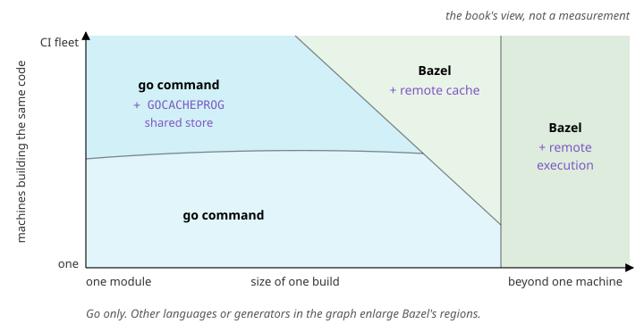
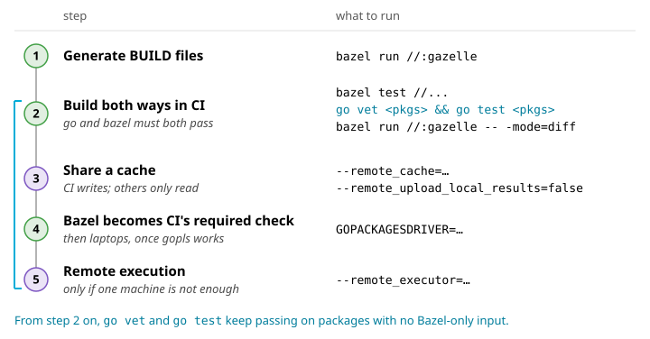

# 10. 做出决定
<!-- 译自 d9d1c21 -->

## 每种工具的适用范围

图 10.1 按两个维度摆放一个 Go 仓库：有多少台机器构建同一份代码，以及一次构建有多大。在笔者看来，
一旦有多台机器共享构建，共享的 Go 缓存就划算（曲线）；一旦该缓存无法共享的工作（见下文）
在持续集成（CI）时间中占主导，Bazel 就划算（对角线），因为这部分工作随构建的规模增长，
并在每台机器上重复发生。

### go 命令能走多远

go 命令本身已经是一个增量构建系统。它把一次构建拆分为动作（action，单次工具运行，例如一次编译），
以动作 ID（action ID，能改变动作输出的一切内容的哈希）作为每个动作的键，并把输出保存在 GOCACHE
中，即每个用户各自的磁盘缓存（第 4 章）。自 Go 1.24 起，`GOCACHEPROG`
用一个以 JSON 协议通信的外部程序取代这个缓存。[^go-cacheprog]Go 只定义了协议；
由团队提供的程序可以把条目保存在所有 CI 机器共享的存储中。[^go-cacheprog-doc]

共享存储只有在动作 ID 一致时才有用。动作 ID 涵盖编译器的版本、标志、目标平台以及每个输入的内容。
除非用 `-trimpath` 从输出中去掉文件系统路径，[^go-trimpath]动作 ID 还涵盖包所在的目录。[^go-actionid]
cgo 包（调用 C 的 Go 代码）还会加入 C 编译器的命令、标志和版本。[^go-actionid-cgo]

共享存储改变不了以下几点：

- 每条命令仍要加载它的包，并重新计算其源文件的哈希，因此其开销随源码树增长。[^go-load][^go-filehash]
- 二进制不会被存储：没有上一次输出的机器要重新链接每个二进制。[^go-noexe]
- 只有当测试的二进制、标志、测试读取的环境变量，以及它在所属模块中打开的每个文件的绝对路径、
  大小和修改时间全部一致时，存储的测试结果才会被复用。[^go-testinputs]笔者预计，
  全新检出会重新运行每个读取文件的测试。
- 每次命中都以本地文件的形式交付，因此每台机器都要下载它用到的内容。[^go-cacheprog-disk]
- `go generate` 和其他非 Go 步骤仍在图之外。[^go-generate]
- 每个动作都在启动命令的那台机器上运行。[^go-do]

对于时间花在编译上的 CI 机群（fleet），笔者建议首先采用 `-trimpath`、统一的 Go 版本和共享的
`GOCACHEPROG` 存储，并像 Bazel 对其缓存的建议那样，只让 CI 写入。[^bazel-cache-rw]

### Bazel 在何处划算

在笔者看来，满足以下一条或多条时，Bazel 是划算的：

- **许多机器构建同一份代码，并且编译之外的时间花在链接、测试或生成器上**。Bazel
  把每一项都当作动作缓存起来，测试运行也包括在内；[^bazel-test-spawn]每个动作以其声明的输入为键
  （第 6 章），存放在远程缓存（remote cache）中，即所有机器共享的一台服务器。
- **其他语言或代码生成器共用同一个图**。Bazel 的 BUILD 文件可以声明任何语言的动作
  （第 6 章和第 8 章）。
- **一次构建超出了一台机器的能力**。远程执行在一个机器池上运行动作，[^bazel-rbe]
  但任何机器池都无法缩短关键路径（critical path），即相互依赖的动作构成的最长链（第 5 章）。
- **发布构建必须是封闭的**（hermetic），即无论机器上另外安装了什么，输出都相同。[^bazel-hermetic]
  对于不使用 cgo 的 Go，笔者预计 `-trimpath`、固定的 Go 版本和 `CGO_ENABLED=0` 就足够了；
  如果缺少最后一项，导入 `net` 的 Linux 原生构建只要 `PATH` 上有 C 编译器就会使用 cgo。[^go-cgo-default]
  Bazel 可以把生成器和注册的 C 工具链声明为输入，但默认使用主机的 C 编译器，
  而它并不追踪这个编译器（第 3 章）。[^bazel-cache-issues]

Bazel 更细的截断（cutoff，一次修改停止传播的位置）也能省下编译：对一个被广泛导入的包做函数体修改（body edit）之后，
Bazel 只重新编译这个包，go 命令则重新编译每个直接导入者（第 7 章）。在笔者看来，
仅凭这一点很少能抵消 Bazel 的代价：共享存储让这些编译在整个机群中只运行一次，
而且两种工具都要重新链接包含该包的每个二进制。

Bazel 的代价（第 3 章和第 6 章）：BUILD 文件，它是对图的第二份描述，要靠 Gazelle
（根据 Go 源码生成 BUILD 文件的工具）保持最新；服务进程（server），即持有图的长期运行进程，其内存随图增长；
每次服务进程启动后的加载与分析（读取 BUILD 文件、规划动作）；每个动作的固定开销；
需要掌握两个命令；以及第 3 章预计主要集中在测试上的迁移工作。

表 10.1：各种情形、笔者推荐的工具，以及切换之前可以先尝试的做法。

| 情形 | 在笔者看来 | 原因 | 先尝试 |
|---|---|---|---|
| 一个 Go 模块，一个团队 | go 命令 | 增量构建，缓存以内容哈希为键（第 4 章）；Bazel 会多出第二个图和一个服务进程 | `go build -o <dir>`；在 CI 各次运行之间保留 `<dir>` 和 GOCACHE，并使用 `-trimpath` |
| 一个 Go 仓库，许多服务，CI 时间花在编译上 | go 命令加共享的 `GOCACHEPROG` 存储 | 动作 ID 一致后，编译即可共享；[^go-actionid]Bazel 更细的截断所省下的编译，共享存储本来就只在机群中运行一次（第 7 章） | 所有地方都用 `-trimpath` 和同一个 Go 版本 |
| 一个 Go 仓库，CI 时间花在链接或测试上，或在长期存活的运行器上花在加载上 | 带远程缓存的 Bazel | 链接（第 8 章）和测试运行[^bazel-test-spawn]都是被缓存的动作；热的服务进程把图保存在内存中，但新的服务进程要加载并分析所有内容（第 6 章） | 把 `go test` 的包分到多个并行作业中 |
| 含生成代码的 Go | 生成文件已提交到仓库时用 go 命令；生成很慢或生成结果会过时则用 Bazel | Bazel 把生成器作为被缓存的动作运行（第 3 章） | 把生成文件提交到仓库；在 CI 中重新生成并比较差异 |
| 使用 cgo 的 Go | 两者皆可，但每台机器使用同一个 C 编译器；在 Bazel 下使用固定的 C 工具链（第 3 章） | C 编译器的版本会进入 go 命令的动作 ID；[^go-actionid-cgo]Bazel 不追踪工作区之外的编译器[^bazel-cache-issues] | 所有机器使用同一个构建镜像 |
| 同一仓库中 Go 与其他语言并存 | Bazel | 跨语言的同一个声明式的图；go 命令只构建 Go 包[^go-about] | 先在一个服务上使用 Gazelle，以评估维护 BUILD 文件的代价 |
| 一次构建超出一台机器的能力 | 带远程执行的 Bazel | 并行度受机器池而非单台机器的核心数限制；[^bazel-rbe]关键路径仍然限制构建时间 | 缩短关键路径；让二进制保持较小（第 5 章） |
| 封闭的发布构建 | 不使用 cgo 的 Go：go 命令；含 C 或生成器：Bazel，并使用固定的 C 工具链 | 没有 `CGO_ENABLED=0` 时，主机上的 C 编译器可能进入构建；[^go-cgo-default]Bazel 把生成器和注册的 C 工具链声明为输入（第 3 章） | `-trimpath`、`CGO_ENABLED=0` 和固定的 Go 版本；构建两次并比较 |

## 一条迁移路径

Bazel 的 Maven 迁移指南建议同时运行两个构建工具，直到团队、CI 和其他系统都完成迁移。[^bazel-migrate]
笔者建议按以下顺序进行：

1. **生成 BUILD 文件**：配置 rules_go 和 Gazelle，并运行 `bazel run //:gazelle`
   （第 2 章）。[^rg-gazelle]
2. **在 CI 中用两种方式构建**：运行 `bazel test //...`，同时对不需要 Bazel 专属输入的包运行
   `go vet` 和 `go test`（第 3 章）。要求 Gazelle 的 diff 为空：遇到过时的 BUILD 文件时，
   它以状态码 1 退出，[^gz-diff]因此每个变更都会带上相应的 BUILD 文件更新。
3. **在 CI 依赖 Bazel 之前共享缓存**，使 CI 的运行不从冷状态开始。Bazel 的文档建议只让 CI 写入：
   每台机器都设置 `--remote_cache`，CI 之外的机器再加上 `--remote_upload_local_results=false`。[^bazel-cache-rw]
   如果使用 cgo，或在 macOS 上链接，先固定 C 工具链（第 3 章）。
4. **把 Bazel 设为 CI 的必需检查**，等 Go 的语言服务器 gopls 能通过 Bazel 工作之后，
   再迁移笔记本电脑（第 2 章）。
5. **最后加入远程执行**（`--remote_executor`），[^bazel-remote-executor]并且只在构建等待的是核心
   而不是关键路径时（第 1 章和第 5 章），或者某些动作需要更大的机器时（第 9 章），才这样做。

在笔者看来，在第 4 步之前，中途停止的代价只是 BUILD 文件、Gazelle 检查和缓存服务器。

## 规模变大时意味着什么

- 先找出 CI 时间花在哪里：把加载、编译、链接和测试拆成单独的 CI 步骤分别计时；在 Bazel 下，
  读剖面中的关键路径（第 9 章）。
- 先尝试 `GOCACHEPROG` 存储：这一步可以撤销，对编译也足够。Go 只提供协议，
  因此要为一个程序和一个存储留出预算。
- 需要在全新检出之间共享链接与测试结果、图中有其他语言，或执行超出一台机器时，选择 Bazel；
  笔记本电脑上的单个模块则不必。
- 让 CI 运行器及其 Bazel 服务进程长期运行：新的服务进程在第一次缓存命中之前，
  要加载并分析所有内容（第 6 章）。

## 参考文献

[^go-cacheprog]: Go 1.24 发布说明，「GOCACHEPROG」一节：此前需要通过 `GOEXPERIMENT` 启用；
    Go，`cmd/go/internal/cache/prog.go`，`ProgCache`；`cache/default.go`，其中 `GOCACHEPROG`
    取代磁盘缓存。
    <https://go.dev/doc/go1.24#gocacheprog>
    <https://github.com/golang/go/blob/go1.27.3/src/cmd/go/internal/cache/prog.go#L27-L31>
    <https://github.com/golang/go/blob/go1.27.3/src/cmd/go/internal/cache/default.go#L57-L59>
[^go-cacheprog-doc]: Go，`cmd/go/internal/cacheprog/cacheprog.go`，包注释：该包「defines the protocol for a
    GOCACHEPROG program」，这种程序「implements the go command build cache externally. This permits
    defining a different cache policy.」
    <https://github.com/golang/go/blob/go1.27.3/src/cmd/go/internal/cacheprog/cacheprog.go#L5-L19>
[^go-trimpath]: Go，`cmd/go/internal/work/build.go`，`go build` 文档中的 `-trimpath` 标志。
    <https://github.com/golang/go/blob/go1.27.3/src/cmd/go/internal/work/build.go#L197-L201>
[^go-actionid]: Go，`cmd/go/internal/work/exec.go`，`buildActionID`：目录（除非设置了
    `-trimpath`）、平台以及 `-trimpath` 本身；编译器的工具 ID 与标志；每个输入文件的内容与
    每个导入的内容 ID。
    <https://github.com/golang/go/blob/go1.27.3/src/cmd/go/internal/work/exec.go#L275-L313>
    <https://github.com/golang/go/blob/go1.27.3/src/cmd/go/internal/work/exec.go#L367>
    <https://github.com/golang/go/blob/go1.27.3/src/cmd/go/internal/work/exec.go#L428-L435>
[^go-actionid-cgo]: Go，`cmd/go/internal/work/exec.go`，`buildActionID` 中 cgo 的情形：C
    编译器命令、其标志及其工具 ID。
    <https://github.com/golang/go/blob/go1.27.3/src/cmd/go/internal/work/exec.go#L317-L329>
[^go-load]: Go，`cmd/go/internal/load/pkg.go`，`PackagesAndErrors`。
    <https://github.com/golang/go/blob/go1.27.3/src/cmd/go/internal/load/pkg.go#L2937>
[^go-filehash]: Go，`cmd/go/internal/cache/hash.go`，`FileHash`：它记住的哈希只在进程存活期间有效。
    <https://github.com/golang/go/blob/go1.27.3/src/cmd/go/internal/cache/hash.go#L140-L158>
[^go-noexe]: Go，`cmd/go/internal/work/buildid.go`：只有当输出文件已带有匹配的构建 ID，
    或缓存中存有该输出时，`useCache` 才跳过链接；`updateBuildID` 只在被要求时保存可执行文件，
    并且只在缓存是磁盘缓存时才保存。
    <https://github.com/golang/go/blob/go1.27.3/src/cmd/go/internal/work/buildid.go#L484-L485>
    <https://github.com/golang/go/blob/go1.27.3/src/cmd/go/internal/work/buildid.go#L565>
    <https://github.com/golang/go/blob/go1.27.3/src/cmd/go/internal/work/buildid.go#L730-L736>
    <https://github.com/golang/go/blob/go1.27.3/src/cmd/go/internal/work/buildid.go#L756>
[^go-testinputs]: Go，`cmd/go/internal/test/test.go`：测试 ID 对测试二进制（或链接的输入）
    与标志求哈希；结果在所配置的缓存中查找；`computeTestInputsID` 对测试读取的每个环境变量
    按其值求哈希，对每个打开的文件按其绝对名称和 `hashOpen` 求哈希，后者通过 `hashWriteStat`
    记录大小与修改时间。
    <https://github.com/golang/go/blob/go1.27.3/src/cmd/go/internal/test/test.go#L1907-L1908>
    <https://github.com/golang/go/blob/go1.27.3/src/cmd/go/internal/test/test.go#L1942>
    <https://github.com/golang/go/blob/go1.27.3/src/cmd/go/internal/test/test.go#L2042-L2071>
    <https://github.com/golang/go/blob/go1.27.3/src/cmd/go/internal/test/test.go#L2148-L2149>
[^go-cacheprog-disk]: Go，`cmd/go/internal/cacheprog/cacheprog.go`，`CmdPut` 与 `CmdGet`：
    程序以本地文件系统中的路径返回每个条目的内容。
    <https://github.com/golang/go/blob/go1.27.3/src/cmd/go/internal/cacheprog/cacheprog.go#L34-L52>
[^go-generate]: Go，`cmd/go/internal/generate/generate.go`：「go build、go test 等命令
    从不自动运行 Go generate。」
    <https://github.com/golang/go/blob/go1.27.3/src/cmd/go/internal/generate/generate.go#L43-L44>
[^go-do]: Go，`cmd/go/internal/work/exec.go`，`Builder.Do`，它启动 `-p` 个 goroutine，
    以本地进程的形式运行动作。
    <https://github.com/golang/go/blob/go1.27.3/src/cmd/go/internal/work/exec.go#L223-L229>
[^go-about]: Go，「About the go command」，「Configuration versus convention」一节：go
    命令「除 Go 包之外，不尝试构建任何东西」。
    <https://go.dev/doc/articles/go_command>
[^go-cgo-default]: Go，`cmd/go/internal/cfg/cfg.go`，`defaultContext`：「starting in Go 1.20 …
    if CC is unset and the default C compiler we'd look for is not in the PATH, we automatically
    default cgo to off」，
    因此 PATH 中有这样的编译器时，cgo 是开启的；`net/cgo_unix_cgo.go`，其构建约束
    `cgo && !netgo && unix && !darwin` 使 cgo 开启时 Linux 上的 `net` 会编译进 C 代码。
    <https://github.com/golang/go/blob/go1.27.3/src/cmd/go/internal/cfg/cfg.go#L165-L176>
    <https://github.com/golang/go/blob/go1.27.3/src/net/cgo_unix_cgo.go#L5>
[^bazel-test-spawn]: Bazel，`lib/exec/StandaloneTestStrategy.java`，`createTestRunnerSpawn`，
    它以测试动作的输入把测试作为一个 spawn 运行；以及 `extractExecutionInfo`，它把缓存命中
    标记为来自远程缓存。
    <https://github.com/bazelbuild/bazel/blob/9.3.2/src/main/java/com/google/devtools/build/lib/exec/StandaloneTestStrategy.java#L131-L139>
    <https://github.com/bazelbuild/bazel/blob/9.3.2/src/main/java/com/google/devtools/build/lib/exec/StandaloneTestStrategy.java#L374-L376>
[^bazel-rbe]: Bazel，「Remote Execution Overview」。<https://bazel.build/remote/rbe>
[^bazel-hermetic]: Bazel，「Hermeticity」，「Overview」一节。
    <https://bazel.build/basics/hermeticity#overview>
[^bazel-cache-issues]: Bazel，「Remote Caching」，「Known issues」一节：「Bazel 不追踪工作区之外的
    工具」，例如 `/usr/bin` 中的编译器。
    <https://bazel.build/remote/caching#known-issues>
[^bazel-migrate]: Bazel，「Migrating from Maven to Bazel」，引言：「从任何构建工具迁移到 Bazel 时，
    最好让两个构建工具并行运行」。
    <https://bazel.build/migrate/maven>
[^rg-gazelle]: rules_go，`docs/go/core/bzlmod.md`，「Generating BUILD files」一节。
    <https://github.com/bazel-contrib/rules_go/blob/v0.65.0/docs/go/core/bzlmod.md?plain=1#L120-L136>
[^gz-diff]: Gazelle，`gazelle-reference.md`，`-mode`；`v2/cmd/gazelle/update/diff.go`，`ErrDiff`，
    diff 模式发现改动时返回它；`cmd/gazelle/main.go`，`main`，它在遇到 `ErrDiff` 时以状态码 1 退出。
    <https://github.com/bazel-contrib/bazel-gazelle/blob/v0.54.0/gazelle-reference.md?plain=1#L53-L59>
    <https://github.com/bazel-contrib/bazel-gazelle/blob/v0.54.0/v2/cmd/gazelle/update/diff.go#L30>
    <https://github.com/bazel-contrib/bazel-gazelle/blob/v0.54.0/cmd/gazelle/main.go#L92-L95>
[^bazel-cache-rw]: Bazel，「Remote Caching」，「Read from and write to the remote cache」一节：
    「可能希望只让 CI 系统能够写入远程缓存。」
    <https://bazel.build/remote/caching#read-write-remote-cache>
[^bazel-remote-executor]: Bazel，`lib/remote/options/RemoteOptions.java`，`--remote_executor`。
    <https://github.com/bazelbuild/bazel/blob/9.3.2/src/main/java/com/google/devtools/build/lib/remote/options/RemoteOptions.java#L90-L99>
